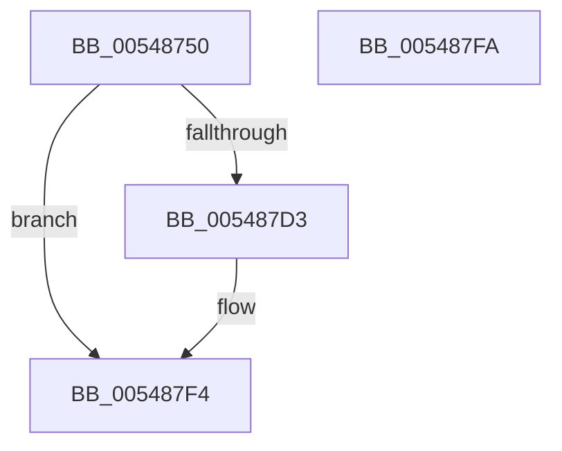

# HalpTimerPrepareClockInterrupt

- RVA: `0x00548750`–`0x005487FB` (길이 `171` bytes)
- VA: `0x0000000140548750`
- 실행 섹션: `.text`
- PDB 이름 있음: `예`; PDB Function 태그: `아니요`
- unwind 정보 RVA: `0x000AF0B0`
- 디코드: `44`개 명령, `171/171` bytes 표시
- 미해석 바이트: `0` (있으면 어셈블리에 `.byte`로 보존)

> 이 문서는 커널 이미지의 기계어와 PDB 기호를 분석해 생성했습니다. 4번과 5번은 함수 원형과 자료형을 바이너리 사용 방식에서 추정한 C 해석이며 원본 소스 복구 결과는 아닙니다.

## 1. Dependencies

- 직접 호출 지점: **2**; 고유 호출 대상: **2**
- 직접 호출자로 확인된 함수: **1**
- RIP 상대 이미지 참조: **4**

### Outgoing calls
- `0x005487CA` → [HalpTimerConfigureInterrupt](HalpTimerConfigureInterrupt_function_00548AB0.md) (function, `0x00548AB0`)
- `0x005487EE` → [KeBugCheckEx](../4F/KeBugCheckEx_function_004FD660.md) (function, `0x004FD660`)

### Direct callers
- [HalpTimerClockActivate](HalpTimerClockActivate_function_005480B0.md) at `0x005480BA`

### Static image references
- `0x00548763` → RVA `0x00FC40F0` (`.data`; read)
- `0x00548774` → RVA `0x00F231B0` (`.data`; read)
- `0x005487AA` → RVA `0x005604C0` (`HalpTimerClockInterruptStub`; read)
- `0x005487D3` → RVA `0x00E10358` (`.data`; read)

## 2. Other-region calls and transfers

- 다른 실행 섹션으로 향하는 call: **0**
- 별도 외부 분기/꼬리 이동을 확인하지 못했습니다.

## 3. Assembly (complete function range)

```asm
00548750  4C 8B DC                        mov r11, rsp
00548753  53                              push rbx
00548754  48 83 EC 50                     sub rsp, 0x50
00548758  65 8B 04 25 A4 01 00 00         mov eax, dword ptr gs:[0x1a4]
00548760  0F 57 C0                        xorps xmm0, xmm0
00548763  48 8B 1D 86 B9 A7 00            mov rbx, qword ptr [rip + 0xa7b986]
0054876A  41 B0 0D                        mov r8b, 0xd
0054876D  8B C8                           mov ecx, eax
0054876F  BA D1 00 00 00                  mov edx, 0xd1
00548774  48 8B 05 35 AA 9D 00            mov rax, qword ptr [rip + 0x9daa35]
0054877B  0F 11 44 24 40                  movups xmmword ptr [rsp + 0x40], xmm0
00548780  8B 0C 88                        mov ecx, dword ptr [rax + rcx*4]
00548783  33 C0                           xor eax, eax
00548785  89 44 24 4A                     mov dword ptr [rsp + 0x4a], eax
00548789  66 89 44 24 4E                  mov word ptr [rsp + 0x4e], ax
0054878E  8B C1                           mov eax, ecx
00548790  C1 E8 06                        shr eax, 6
00548793  83 E1 3F                        and ecx, 0x3f
00548796  66 89 44 24 48                  mov word ptr [rsp + 0x48], ax
0054879B  B8 01 00 00 00                  mov eax, 1
005487A0  48 D3 E0                        shl rax, cl
005487A3  48 8B CB                        mov rcx, rbx
005487A6  49 89 43 E8                     mov qword ptr [r11 - 0x18], rax
005487AA  48 8D 05 0F 7D 01 00            lea rax, [rip + 0x17d0f]
005487B1  49 89 43 E0                     mov qword ptr [r11 - 0x20], rax
005487B5  49 8D 43 E8                     lea rax, [r11 - 0x18]
005487B9  49 89 43 D8                     mov qword ptr [r11 - 0x28], rax
005487BD  83 64 24 28 00                  and dword ptr [rsp + 0x28], 0
005487C2  49 C7 43 C8 FD FF FF FF         mov qword ptr [r11 - 0x38], 0xfffffffffffffffd
005487CA  E8 E1 02 00 00                  call 0x140548ab0
005487CF  85 C0                           test eax, eax
005487D1  79 21                           jns 0x1405487f4
005487D3  4C 63 0D 7E 7B 8C 00            movsxd r9, dword ptr [rip + 0x8c7b7e]
005487DA  4C 8B C3                        mov r8, rbx
005487DD  48 98                           cdqe
005487DF  BA 10 01 00 00                  mov edx, 0x110
005487E4  B9 5C 00 00 00                  mov ecx, 0x5c
005487E9  48 89 44 24 20                  mov qword ptr [rsp + 0x20], rax
005487EE  E8 6D 4E FB FF                  call 0x1404fd660
005487F3  CC                              int3
005487F4  48 83 C4 50                     add rsp, 0x50
005487F8  5B                              pop rbx
005487F9  C3                              ret
005487FA  CC                              int3
```

## 4. C-style interpretation (structured pseudocode)

```c
__int64 __fastcall HalpTimerPrepareClockInterrupt(void)
{
    __int64 result;
    __int64 v_rsp;
    unsigned __int16 v_stack_m10;
    unsigned __int64 v_stack_m18;
    unsigned int v_stack_m30;
    unsigned __int64 v_stack_m38;
    unsigned __int16 v_stack_mA;
    unsigned int v_stack_mE;

    v_rsp = (v_rsp) - (80);
    v_stack_m18 = v_xmm0;
    result = 0;
    v_stack_mE = 0;
    v_stack_mA = 0;
    result = (unsigned int)(((unsigned int)((unsigned int)((unsigned int)(*(unsigned int *)(*(unsigned __int64 *)(v_rip + 10332725) + (unsigned int)((unsigned int)((unsigned int)(*(unsigned int *)(gs_base + (0 + 420))))) * 4))))) >> (6));
    a1 = (unsigned int)(((unsigned int)(*(unsigned int *)(*(unsigned __int64 *)(v_rip + 10332725) + (unsigned int)((unsigned int)((unsigned int)(*(unsigned int *)(gs_base + (0 + 420))))) * 4))) & (63));
    v_stack_m10 = (unsigned __int16)(result);
    result = (1) << ((unsigned __int8)(a1));
    *(unsigned __int64 *)(v_rsp - 24) = result;
    *(unsigned __int64 *)(v_rsp - 32) = v_rip + 97551;
    *(unsigned __int64 *)(v_rsp - 40) = v_rsp - 24;
    *(unsigned __int64 *)(v_rsp - 56) = -3;
    result = HalpTimerConfigureInterrupt(*(unsigned __int64 *)(v_rip + 10992006), 209, 13, a4);
    if (sign_flag) {
        a4 = (int)(*(unsigned int *)(v_rip + 9206654));
        a3 = *(unsigned __int64 *)(v_rip + 10992006);
        a2 = 272;
        a1 = 92;
        v_stack_m38 = result;
        result = KeBugCheckEx(a1, a2, a3, a4);
    }
    v_rsp = (v_rsp) + (80);
    return result;
}
```

## 5. (Beta) C Style

```c
void HalpTimerPrepareClockInterrupt(void)
{
    int64_t result;
    int64_t local_rsp;
    uint16_t v_stack_m10;
    uint64_t v_stack_m18;
    uint32_t v_stack_m30;
    uint64_t v_stack_m38;
    uint16_t v_stack_mA;
    uint32_t v_stack_mE;

    local_rsp = (local_rsp) - (80);
    v_stack_m18 = v_xmm0;
    result = 0;
    v_stack_mE = 0;
    v_stack_mA = 0;
    result = (uint32_t)(((uint32_t)((uint32_t)((uint32_t)(*(uint32_t *)(*(uint64_t *)(v_rip + 0x9DAA35) + (uint32_t)((uint32_t)((uint32_t)(*(uint32_t *)(gs_base + (0 + 0x1A4))))) * 4))))) >> (6));
    a1 = (uint32_t)(((uint32_t)(*(uint32_t *)(*(uint64_t *)(v_rip + 0x9DAA35) + (uint32_t)((uint32_t)((uint32_t)(*(uint32_t *)(gs_base + (0 + 0x1A4))))) * 4))) & (63));
    v_stack_m10 = (uint16_t)(result);
    result = (1) << ((uint8_t)(a1));
    *(uint64_t *)(local_rsp - 0x18) = result;
    *(uint64_t *)(local_rsp - 0x20) = v_rip + 97551;
    *(uint64_t *)(local_rsp - 0x28) = local_rsp - 24;
    *(uint64_t *)(local_rsp - 0x38) = -3;
    result = HalpTimerConfigureInterrupt(*(uint64_t *)(v_rip + 0xA7B986), 209, 13, a4);
    if (sign_flag) {
        a4 = (int32_t)(*(uint32_t *)(v_rip + 0x8C7B7E));
        a3 = *(uint64_t *)(v_rip + 0xA7B986);
        a2 = 272;
        a1 = 92;
        v_stack_m38 = result;
        result = KeBugCheckEx(a1, a2, a3, a4);
    }
    local_rsp = (local_rsp) + (80);
    return result;
}
```

## 6. Execution-region graph

[열기: 2D/3D 그래프와 함수 탐색 컨트롤 패널](../../../control-panel.html?section=text&rva=0x00548750&view=graph)

- 2D 그래프는 위에서 아래로 흐르고, 3D 그래프는 빈 공간을 드래그해 회전합니다. Shift+드래그는 이동, 휠은 확대·축소, 함수 노드 선택은 대상 보고서 이동입니다.

### Static fallback


