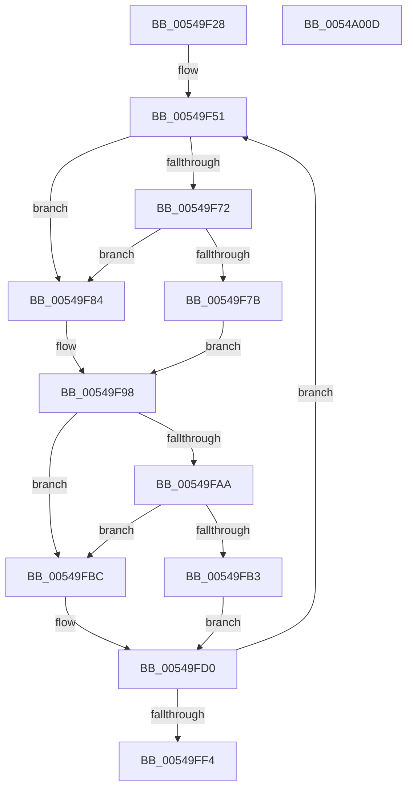

# HalpTimerReadTimerPairWithLatencyLimit

- RVA: `0x00549F28`–`0x0054A00E` (길이 `230` bytes)
- VA: `0x0000000140549F28`
- 실행 섹션: `.text`
- PDB 이름 있음: `예`; PDB Function 태그: `아니요`
- unwind 정보 RVA: `0x00060300`
- 디코드: `67`개 명령, `230/230` bytes 표시
- 미해석 바이트: `0` (있으면 어셈블리에 `.byte`로 보존)

> 이 문서는 커널 이미지의 기계어와 PDB 기호를 분석해 생성했습니다. 4번과 5번은 함수 원형과 자료형을 바이너리 사용 방식에서 추정한 C 해석이며 원본 소스 복구 결과는 아닙니다.

## 1. Dependencies

- 직접 호출 지점: **6**; 고유 호출 대상: **3**
- 직접 호출자로 확인된 함수: **2**
- RIP 상대 이미지 참조: **2**

### Outgoing calls
- `0x00549F7D` → [KeQueryPerformanceCounter](../37/KeQueryPerformanceCounter_function_0037E7E0.md) (function, `0x0037E7E0`)
- `0x00549F87` → [HalpTimerGetInternalData](../20/HalpTimerGetInternalData_function_00209500.md) (function, `0x00209500`)
- `0x00549F93` → [guard_dispatch_icall](../6B/guard_dispatch_icall_function_006BAAD0.md) (function, `0x006BAAD0`)
- `0x00549FB5` → [KeQueryPerformanceCounter](../37/KeQueryPerformanceCounter_function_0037E7E0.md) (function, `0x0037E7E0`)
- `0x00549FBF` → [HalpTimerGetInternalData](../20/HalpTimerGetInternalData_function_00209500.md) (function, `0x00209500`)
- `0x00549FCB` → [guard_dispatch_icall](../6B/guard_dispatch_icall_function_006BAAD0.md) (function, `0x006BAAD0`)

### Direct callers
- [HalpTimerMeasureFrequencies](HalpTimerMeasureFrequencies_function_005493C0.md) at `0x0054952B`
- [HalpTimerMeasureFrequencies](HalpTimerMeasureFrequencies_function_005493C0.md) at `0x005495ED`
- [HalpTimerMeasureProcessorsWorker](HalpTimerMeasureProcessorsWorker_function_0054D910.md) at `0x0054DA1D`
- [HalpTimerMeasureProcessorsWorker](HalpTimerMeasureProcessorsWorker_function_0054D910.md) at `0x0054DA63`

### Static image references
- `0x00549F69` → RVA `0x00FC3FD0` (`.data`; read)
- `0x00549F72` → RVA `0x00FC4138` (`.data`; read)

## 2. Other-region calls and transfers

- 다른 실행 섹션으로 향하는 call: **0**
- 별도 외부 분기/꼬리 이동을 확인하지 못했습니다.

## 3. Assembly (complete function range)

```asm
00549F28  48 89 5C 24 08                  mov qword ptr [rsp + 8], rbx
00549F2D  48 89 6C 24 10                  mov qword ptr [rsp + 0x10], rbp
00549F32  48 89 74 24 18                  mov qword ptr [rsp + 0x18], rsi
00549F37  57                              push rdi
00549F38  41 56                           push r14
00549F3A  41 57                           push r15
00549F3C  48 83 EC 20                     sub rsp, 0x20
00549F40  4C 8B 7C 24 60                  mov r15, qword ptr [rsp + 0x60]
00549F45  49 8B F1                        mov rsi, r9
00549F48  49 8B D8                        mov rbx, r8
00549F4B  44 8B F1                        mov r14d, ecx
00549F4E  48 8B FA                        mov rdi, rdx
00549F51  0F 20 D0                        mov rax, cr2
00549F54  0F 22 D0                        mov cr2, rax
00549F57  0F 31                           rdtsc
00549F59  48 C1 E2 20                     shl rdx, 0x20
00549F5D  48 0B C2                        or rax, rdx
00549F60  48 8B E8                        mov rbp, rax
00549F63  0F 20 D1                        mov rcx, cr2
00549F66  0F 22 D1                        mov cr2, rcx
00549F69  48 3B 3D 60 A0 A7 00            cmp rdi, qword ptr [rip + 0xa7a060]
00549F70  75 12                           jne 0x140549f84
00549F72  80 3D BF A1 A7 00 00            cmp byte ptr [rip + 0xa7a1bf], 0
00549F79  74 09                           je 0x140549f84
00549F7B  33 C9                           xor ecx, ecx
00549F7D  E8 5E 48 E3 FF                  call 0x14037e7e0
00549F82  EB 14                           jmp 0x140549f98
00549F84  48 8B CF                        mov rcx, rdi
00549F87  E8 74 F5 CB FF                  call 0x140209500
00549F8C  48 8B C8                        mov rcx, rax
00549F8F  48 8B 47 70                     mov rax, qword ptr [rdi + 0x70]
00549F93  E8 38 0B 17 00                  call 0x1406baad0
00549F98  48 89 06                        mov qword ptr [rsi], rax
00549F9B  0F 20 D0                        mov rax, cr2
00549F9E  0F 22 D0                        mov cr2, rax
00549FA1  48 3B 1D 28 A0 A7 00            cmp rbx, qword ptr [rip + 0xa7a028]
00549FA8  75 12                           jne 0x140549fbc
00549FAA  80 3D 87 A1 A7 00 00            cmp byte ptr [rip + 0xa7a187], 0
00549FB1  74 09                           je 0x140549fbc
00549FB3  33 C9                           xor ecx, ecx
00549FB5  E8 26 48 E3 FF                  call 0x14037e7e0
00549FBA  EB 14                           jmp 0x140549fd0
00549FBC  48 8B CB                        mov rcx, rbx
00549FBF  E8 3C F5 CB FF                  call 0x140209500
00549FC4  48 8B C8                        mov rcx, rax
00549FC7  48 8B 43 70                     mov rax, qword ptr [rbx + 0x70]
00549FCB  E8 00 0B 17 00                  call 0x1406baad0
00549FD0  49 89 07                        mov qword ptr [r15], rax
00549FD3  0F 20 D0                        mov rax, cr2
00549FD6  0F 22 D0                        mov cr2, rax
00549FD9  0F 31                           rdtsc
00549FDB  48 C1 E2 20                     shl rdx, 0x20
00549FDF  48 0B C2                        or rax, rdx
00549FE2  0F 20 D1                        mov rcx, cr2
00549FE5  0F 22 D1                        mov cr2, rcx
00549FE8  48 2B C5                        sub rax, rbp
00549FEB  49 3B C6                        cmp rax, r14
00549FEE  0F 87 5D FF FF FF               ja 0x140549f51
00549FF4  48 8B 5C 24 40                  mov rbx, qword ptr [rsp + 0x40]
00549FF9  48 8B 6C 24 48                  mov rbp, qword ptr [rsp + 0x48]
00549FFE  48 8B 74 24 50                  mov rsi, qword ptr [rsp + 0x50]
0054A003  48 83 C4 20                     add rsp, 0x20
0054A007  41 5F                           pop r15
0054A009  41 5E                           pop r14
0054A00B  5F                              pop rdi
0054A00C  C3                              ret
0054A00D  CC                              int3
```

## 4. C-style interpretation (structured pseudocode)

```c
__int64 __fastcall HalpTimerReadTimerPairWithLatencyLimit(int a1, __int64 a2, __int64 a3, __int64 a4, __int64 a5)
{
    __int64 result;
    __int64 v_rsp;
    unsigned __int64 v_stack_p10;
    unsigned __int64 v_stack_p18;
    unsigned __int64 v_stack_p8;

    v_stack_p8 = v_rbx;
    v_stack_p10 = v_rbp;
    v_stack_p18 = v_rsi;
    v_rsp = (v_rsp) - (32);
loc_00549F51:
    a2 = (a2) << (32);
    result = (v_cr2) | (a2);
    if (a2 != (*(unsigned __int64 *)(v_rip + 10985568))) goto loc_00549F84;
    if ((*(unsigned __int8 *)(v_rip + 10985919)) == 0) goto loc_00549F84;
    a1 = 0;
    result = KeQueryPerformanceCounter(a1, a2, a3, a4);
    goto loc_00549F98;
loc_00549F84:
    result = HalpTimerGetInternalData(a2, a2, a3, a4);
    result = guard_dispatch_icall(result, a2, a3, a4);
loc_00549F98:
    *(unsigned __int64 *)(a4) = result;
    if (a3 != (*(unsigned __int64 *)(v_rip + 10985512))) goto loc_00549FBC;
    if ((*(unsigned __int8 *)(v_rip + 10985863)) == 0) goto loc_00549FBC;
    a1 = 0;
    result = KeQueryPerformanceCounter(a1, a2, a3, a4);
    goto loc_00549FD0;
loc_00549FBC:
    result = HalpTimerGetInternalData(a3, a2, a3, a4);
    result = guard_dispatch_icall(result, a2, a3, a4);
loc_00549FD0:
    *(unsigned __int64 *)(a5) = result;
    a2 = (a2) << (32);
    result = (v_cr2) | (a2);
    result = (result) - (result);
    if (result > ((unsigned int)(a1))) goto loc_00549F51;
    v_rsp = (v_rsp) + (32);
    return result;
}
```

## 5. (Beta) C Style

```c
int64_t HalpTimerReadTimerPairWithLatencyLimit(int32_t Arg1, int64_t Arg2, int64_t Arg3, void *Arg4, void *Arg5)
{
    uint8_t *arg4 = (uint8_t *)Arg4;
    uint8_t *arg5 = (uint8_t *)Arg5;

    int64_t result;
    int64_t local_rsp;
    uint64_t v_stack_p10;
    uint64_t v_stack_p18;
    uint64_t v_stack_p8;

    v_stack_p8 = local_rbx;
    v_stack_p10 = local_rbp;
    v_stack_p18 = local_rsi;
    local_rsp = (local_rsp) - (32);
loc_00549F51:
    Arg2 = (Arg2) << (32);
    result = (v_cr2) | (Arg2);
    if (Arg2 != (*(uint64_t *)(v_rip + 0xA7A060))) goto loc_00549F84;
    if ((*(uint8_t *)(v_rip + 0xA7A1BF)) == 0) goto loc_00549F84;
    Arg1 = 0;
    result = KeQueryPerformanceCounter(Arg1, Arg2, Arg3, Arg4);
    goto loc_00549F98;
loc_00549F84:
    result = HalpTimerGetInternalData(Arg2, Arg2, Arg3, Arg4);
    result = guard_dispatch_icall(result, Arg2, Arg3, Arg4);
loc_00549F98:
    *(uint64_t *)(arg4) = result;
    if (Arg3 != (*(uint64_t *)(v_rip + 0xA7A028))) goto loc_00549FBC;
    if ((*(uint8_t *)(v_rip + 0xA7A187)) == 0) goto loc_00549FBC;
    Arg1 = 0;
    result = KeQueryPerformanceCounter(Arg1, Arg2, Arg3, Arg4);
    goto loc_00549FD0;
loc_00549FBC:
    result = HalpTimerGetInternalData(Arg3, Arg2, Arg3, Arg4);
    result = guard_dispatch_icall(result, Arg2, Arg3, Arg4);
loc_00549FD0:
    *(uint64_t *)(arg5) = result;
    Arg2 = (Arg2) << (32);
    result = (v_cr2) | (Arg2);
    result = (result) - (result);
    if (result > ((uint32_t)(Arg1))) goto loc_00549F51;
    local_rsp = (local_rsp) + (32);
    return result;
}
```

### 관측된 메모리 오프셋

구조체 형식이 확인되지 않은 접근은 인자 기준의 오프셋으로만 기록했습니다.

| 기준 인자 | 오프셋 표현 | 폭 (bit) | 접근 |
|---|---:|---:|---|
| `Arg4` | `+ 0x0` | `64` | `W` |
| `Arg5` | `+ 0x0` | `64` | `W` |

## 6. Execution-region graph

[열기: 2D/3D 그래프와 함수 탐색 컨트롤 패널](../../../control-panel.html?section=text&rva=0x00549F28&view=graph)

- 2D 그래프는 위에서 아래로 흐르고, 3D 그래프는 빈 공간을 드래그해 회전합니다. Shift+드래그는 이동, 휠은 확대·축소, 함수 노드 선택은 대상 보고서 이동입니다.

### Static fallback


