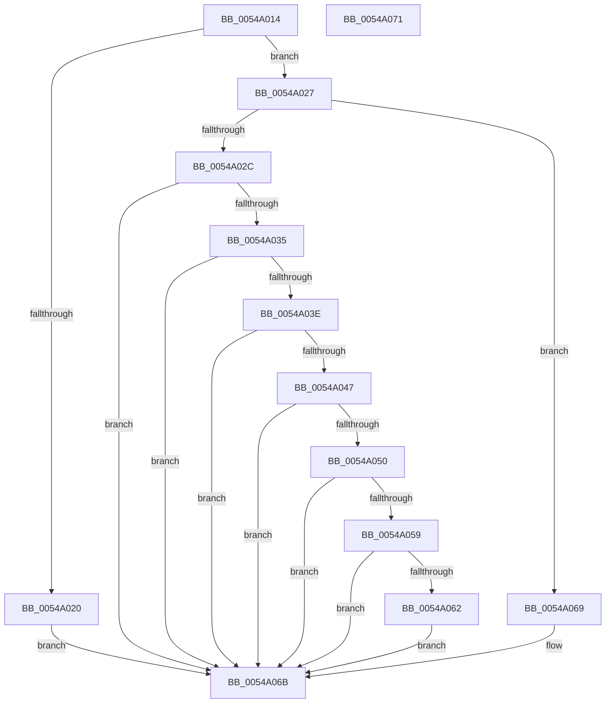

# HalpTimerRegisterBuiltinPluginsCommon

- RVA: `0x0054A014`–`0x0054A072` (길이 `94` bytes)
- VA: `0x000000014054A014`
- 실행 섹션: `.text`
- PDB 이름 있음: `예`; PDB Function 태그: `아니요`
- unwind 정보 RVA: `0x0005CF00`
- 디코드: `34`개 명령, `94/94` bytes 표시
- 미해석 바이트: `0` (있으면 어셈블리에 `.byte`로 보존)

> 이 문서는 커널 이미지의 기계어와 PDB 기호를 분석해 생성했습니다. 4번과 5번은 함수 원형과 자료형을 바이너리 사용 방식에서 추정한 C 해석이며 원본 소스 복구 결과는 아닙니다.

## 1. Dependencies

- 직접 호출 지점: **8**; 고유 호출 대상: **8**
- 직접 호출자로 확인된 함수: **2**
- RIP 상대 이미지 참조: **0**

### Outgoing calls
- `0x0054A020` → [HalpTscDiscover](../56/HalpTscDiscover_function_00562728.md) (function, `0x00562728`)
- `0x0054A02C` → [HalpPmTimerDiscover](../56/HalpPmTimerDiscover_function_00561AD0.md) (function, `0x00561AD0`)
- `0x0054A035` → [HalpHpetDiscover](../56/HalpHpetDiscover_function_00561E98.md) (function, `0x00561E98`)
- `0x0054A03E` → [HalpApicTimerDiscover](../56/HalpApicTimerDiscover_function_005623D0.md) (function, `0x005623D0`)
- `0x0054A047` → [HalpArtDiscover](../56/HalpArtDiscover_function_00561DB4.md) (function, `0x00561DB4`)
- `0x0054A050` → [HalpHvWatchdogDiscover](../56/HalpHvWatchdogDiscover_function_00561C60.md) (function, `0x00561C60`)
- `0x0054A059` → [HalpHvDiscover](../56/HalpHvDiscover_function_005606A0.md) (function, `0x005606A0`)
- `0x0054A062` → [HalpWdatDiscover](../56/HalpWdatDiscover_function_005609A8.md) (function, `0x005609A8`)

### Direct callers
- [HalpInitializeTimers](../53/HalpInitializeTimers_function_0053C1E0.md) at `0x0053C27D`
- [HalpTimerInitializeEarlyStallSource](../53/HalpTimerInitializeEarlyStallSource_function_0053CFDC.md) at `0x0053D00E`

### Static image references
- 디코드된 RIP-relative 메모리 참조가 없습니다.

## 2. Other-region calls and transfers

- 다른 실행 섹션으로 향하는 call: **0**
- 별도 외부 분기/꼬리 이동을 확인하지 못했습니다.

## 3. Assembly (complete function range)

```asm
0054A014  40 53                           push rbx
0054A016  48 83 EC 20                     sub rsp, 0x20
0054A01A  8B D9                           mov ebx, ecx
0054A01C  85 C9                           test ecx, ecx
0054A01E  75 07                           jne 0x14054a027
0054A020  E8 03 87 01 00                  call 0x140562728
0054A025  EB 44                           jmp 0x14054a06b
0054A027  83 FB 01                        cmp ebx, 1
0054A02A  75 3D                           jne 0x14054a069
0054A02C  E8 9F 7A 01 00                  call 0x140561ad0
0054A031  85 C0                           test eax, eax
0054A033  78 36                           js 0x14054a06b
0054A035  E8 5E 7E 01 00                  call 0x140561e98
0054A03A  85 C0                           test eax, eax
0054A03C  78 2D                           js 0x14054a06b
0054A03E  E8 8D 83 01 00                  call 0x1405623d0
0054A043  85 C0                           test eax, eax
0054A045  78 24                           js 0x14054a06b
0054A047  E8 68 7D 01 00                  call 0x140561db4
0054A04C  85 C0                           test eax, eax
0054A04E  78 1B                           js 0x14054a06b
0054A050  E8 0B 7C 01 00                  call 0x140561c60
0054A055  85 C0                           test eax, eax
0054A057  78 12                           js 0x14054a06b
0054A059  E8 42 66 01 00                  call 0x1405606a0
0054A05E  85 C0                           test eax, eax
0054A060  78 09                           js 0x14054a06b
0054A062  E8 41 69 01 00                  call 0x1405609a8
0054A067  EB 02                           jmp 0x14054a06b
0054A069  33 C0                           xor eax, eax
0054A06B  48 83 C4 20                     add rsp, 0x20
0054A06F  5B                              pop rbx
0054A070  C3                              ret
0054A071  CC                              int3
```

## 4. C-style interpretation (structured pseudocode)

```c
__int64 __fastcall HalpTimerRegisterBuiltinPluginsCommon(int a1)
{
    __int64 result;
    __int64 v_rsp;

    v_rsp = (v_rsp) - (32);
    if (a1 != 0) goto loc_0054A027;
    result = HalpTscDiscover(a1, a2, a3, a4);
    goto loc_0054A06B;
loc_0054A027:
    if (((unsigned int)((unsigned int)(a1))) != 1) goto loc_0054A069;
    result = HalpPmTimerDiscover(a1, a2, a3, a4);
    if (sign_flag) goto loc_0054A06B;
    result = HalpHpetDiscover(a1, a2, a3, a4);
    if (sign_flag) goto loc_0054A06B;
    result = HalpApicTimerDiscover(a1, a2, a3, a4);
    if (sign_flag) goto loc_0054A06B;
    result = HalpArtDiscover(a1, a2, a3, a4);
    if (sign_flag) goto loc_0054A06B;
    result = HalpHvWatchdogDiscover(a1, a2, a3, a4);
    if (sign_flag) goto loc_0054A06B;
    result = HalpHvDiscover(a1, a2, a3, a4);
    if (sign_flag) goto loc_0054A06B;
    result = HalpWdatDiscover(a1, a2, a3, a4);
    goto loc_0054A06B;
loc_0054A069:
    result = 0;
loc_0054A06B:
    v_rsp = (v_rsp) + (32);
    return result;
}
```

## 5. (Beta) C Style

```c
int64_t HalpTimerRegisterBuiltinPluginsCommon(int32_t Arg1)
{
    int64_t result;
    int64_t local_rsp;

    local_rsp = (local_rsp) - (32);
    if (Arg1 != 0) goto loc_0054A027;
    result = HalpTscDiscover(Arg1, a2, a3, a4);
    goto loc_0054A06B;
loc_0054A027:
    if (((uint32_t)((uint32_t)(Arg1))) != 1) goto loc_0054A069;
    result = HalpPmTimerDiscover(Arg1, a2, a3, a4);
    if (sign_flag) goto loc_0054A06B;
    result = HalpHpetDiscover(Arg1, a2, a3, a4);
    if (sign_flag) goto loc_0054A06B;
    result = HalpApicTimerDiscover(Arg1, a2, a3, a4);
    if (sign_flag) goto loc_0054A06B;
    result = HalpArtDiscover(Arg1, a2, a3, a4);
    if (sign_flag) goto loc_0054A06B;
    result = HalpHvWatchdogDiscover(Arg1, a2, a3, a4);
    if (sign_flag) goto loc_0054A06B;
    result = HalpHvDiscover(Arg1, a2, a3, a4);
    if (sign_flag) goto loc_0054A06B;
    result = HalpWdatDiscover(Arg1, a2, a3, a4);
    goto loc_0054A06B;
loc_0054A069:
    result = 0;
loc_0054A06B:
    local_rsp = (local_rsp) + (32);
    return result;
}
```

## 6. Execution-region graph

[열기: 2D/3D 그래프와 함수 탐색 컨트롤 패널](../../../control-panel.html?section=text&rva=0x0054A014&view=graph)

- 2D 그래프는 위에서 아래로 흐르고, 3D 그래프는 빈 공간을 드래그해 회전합니다. Shift+드래그는 이동, 휠은 확대·축소, 함수 노드 선택은 대상 보고서 이동입니다.

### Static fallback


