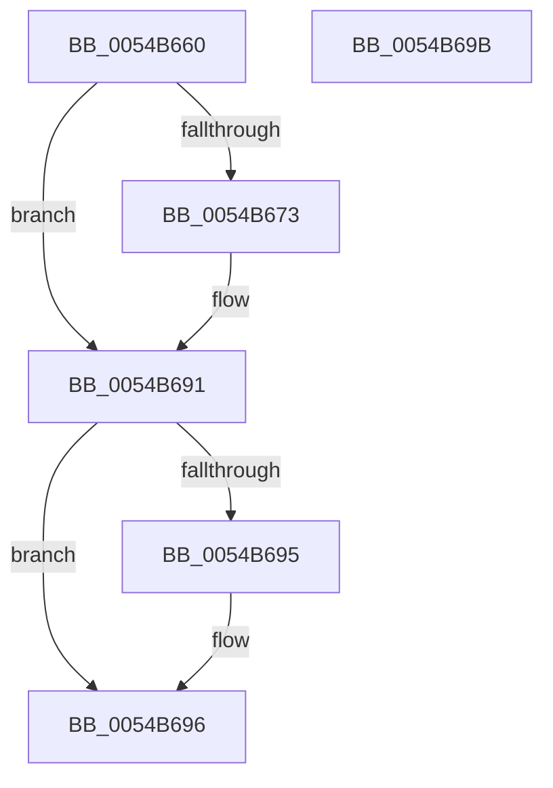

# HalpTimerResetProfileAdjustment

- RVA: `0x0054B660`–`0x0054B69C` (길이 `60` bytes)
- VA: `0x000000014054B660`
- 실행 섹션: `.text`
- PDB 이름 있음: `예`; PDB Function 태그: `아니요`
- unwind 정보 RVA: `0x0005C788`
- 디코드: `15`개 명령, `60/60` bytes 표시
- 미해석 바이트: `0` (있으면 어셈블리에 `.byte`로 보존)

> 이 문서는 커널 이미지의 기계어와 PDB 기호를 분석해 생성했습니다. 4번과 5번은 함수 원형과 자료형을 바이너리 사용 방식에서 추정한 C 해석이며 원본 소스 복구 결과는 아닙니다.

## 1. Dependencies

- 직접 호출 지점: **1**; 고유 호출 대상: **1**
- 직접 호출자로 확인된 함수: **3**
- RIP 상대 이미지 참조: **1**

### Outgoing calls
- `0x0054B664` → [HalpDisableInterrupts](../25/HalpDisableInterrupts_function_002521A0.md) (function, `0x002521A0`)

### Direct callers
- [HalCalibratePerformanceCounter](../53/HalCalibratePerformanceCounter_function_0053C010.md) at `0x0053C0F6`
- [HalpTimerNotifyProcessorFreeze](../53/HalpTimerNotifyProcessorFreeze_function_0053D150.md) at `0x0053D161`
- [HalProcessorIdle](../6A/HalProcessorIdle_function_006AC7C0.md) at `0x006AC7C4`

### Static image references
- `0x0054B669` → RVA `0x00FC21E8` (`.data`; read)

## 2. Other-region calls and transfers

- 다른 실행 섹션으로 향하는 call: **0**
- 별도 외부 분기/꼬리 이동을 확인하지 못했습니다.

## 3. Assembly (complete function range)

```asm
0054B660  48 83 EC 28                     sub rsp, 0x28
0054B664  E8 37 6B D0 FF                  call 0x1402521a0
0054B669  48 83 3D 77 6B A7 00 00         cmp qword ptr [rip + 0xa76b77], 0
0054B671  74 1E                           je 0x14054b691
0054B673  65 8B 0C 25 A4 01 00 00         mov ecx, dword ptr gs:[0x1a4]
0054B67B  8B D1                           mov edx, ecx
0054B67D  48 8B 0D 64 6B A7 00            mov rcx, qword ptr [rip + 0xa76b64]
0054B684  4C 69 C2 28 01 00 00            imul r8, rdx, 0x128
0054B68B  41 83 64 08 14 00               and dword ptr [r8 + rcx + 0x14], 0
0054B691  84 C0                           test al, al
0054B693  74 01                           je 0x14054b696
0054B695  FB                              sti
0054B696  48 83 C4 28                     add rsp, 0x28
0054B69A  C3                              ret
0054B69B  CC                              int3
```

## 4. C-style interpretation (structured pseudocode)

```c
__int64 __fastcall HalpTimerResetProfileAdjustment(void)
{
    __int64 result;
    __int64 v_rsp;

    v_rsp = (v_rsp) - (40);
    result = HalpDisableInterrupts(a1, a2, a3, a4);
    if ((*(unsigned __int64 *)(v_rip + 10972023)) != 0) {
        a1 = *(unsigned int *)(gs_base + (0 + 420));
        a2 = (unsigned int)(a1);
        a1 = *(unsigned __int64 *)(v_rip + 10972004);
        a3 = (a3) * (a2);
    }
    if ((unsigned __int8)(result) != 0) {
    }
    v_rsp = (v_rsp) + (40);
    return result;
}
```

## 5. (Beta) C Style

```c
void HalpTimerResetProfileAdjustment(void)
{
    int64_t result;
    int64_t local_rsp;

    local_rsp = (local_rsp) - (40);
    result = HalpDisableInterrupts(a1, a2, a3, a4);
    if ((*(uint64_t *)(v_rip + 0xA76B77)) != 0) {
        a1 = *(uint32_t *)(gs_base + (0 + 0x1A4));
        a2 = (uint32_t)(a1);
        a1 = *(uint64_t *)(v_rip + 0xA76B64);
        a3 = (a3) * (a2);
    }
    if ((uint8_t)(result) != 0) {
    }
    local_rsp = (local_rsp) + (40);
    return result;
}
```

## 6. Execution-region graph

[열기: 2D/3D 그래프와 함수 탐색 컨트롤 패널](../../../control-panel.html?section=text&rva=0x0054B660&view=graph)

- 2D 그래프는 위에서 아래로 흐르고, 3D 그래프는 빈 공간을 드래그해 회전합니다. Shift+드래그는 이동, 휠은 확대·축소, 함수 노드 선택은 대상 보고서 이동입니다.

### Static fallback


