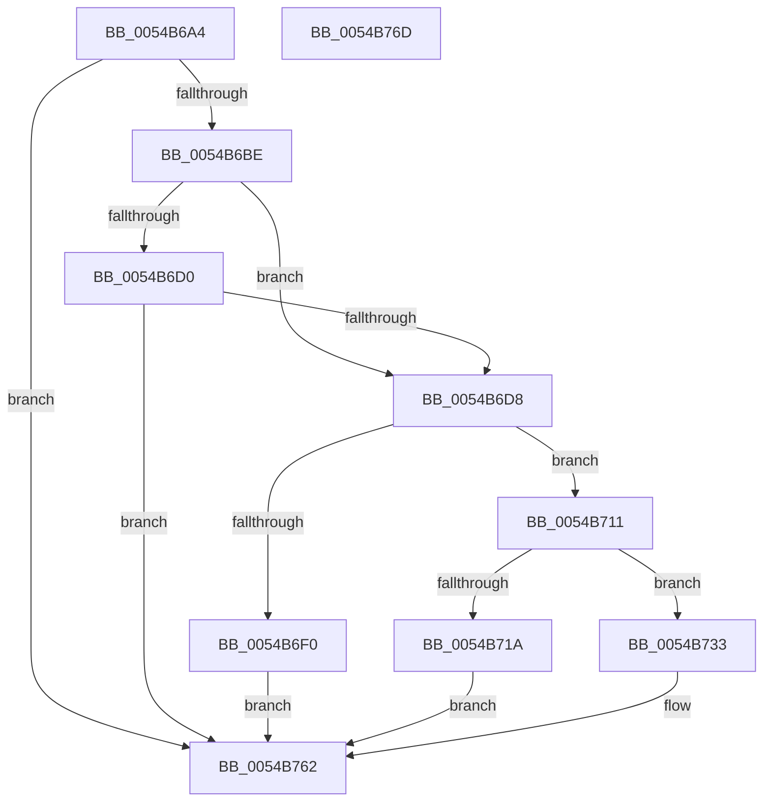

# HalpTimerRestartProfileInterrupt

- RVA: `0x0054B6A4`–`0x0054B76E` (길이 `202` bytes)
- VA: `0x000000014054B6A4`
- 실행 섹션: `.text`
- PDB 이름 있음: `예`; PDB Function 태그: `아니요`
- unwind 정보 RVA: `0x0008A658`
- 디코드: `49`개 명령, `202/202` bytes 표시
- 미해석 바이트: `0` (있으면 어셈블리에 `.byte`로 보존)

> 이 문서는 커널 이미지의 기계어와 PDB 기호를 분석해 생성했습니다. 4번과 5번은 함수 원형과 자료형을 바이너리 사용 방식에서 추정한 C 해석이며 원본 소스 복구 결과는 아닙니다.

## 1. Dependencies

- 직접 호출 지점: **6**; 고유 호출 대상: **4**
- 직접 호출자로 확인된 함수: **2**
- RIP 상대 이미지 참조: **4**

### Outgoing calls
- `0x0054B6DB` → [HalpTimerGetInternalData](../20/HalpTimerGetInternalData_function_00209500.md) (function, `0x00209500`)
- `0x0054B6E7` → [guard_dispatch_icall](../6B/guard_dispatch_icall_function_006BAAD0.md) (function, `0x006BAAD0`)
- `0x0054B70A` → [HalpTimerSetProblemEx](../4F/HalpTimerSetProblemEx_function_004FAEC4.md) (function, `0x004FAEC4`)
- `0x0054B71D` → [HalpTimerGetInternalData](../20/HalpTimerGetInternalData_function_00209500.md) (function, `0x00209500`)
- `0x0054B72C` → [guard_dispatch_icall](../6B/guard_dispatch_icall_function_006BAAD0.md) (function, `0x006BAAD0`)
- `0x0054B75D` → [HalpSetTimer](../42/HalpSetTimer_function_0042BD30.md) (function, `0x0042BD30`)

### Direct callers
- [HalpTimerPowerChange](HalpTimerPowerChange_function_00549DF0.md) at `0x00549EC3`
- [DefaultRestartProfiling](../../pagelk/B5/DefaultRestartProfiling_function_00B5CC00.md) at `0x00B5CC04`

### Static image references
- `0x0054B6AE` → RVA `0x00FC3FC0` (`.data`; read)
- `0x0054B6F0` → RVA `0x00023E88` (`.rdata`; read)
- `0x0054B711` → RVA `0x00E10368` (`.data`; read)
- `0x0054B73F` → RVA `0x00FC21E8` (`.data`; read)

## 2. Other-region calls and transfers

- 다른 실행 섹션으로 향하는 call: **0**
- 별도 외부 분기/꼬리 이동을 확인하지 못했습니다.

## 3. Assembly (complete function range)

```asm
0054B6A4  48 89 5C 24 10                  mov qword ptr [rsp + 0x10], rbx
0054B6A9  57                              push rdi
0054B6AA  48 83 EC 30                     sub rsp, 0x30
0054B6AE  48 8B 1D 0B 89 A7 00            mov rbx, qword ptr [rip + 0xa7890b]
0054B6B5  48 85 DB                        test rbx, rbx
0054B6B8  0F 84 A4 00 00 00               je 0x14054b762
0054B6BE  65 8B 3C 25 A4 01 00 00         mov edi, dword ptr gs:[0x1a4]
0054B6C6  8B 83 E0 00 00 00               mov eax, dword ptr [rbx + 0xe0]
0054B6CC  A8 01                           test al, 1
0054B6CE  75 08                           jne 0x14054b6d8
0054B6D0  85 FF                           test edi, edi
0054B6D2  0F 85 8A 00 00 00               jne 0x14054b762
0054B6D8  48 8B CB                        mov rcx, rbx
0054B6DB  E8 20 DE CB FF                  call 0x140209500
0054B6E0  48 8B C8                        mov rcx, rax
0054B6E3  48 8B 43 68                     mov rax, qword ptr [rbx + 0x68]
0054B6E7  E8 E4 F3 16 00                  call 0x1406baad0
0054B6EC  85 C0                           test eax, eax
0054B6EE  79 21                           jns 0x14054b711
0054B6F0  4C 8D 0D 91 87 AD FF            lea r9, [rip - 0x52786f]
0054B6F7  C7 44 24 20 1C 02 00 00         mov dword ptr [rsp + 0x20], 0x21c
0054B6FF  44 8B C0                        mov r8d, eax
0054B702  BA 0F 00 00 00                  mov edx, 0xf
0054B707  48 8B CB                        mov rcx, rbx
0054B70A  E8 B5 F7 FA FF                  call 0x1404faec4
0054B70F  EB 51                           jmp 0x14054b762
0054B711  83 3D 50 4C 8C 00 00            cmp dword ptr [rip + 0x8c4c50], 0
0054B718  75 19                           jne 0x14054b733
0054B71A  48 8B CB                        mov rcx, rbx
0054B71D  E8 DE DD CB FF                  call 0x140209500
0054B722  48 8B C8                        mov rcx, rax
0054B725  48 8B 83 88 00 00 00            mov rax, qword ptr [rbx + 0x88]
0054B72C  E8 9F F3 16 00                  call 0x1406baad0
0054B731  EB 2F                           jmp 0x14054b762
0054B733  8B C7                           mov eax, edi
0054B735  41 B1 01                        mov r9b, 1
0054B738  48 69 C8 28 01 00 00            imul rcx, rax, 0x128
0054B73F  48 8B 05 A2 6A A7 00            mov rax, qword ptr [rip + 0xa76aa2]
0054B746  BA 02 00 00 00                  mov edx, 2
0054B74B  44 8B 44 01 18                  mov r8d, dword ptr [rcx + rax + 0x18]
0054B750  48 8D 44 24 40                  lea rax, [rsp + 0x40]
0054B755  48 8B CB                        mov rcx, rbx
0054B758  48 89 44 24 20                  mov qword ptr [rsp + 0x20], rax
0054B75D  E8 CE 05 EE FF                  call 0x14042bd30
0054B762  48 8B 5C 24 48                  mov rbx, qword ptr [rsp + 0x48]
0054B767  48 83 C4 30                     add rsp, 0x30
0054B76B  5F                              pop rdi
0054B76C  C3                              ret
0054B76D  CC                              int3
```

## 4. C-style interpretation (structured pseudocode)

```c
__int64 __fastcall HalpTimerRestartProfileInterrupt(void)
{
    __int64 result;
    __int64 v_rsp;
    unsigned int v_stack_m18;
    unsigned __int64 v_stack_p10;
    unsigned __int64 v_stack_p8;

    v_stack_p10 = v_rbx;
    v_rsp = (v_rsp) - (48);
    if (*(unsigned __int64 *)(v_rip + 10979595) == 0) goto loc_0054B762;
    if ((((unsigned __int8)((unsigned int)(*(unsigned int *)(*(unsigned __int64 *)(v_rip + 10979595) + 224)))) & (1)) != 0) goto loc_0054B6D8;
    if ((unsigned int)((unsigned int)(*(unsigned int *)(gs_base + (0 + 420)))) != 0) goto loc_0054B762;
loc_0054B6D8:
    result = HalpTimerGetInternalData(*(unsigned __int64 *)(v_rip + 10979595), a2, a3, a4);
    result = guard_dispatch_icall(result, a2, a3, a4);
    if (!sign_flag) goto loc_0054B711;
    v_stack_m18 = 540;
    result = HalpTimerSetProblemEx(*(unsigned __int64 *)(v_rip + 10979595), 15, (unsigned int)((unsigned int)(result)), v_rip - 5404783);
    goto loc_0054B762;
loc_0054B711:
    if ((*(unsigned int *)(v_rip + 9194576)) != 0) goto loc_0054B733;
    result = HalpTimerGetInternalData(*(unsigned __int64 *)(v_rip + 10979595), 15, (unsigned int)((unsigned int)(result)), v_rip - 5404783);
    result = guard_dispatch_icall(result, 15, (unsigned int)((unsigned int)(result)), v_rip - 5404783);
    goto loc_0054B762;
loc_0054B733:
    a1 = (result) * ((unsigned int)((unsigned int)((unsigned int)(*(unsigned int *)(gs_base + (0 + 420))))));
    v_stack_m18 = v_stack_p8;
    result = HalpSetTimer(*(unsigned __int64 *)(v_rip + 10979595), 2, (unsigned int)(*(unsigned int *)(a1 + *(unsigned __int64 *)(v_rip + 10971810) * 1 + 24)), 1);
loc_0054B762:
    v_rsp = (v_rsp) + (48);
    return result;
}
```

## 5. (Beta) C Style

```c
void HalpTimerRestartProfileInterrupt(void)
{
    int64_t result;
    int64_t local_rsp;
    uint32_t v_stack_m18;
    uint64_t v_stack_p10;
    uint64_t v_stack_p8;

    v_stack_p10 = local_rbx;
    local_rsp = (local_rsp) - (48);
    if (*(uint64_t *)(v_rip + 0xA7890B) == 0) goto loc_0054B762;
    if ((((uint8_t)((uint32_t)(*(uint32_t *)(*(uint64_t *)(v_rip + 0xA7890B) + 0xE0)))) & (1)) != 0) goto loc_0054B6D8;
    if ((uint32_t)((uint32_t)(*(uint32_t *)(gs_base + (0 + 0x1A4)))) != 0) goto loc_0054B762;
loc_0054B6D8:
    result = HalpTimerGetInternalData(*(uint64_t *)(v_rip + 0xA7890B), a2, a3, a4);
    result = guard_dispatch_icall(result, a2, a3, a4);
    if (!sign_flag) goto loc_0054B711;
    v_stack_m18 = 540;
    result = HalpTimerSetProblemEx(*(uint64_t *)(v_rip + 0xA7890B), 15, (uint32_t)((uint32_t)(result)), v_rip - 5404783);
    goto loc_0054B762;
loc_0054B711:
    if ((*(uint32_t *)(v_rip + 0x8C4C50)) != 0) goto loc_0054B733;
    result = HalpTimerGetInternalData(*(uint64_t *)(v_rip + 0xA7890B), 15, (uint32_t)((uint32_t)(result)), v_rip - 5404783);
    result = guard_dispatch_icall(result, 15, (uint32_t)((uint32_t)(result)), v_rip - 5404783);
    goto loc_0054B762;
loc_0054B733:
    a1 = (result) * ((uint32_t)((uint32_t)((uint32_t)(*(uint32_t *)(gs_base + (0 + 0x1A4))))));
    v_stack_m18 = v_stack_p8;
    result = HalpSetTimer(*(uint64_t *)(v_rip + 0xA7890B), 2, (uint32_t)(*(uint32_t *)(a1 + *(uint64_t *)(v_rip + 0xA76AA2) * 1 + 0x18)), 1);
loc_0054B762:
    local_rsp = (local_rsp) + (48);
    return result;
}
```

## 6. Execution-region graph

[열기: 2D/3D 그래프와 함수 탐색 컨트롤 패널](../../../control-panel.html?section=text&rva=0x0054B6A4&view=graph)

- 2D 그래프는 위에서 아래로 흐르고, 3D 그래프는 빈 공간을 드래그해 회전합니다. Shift+드래그는 이동, 휠은 확대·축소, 함수 노드 선택은 대상 보고서 이동입니다.

### Static fallback


