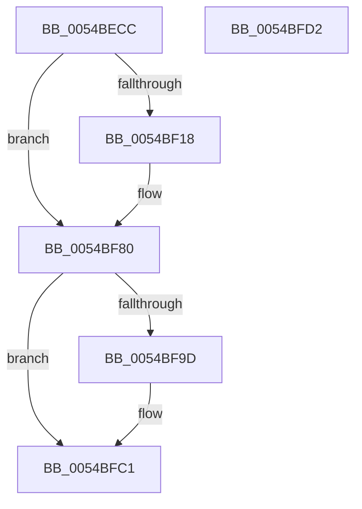

# HalpTimerSaveProcessorFrequency

- RVA: `0x0054BECC`–`0x0054BFD3` (길이 `263` bytes)
- VA: `0x000000014054BECC`
- 실행 섹션: `.text`
- PDB 이름 있음: `예`; PDB Function 태그: `아니요`
- unwind 정보 RVA: `0x000C3FC0`
- 디코드: `57`개 명령, `263/263` bytes 표시
- 미해석 바이트: `0` (있으면 어셈블리에 `.byte`로 보존)

> 이 문서는 커널 이미지의 기계어와 PDB 기호를 분석해 생성했습니다. 4번과 5번은 함수 원형과 자료형을 바이너리 사용 방식에서 추정한 C 해석이며 원본 소스 복구 결과는 아닙니다.

## 1. Dependencies

- 직접 호출 지점: **2**; 고유 호출 대상: **1**
- 직접 호출자로 확인된 함수: **1**
- RIP 상대 이미지 참조: **0**

### Outgoing calls
- `0x0054BF01` → [HalpFindTimer](HalpFindTimer_function_005488D0.md) (function, `0x005488D0`)
- `0x0054BF93` → [HalpFindTimer](HalpFindTimer_function_005488D0.md) (function, `0x005488D0`)

### Direct callers
- [HalpTimerInitSystem](../53/HalpTimerInitSystem_function_0053CB70.md) at `0x0053CD74`
- [HalpTimerInitSystem](../53/HalpTimerInitSystem_function_0053CB70.md) at `0x0053CE8C`

### Static image references
- 디코드된 RIP-relative 메모리 참조가 없습니다.

## 2. Other-region calls and transfers

- 다른 실행 섹션으로 향하는 call: **0**
- 별도 외부 분기/꼬리 이동을 확인하지 못했습니다.

## 3. Assembly (complete function range)

```asm
0054BECC  48 89 5C 24 08                  mov qword ptr [rsp + 8], rbx
0054BED1  48 89 7C 24 10                  mov qword ptr [rsp + 0x10], rdi
0054BED6  41 56                           push r14
0054BED8  48 83 EC 30                     sub rsp, 0x30
0054BEDC  65 48 8B 1C 25 18 00 00 00      mov rbx, qword ptr gs:[0x18]
0054BEE5  33 D2                           xor edx, edx
0054BEE7  65 48 8B 3C 25 18 00 00 00      mov rdi, qword ptr gs:[0x18]
0054BEF0  45 33 C9                        xor r9d, r9d
0054BEF3  45 33 C0                        xor r8d, r8d
0054BEF6  C7 44 24 20 01 00 00 00         mov dword ptr [rsp + 0x20], 1
0054BEFE  8D 4A 05                        lea ecx, [rdx + 5]
0054BF01  E8 CA C9 FF FF                  call 0x1405488d0
0054BF06  4C 8B C0                        mov r8, rax
0054BF09  49 BE 4B 59 86 38 D6 C5 6D 34   movabs r14, 0x346dc5d63886594b
0054BF13  48 85 C0                        test rax, rax
0054BF16  74 68                           je 0x14054bf80
0054BF18  48 8B 88 C0 00 00 00            mov rcx, qword ptr [rax + 0xc0]
0054BF1F  49 8B C6                        mov rax, r14
0054BF22  48 81 C1 88 13 00 00            add rcx, 0x1388
0054BF29  48 F7 E1                        mul rcx
0054BF2C  48 C1 EA 0B                     shr rdx, 0xb
0054BF30  48 69 CA 10 27 00 00            imul rcx, rdx, 0x2710
0054BF37  48 89 8B C0 00 00 00            mov qword ptr [rbx + 0xc0], rcx
0054BF3E  49 8B 88 C0 00 00 00            mov rcx, qword ptr [r8 + 0xc0]
0054BF45  49 B8 DB 34 B6 D7 82 DE 1B 43   movabs r8, 0x431bde82d7b634db
0054BF4F  48 81 C1 20 A1 07 00            add rcx, 0x7a120
0054BF56  49 8B C0                        mov rax, r8
0054BF59  48 F7 E1                        mul rcx
0054BF5C  49 8B C0                        mov rax, r8
0054BF5F  48 C1 EA 12                     shr rdx, 0x12
0054BF63  48 69 CA 40 42 0F 00            imul rcx, rdx, 0xf4240
0054BF6A  48 F7 E1                        mul rcx
0054BF6D  48 C1 EA 12                     shr rdx, 0x12
0054BF71  89 57 64                        mov dword ptr [rdi + 0x64], edx
0054BF74  65 48 8B 04 25 20 00 00 00      mov rax, qword ptr gs:[0x20]
0054BF7D  89 50 44                        mov dword ptr [rax + 0x44], edx
0054BF80  33 D2                           xor edx, edx
0054BF82  C7 44 24 20 01 00 00 00         mov dword ptr [rsp + 0x20], 1
0054BF8A  45 33 C9                        xor r9d, r9d
0054BF8D  45 33 C0                        xor r8d, r8d
0054BF90  8D 4A 07                        lea ecx, [rdx + 7]
0054BF93  E8 38 C9 FF FF                  call 0x1405488d0
0054BF98  48 85 C0                        test rax, rax
0054BF9B  74 24                           je 0x14054bfc1
0054BF9D  48 8B 88 C0 00 00 00            mov rcx, qword ptr [rax + 0xc0]
0054BFA4  49 8B C6                        mov rax, r14
0054BFA7  48 81 C1 88 13 00 00            add rcx, 0x1388
0054BFAE  48 F7 E1                        mul rcx
0054BFB1  48 C1 EA 0B                     shr rdx, 0xb
0054BFB5  69 C2 10 27 00 00               imul eax, edx, 0x2710
0054BFBB  89 83 CC 00 00 00               mov dword ptr [rbx + 0xcc], eax
0054BFC1  48 8B 5C 24 40                  mov rbx, qword ptr [rsp + 0x40]
0054BFC6  48 8B 7C 24 48                  mov rdi, qword ptr [rsp + 0x48]
0054BFCB  48 83 C4 30                     add rsp, 0x30
0054BFCF  41 5E                           pop r14
0054BFD1  C3                              ret
0054BFD2  CC                              int3
```

## 4. C-style interpretation (structured pseudocode)

```c
__int64 __fastcall HalpTimerSaveProcessorFrequency(__int64 a1, int a2, int a3, int a4)
{
    __int64 result;
    __int64 v_rsp;
    unsigned int v_stack_m18;
    unsigned __int64 v_stack_p10;
    unsigned __int64 v_stack_p8;

    v_stack_p8 = v_rbx;
    v_stack_p10 = v_rdi;
    v_rsp = (v_rsp) - (48);
    a2 = 0;
    a4 = 0;
    a3 = 0;
    v_stack_m18 = 1;
    result = HalpFindTimer(a2 + 5, a2, a3, a4);
    if (result != 0) {
        a1 = *(unsigned __int64 *)(result + 192);
        result = v_r14;
        a1 = (a1) + (0x1388ULL);
        a2 = (a2) >> (11);
        a1 = (a1) * (a2);
        *(unsigned __int64 *)(*(unsigned __int64 *)(gs_base + (0 + 24)) + 192) = a1;
        a1 = *(unsigned __int64 *)(result + 192);
        a1 = (a1) + (0x7A120ULL);
        result = result;
        result = result;
        a2 = (a2) >> (18);
        a1 = (a1) * (a2);
        a2 = (a2) >> (18);
        *(unsigned int *)(*(unsigned __int64 *)(gs_base + (0 + 24)) + 100) = a2;
        result = *(unsigned __int64 *)(gs_base + (0 + 32));
        *(unsigned int *)(result + 68) = a2;
    }
    a2 = 0;
    v_stack_m18 = 1;
    a4 = 0;
    a3 = 0;
    result = HalpFindTimer(a2 + 7, a2, a3, a4);
    if (result != 0) {
        a1 = *(unsigned __int64 *)(result + 192);
        result = v_r14;
        a1 = (a1) + (0x1388ULL);
        a2 = (a2) >> (11);
        result = (unsigned int)((result) * (a2));
        *(unsigned int *)(*(unsigned __int64 *)(gs_base + (0 + 24)) + 204) = (unsigned int)(result);
    }
    v_rsp = (v_rsp) + (48);
    return result;
}
```

## 5. (Beta) C Style

```c
int64_t HalpTimerSaveProcessorFrequency(int64_t Arg1, int32_t Arg2, int32_t Arg3, int32_t Arg4)
{
    int64_t result;
    int64_t local_rsp;
    uint32_t v_stack_m18;
    uint64_t v_stack_p10;
    uint64_t v_stack_p8;

    v_stack_p8 = local_rbx;
    v_stack_p10 = local_rdi;
    local_rsp = (local_rsp) - (48);
    Arg2 = 0;
    Arg4 = 0;
    Arg3 = 0;
    v_stack_m18 = 1;
    result = HalpFindTimer(Arg2 + 5, Arg2, Arg3, Arg4);
    if (result != 0) {
        Arg1 = *(uint64_t *)(result + 0xC0);
        result = local_r14;
        Arg1 = (Arg1) + (0x1388ULL);
        Arg2 = (Arg2) >> (11);
        Arg1 = (Arg1) * (Arg2);
        *(uint64_t *)(*(uint64_t *)(gs_base + (0 + 0x18)) + 0xC0) = Arg1;
        Arg1 = *(uint64_t *)(result + 0xC0);
        Arg1 = (Arg1) + (0x7A120ULL);
        result = result;
        result = result;
        Arg2 = (Arg2) >> (18);
        Arg1 = (Arg1) * (Arg2);
        Arg2 = (Arg2) >> (18);
        *(uint32_t *)(*(uint64_t *)(gs_base + (0 + 0x18)) + 0x64) = Arg2;
        result = *(uint64_t *)(gs_base + (0 + 0x20));
        *(uint32_t *)(result + 0x44) = Arg2;
    }
    Arg2 = 0;
    v_stack_m18 = 1;
    Arg4 = 0;
    Arg3 = 0;
    result = HalpFindTimer(Arg2 + 7, Arg2, Arg3, Arg4);
    if (result != 0) {
        Arg1 = *(uint64_t *)(result + 0xC0);
        result = local_r14;
        Arg1 = (Arg1) + (0x1388ULL);
        Arg2 = (Arg2) >> (11);
        result = (uint32_t)((result) * (Arg2));
        *(uint32_t *)(*(uint64_t *)(gs_base + (0 + 0x18)) + 0xCC) = (uint32_t)(result);
    }
    local_rsp = (local_rsp) + (48);
    return result;
}
```

## 6. Execution-region graph

[열기: 2D/3D 그래프와 함수 탐색 컨트롤 패널](../../../control-panel.html?section=text&rva=0x0054BECC&view=graph)

- 2D 그래프는 위에서 아래로 흐르고, 3D 그래프는 빈 공간을 드래그해 회전합니다. Shift+드래그는 이동, 휠은 확대·축소, 함수 노드 선택은 대상 보고서 이동입니다.

### Static fallback


