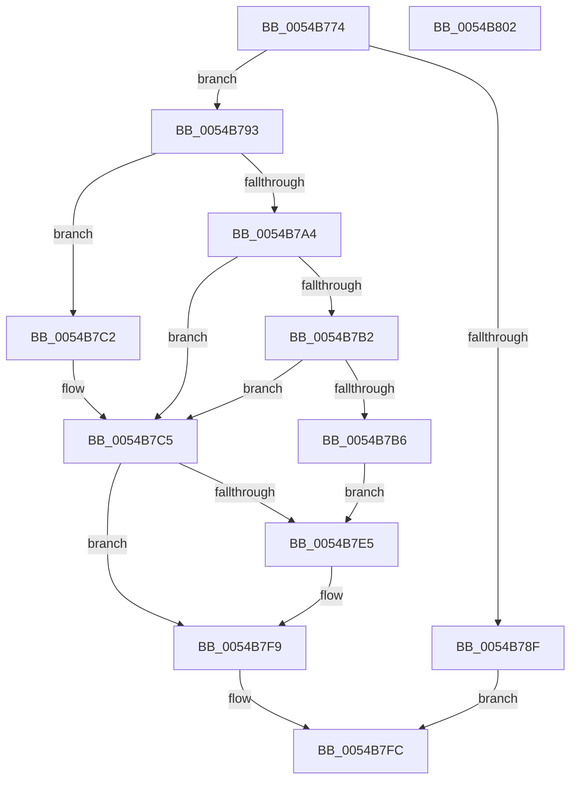

# HalpTimerSetTimerBackedProfileInterval

- RVA: `0x0054B774`–`0x0054B803` (길이 `143` bytes)
- VA: `0x000000014054B774`
- 실행 섹션: `.text`
- PDB 이름 있음: `예`; PDB Function 태그: `아니요`
- unwind 정보 RVA: `0x00064C80`
- 디코드: `39`개 명령, `143/143` bytes 표시
- 미해석 바이트: `0` (있으면 어셈블리에 `.byte`로 보존)

> 이 문서는 커널 이미지의 기계어와 PDB 기호를 분석해 생성했습니다. 4번과 5번은 함수 원형과 자료형을 바이너리 사용 방식에서 추정한 C 해석이며 원본 소스 복구 결과는 아닙니다.

## 1. Dependencies

- 직접 호출 지점: **1**; 고유 호출 대상: **1**
- 직접 호출자로 확인된 함수: **1**
- RIP 상대 이미지 참조: **3**

### Outgoing calls
- `0x0054B7D7` → [HalpSetTimer](../42/HalpSetTimer_function_0042BD30.md) (function, `0x0042BD30`)

### Direct callers
- [DefaultSetInterval](DefaultSetInterval_function_0054DC10.md) at `0x0054DC4F`

### Static image references
- `0x0054B783` → RVA `0x00FC3FC0` (`.data`; read)
- `0x0054B79B` → RVA `0x00E10368` (`.data`; read)
- `0x0054B7B6` → RVA `0x00FC21E8` (`.data`; read)

## 2. Other-region calls and transfers

- 다른 실행 섹션으로 향하는 call: **0**
- 별도 외부 분기/꼬리 이동을 확인하지 못했습니다.

## 3. Assembly (complete function range)

```asm
0054B774  40 53                           push rbx
0054B776  48 83 EC 30                     sub rsp, 0x30
0054B77A  48 83 64 24 48 00               and qword ptr [rsp + 0x48], 0
0054B780  48 8B D1                        mov rdx, rcx
0054B783  48 8B 0D 36 88 A7 00            mov rcx, qword ptr [rip + 0xa78836]
0054B78A  48 85 C9                        test rcx, rcx
0054B78D  75 04                           jne 0x14054b793
0054B78F  33 C0                           xor eax, eax
0054B791  EB 69                           jmp 0x14054b7fc
0054B793  65 8B 1C 25 A4 01 00 00         mov ebx, dword ptr gs:[0x1a4]
0054B79B  83 3D C6 4B 8C 00 00            cmp dword ptr [rip + 0x8c4bc6], 0
0054B7A2  74 1E                           je 0x14054b7c2
0054B7A4  8B 81 E0 00 00 00               mov eax, dword ptr [rcx + 0xe0]
0054B7AA  41 B1 01                        mov r9b, 1
0054B7AD  41 84 C1                        test r9b, al
0054B7B0  75 13                           jne 0x14054b7c5
0054B7B2  85 DB                           test ebx, ebx
0054B7B4  74 0F                           je 0x14054b7c5
0054B7B6  48 8B 05 2B 6A A7 00            mov rax, qword ptr [rip + 0xa76a2b]
0054B7BD  8B 50 18                        mov edx, dword ptr [rax + 0x18]
0054B7C0  EB 23                           jmp 0x14054b7e5
0054B7C2  45 33 C9                        xor r9d, r9d
0054B7C5  48 8D 44 24 48                  lea rax, [rsp + 0x48]
0054B7CA  44 8B C2                        mov r8d, edx
0054B7CD  BA 02 00 00 00                  mov edx, 2
0054B7D2  48 89 44 24 20                  mov qword ptr [rsp + 0x20], rax
0054B7D7  E8 54 05 EE FF                  call 0x14042bd30
0054B7DC  48 8B 54 24 48                  mov rdx, qword ptr [rsp + 0x48]
0054B7E1  85 C0                           test eax, eax
0054B7E3  78 14                           js 0x14054b7f9
0054B7E5  8B C3                           mov eax, ebx
0054B7E7  48 69 C8 28 01 00 00            imul rcx, rax, 0x128
0054B7EE  48 8B 05 F3 69 A7 00            mov rax, qword ptr [rip + 0xa769f3]
0054B7F5  89 54 01 18                     mov dword ptr [rcx + rax + 0x18], edx
0054B7F9  48 8B C2                        mov rax, rdx
0054B7FC  48 83 C4 30                     add rsp, 0x30
0054B800  5B                              pop rbx
0054B801  C3                              ret
0054B802  CC                              int3
```

## 4. C-style interpretation (structured pseudocode)

```c
__int64 __fastcall HalpTimerSetTimerBackedProfileInterval(__int64 a1)
{
    __int64 result;
    __int64 v_rsp;
    unsigned __int64 v_stack_m18;
    unsigned __int64 v_stack_p10;

    v_rsp = (v_rsp) - (48);
    if (*(unsigned __int64 *)(v_rip + 10979382) != 0) goto loc_0054B793;
    result = 0;
    goto loc_0054B7FC;
loc_0054B793:
    if ((*(unsigned int *)(v_rip + 9194438)) == 0) goto loc_0054B7C2;
    if (((1) & ((unsigned __int8)((unsigned int)(*(unsigned int *)(*(unsigned __int64 *)(v_rip + 10979382) + 224))))) != 0) goto loc_0054B7C5;
    if ((unsigned int)((unsigned int)(*(unsigned int *)(gs_base + (0 + 420)))) == 0) goto loc_0054B7C5;
    goto loc_0054B7E5;
loc_0054B7C2:
    a4 = 0;
loc_0054B7C5:
    v_stack_m18 = v_stack_p10;
    result = HalpSetTimer(*(unsigned __int64 *)(v_rip + 10979382), 2, (unsigned int)((unsigned int)((unsigned int)(*(unsigned int *)(*(unsigned __int64 *)(v_rip + 10971691) + 24)))), a4);
    if (!(sign_flag)) {
        result = (unsigned int)((unsigned int)(*(unsigned int *)(gs_base + (0 + 420))));
        a1 = (*(unsigned __int64 *)(v_rip + 10979382)) * (result);
        result = *(unsigned __int64 *)(v_rip + 10971635);
        *(unsigned int *)(a1 + result * 1 + 24) = (unsigned int)(v_stack_p10);
    }
loc_0054B7FC:
    v_rsp = (v_rsp) + (48);
    return v_stack_p10;
}
```

## 5. (Beta) C Style

```c
int64_t HalpTimerSetTimerBackedProfileInterval(int64_t Arg1)
{
    int64_t result;
    int64_t local_rsp;
    uint64_t v_stack_m18;
    uint64_t v_stack_p10;

    local_rsp = (local_rsp) - (48);
    if (*(uint64_t *)(v_rip + 0xA78836) != 0) goto loc_0054B793;
    result = 0;
    goto loc_0054B7FC;
loc_0054B793:
    if ((*(uint32_t *)(v_rip + 0x8C4BC6)) == 0) goto loc_0054B7C2;
    if (((1) & ((uint8_t)((uint32_t)(*(uint32_t *)(*(uint64_t *)(v_rip + 0xA78836) + 0xE0))))) != 0) goto loc_0054B7C5;
    if ((uint32_t)((uint32_t)(*(uint32_t *)(gs_base + (0 + 0x1A4)))) == 0) goto loc_0054B7C5;
    goto loc_0054B7E5;
loc_0054B7C2:
    a4 = 0;
loc_0054B7C5:
    v_stack_m18 = v_stack_p10;
    result = HalpSetTimer(*(uint64_t *)(v_rip + 0xA78836), 2, (uint32_t)((uint32_t)((uint32_t)(*(uint32_t *)(*(uint64_t *)(v_rip + 0xA76A2B) + 0x18)))), a4);
    if (!(sign_flag)) {
        result = (uint32_t)((uint32_t)(*(uint32_t *)(gs_base + (0 + 0x1A4))));
        Arg1 = (*(uint64_t *)(v_rip + 0xA78836)) * (result);
        result = *(uint64_t *)(v_rip + 0xA769F3);
        *(uint32_t *)(Arg1 + result * 1 + 0x18) = (uint32_t)(v_stack_p10);
    }
loc_0054B7FC:
    local_rsp = (local_rsp) + (48);
    return v_stack_p10;
}
```

## 6. Execution-region graph

[열기: 2D/3D 그래프와 함수 탐색 컨트롤 패널](../../../control-panel.html?section=text&rva=0x0054B774&view=graph)

- 2D 그래프는 위에서 아래로 흐르고, 3D 그래프는 빈 공간을 드래그해 회전합니다. Shift+드래그는 이동, 휠은 확대·축소, 함수 노드 선택은 대상 보고서 이동입니다.

### Static fallback


