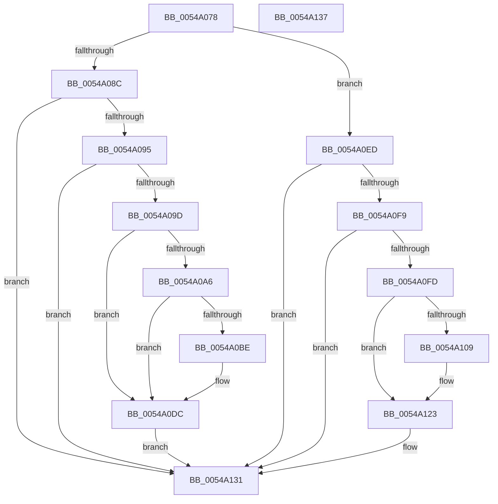

# HalpTimerStallCounterPowerChange

- RVA: `0x0054A078`–`0x0054A138` (길이 `192` bytes)
- VA: `0x000000014054A078`
- 실행 섹션: `.text`
- PDB 이름 있음: `예`; PDB Function 태그: `아니요`
- unwind 정보 RVA: `0x00064C80`
- 디코드: `51`개 명령, `192/192` bytes 표시
- 미해석 바이트: `0` (있으면 어셈블리에 `.byte`로 보존)

> 이 문서는 커널 이미지의 기계어와 PDB 기호를 분석해 생성했습니다. 4번과 5번은 함수 원형과 자료형을 바이너리 사용 방식에서 추정한 C 해석이며 원본 소스 복구 결과는 아닙니다.

## 1. Dependencies

- 직접 호출 지점: **4**; 고유 호출 대상: **3**
- 직접 호출자로 확인된 함수: **1**
- RIP 상대 이미지 참조: **7**

### Outgoing calls
- `0x0054A0A9` → [HalpTimerGetInternalData](../20/HalpTimerGetInternalData_function_00209500.md) (function, `0x00209500`)
- `0x0054A0B5` → [guard_dispatch_icall](../6B/guard_dispatch_icall_function_006BAAD0.md) (function, `0x006BAAD0`)
- `0x0054A0D6` → [KeBugCheckEx](../4F/KeBugCheckEx_function_004FD660.md) (function, `0x004FD660`)
- `0x0054A11D` → [KeBugCheckEx](../4F/KeBugCheckEx_function_004FD660.md) (function, `0x004FD660`)

### Direct callers
- [HalpTimerPowerChange](HalpTimerPowerChange_function_00549DF0.md) at `0x00549E78`

### Static image references
- `0x0054A07E` → RVA `0x00FC40C8` (`.data`; read)
- `0x0054A09D` → RVA `0x00FC3FD0` (`.data`; read)
- `0x0054A0DC` → RVA `0x00FC40C8` (`.data`; read/write)
- `0x0054A0E4` → RVA `0x00FC4100` (`.data`; write)
- `0x0054A0ED` → RVA `0x00FC4100` (`.data`; read)
- `0x0054A0FD` → RVA `0x00FC4140` (`.data`; read)
- `0x0054A123` → RVA `0x00FC40C8` (`.data`; write)

## 2. Other-region calls and transfers

- 다른 실행 섹션으로 향하는 call: **0**
- 별도 외부 분기/꼬리 이동을 확인하지 못했습니다.

## 3. Assembly (complete function range)

```asm
0054A078  40 53                           push rbx
0054A07A  48 83 EC 30                     sub rsp, 0x30
0054A07E  48 8B 1D 43 A0 A7 00            mov rbx, qword ptr [rip + 0xa7a043]
0054A085  8A C2                           mov al, dl
0054A087  48 85 DB                        test rbx, rbx
0054A08A  74 61                           je 0x14054a0ed
0054A08C  48 3B CB                        cmp rcx, rbx
0054A08F  0F 85 9C 00 00 00               jne 0x14054a131
0054A095  84 C0                           test al, al
0054A097  0F 84 94 00 00 00               je 0x14054a131
0054A09D  48 3B 1D 2C 9F A7 00            cmp rbx, qword ptr [rip + 0xa79f2c]
0054A0A4  74 36                           je 0x14054a0dc
0054A0A6  48 8B CB                        mov rcx, rbx
0054A0A9  E8 52 F4 CB FF                  call 0x140209500
0054A0AE  48 8B C8                        mov rcx, rax
0054A0B1  48 8B 43 68                     mov rax, qword ptr [rbx + 0x68]
0054A0B5  E8 16 0A 17 00                  call 0x1406baad0
0054A0BA  85 C0                           test eax, eax
0054A0BC  79 1E                           jns 0x14054a0dc
0054A0BE  B9 5C 00 00 00                  mov ecx, 0x5c
0054A0C3  48 98                           cdqe
0054A0C5  4C 8B CB                        mov r9, rbx
0054A0C8  48 89 44 24 20                  mov qword ptr [rsp + 0x20], rax
0054A0CD  BA 13 01 00 00                  mov edx, 0x113
0054A0D2  44 8D 41 B3                     lea r8d, [rcx - 0x4d]
0054A0D6  E8 85 35 FB FF                  call 0x1404fd660
0054A0DB  CC                              int3
0054A0DC  48 83 25 E4 9F A7 00 00         and qword ptr [rip + 0xa79fe4], 0
0054A0E4  48 89 1D 15 A0 A7 00            mov qword ptr [rip + 0xa7a015], rbx
0054A0EB  EB 44                           jmp 0x14054a131
0054A0ED  48 8B 15 0C A0 A7 00            mov rdx, qword ptr [rip + 0xa7a00c]
0054A0F4  48 3B CA                        cmp rcx, rdx
0054A0F7  75 38                           jne 0x14054a131
0054A0F9  84 C0                           test al, al
0054A0FB  75 34                           jne 0x14054a131
0054A0FD  48 8B 05 3C A0 A7 00            mov rax, qword ptr [rip + 0xa7a03c]
0054A104  48 85 C0                        test rax, rax
0054A107  75 1A                           jne 0x14054a123
0054A109  48 21 44 24 20                  and qword ptr [rsp + 0x20], rax
0054A10E  44 8D 40 22                     lea r8d, [rax + 0x22]
0054A112  4C 8B C9                        mov r9, rcx
0054A115  BA 13 01 00 00                  mov edx, 0x113
0054A11A  8D 48 5C                        lea ecx, [rax + 0x5c]
0054A11D  E8 3E 35 FB FF                  call 0x1404fd660
0054A122  CC                              int3
0054A123  48 89 15 9E 9F A7 00            mov qword ptr [rip + 0xa79f9e], rdx
0054A12A  48 89 05 CF 9F A7 00            mov qword ptr [rip + 0xa79fcf], rax
0054A131  48 83 C4 30                     add rsp, 0x30
0054A135  5B                              pop rbx
0054A136  C3                              ret
0054A137  CC                              int3
```

## 4. C-style interpretation (structured pseudocode)

```c
__int64 __fastcall HalpTimerStallCounterPowerChange(__int64 a1, unsigned __int8 a2)
{
    __int64 result;
    __int64 v_rsp;
    unsigned __int64 v_stack_m18;

    v_rsp = (v_rsp) - (48);
    if (*(unsigned __int64 *)(v_rip + 10985539) == 0) goto loc_0054A0ED;
    if (a1 != (*(unsigned __int64 *)(v_rip + 10985539))) goto loc_0054A131;
    if (a2 == 0) goto loc_0054A131;
    if ((*(unsigned __int64 *)(v_rip + 10985539)) == (*(unsigned __int64 *)(v_rip + 10985260))) goto loc_0054A0DC;
    result = HalpTimerGetInternalData(*(unsigned __int64 *)(v_rip + 10985539), a2, a3, a4);
    result = guard_dispatch_icall(result, a2, a3, a4);
    if (sign_flag) {
        a1 = 92;
        a4 = *(unsigned __int64 *)(v_rip + 10985539);
        v_stack_m18 = result;
        a2 = 275;
        a3 = a1 - 77;
        result = KeBugCheckEx(a1, a2, a3, a4);
    }
    *(unsigned __int64 *)(v_rip + 10985493) = *(unsigned __int64 *)(v_rip + 10985539);
    goto loc_0054A131;
loc_0054A0ED:
    if (a1 != (*(unsigned __int64 *)(v_rip + 10985484))) goto loc_0054A131;
    if ((unsigned __int8)(result) != 0) goto loc_0054A131;
    result = *(unsigned __int64 *)(v_rip + 10985532);
    if (*(unsigned __int64 *)(v_rip + 10985532) == 0) {
        a3 = *(unsigned __int64 *)(v_rip + 10985532) + 34;
        a4 = a1;
        a2 = 275;
        a1 = *(unsigned __int64 *)(v_rip + 10985532) + 92;
        result = KeBugCheckEx(a1, a2, a3, a4);
    }
    *(unsigned __int64 *)(v_rip + 10985374) = a2;
    *(unsigned __int64 *)(v_rip + 10985423) = result;
loc_0054A131:
    v_rsp = (v_rsp) + (48);
    return result;
}
```

## 5. (Beta) C Style

```c
int64_t HalpTimerStallCounterPowerChange(int64_t Arg1, uint8_t Arg2)
{
    int64_t result;
    int64_t local_rsp;
    uint64_t v_stack_m18;

    local_rsp = (local_rsp) - (48);
    if (*(uint64_t *)(v_rip + 0xA7A043) == 0) goto loc_0054A0ED;
    if (Arg1 != (*(uint64_t *)(v_rip + 0xA7A043))) goto loc_0054A131;
    if (Arg2 == 0) goto loc_0054A131;
    if ((*(uint64_t *)(v_rip + 0xA7A043)) == (*(uint64_t *)(v_rip + 0xA79F2C))) goto loc_0054A0DC;
    result = HalpTimerGetInternalData(*(uint64_t *)(v_rip + 0xA7A043), Arg2, a3, a4);
    result = guard_dispatch_icall(result, Arg2, a3, a4);
    if (sign_flag) {
        Arg1 = 92;
        a4 = *(uint64_t *)(v_rip + 0xA7A043);
        v_stack_m18 = result;
        Arg2 = 275;
        a3 = Arg1 - 77;
        result = KeBugCheckEx(Arg1, Arg2, a3, a4);
    }
    *(uint64_t *)(v_rip + 0xA7A015) = *(uint64_t *)(v_rip + 0xA7A043);
    goto loc_0054A131;
loc_0054A0ED:
    if (Arg1 != (*(uint64_t *)(v_rip + 0xA7A00C))) goto loc_0054A131;
    if ((uint8_t)(result) != 0) goto loc_0054A131;
    result = *(uint64_t *)(v_rip + 0xA7A03C);
    if (*(uint64_t *)(v_rip + 0xA7A03C) == 0) {
        a3 = *(uint64_t *)(v_rip + 0xA7A03C) + 34;
        a4 = Arg1;
        Arg2 = 275;
        Arg1 = *(uint64_t *)(v_rip + 0xA7A03C) + 92;
        result = KeBugCheckEx(Arg1, Arg2, a3, a4);
    }
    *(uint64_t *)(v_rip + 0xA79F9E) = Arg2;
    *(uint64_t *)(v_rip + 0xA79FCF) = result;
loc_0054A131:
    local_rsp = (local_rsp) + (48);
    return result;
}
```

## 6. Execution-region graph

[열기: 2D/3D 그래프와 함수 탐색 컨트롤 패널](../../../control-panel.html?section=text&rva=0x0054A078&view=graph)

- 2D 그래프는 위에서 아래로 흐르고, 3D 그래프는 빈 공간을 드래그해 회전합니다. Shift+드래그는 이동, 휠은 확대·축소, 함수 노드 선택은 대상 보고서 이동입니다.

### Static fallback


