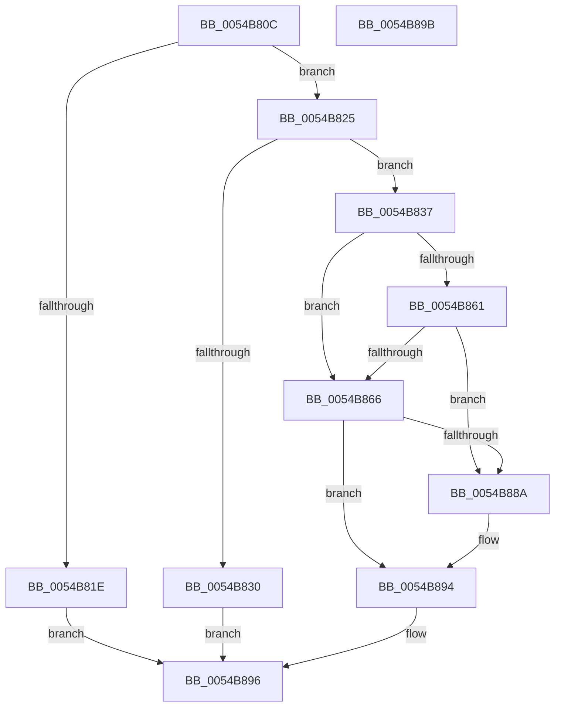

# HalpTimerStartProfileInterrupt

- RVA: `0x0054B80C`–`0x0054B89C` (길이 `144` bytes)
- VA: `0x000000014054B80C`
- 실행 섹션: `.text`
- PDB 이름 있음: `예`; PDB Function 태그: `아니요`
- unwind 정보 RVA: `0x0005D2F4`
- 디코드: `37`개 명령, `144/144` bytes 표시
- 미해석 바이트: `0` (있으면 어셈블리에 `.byte`로 보존)

> 이 문서는 커널 이미지의 기계어와 PDB 기호를 분석해 생성했습니다. 4번과 5번은 함수 원형과 자료형을 바이너리 사용 방식에서 추정한 C 해석이며 원본 소스 복구 결과는 아닙니다.

## 1. Dependencies

- 직접 호출 지점: **1**; 고유 호출 대상: **1**
- 직접 호출자로 확인된 함수: **1**
- RIP 상대 이미지 참조: **3**

### Outgoing calls
- `0x0054B87F` → [HalpSetTimer](../42/HalpSetTimer_function_0042BD30.md) (function, `0x0042BD30`)

### Direct callers
- [DefaultEnableMonitoring](DefaultEnableMonitoring_function_0054DB50.md) at `0x0054DB73`

### Static image references
- `0x0054B810` → RVA `0x00FC3FC0` (`.data`; read)
- `0x0054B84A` → RVA `0x00FC21E8` (`.data`; read)
- `0x0054B88A` → RVA `0x00E10368` (`.data`; write)

## 2. Other-region calls and transfers

- 다른 실행 섹션으로 향하는 call: **0**
- 별도 외부 분기/꼬리 이동을 확인하지 못했습니다.

## 3. Assembly (complete function range)

```asm
0054B80C  48 83 EC 38                     sub rsp, 0x38
0054B810  4C 8B 15 A9 87 A7 00            mov r10, qword ptr [rip + 0xa787a9]
0054B817  33 D2                           xor edx, edx
0054B819  4D 85 D2                        test r10, r10
0054B81C  75 07                           jne 0x14054b825
0054B81E  B8 BB 00 00 C0                  mov eax, 0xc00000bb
0054B823  EB 71                           jmp 0x14054b896
0054B825  41 8B 82 B8 00 00 00            mov eax, dword ptr [r10 + 0xb8]
0054B82C  84 C0                           test al, al
0054B82E  79 07                           jns 0x14054b837
0054B830  B8 89 01 00 C0                  mov eax, 0xc0000189
0054B835  EB 5F                           jmp 0x14054b896
0054B837  65 44 8B 04 25 A4 01 00 00      mov r8d, dword ptr gs:[0x1a4]
0054B840  41 8B C0                        mov eax, r8d
0054B843  48 69 C8 28 01 00 00            imul rcx, rax, 0x128
0054B84A  48 8B 05 97 69 A7 00            mov rax, qword ptr [rip + 0xa76997]
0054B851  44 8B 4C 01 18                  mov r9d, dword ptr [rcx + rax + 0x18]
0054B856  41 8B 82 E0 00 00 00            mov eax, dword ptr [r10 + 0xe0]
0054B85D  A8 01                           test al, 1
0054B85F  75 05                           jne 0x14054b866
0054B861  45 85 C0                        test r8d, r8d
0054B864  75 24                           jne 0x14054b88a
0054B866  4D 8D 41 01                     lea r8, [r9 + 1]
0054B86A  BA 02 00 00 00                  mov edx, 2
0054B86F  48 8D 44 24 40                  lea rax, [rsp + 0x40]
0054B874  41 B1 01                        mov r9b, 1
0054B877  49 8B CA                        mov rcx, r10
0054B87A  48 89 44 24 20                  mov qword ptr [rsp + 0x20], rax
0054B87F  E8 AC 04 EE FF                  call 0x14042bd30
0054B884  8B D0                           mov edx, eax
0054B886  85 C0                           test eax, eax
0054B888  78 0A                           js 0x14054b894
0054B88A  C7 05 D4 4A 8C 00 01 00 00 00   mov dword ptr [rip + 0x8c4ad4], 1
0054B894  8B C2                           mov eax, edx
0054B896  48 83 C4 38                     add rsp, 0x38
0054B89A  C3                              ret
0054B89B  CC                              int3
```

## 4. C-style interpretation (structured pseudocode)

```c
__int64 __fastcall HalpTimerStartProfileInterrupt(__int64 a1, int a2)
{
    __int64 result;
    __int64 v_rsp;
    unsigned __int64 v_stack_m18;
    unsigned __int64 v_stack_p8;

    v_rsp = (v_rsp) - (56);
    a2 = 0;
    if (*(unsigned __int64 *)(v_rip + 10979241) != 0) goto loc_0054B825;
    goto loc_0054B896;
loc_0054B825:
    if (!sign_flag) goto loc_0054B837;
    goto loc_0054B896;
loc_0054B837:
    a1 = (a1) * ((unsigned int)((unsigned int)((unsigned int)(*(unsigned int *)(gs_base + (0 + 420))))));
    if ((((unsigned __int8)((unsigned int)(*(unsigned int *)(*(unsigned __int64 *)(v_rip + 10979241) + 224)))) & (1)) != 0) goto loc_0054B866;
    if ((unsigned int)((unsigned int)(*(unsigned int *)(gs_base + (0 + 420)))) != 0) goto loc_0054B88A;
loc_0054B866:
    v_stack_m18 = v_stack_p8;
    result = HalpSetTimer(*(unsigned __int64 *)(v_rip + 10979241), 2, (unsigned int)(*(unsigned int *)(a1 + *(unsigned __int64 *)(v_rip + 10971543) * 1 + 24)) + 1, 1);
    if (!(sign_flag)) {
        *(unsigned int *)(v_rip + 9194196) = 1;
    }
loc_0054B896:
    v_rsp = (v_rsp) + (56);
    return (unsigned int)((unsigned int)((unsigned int)((unsigned int)(result))));
}
```

## 5. (Beta) C Style

```c
int64_t HalpTimerStartProfileInterrupt(void *Arg1, int32_t Arg2)
{
    uint8_t *arg1 = (uint8_t *)Arg1;

    int64_t result;
    int64_t local_rsp;
    uint64_t v_stack_m18;
    uint64_t v_stack_p8;

    local_rsp = (local_rsp) - (56);
    Arg2 = 0;
    if (*(uint64_t *)(v_rip + 0xA787A9) != 0) goto loc_0054B825;
    goto loc_0054B896;
loc_0054B825:
    if (!sign_flag) goto loc_0054B837;
    goto loc_0054B896;
loc_0054B837:
    Arg1 = (Arg1) * ((uint32_t)((uint32_t)((uint32_t)(*(uint32_t *)(gs_base + (0 + 0x1A4))))));
    if ((((uint8_t)((uint32_t)(*(uint32_t *)(*(uint64_t *)(v_rip + 0xA787A9) + 0xE0)))) & (1)) != 0) goto loc_0054B866;
    if ((uint32_t)((uint32_t)(*(uint32_t *)(gs_base + (0 + 0x1A4)))) != 0) goto loc_0054B88A;
loc_0054B866:
    v_stack_m18 = v_stack_p8;
    result = HalpSetTimer(*(uint64_t *)(v_rip + 0xA787A9), 2, (uint32_t)(*(uint32_t *)(arg1 + *(uint64_t *)(v_rip + 0xA76997) * 1 + 0x18)) + 1, 1);
    if (!(sign_flag)) {
        *(uint32_t *)(v_rip + 0x8C4AD4) = 1;
    }
loc_0054B896:
    local_rsp = (local_rsp) + (56);
    return (uint32_t)((uint32_t)((uint32_t)((uint32_t)(result))));
}
```

### 관측된 메모리 오프셋

구조체 형식이 확인되지 않은 접근은 인자 기준의 오프셋으로만 기록했습니다.

| 기준 인자 | 오프셋 표현 | 폭 (bit) | 접근 |
|---|---:|---:|---|
| `Arg1` | `+ 0x18 + rax*1` | `32` | `R` |

## 6. Execution-region graph

[열기: 2D/3D 그래프와 함수 탐색 컨트롤 패널](../../../control-panel.html?section=text&rva=0x0054B80C&view=graph)

- 2D 그래프는 위에서 아래로 흐르고, 3D 그래프는 빈 공간을 드래그해 회전합니다. Shift+드래그는 이동, 휠은 확대·축소, 함수 노드 선택은 대상 보고서 이동입니다.

### Static fallback


