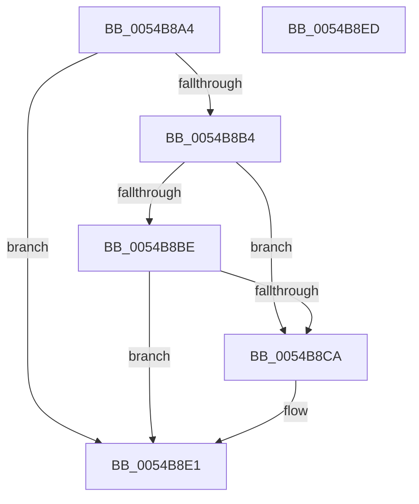

# HalpTimerStopProfileInterrupt

- RVA: `0x0054B8A4`–`0x0054B8EE` (길이 `74` bytes)
- VA: `0x000000014054B8A4`
- 실행 섹션: `.text`
- PDB 이름 있음: `예`; PDB Function 태그: `아니요`
- unwind 정보 RVA: `0x0005C788`
- 디코드: `19`개 명령, `74/74` bytes 표시
- 미해석 바이트: `0` (있으면 어셈블리에 `.byte`로 보존)

> 이 문서는 커널 이미지의 기계어와 PDB 기호를 분석해 생성했습니다. 4번과 5번은 함수 원형과 자료형을 바이너리 사용 방식에서 추정한 C 해석이며 원본 소스 복구 결과는 아닙니다.

## 1. Dependencies

- 직접 호출 지점: **2**; 고유 호출 대상: **2**
- 직접 호출자로 확인된 함수: **2**
- RIP 상대 이미지 참조: **2**

### Outgoing calls
- `0x0054B8CD` → [HalpTimerGetInternalData](../20/HalpTimerGetInternalData_function_00209500.md) (function, `0x00209500`)
- `0x0054B8DC` → [guard_dispatch_icall](../6B/guard_dispatch_icall_function_006BAAD0.md) (function, `0x006BAAD0`)

### Direct callers
- [HalpTimerSelectRoles](../53/HalpTimerSelectRoles_function_0053D4B0.md) at `0x0053D81C`
- [DefaultDisableMonitoring](DefaultDisableMonitoring_function_0054DB30.md) at `0x0054DB38`

### Static image references
- `0x0054B8A8` → RVA `0x00FC3FC0` (`.data`; read)
- `0x0054B8E1` → RVA `0x00E10368` (`.data`; read/write)

## 2. Other-region calls and transfers

- 다른 실행 섹션으로 향하는 call: **0**
- 별도 외부 분기/꼬리 이동을 확인하지 못했습니다.

## 3. Assembly (complete function range)

```asm
0054B8A4  48 83 EC 28                     sub rsp, 0x28
0054B8A8  48 8B 15 11 87 A7 00            mov rdx, qword ptr [rip + 0xa78711]
0054B8AF  48 85 D2                        test rdx, rdx
0054B8B2  74 2D                           je 0x14054b8e1
0054B8B4  8B 82 E0 00 00 00               mov eax, dword ptr [rdx + 0xe0]
0054B8BA  A8 01                           test al, 1
0054B8BC  75 0C                           jne 0x14054b8ca
0054B8BE  65 8B 04 25 A4 01 00 00         mov eax, dword ptr gs:[0x1a4]
0054B8C6  85 C0                           test eax, eax
0054B8C8  75 17                           jne 0x14054b8e1
0054B8CA  48 8B CA                        mov rcx, rdx
0054B8CD  E8 2E DC CB FF                  call 0x140209500
0054B8D2  48 8B C8                        mov rcx, rax
0054B8D5  48 8B 82 88 00 00 00            mov rax, qword ptr [rdx + 0x88]
0054B8DC  E8 EF F1 16 00                  call 0x1406baad0
0054B8E1  83 25 80 4A 8C 00 00            and dword ptr [rip + 0x8c4a80], 0
0054B8E8  48 83 C4 28                     add rsp, 0x28
0054B8EC  C3                              ret
0054B8ED  CC                              int3
```

## 4. C-style interpretation (structured pseudocode)

```c
__int64 __fastcall HalpTimerStopProfileInterrupt(void)
{
    __int64 result;
    __int64 v_rsp;

    v_rsp = (v_rsp) - (40);
    if (*(unsigned __int64 *)(v_rip + 10979089) == 0) goto loc_0054B8E1;
    if ((((unsigned __int8)((unsigned int)(*(unsigned int *)(*(unsigned __int64 *)(v_rip + 10979089) + 224)))) & (1)) != 0) goto loc_0054B8CA;
    result = (unsigned int)(*(unsigned int *)(gs_base + (0 + 420)));
    if ((unsigned int)((unsigned int)(*(unsigned int *)(gs_base + (0 + 420)))) == 0) {
        a1 = *(unsigned __int64 *)(v_rip + 10979089);
        result = HalpTimerGetInternalData(a1, *(unsigned __int64 *)(v_rip + 10979089), a3, a4);
        a1 = result;
        result = *(unsigned __int64 *)(*(unsigned __int64 *)(v_rip + 10979089) + 136);
        result = guard_dispatch_icall(a1, *(unsigned __int64 *)(v_rip + 10979089), a3, a4);
    }
    v_rsp = (v_rsp) + (40);
    return result;
}
```

## 5. (Beta) C Style

```c
void HalpTimerStopProfileInterrupt(void)
{
    int64_t result;
    int64_t local_rsp;

    local_rsp = (local_rsp) - (40);
    if (*(uint64_t *)(v_rip + 0xA78711) == 0) goto loc_0054B8E1;
    if ((((uint8_t)((uint32_t)(*(uint32_t *)(*(uint64_t *)(v_rip + 0xA78711) + 0xE0)))) & (1)) != 0) goto loc_0054B8CA;
    result = (uint32_t)(*(uint32_t *)(gs_base + (0 + 0x1A4)));
    if ((uint32_t)((uint32_t)(*(uint32_t *)(gs_base + (0 + 0x1A4)))) == 0) {
        a1 = *(uint64_t *)(v_rip + 0xA78711);
        result = HalpTimerGetInternalData(a1, *(uint64_t *)(v_rip + 0xA78711), a3, a4);
        a1 = result;
        result = *(uint64_t *)(*(uint64_t *)(v_rip + 0xA78711) + 0x88);
        result = guard_dispatch_icall(a1, *(uint64_t *)(v_rip + 0xA78711), a3, a4);
    }
    local_rsp = (local_rsp) + (40);
    return result;
}
```

## 6. Execution-region graph

[열기: 2D/3D 그래프와 함수 탐색 컨트롤 패널](../../../control-panel.html?section=text&rva=0x0054B8A4&view=graph)

- 2D 그래프는 위에서 아래로 흐르고, 3D 그래프는 빈 공간을 드래그해 회전합니다. Shift+드래그는 이동, 휠은 확대·축소, 함수 노드 선택은 대상 보고서 이동입니다.

### Static fallback


