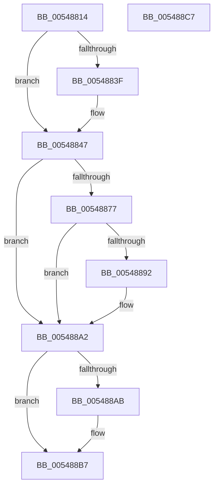

# HalpTimerSwitchToNormalClock

- RVA: `0x00548814`–`0x005488C8` (길이 `180` bytes)
- VA: `0x0000000140548814`
- 실행 섹션: `.text`
- PDB 이름 있음: `예`; PDB Function 태그: `아니요`
- unwind 정보 RVA: `0x000C3DE4`
- 디코드: `47`개 명령, `180/180` bytes 표시
- 미해석 바이트: `0` (있으면 어셈블리에 `.byte`로 보존)

> 이 문서는 커널 이미지의 기계어와 PDB 기호를 분석해 생성했습니다. 4번과 5번은 함수 원형과 자료형을 바이너리 사용 방식에서 추정한 C 해석이며 원본 소스 복구 결과는 아닙니다.

## 1. Dependencies

- 직접 호출 지점: **6**; 고유 호출 대상: **6**
- 직접 호출자로 확인된 함수: **2**
- RIP 상대 이미지 참조: **2**

### Outgoing calls
- `0x00548842` → [KiRaiseIrqlProcessIrqlFlags](../4F/KiRaiseIrqlProcessIrqlFlags_function_004F56FC.md) (function, `0x004F56FC`)
- `0x0054885A` → [HalpTimerGetInternalData](../20/HalpTimerGetInternalData_function_00209500.md) (function, `0x00209500`)
- `0x00548869` → [guard_dispatch_icall](../6B/guard_dispatch_icall_function_006BAAD0.md) (function, `0x006BAAD0`)
- `0x00548886` → [KeGetClockTimerResolution](../5B/KeGetClockTimerResolution_function_005BA2F0.md) (function, `0x005BA2F0`)
- `0x0054889D` → [HalpTimerClockArm](../42/HalpTimerClockArm_function_0042B950.md) (function, `0x0042B950`)
- `0x005488B2` → [KiLowerIrqlProcessIrqlFlags](../4F/KiLowerIrqlProcessIrqlFlags_function_004F5698.md) (function, `0x004F5698`)

### Direct callers
- [sub_0042BC55](../42/Unknown_function_0042BC55.md) at `0x0042BC73`
- [HalpTimerAlwaysOnClockInterrupt](../56/HalpTimerAlwaysOnClockInterrupt_function_00560240.md) at `0x00560322`

### Static image references
- `0x00548836` → RVA `0x00FC6D20` (`ALMOSTRO`; read)
- `0x00548850` → RVA `0x00FC4108` (`.data`; read)

## 2. Other-region calls and transfers

- 다른 실행 섹션으로 향하는 call: **0**
- 별도 외부 분기/꼬리 이동을 확인하지 못했습니다.

## 3. Assembly (complete function range)

```asm
00548814  40 53                           push rbx
00548816  56                              push rsi
00548817  57                              push rdi
00548818  48 83 EC 20                     sub rsp, 0x20
0054881C  83 64 24 48 00                  and dword ptr [rsp + 0x48], 0
00548821  40 8A F1                        mov sil, cl
00548824  C6 44 24 40 00                  mov byte ptr [rsp + 0x40], 0
00548829  44 0F 20 C7                     mov rdi, cr8
0054882D  BA 0F 00 00 00                  mov edx, 0xf
00548832  44 0F 22 C2                     mov cr8, rdx
00548836  83 3D E3 E4 A7 00 00            cmp dword ptr [rip + 0xa7e4e3], 0
0054883D  74 08                           je 0x140548847
0054883F  40 8A CF                        mov cl, dil
00548842  E8 B5 CE FA FF                  call 0x1404f56fc
00548847  65 48 8B 1C 25 20 00 00 00      mov rbx, qword ptr gs:[0x20]
00548850  48 8B 15 B1 B8 A7 00            mov rdx, qword ptr [rip + 0xa7b8b1]
00548857  48 8B CA                        mov rcx, rdx
0054885A  E8 A1 0C CC FF                  call 0x140209500
0054885F  48 8B C8                        mov rcx, rax
00548862  48 8B 82 88 00 00 00            mov rax, qword ptr [rdx + 0x88]
00548869  E8 62 22 17 00                  call 0x1406baad0
0054886E  80 63 22 FD                     and byte ptr [rbx + 0x22], 0xfd
00548872  40 84 F6                        test sil, sil
00548875  74 2B                           je 0x1405488a2
00548877  4C 8D 44 24 40                  lea r8, [rsp + 0x40]
0054887C  48 8D 54 24 50                  lea rdx, [rsp + 0x50]
00548881  48 8D 4C 24 48                  lea rcx, [rsp + 0x48]
00548886  E8 65 1A 07 00                  call 0x1405ba2f0
0054888B  80 7C 24 40 00                  cmp byte ptr [rsp + 0x40], 0
00548890  75 10                           jne 0x1405488a2
00548892  8B 54 24 48                     mov edx, dword ptr [rsp + 0x48]
00548896  4C 8D 44 24 48                  lea r8, [rsp + 0x48]
0054889B  33 C9                           xor ecx, ecx
0054889D  E8 AE 30 EE FF                  call 0x14042b950
005488A2  83 3D 77 E4 A7 00 00            cmp dword ptr [rip + 0xa7e477], 0
005488A9  74 0C                           je 0x1405488b7
005488AB  44 0F 20 C1                     mov rcx, cr8
005488AF  40 8A D7                        mov dl, dil
005488B2  E8 E1 CD FA FF                  call 0x1404f5698
005488B7  40 0F B6 C7                     movzx eax, dil
005488BB  44 0F 22 C0                     mov cr8, rax
005488BF  48 83 C4 20                     add rsp, 0x20
005488C3  5F                              pop rdi
005488C4  5E                              pop rsi
005488C5  5B                              pop rbx
005488C6  C3                              ret
005488C7  CC                              int3
```

## 4. C-style interpretation (structured pseudocode)

```c
__int64 __fastcall HalpTimerSwitchToNormalClock(unsigned __int8 a1)
{
    __int64 result;
    __int64 v_rsp;
    unsigned int v_stack_p10;
    unsigned __int64 v_stack_p18;
    unsigned __int8 v_stack_p8;

    v_rsp = (v_rsp) - (32);
    v_stack_p8 = 0;
    if ((*(unsigned int *)(v_rip + 11003107)) != 0) {
        a1 = (unsigned __int8)(v_cr8);
        result = KiRaiseIrqlProcessIrqlFlags(a1, 15, a3, a4);
    }
    result = HalpTimerGetInternalData(*(unsigned __int64 *)(v_rip + 10991793), *(unsigned __int64 *)(v_rip + 10991793), a3, a4);
    result = guard_dispatch_icall(result, *(unsigned __int64 *)(v_rip + 10991793), a3, a4);
    if (a1 == 0) goto loc_005488A2;
    result = KeGetClockTimerResolution(v_stack_p10, v_stack_p18, v_stack_p8, a4);
    if (v_stack_p8 == 0) {
        a2 = v_stack_p10;
        a3 = v_stack_p10;
        a1 = 0;
        result = HalpTimerClockArm(a1, a2, a3, a4);
    }
    if ((*(unsigned int *)(v_rip + 11002999)) != 0) {
        a1 = 15;
        a2 = (unsigned __int8)(v_cr8);
        result = KiLowerIrqlProcessIrqlFlags(a1, a2, a3, a4);
    }
    v_rsp = (v_rsp) + (32);
    return (unsigned __int8)(v_cr8);
}
```

## 5. (Beta) C Style

```c
int64_t HalpTimerSwitchToNormalClock(uint8_t Arg1)
{
    int64_t result;
    int64_t local_rsp;
    uint32_t v_stack_p10;
    uint64_t v_stack_p18;
    uint8_t v_stack_p8;

    local_rsp = (local_rsp) - (32);
    v_stack_p8 = 0;
    if ((*(uint32_t *)(v_rip + 0xA7E4E3)) != 0) {
        Arg1 = (uint8_t)(v_cr8);
        result = KiRaiseIrqlProcessIrqlFlags(Arg1, 15, a3, a4);
    }
    result = HalpTimerGetInternalData(*(uint64_t *)(v_rip + 0xA7B8B1), *(uint64_t *)(v_rip + 0xA7B8B1), a3, a4);
    result = guard_dispatch_icall(result, *(uint64_t *)(v_rip + 0xA7B8B1), a3, a4);
    if (Arg1 == 0) goto loc_005488A2;
    result = KeGetClockTimerResolution(v_stack_p10, v_stack_p18, v_stack_p8, a4);
    if (v_stack_p8 == 0) {
        a2 = v_stack_p10;
        a3 = v_stack_p10;
        Arg1 = 0;
        result = HalpTimerClockArm(Arg1, a2, a3, a4);
    }
    if ((*(uint32_t *)(v_rip + 0xA7E477)) != 0) {
        Arg1 = 15;
        a2 = (uint8_t)(v_cr8);
        result = KiLowerIrqlProcessIrqlFlags(Arg1, a2, a3, a4);
    }
    local_rsp = (local_rsp) + (32);
    return (uint8_t)(v_cr8);
}
```

## 6. Execution-region graph

[열기: 2D/3D 그래프와 함수 탐색 컨트롤 패널](../../../control-panel.html?section=text&rva=0x00548814&view=graph)

- 2D 그래프는 위에서 아래로 흐르고, 3D 그래프는 빈 공간을 드래그해 회전합니다. Shift+드래그는 이동, 휠은 확대·축소, 함수 노드 선택은 대상 보고서 이동입니다.

### Static fallback


