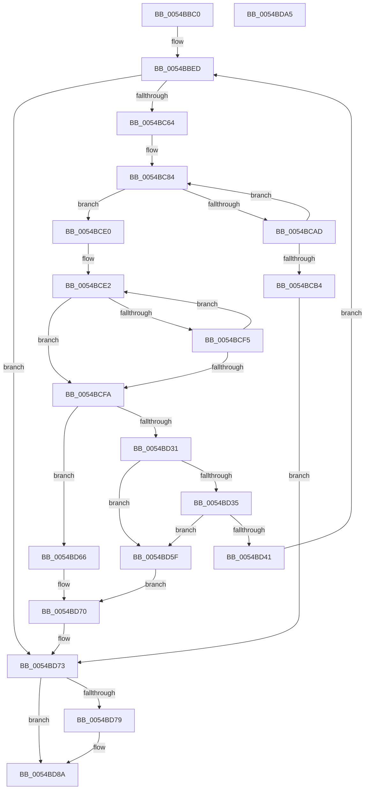

# HalpTimerTestHypervisorTimer

- RVA: `0x0054BBC0`–`0x0054BDA6` (길이 `486` bytes)
- VA: `0x000000014054BBC0`
- 실행 섹션: `.text`
- PDB 이름 있음: `예`; PDB Function 태그: `아니요`
- unwind 정보 RVA: `0x000C3F60`
- 디코드: `130`개 명령, `486/486` bytes 표시
- 미해석 바이트: `0` (있으면 어셈블리에 `.byte`로 보존)

> 이 문서는 커널 이미지의 기계어와 PDB 기호를 분석해 생성했습니다. 4번과 5번은 함수 원형과 자료형을 바이너리 사용 방식에서 추정한 C 해석이며 원본 소스 복구 결과는 아닙니다.

## 1. Dependencies

- 직접 호출 지점: **10**; 고유 호출 대상: **7**
- 직접 호출자로 확인된 함수: **1**
- RIP 상대 이미지 참조: **3**

### Outgoing calls
- `0x0054BC55` → [HalpTimerConfigureInterrupt](HalpTimerConfigureInterrupt_function_00548AB0.md) (function, `0x00548AB0`)
- `0x0054BC7D` → [HalpInterruptSetIdtEntry](../55/HalpInterruptSetIdtEntry_function_0055BAE0.md) (function, `0x0055BAE0`)
- `0x0054BCA2` → [HalpSetTimer](../42/HalpSetTimer_function_0042BD30.md) (function, `0x0042BD30`)
- `0x0054BCBF` → [guard_dispatch_icall](../6B/guard_dispatch_icall_function_006BAAD0.md) (function, `0x006BAAD0`)
- `0x0054BCD6` → [HalpCreateInterrupt](../55/HalpCreateInterrupt_function_0055BA00.md) (function, `0x0055BA00`)
- `0x0054BCE7` → [KeStallExecutionProcessor](../44/KeStallExecutionProcessor_function_0044F620.md) (function, `0x0044F620`)
- `0x0054BD05` → [guard_dispatch_icall](../6B/guard_dispatch_icall_function_006BAAD0.md) (function, `0x006BAAD0`)
- `0x0054BD1C` → [HalpCreateInterrupt](../55/HalpCreateInterrupt_function_0055BA00.md) (function, `0x0055BA00`)
- `0x0054BD4D` → [HalpTimerUnmapInterrupt](HalpTimerUnmapInterrupt_function_0054A140.md) (function, `0x0054A140`)
- `0x0054BD85` → [HalpTimerUnmapInterrupt](HalpTimerUnmapInterrupt_function_0054A140.md) (function, `0x0054A140`)

### Direct callers
- [HalpTimerInitializeHypervisorTimer](HalpTimerInitializeHypervisorTimer_function_0054B8F4.md) at `0x0054B9B6`

### Static image references
- `0x0054BBED` → RVA `0x00F231B0` (`.data`; read)
- `0x0054BBF4` → RVA `0x00543CB0` (`HalFlushCommonBuffer`; read)
- `0x0054BC6E` → RVA `0x00560510` (`HalpTimerHypervisorInterruptStub`; read)

## 2. Other-region calls and transfers

- 다른 실행 섹션으로 향하는 call: **0**
- 별도 외부 분기/꼬리 이동을 확인하지 못했습니다.

## 3. Assembly (complete function range)

```asm
0054BBC0  48 89 5C 24 10                  mov qword ptr [rsp + 0x10], rbx
0054BBC5  48 89 6C 24 18                  mov qword ptr [rsp + 0x18], rbp
0054BBCA  56                              push rsi
0054BBCB  57                              push rdi
0054BBCC  41 54                           push r12
0054BBCE  41 55                           push r13
0054BBD0  41 56                           push r14
0054BBD2  48 83 EC 50                     sub rsp, 0x50
0054BBD6  4C 8B F2                        mov r14, rdx
0054BBD9  48 8D B9 B8 00 00 00            lea rdi, [rcx + 0xb8]
0054BBE0  48 8B D9                        mov rbx, rcx
0054BBE3  49 83 CD FF                     or r13, 0xffffffffffffffff
0054BBE7  41 BC D4 00 00 00               mov r12d, 0xd4
0054BBED  48 8B 05 BC 75 9D 00            mov rax, qword ptr [rip + 0x9d75bc]
0054BBF4  48 8D 15 B5 80 FF FF            lea rdx, [rip - 0x7f4b]
0054BBFB  48 83 A4 24 80 00 00 00 00      and qword ptr [rsp + 0x80], 0
0054BC04  0F 57 C0                        xorps xmm0, xmm0
0054BC07  0F 11 44 24 40                  movups xmmword ptr [rsp + 0x40], xmm0
0054BC0C  48 89 54 24 38                  mov qword ptr [rsp + 0x38], rdx
0054BC11  41 B0 0F                        mov r8b, 0xf
0054BC14  8B 08                           mov ecx, dword ptr [rax]
0054BC16  41 8B D4                        mov edx, r12d
0054BC19  33 C0                           xor eax, eax
0054BC1B  89 44 24 4A                     mov dword ptr [rsp + 0x4a], eax
0054BC1F  66 89 44 24 4E                  mov word ptr [rsp + 0x4e], ax
0054BC24  8B C1                           mov eax, ecx
0054BC26  C1 E8 06                        shr eax, 6
0054BC29  83 E1 3F                        and ecx, 0x3f
0054BC2C  66 89 44 24 48                  mov word ptr [rsp + 0x48], ax
0054BC31  B8 01 00 00 00                  mov eax, 1
0054BC36  48 D3 E0                        shl rax, cl
0054BC39  48 8B CB                        mov rcx, rbx
0054BC3C  48 89 44 24 40                  mov qword ptr [rsp + 0x40], rax
0054BC41  48 8D 44 24 40                  lea rax, [rsp + 0x40]
0054BC46  48 89 44 24 30                  mov qword ptr [rsp + 0x30], rax
0054BC4B  83 64 24 28 00                  and dword ptr [rsp + 0x28], 0
0054BC50  4C 89 6C 24 20                  mov qword ptr [rsp + 0x20], r13
0054BC55  E8 56 CE FF FF                  call 0x140548ab0
0054BC5A  8B F0                           mov esi, eax
0054BC5C  85 C0                           test eax, eax
0054BC5E  0F 88 0F 01 00 00               js 0x14054bd73
0054BC64  41 B0 0F                        mov r8b, 0xf
0054BC67  C7 43 40 00 00 00 00            mov dword ptr [rbx + 0x40], 0
0054BC6E  48 8D 15 9B 48 01 00            lea rdx, [rip + 0x1489b]
0054BC75  4C 89 6C 24 20                  mov qword ptr [rsp + 0x20], r13
0054BC7A  41 8B CC                        mov ecx, r12d
0054BC7D  E8 5E FE 00 00                  call 0x14055bae0
0054BC82  33 ED                           xor ebp, ebp
0054BC84  48 8D 84 24 80 00 00 00         lea rax, [rsp + 0x80]
0054BC8C  41 B1 01                        mov r9b, 1
0054BC8F  BA 03 00 00 00                  mov edx, 3
0054BC94  48 89 44 24 20                  mov qword ptr [rsp + 0x20], rax
0054BC99  41 B8 10 27 00 00               mov r8d, 0x2710
0054BC9F  48 8B CB                        mov rcx, rbx
0054BCA2  E8 89 00 EE FF                  call 0x14042bd30
0054BCA7  8B F0                           mov esi, eax
0054BCA9  85 C0                           test eax, eax
0054BCAB  79 33                           jns 0x14054bce0
0054BCAD  FF C5                           inc ebp
0054BCAF  83 FD 0A                        cmp ebp, 0xa
0054BCB2  72 D0                           jb 0x14054bc84
0054BCB4  48 8B 83 88 00 00 00            mov rax, qword ptr [rbx + 0x88]
0054BCBB  48 8B 4B 48                     mov rcx, qword ptr [rbx + 0x48]
0054BCBF  E8 0C EE 16 00                  call 0x1406baad0
0054BCC4  41 B0 0F                        mov r8b, 0xf
0054BCC7  4C 89 6C 24 20                  mov qword ptr [rsp + 0x20], r13
0054BCCC  41 8B D4                        mov edx, r12d
0054BCCF  48 8D 0D DA 7F FF FF            lea rcx, [rip - 0x8026]
0054BCD6  E8 25 FD 00 00                  call 0x14055ba00
0054BCDB  E9 93 00 00 00                  jmp 0x14054bd73
0054BCE0  33 F6                           xor esi, esi
0054BCE2  B9 E8 03 00 00                  mov ecx, 0x3e8
0054BCE7  E8 34 39 F0 FF                  call 0x14044f620
0054BCEC  8B 6B 40                        mov ebp, dword ptr [rbx + 0x40]
0054BCEF  FF C6                           inc esi
0054BCF1  85 ED                           test ebp, ebp
0054BCF3  75 05                           jne 0x14054bcfa
0054BCF5  83 FE 64                        cmp esi, 0x64
0054BCF8  72 E8                           jb 0x14054bce2
0054BCFA  48 8B 83 88 00 00 00            mov rax, qword ptr [rbx + 0x88]
0054BD01  48 8B 4B 48                     mov rcx, qword ptr [rbx + 0x48]
0054BD05  E8 C6 ED 16 00                  call 0x1406baad0
0054BD0A  41 B0 0F                        mov r8b, 0xf
0054BD0D  4C 89 6C 24 20                  mov qword ptr [rsp + 0x20], r13
0054BD12  41 8B D4                        mov edx, r12d
0054BD15  48 8D 0D 94 7F FF FF            lea rcx, [rip - 0x806c]
0054BD1C  E8 DF FC 00 00                  call 0x14055ba00
0054BD21  48 8D 8B B8 00 00 00            lea rcx, [rbx + 0xb8]
0054BD28  8B 01                           mov eax, dword ptr [rcx]
0054BD2A  83 E0 10                        and eax, 0x10
0054BD2D  85 ED                           test ebp, ebp
0054BD2F  75 35                           jne 0x14054bd66
0054BD31  85 C0                           test eax, eax
0054BD33  74 2A                           je 0x14054bd5f
0054BD35  F7 83 E0 00 00 00 00 0B 00 00   test dword ptr [rbx + 0xe0], 0xb00
0054BD3F  74 1E                           je 0x14054bd5f
0054BD41  45 33 C9                        xor r9d, r9d
0054BD44  45 33 C0                        xor r8d, r8d
0054BD47  41 8B D4                        mov edx, r12d
0054BD4A  48 8B CB                        mov rcx, rbx
0054BD4D  E8 EE E3 FF FF                  call 0x14054a140
0054BD52  0F BA B3 E0 00 00 00 0A         btr dword ptr [rbx + 0xe0], 0xa
0054BD5A  E9 8E FE FF FF                  jmp 0x14054bbed
0054BD5F  BE 01 00 00 C0                  mov esi, 0xc0000001
0054BD64  EB 0A                           jmp 0x14054bd70
0054BD66  85 C0                           test eax, eax
0054BD68  0F 95 C0                        setne al
0054BD6B  33 F6                           xor esi, esi
0054BD6D  41 88 06                        mov byte ptr [r14], al
0054BD70  48 8B F9                        mov rdi, rcx
0054BD73  8B 07                           mov eax, dword ptr [rdi]
0054BD75  A8 40                           test al, 0x40
0054BD77  74 11                           je 0x14054bd8a
0054BD79  45 33 C9                        xor r9d, r9d
0054BD7C  45 33 C0                        xor r8d, r8d
0054BD7F  41 8B D4                        mov edx, r12d
0054BD82  48 8B CB                        mov rcx, rbx
0054BD85  E8 B6 E3 FF FF                  call 0x14054a140
0054BD8A  4C 8D 5C 24 50                  lea r11, [rsp + 0x50]
0054BD8F  8B C6                           mov eax, esi
0054BD91  49 8B 5B 38                     mov rbx, qword ptr [r11 + 0x38]
0054BD95  49 8B 6B 40                     mov rbp, qword ptr [r11 + 0x40]
0054BD99  49 8B E3                        mov rsp, r11
0054BD9C  41 5E                           pop r14
0054BD9E  41 5D                           pop r13
0054BDA0  41 5C                           pop r12
0054BDA2  5F                              pop rdi
0054BDA3  5E                              pop rsi
0054BDA4  C3                              ret
0054BDA5  CC                              int3
```

## 4. C-style interpretation (structured pseudocode)

```c
__int64 __fastcall HalpTimerTestHypervisorTimer(__int64 a1, __int64 a2)
{
    __int64 result;
    __int64 v_r13;
    __int64 v_rbp;
    __int64 v_rsi;
    __int64 v_rsp;
    unsigned __int64 v_stack_m28;
    unsigned __int16 v_stack_m2A;
    unsigned int v_stack_m2E;
    unsigned __int16 v_stack_m30;
    unsigned __int64 v_stack_m38;
    unsigned __int64 v_stack_m40;
    unsigned __int64 v_stack_m48;
    unsigned int v_stack_m50;
    unsigned __int64 v_stack_m58;
    unsigned __int64 v_stack_p10;
    unsigned __int64 v_stack_p18;
    unsigned __int64 v_stack_p8;

    v_stack_p10 = v_rbx;
    v_stack_p18 = v_rbp;
    v_rsp = (v_rsp) - (80);
    v_r13 = (v_r13) | (-1);
loc_0054BBED:
    v_stack_m38 = v_xmm0;
    v_stack_m40 = v_rip - 32587;
    result = 0;
    v_stack_m2E = 0;
    v_stack_m2A = 0;
    result = (unsigned int)(((unsigned int)((unsigned int)((unsigned int)(*(unsigned int *)(*(unsigned __int64 *)(v_rip + 10319292)))))) >> (6));
    a1 = (unsigned int)(((unsigned int)(*(unsigned int *)(*(unsigned __int64 *)(v_rip + 10319292)))) & (63));
    v_stack_m30 = (unsigned __int16)(result);
    result = (1) << ((unsigned __int8)(a1));
    v_stack_m38 = result;
    v_stack_m48 = v_stack_m38;
    v_stack_m58 = v_r13;
    result = HalpTimerConfigureInterrupt(a1, 212, 15, a4);
    if (sign_flag) goto loc_0054BD73;
    *(unsigned int *)(a1 + 64) = 0;
    v_stack_m58 = v_r13;
    result = HalpInterruptSetIdtEntry(212, v_rip + 84123, 15, a4);
    v_rbp = 0;
loc_0054BC84:
    v_stack_m58 = v_stack_p8;
    result = HalpSetTimer(a1, 3, (unsigned int)(0x2710ULL), 1);
    if (!sign_flag) goto loc_0054BCE0;
    v_rbp = (unsigned int)((v_rbp) + 1);
    if (((unsigned int)(v_rbp)) < 10) goto loc_0054BC84;
    result = guard_dispatch_icall(*(unsigned __int64 *)(a1 + 72), 3, (unsigned int)(0x2710ULL), 1);
    v_stack_m58 = v_r13;
    result = HalpCreateInterrupt(v_rip - 32806, 212, 15, 1);
    goto loc_0054BD73;
loc_0054BCE0:
    v_rsi = 0;
loc_0054BCE2:
    result = KeStallExecutionProcessor(1000, 212, 15, 1);
    v_rsi = (unsigned int)((v_rsi) + 1);
    if ((unsigned int)((unsigned int)(*(unsigned int *)(a1 + 64))) != 0) goto loc_0054BCFA;
    if (((unsigned int)(v_rsi)) < 100) goto loc_0054BCE2;
loc_0054BCFA:
    result = guard_dispatch_icall(*(unsigned __int64 *)(a1 + 72), 212, 15, 1);
    v_stack_m58 = v_r13;
    result = HalpCreateInterrupt(v_rip - 32876, 212, 15, 1);
    result = (unsigned int)(((unsigned int)(*(unsigned int *)(a1 + 184))) & (16));
    if ((unsigned int)((unsigned int)(*(unsigned int *)(a1 + 64))) != 0) goto loc_0054BD66;
    if ((unsigned int)(result) == 0) goto loc_0054BD5F;
    if (((*(unsigned int *)(a1 + 224)) & (0xB00ULL)) == 0) goto loc_0054BD5F;
    a4 = 0;
    a3 = 0;
    result = HalpTimerUnmapInterrupt(a1, 212, a3, a4);
    goto loc_0054BBED;
loc_0054BD5F:
    goto loc_0054BD70;
loc_0054BD66:
    result = ((unsigned int)(result) != 0) ? 1 : 0;
    v_rsi = 0;
    *(unsigned __int8 *)(a2) = (unsigned __int8)(result);
loc_0054BD70:
loc_0054BD73:
    result = (unsigned int)(*(unsigned int *)(a1));
    if ((((unsigned __int8)((unsigned int)(*(unsigned int *)(a1)))) & (64)) != 0) {
        a4 = 0;
        a3 = 0;
        a2 = 212;
        a1 = a1;
        result = HalpTimerUnmapInterrupt(a1, a2, a3, a4);
    }
    return 0;
}
```

## 5. (Beta) C Style

```c
int64_t HalpTimerTestHypervisorTimer(void *Arg1, void *Arg2)
{
    uint8_t *arg1 = (uint8_t *)Arg1;
    uint8_t *arg2 = (uint8_t *)Arg2;

    int64_t result;
    int64_t local_r13;
    int64_t local_rbp;
    int64_t local_rsi;
    int64_t local_rsp;
    uint64_t v_stack_m28;
    uint16_t v_stack_m2A;
    uint32_t v_stack_m2E;
    uint16_t v_stack_m30;
    uint64_t v_stack_m38;
    uint64_t v_stack_m40;
    uint64_t v_stack_m48;
    uint32_t v_stack_m50;
    uint64_t v_stack_m58;
    uint64_t v_stack_p10;
    uint64_t v_stack_p18;
    uint64_t v_stack_p8;

    v_stack_p10 = local_rbx;
    v_stack_p18 = local_rbp;
    local_rsp = (local_rsp) - (80);
    local_r13 = (local_r13) | (-1);
loc_0054BBED:
    v_stack_m38 = v_xmm0;
    v_stack_m40 = v_rip - 32587;
    result = 0;
    v_stack_m2E = 0;
    v_stack_m2A = 0;
    result = (uint32_t)(((uint32_t)((uint32_t)((uint32_t)(*(uint32_t *)(*(uint64_t *)(v_rip + 0x9D75BC)))))) >> (6));
    Arg1 = (uint32_t)(((uint32_t)(*(uint32_t *)(*(uint64_t *)(v_rip + 0x9D75BC)))) & (63));
    v_stack_m30 = (uint16_t)(result);
    result = (1) << ((uint8_t)(Arg1));
    v_stack_m38 = result;
    v_stack_m48 = v_stack_m38;
    v_stack_m58 = local_r13;
    result = HalpTimerConfigureInterrupt(Arg1, 212, 15, a4);
    if (sign_flag) goto loc_0054BD73;
    *(uint32_t *)(arg1 + 0x40) = 0;
    v_stack_m58 = local_r13;
    result = HalpInterruptSetIdtEntry(212, v_rip + 84123, 15, a4);
    local_rbp = 0;
loc_0054BC84:
    v_stack_m58 = v_stack_p8;
    result = HalpSetTimer(Arg1, 3, (uint32_t)(0x2710ULL), 1);
    if (!sign_flag) goto loc_0054BCE0;
    local_rbp = (uint32_t)((local_rbp) + 1);
    if (((uint32_t)(local_rbp)) < 10) goto loc_0054BC84;
    result = guard_dispatch_icall(*(uint64_t *)(arg1 + 0x48), 3, (uint32_t)(0x2710ULL), 1);
    v_stack_m58 = local_r13;
    result = HalpCreateInterrupt(v_rip - 32806, 212, 15, 1);
    goto loc_0054BD73;
loc_0054BCE0:
    local_rsi = 0;
loc_0054BCE2:
    result = KeStallExecutionProcessor(1000, 212, 15, 1);
    local_rsi = (uint32_t)((local_rsi) + 1);
    if ((uint32_t)((uint32_t)(*(uint32_t *)(arg1 + 0x40))) != 0) goto loc_0054BCFA;
    if (((uint32_t)(local_rsi)) < 100) goto loc_0054BCE2;
loc_0054BCFA:
    result = guard_dispatch_icall(*(uint64_t *)(arg1 + 0x48), 212, 15, 1);
    v_stack_m58 = local_r13;
    result = HalpCreateInterrupt(v_rip - 32876, 212, 15, 1);
    result = (uint32_t)(((uint32_t)(*(uint32_t *)(arg1 + 0xB8))) & (16));
    if ((uint32_t)((uint32_t)(*(uint32_t *)(arg1 + 0x40))) != 0) goto loc_0054BD66;
    if ((uint32_t)(result) == 0) goto loc_0054BD5F;
    if (((*(uint32_t *)(arg1 + 0xE0)) & (0xB00ULL)) == 0) goto loc_0054BD5F;
    a4 = 0;
    a3 = 0;
    result = HalpTimerUnmapInterrupt(Arg1, 212, a3, a4);
    goto loc_0054BBED;
loc_0054BD5F:
    goto loc_0054BD70;
loc_0054BD66:
    result = ((uint32_t)(result) != 0) ? 1 : 0;
    local_rsi = 0;
    *(uint8_t *)(arg2) = (uint8_t)(result);
loc_0054BD70:
loc_0054BD73:
    result = (uint32_t)(*(uint32_t *)(arg1));
    if ((((uint8_t)((uint32_t)(*(uint32_t *)(arg1)))) & (64)) != 0) {
        a4 = 0;
        a3 = 0;
        Arg2 = 212;
        Arg1 = Arg1;
        result = HalpTimerUnmapInterrupt(Arg1, Arg2, a3, a4);
    }
    return 0;
}
```

### 관측된 메모리 오프셋

구조체 형식이 확인되지 않은 접근은 인자 기준의 오프셋으로만 기록했습니다.

| 기준 인자 | 오프셋 표현 | 폭 (bit) | 접근 |
|---|---:|---:|---|
| `Arg1` | `+ 0x0` | `32` | `R` |
| `Arg1` | `+ 0x40` | `32` | `R` |
| `Arg1` | `+ 0x40` | `32` | `W` |
| `Arg1` | `+ 0x48` | `64` | `R` |
| `Arg1` | `+ 0x88` | `64` | `R` |
| `Arg1` | `+ 0xB8` | `64` | `R` |
| `Arg1` | `+ 0xE0` | `32` | `R` |
| `Arg1` | `+ 0xE0` | `32` | `R/W` |
| `Arg2` | `+ 0x0` | `8` | `W` |

## 6. Execution-region graph

[열기: 2D/3D 그래프와 함수 탐색 컨트롤 패널](../../../control-panel.html?section=text&rva=0x0054BBC0&view=graph)

- 2D 그래프는 위에서 아래로 흐르고, 3D 그래프는 빈 공간을 드래그해 회전합니다. Shift+드래그는 이동, 휠은 확대·축소, 함수 노드 선택은 대상 보고서 이동입니다.

### Static fallback


