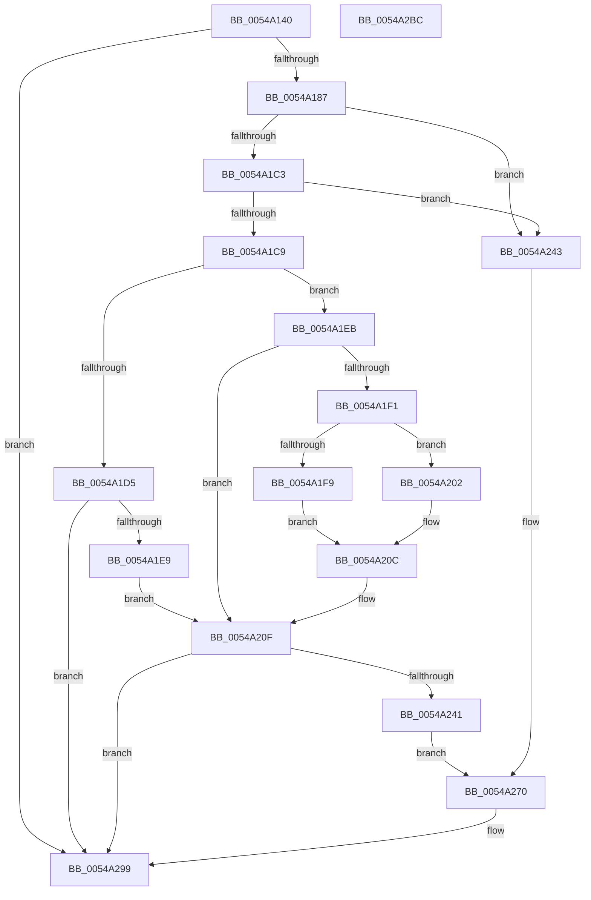

# HalpTimerUnmapInterrupt

- RVA: `0x0054A140`–`0x0054A2BD` (길이 `381` bytes)
- VA: `0x000000014054A140`
- 실행 섹션: `.text`
- PDB 이름 있음: `예`; PDB Function 태그: `아니요`
- unwind 정보 RVA: `0x000C3E58`
- 디코드: `100`개 명령, `381/381` bytes 표시
- 미해석 바이트: `0` (있으면 어셈블리에 `.byte`로 보존)

> 이 문서는 커널 이미지의 기계어와 PDB 기호를 분석해 생성했습니다. 4번과 5번은 함수 원형과 자료형을 바이너리 사용 방식에서 추정한 C 해석이며 원본 소스 복구 결과는 아닙니다.

## 1. Dependencies

- 직접 호출 지점: **6**; 고유 호출 대상: **6**
- 직접 호출자로 확인된 함수: **3**
- RIP 상대 이미지 참조: **1**

### Outgoing calls
- `0x0054A19A` → [memset](../6C/memset_function_006C6C40.md) (function, `0x006C6C40`)
- `0x0054A1DC` → [HalpInterruptGsiToLine](../2D/HalpInterruptGsiToLine_function_002D2DD0.md) (function, `0x002D2DD0`)
- `0x0054A22B` → [HalpInterruptApplyOverrides](../2D/HalpInterruptApplyOverrides_function_002D2CE0.md) (function, `0x002D2CE0`)
- `0x0054A238` → [HalpInterruptLineToGsi](../4A/HalpInterruptLineToGsi_function_004A94F8.md) (function, `0x004A94F8`)
- `0x0054A294` → [HalpInterruptUnmap](../../page/70/HalpInterruptUnmap_function_00707408.md) (function, `0x00707408`)
- `0x0054A2A0` → [_security_check_cookie](../6A/_security_check_cookie_function_006AC640.md) (function, `0x006AC640`)

### Direct callers
- [HalpTimerInitializeClock](HalpTimerInitializeClock_function_00548424.md) at `0x005485C3`
- [HalpTimerConfigureInterrupt](HalpTimerConfigureInterrupt_function_00548AB0.md) at `0x00548CC8`
- [HalpTimerTestHypervisorTimer](HalpTimerTestHypervisorTimer_function_0054BBC0.md) at `0x0054BD4D`
- [HalpTimerTestHypervisorTimer](HalpTimerTestHypervisorTimer_function_0054BBC0.md) at `0x0054BD85`

### Static image references
- `0x0054A158` → RVA `0x00E0A740` (`.data`; read)

## 2. Other-region calls and transfers

- 다른 실행 섹션으로 향하는 call: **1**
  - `0x0054A294` → [HalpInterruptUnmap](../../page/70/HalpInterruptUnmap_function_00707408.md) (`.text` → `PAGE`)
- 별도 외부 분기/꼬리 이동을 확인하지 못했습니다.

## 3. Assembly (complete function range)

```asm
0054A140  48 89 5C 24 20                  mov qword ptr [rsp + 0x20], rbx
0054A145  55                              push rbp
0054A146  56                              push rsi
0054A147  57                              push rdi
0054A148  41 56                           push r14
0054A14A  41 57                           push r15
0054A14C  48 8D 6C 24 C9                  lea rbp, [rsp - 0x37]
0054A151  48 81 EC B0 00 00 00            sub rsp, 0xb0
0054A158  48 8B 05 E1 05 8C 00            mov rax, qword ptr [rip + 0x8c05e1]
0054A15F  48 33 C4                        xor rax, rsp
0054A162  48 89 45 27                     mov qword ptr [rbp + 0x27], rax
0054A166  48 83 65 B7 00                  and qword ptr [rbp - 0x49], 0
0054A16B  45 8A F1                        mov r14b, r9b
0054A16E  8B B9 B8 00 00 00               mov edi, dword ptr [rcx + 0xb8]
0054A174  41 8B F0                        mov esi, r8d
0054A177  44 8B FA                        mov r15d, edx
0054A17A  48 8B D9                        mov rbx, rcx
0054A17D  40 F6 C7 40                     test dil, 0x40
0054A181  0F 84 12 01 00 00               je 0x14054a299
0054A187  33 D2                           xor edx, edx
0054A189  83 E7 BF                        and edi, 0xffffffbf
0054A18C  89 B9 B8 00 00 00               mov dword ptr [rcx + 0xb8], edi
0054A192  48 8D 4D C7                     lea rcx, [rbp - 0x39]
0054A196  44 8D 42 58                     lea r8d, [rdx + 0x58]
0054A19A  E8 A1 CA 17 00                  call 0x1406c6c40
0054A19F  8B 45 EF                        mov eax, dword ptr [rbp - 0x11]
0054A1A2  81 E6 FF FF FF 3F               and esi, 0x3fffffff
0054A1A8  25 00 00 00 C0                  and eax, 0xc0000000
0054A1AD  44 89 7D CB                     mov dword ptr [rbp - 0x35], r15d
0054A1B1  0B F0                           or esi, eax
0054A1B3  0F BA EE 1E                     bts esi, 0x1e
0054A1B7  89 75 EF                        mov dword ptr [rbp - 0x11], esi
0054A1BA  45 84 F6                        test r14b, r14b
0054A1BD  0F 85 80 00 00 00               jne 0x14054a243
0054A1C3  40 F6 C7 10                     test dil, 0x10
0054A1C7  75 7A                           jne 0x14054a243
0054A1C9  8B 83 E0 00 00 00               mov eax, dword ptr [rbx + 0xe0]
0054A1CF  0F BA E0 09                     bt eax, 9
0054A1D3  73 16                           jae 0x14054a1eb
0054A1D5  8B 4B 58                        mov ecx, dword ptr [rbx + 0x58]
0054A1D8  48 8D 55 B7                     lea rdx, [rbp - 0x49]
0054A1DC  E8 EF 8B D8 FF                  call 0x1402d2dd0
0054A1E1  85 C0                           test eax, eax
0054A1E3  0F 88 B0 00 00 00               js 0x14054a299
0054A1E9  EB 24                           jmp 0x14054a20f
0054A1EB  0F BA E0 08                     bt eax, 8
0054A1EF  73 1E                           jae 0x14054a20f
0054A1F1  8B 43 54                        mov eax, dword ptr [rbx + 0x54]
0054A1F4  83 F8 08                        cmp eax, 8
0054A1F7  73 09                           jae 0x14054a202
0054A1F9  C7 45 B7 00 B0 00 00            mov dword ptr [rbp - 0x49], 0xb000
0054A200  EB 0A                           jmp 0x14054a20c
0054A202  C7 45 B7 01 B0 00 00            mov dword ptr [rbp - 0x49], 0xb001
0054A209  83 C0 F8                        add eax, -8
0054A20C  89 45 BB                        mov dword ptr [rbp - 0x45], eax
0054A20F  8B 43 60                        mov eax, dword ptr [rbx + 0x60]
0054A212  4C 8D 45 D7                     lea r8, [rbp - 0x29]
0054A216  83 65 C7 00                     and dword ptr [rbp - 0x39], 0
0054A21A  48 8D 55 D3                     lea rdx, [rbp - 0x2d]
0054A21E  89 45 D7                        mov dword ptr [rbp - 0x29], eax
0054A221  48 8D 4D B7                     lea rcx, [rbp - 0x49]
0054A225  8B 43 5C                        mov eax, dword ptr [rbx + 0x5c]
0054A228  89 45 D3                        mov dword ptr [rbp - 0x2d], eax
0054A22B  E8 B0 8A D8 FF                  call 0x1402d2ce0
0054A230  48 8D 55 FF                     lea rdx, [rbp - 1]
0054A234  48 8D 4D B7                     lea rcx, [rbp - 0x49]
0054A238  E8 BB F2 F5 FF                  call 0x1404a94f8
0054A23D  85 C0                           test eax, eax
0054A23F  78 58                           js 0x14054a299
0054A241  EB 2D                           jmp 0x14054a270
0054A243  8B 83 EC 00 00 00               mov eax, dword ptr [rbx + 0xec]
0054A249  83 65 D3 00                     and dword ptr [rbp - 0x2d], 0
0054A24D  89 45 F3                        mov dword ptr [rbp - 0xd], eax
0054A250  8B 83 E8 00 00 00               mov eax, dword ptr [rbx + 0xe8]
0054A256  89 45 F7                        mov dword ptr [rbp - 9], eax
0054A259  8B 83 F0 00 00 00               mov eax, dword ptr [rbx + 0xf0]
0054A25F  89 45 FB                        mov dword ptr [rbp - 5], eax
0054A262  C7 45 C7 03 00 00 00            mov dword ptr [rbp - 0x39], 3
0054A269  C7 45 D7 01 00 00 00            mov dword ptr [rbp - 0x29], 1
0054A270  48 8B 8B 20 01 00 00            mov rcx, qword ptr [rbx + 0x120]
0054A277  48 8D 45 C7                     lea rax, [rbp - 0x39]
0054A27B  C7 44 24 28 01 00 00 00         mov dword ptr [rsp + 0x28], 1
0054A283  45 33 C9                        xor r9d, r9d
0054A286  48 89 44 24 20                  mov qword ptr [rsp + 0x20], rax
0054A28B  8B 51 04                        mov edx, dword ptr [rcx + 4]
0054A28E  4C 8D 41 08                     lea r8, [rcx + 8]
0054A292  8B 09                           mov ecx, dword ptr [rcx]
0054A294  E8 6F D1 1B 00                  call 0x140707408
0054A299  48 8B 4D 27                     mov rcx, qword ptr [rbp + 0x27]
0054A29D  48 33 CC                        xor rcx, rsp
0054A2A0  E8 9B 23 16 00                  call 0x1406ac640
0054A2A5  48 8B 9C 24 F8 00 00 00         mov rbx, qword ptr [rsp + 0xf8]
0054A2AD  48 81 C4 B0 00 00 00            add rsp, 0xb0
0054A2B4  41 5F                           pop r15
0054A2B6  41 5E                           pop r14
0054A2B8  5F                              pop rdi
0054A2B9  5E                              pop rsi
0054A2BA  5D                              pop rbp
0054A2BB  C3                              ret
0054A2BC  CC                              int3
```

## 4. C-style interpretation (structured pseudocode)

```c
__int64 __fastcall HalpTimerUnmapInterrupt(__int64 a1, int a2, int a3, int a4)
{
    __int64 result;
    __int64 v_rdi;
    __int64 v_rsi;
    __int64 v_rsp;
    unsigned __int64 v_stack_m38;
    unsigned __int64 v_stack_m5F;
    unsigned __int64 v_stack_m60;
    unsigned int v_stack_m64;
    unsigned int v_stack_m68;
    unsigned int v_stack_m6C;
    unsigned int v_stack_m70;
    unsigned __int64 v_stack_m88;
    unsigned __int64 v_stack_m8C;
    unsigned int v_stack_m94;
    unsigned __int64 v_stack_m98;
    unsigned int v_stack_mA4;
    unsigned __int64 v_stack_mA8;
    unsigned int v_stack_mB0;
    unsigned __int64 v_stack_mB8;
    unsigned __int64 v_stack_p20;

    v_stack_p20 = v_rbx;
    v_rsp = (v_rsp) - (176);
    result = (*(unsigned __int64 *)(v_rip + 9176545)) ^ (v_rsp);
    v_stack_m38 = result;
    if ((((unsigned __int8)((unsigned int)(*(unsigned int *)(a1 + 184)))) & (64)) == 0) goto loc_0054A299;
    a2 = 0;
    v_rdi = (unsigned int)(((unsigned int)(*(unsigned int *)(a1 + 184))) & (0xFFFFFFBFULL));
    *(unsigned int *)(a1 + 184) = (unsigned int)(v_rdi);
    result = memset(v_stack_m98, a2, a2 + 88, a4);
    v_rsi = (unsigned int)(((unsigned int)(a3)) & (0x3FFFFFFFULL));
    result = (unsigned int)(((unsigned int)(v_stack_m70)) & (0xC0000000ULL));
    v_stack_m94 = (unsigned int)((unsigned int)(a2));
    v_rsi = (unsigned int)((v_rsi) | ((unsigned int)(result)));
    v_stack_m70 = (unsigned int)(v_rsi);
    if ((unsigned __int8)((unsigned __int8)(a4)) != 0) goto loc_0054A243;
    if ((((unsigned __int8)(v_rdi)) & (16)) != 0) goto loc_0054A243;
    if (condition_is_above_or_equal) goto loc_0054A1EB;
    result = HalpInterruptGsiToLine((unsigned int)(*(unsigned int *)(a1 + 88)), v_stack_mA8, a2 + 88, a4);
    if (sign_flag) goto loc_0054A299;
    goto loc_0054A20F;
loc_0054A1EB:
    if (condition_is_above_or_equal) goto loc_0054A20F;
    if (((unsigned int)((unsigned int)(*(unsigned int *)(a1 + 84)))) >= 8) goto loc_0054A202;
    v_stack_mA8 = 0xB000ULL;
    goto loc_0054A20C;
loc_0054A202:
    v_stack_mA8 = 0xB001ULL;
    result = (unsigned int)(((unsigned int)(*(unsigned int *)(a1 + 84))) + (-8));
loc_0054A20C:
    v_stack_mA4 = (unsigned int)(result);
loc_0054A20F:
    v_stack_m88 = (unsigned int)((unsigned int)(*(unsigned int *)(a1 + 96)));
    v_stack_m8C = (unsigned int)((unsigned int)(*(unsigned int *)(a1 + 92)));
    result = HalpInterruptApplyOverrides(v_stack_mA8, v_stack_m8C, v_stack_m88, a4);
    result = HalpInterruptLineToGsi(v_stack_mA8, v_stack_m60, v_stack_m88, a4);
    if (sign_flag) goto loc_0054A299;
    goto loc_0054A270;
loc_0054A243:
    v_stack_m6C = (unsigned int)((unsigned int)(*(unsigned int *)(a1 + 236)));
    v_stack_m68 = (unsigned int)((unsigned int)(*(unsigned int *)(a1 + 232)));
    v_stack_m64 = (unsigned int)((unsigned int)(*(unsigned int *)(a1 + 240)));
    v_stack_m98 = 3;
    v_stack_m88 = 1;
loc_0054A270:
    v_stack_mB0 = 1;
    a4 = 0;
    v_stack_mB8 = v_stack_m98;
    result = HalpInterruptUnmap((unsigned int)(*(unsigned int *)(*(unsigned __int64 *)(a1 + 288))), (unsigned int)(*(unsigned int *)(*(unsigned __int64 *)(a1 + 288) + 4)), *(unsigned __int64 *)(a1 + 288) + 8, a4);
loc_0054A299:
    a1 = (v_stack_m38) ^ (v_rsp);
    result = _security_check_cookie(a1, (unsigned int)(*(unsigned int *)(*(unsigned __int64 *)(a1 + 288) + 4)), *(unsigned __int64 *)(a1 + 288) + 8, a4);
    v_rsp = (v_rsp) + (176);
    return result;
}
```

## 5. (Beta) C Style

```c
int64_t HalpTimerUnmapInterrupt(void *Arg1, int32_t Arg2, int32_t Arg3, int32_t Arg4)
{
    uint8_t *arg1 = (uint8_t *)Arg1;

    int64_t result;
    int64_t local_rdi;
    int64_t local_rsi;
    int64_t local_rsp;
    uint64_t v_stack_m38;
    uint64_t v_stack_m5F;
    uint64_t v_stack_m60;
    uint32_t v_stack_m64;
    uint32_t v_stack_m68;
    uint32_t v_stack_m6C;
    uint32_t v_stack_m70;
    uint64_t v_stack_m88;
    uint64_t v_stack_m8C;
    uint32_t v_stack_m94;
    uint64_t v_stack_m98;
    uint32_t v_stack_mA4;
    uint64_t v_stack_mA8;
    uint32_t v_stack_mB0;
    uint64_t v_stack_mB8;
    uint64_t v_stack_p20;

    v_stack_p20 = local_rbx;
    local_rsp = (local_rsp) - (176);
    result = (*(uint64_t *)(v_rip + 0x8C05E1)) ^ (local_rsp);
    v_stack_m38 = result;
    if ((((uint8_t)((uint32_t)(*(uint32_t *)(arg1 + 0xB8)))) & (64)) == 0) goto loc_0054A299;
    Arg2 = 0;
    local_rdi = (uint32_t)(((uint32_t)(*(uint32_t *)(arg1 + 0xB8))) & (0xFFFFFFBFULL));
    *(uint32_t *)(arg1 + 0xB8) = (uint32_t)(local_rdi);
    result = memset(v_stack_m98, Arg2, Arg2 + 88, Arg4);
    local_rsi = (uint32_t)(((uint32_t)(Arg3)) & (0x3FFFFFFFULL));
    result = (uint32_t)(((uint32_t)(v_stack_m70)) & (0xC0000000ULL));
    v_stack_m94 = (uint32_t)((uint32_t)(Arg2));
    local_rsi = (uint32_t)((local_rsi) | ((uint32_t)(result)));
    v_stack_m70 = (uint32_t)(local_rsi);
    if ((uint8_t)((uint8_t)(Arg4)) != 0) goto loc_0054A243;
    if ((((uint8_t)(local_rdi)) & (16)) != 0) goto loc_0054A243;
    if (condition_is_above_or_equal) goto loc_0054A1EB;
    result = HalpInterruptGsiToLine((uint32_t)(*(uint32_t *)(arg1 + 0x58)), v_stack_mA8, Arg2 + 88, Arg4);
    if (sign_flag) goto loc_0054A299;
    goto loc_0054A20F;
loc_0054A1EB:
    if (condition_is_above_or_equal) goto loc_0054A20F;
    if (((uint32_t)((uint32_t)(*(uint32_t *)(arg1 + 0x54)))) >= 8) goto loc_0054A202;
    v_stack_mA8 = 0xB000ULL;
    goto loc_0054A20C;
loc_0054A202:
    v_stack_mA8 = 0xB001ULL;
    result = (uint32_t)(((uint32_t)(*(uint32_t *)(arg1 + 0x54))) + (-8));
loc_0054A20C:
    v_stack_mA4 = (uint32_t)(result);
loc_0054A20F:
    v_stack_m88 = (uint32_t)((uint32_t)(*(uint32_t *)(arg1 + 0x60)));
    v_stack_m8C = (uint32_t)((uint32_t)(*(uint32_t *)(arg1 + 0x5C)));
    result = HalpInterruptApplyOverrides(v_stack_mA8, v_stack_m8C, v_stack_m88, Arg4);
    result = HalpInterruptLineToGsi(v_stack_mA8, v_stack_m60, v_stack_m88, Arg4);
    if (sign_flag) goto loc_0054A299;
    goto loc_0054A270;
loc_0054A243:
    v_stack_m6C = (uint32_t)((uint32_t)(*(uint32_t *)(arg1 + 0xEC)));
    v_stack_m68 = (uint32_t)((uint32_t)(*(uint32_t *)(arg1 + 0xE8)));
    v_stack_m64 = (uint32_t)((uint32_t)(*(uint32_t *)(arg1 + 0xF0)));
    v_stack_m98 = 3;
    v_stack_m88 = 1;
loc_0054A270:
    v_stack_mB0 = 1;
    Arg4 = 0;
    v_stack_mB8 = v_stack_m98;
    result = HalpInterruptUnmap((uint32_t)(*(uint32_t *)(*(uint64_t *)(arg1 + 0x120))), (uint32_t)(*(uint32_t *)(*(uint64_t *)(arg1 + 0x120) + 0x4)), *(uint64_t *)(arg1 + 0x120) + 8, Arg4);
loc_0054A299:
    Arg1 = (v_stack_m38) ^ (local_rsp);
    result = _security_check_cookie(Arg1, (uint32_t)(*(uint32_t *)(*(uint64_t *)(arg1 + 0x120) + 0x4)), *(uint64_t *)(arg1 + 0x120) + 8, Arg4);
    local_rsp = (local_rsp) + (176);
    return result;
}
```

### 관측된 메모리 오프셋

구조체 형식이 확인되지 않은 접근은 인자 기준의 오프셋으로만 기록했습니다.

| 기준 인자 | 오프셋 표현 | 폭 (bit) | 접근 |
|---|---:|---:|---|
| `Arg1` | `+ 0x54` | `32` | `R` |
| `Arg1` | `+ 0x58` | `32` | `R` |
| `Arg1` | `+ 0x5C` | `32` | `R` |
| `Arg1` | `+ 0x60` | `32` | `R` |
| `Arg1` | `+ 0xB8` | `32` | `R` |
| `Arg1` | `+ 0xB8` | `32` | `W` |
| `Arg1` | `+ 0xE0` | `32` | `R` |
| `Arg1` | `+ 0xE8` | `32` | `R` |
| `Arg1` | `+ 0xEC` | `32` | `R` |
| `Arg1` | `+ 0xF0` | `32` | `R` |
| `Arg1` | `+ 0x120` | `64` | `R` |

## 6. Execution-region graph

[열기: 2D/3D 그래프와 함수 탐색 컨트롤 패널](../../../control-panel.html?section=text&rva=0x0054A140&view=graph)

- 2D 그래프는 위에서 아래로 흐르고, 3D 그래프는 빈 공간을 드래그해 회전합니다. Shift+드래그는 이동, 휠은 확대·축소, 함수 노드 선택은 대상 보고서 이동입니다.

### Static fallback


