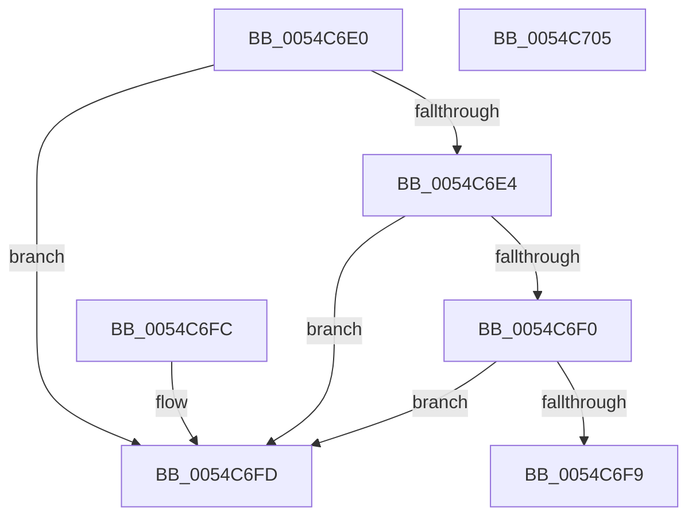

# HalpTimerWatchdogQueryDueTime

- RVA: `0x0054C6E0`–`0x0054C706` (길이 `38` bytes)
- VA: `0x000000014054C6E0`
- 실행 섹션: `.text`
- PDB 이름 있음: `예`; PDB Function 태그: `아니요`
- unwind 정보 RVA: `0x000DB714`
- 디코드: `13`개 명령, `38/38` bytes 표시
- 미해석 바이트: `0` (있으면 어셈블리에 `.byte`로 보존)

> 이 문서는 커널 이미지의 기계어와 PDB 기호를 분석해 생성했습니다. 4번과 5번은 함수 원형과 자료형을 바이너리 사용 방식에서 추정한 C 해석이며 원본 소스 복구 결과는 아닙니다.

## 1. Dependencies

- 직접 호출 지점: **0**; 고유 호출 대상: **0**
- 직접 호출자로 확인된 함수: **0**
- RIP 상대 이미지 참조: **2**

### Outgoing calls
- 직접 디코드된 call 명령이 없습니다.

### Direct callers
- 이 함수 시작 RVA로 연결되는 직접 call은 확인되지 않았습니다. 간접 호출은 완전히 역산할 수 없습니다.

### Static image references
- `0x0054C6E4` → RVA `0x00FC4028` (`.data`; read)
- `0x0054C6FD` → RVA `0x00FC2190` (`.data`; read)

## 2. Other-region calls and transfers

- 다른 실행 섹션으로 향하는 call: **0**
- 별도 외부 분기/꼬리 이동을 확인하지 못했습니다.

## 3. Assembly (complete function range)

```asm
0054C6E0  84 C9                           test cl, cl
0054C6E2  74 19                           je 0x14054c6fd
0054C6E4  48 8B 05 3D 79 A7 00            mov rax, qword ptr [rip + 0xa7793d]
0054C6EB  48 85 C0                        test rax, rax
0054C6EE  74 0D                           je 0x14054c6fd
0054C6F0  83 B8 E4 00 00 00 08            cmp dword ptr [rax + 0xe4], 8
0054C6F7  75 04                           jne 0x14054c6fd
0054C6F9  33 C0                           xor eax, eax
0054C6FB  C3                              ret
0054C6FC  CC                              int3
0054C6FD  48 8B 05 8C 5A A7 00            mov rax, qword ptr [rip + 0xa75a8c]
0054C704  C3                              ret
0054C705  CC                              int3
```

## 4. C-style interpretation (structured pseudocode)

```c
__int64 __fastcall HalpTimerWatchdogQueryDueTime(unsigned __int8 a1)
{
    __int64 result;

    if (a1 == 0) goto loc_0054C6FD;
    if (*(unsigned __int64 *)(v_rip + 10975549) == 0) goto loc_0054C6FD;
    if ((*(unsigned int *)(*(unsigned __int64 *)(v_rip + 10975549) + 228)) != 8) goto loc_0054C6FD;
    result = 0;
    return result;
loc_0054C6FD:
    return *(unsigned __int64 *)(v_rip + 10967692);
}
```

## 5. (Beta) C Style

```c
int64_t HalpTimerWatchdogQueryDueTime(uint8_t Arg1)
{
    int64_t result;

    if (Arg1 == 0) goto loc_0054C6FD;
    if (*(uint64_t *)(v_rip + 0xA7793D) == 0) goto loc_0054C6FD;
    if ((*(uint32_t *)(*(uint64_t *)(v_rip + 0xA7793D) + 0xE4)) != 8) goto loc_0054C6FD;
    result = 0;
    return result;
loc_0054C6FD:
    return *(uint64_t *)(v_rip + 0xA75A8C);
}
```

## 6. Execution-region graph

[열기: 2D/3D 그래프와 함수 탐색 컨트롤 패널](../../../control-panel.html?section=text&rva=0x0054C6E0&view=graph)

- 2D 그래프는 위에서 아래로 흐르고, 3D 그래프는 빈 공간을 드래그해 회전합니다. Shift+드래그는 이동, 휠은 확대·축소, 함수 노드 선택은 대상 보고서 이동입니다.

### Static fallback


