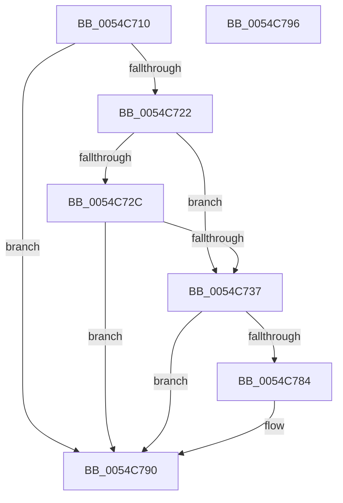

# HalpTimerWatchdogStart

- RVA: `0x0054C710`–`0x0054C797` (길이 `135` bytes)
- VA: `0x000000014054C710`
- 실행 섹션: `.text`
- PDB 이름 있음: `예`; PDB Function 태그: `아니요`
- unwind 정보 RVA: `0x00064C80`
- 디코드: `34`개 명령, `135/135` bytes 표시
- 미해석 바이트: `0` (있으면 어셈블리에 `.byte`로 보존)

> 이 문서는 커널 이미지의 기계어와 PDB 기호를 분석해 생성했습니다. 4번과 5번은 함수 원형과 자료형을 바이너리 사용 방식에서 추정한 C 해석이며 원본 소스 복구 결과는 아닙니다.

## 1. Dependencies

- 직접 호출 지점: **4**; 고유 호출 대상: **4**
- 직접 호출자로 확인된 함수: **1**
- RIP 상대 이미지 참조: **6**

### Outgoing calls
- `0x0054C73A` → [HalpTimerGetInternalData](../20/HalpTimerGetInternalData_function_00209500.md) (function, `0x00209500`)
- `0x0054C746` → [guard_dispatch_icall](../6B/guard_dispatch_icall_function_006BAAD0.md) (function, `0x006BAAD0`)
- `0x0054C77B` → [HalpSetTimer](../42/HalpSetTimer_function_0042BD30.md) (function, `0x0042BD30`)
- `0x0054C78B` → [HalpTimerWatchdogWakeSetDueTime](../4C/HalpTimerWatchdogWakeSetDueTime_function_004CFDF4.md) (function, `0x004CFDF4`)

### Direct callers
- [HalpTimerInitializeSystemWatchdog](HalpTimerInitializeSystemWatchdog_function_0054C58C.md) at `0x0054C6B7`

### Static image references
- `0x0054C716` → RVA `0x00FC4028` (`.data`; read)
- `0x0054C722` → RVA `0x00FC2180` (`.data`; read)
- `0x0054C72F` → RVA `0x00FC2180` (`.data`; write)
- `0x0054C763` → RVA `0x00FC2168` (`.data`; read)
- `0x0054C76A` → RVA `0x00FC2188` (`.data`; write)
- `0x0054C784` → RVA `0x00FC2184` (`.data`; write)

## 2. Other-region calls and transfers

- 다른 실행 섹션으로 향하는 call: **0**
- 별도 외부 분기/꼬리 이동을 확인하지 못했습니다.

## 3. Assembly (complete function range)

```asm
0054C710  40 53                           push rbx
0054C712  48 83 EC 30                     sub rsp, 0x30
0054C716  48 8B 1D 0B 79 A7 00            mov rbx, qword ptr [rip + 0xa7790b]
0054C71D  48 85 DB                        test rbx, rbx
0054C720  74 6E                           je 0x14054c790
0054C722  8B 05 58 5A A7 00               mov eax, dword ptr [rip + 0xa75a58]
0054C728  85 C0                           test eax, eax
0054C72A  78 0B                           js 0x14054c737
0054C72C  83 E8 01                        sub eax, 1
0054C72F  89 05 4B 5A A7 00               mov dword ptr [rip + 0xa75a4b], eax
0054C735  79 59                           jns 0x14054c790
0054C737  48 8B CB                        mov rcx, rbx
0054C73A  E8 C1 CD CB FF                  call 0x140209500
0054C73F  48 8B C8                        mov rcx, rax
0054C742  48 8B 43 68                     mov rax, qword ptr [rbx + 0x68]
0054C746  E8 85 E3 16 00                  call 0x1406baad0
0054C74B  48 B8 08 00 00 00 80 F7 FF FF   movabs rax, 0xfffff78000000008
0054C755  41 B1 01                        mov r9b, 1
0054C758  BA 03 00 00 00                  mov edx, 3
0054C75D  48 8B CB                        mov rcx, rbx
0054C760  48 8B 00                        mov rax, qword ptr [rax]
0054C763  4C 8B 05 FE 59 A7 00            mov r8, qword ptr [rip + 0xa759fe]
0054C76A  48 89 05 17 5A A7 00            mov qword ptr [rip + 0xa75a17], rax
0054C771  48 8D 44 24 40                  lea rax, [rsp + 0x40]
0054C776  48 89 44 24 20                  mov qword ptr [rsp + 0x20], rax
0054C77B  E8 B0 F5 ED FF                  call 0x14042bd30
0054C780  85 C0                           test eax, eax
0054C782  78 0C                           js 0x14054c790
0054C784  C6 05 F9 59 A7 00 01            mov byte ptr [rip + 0xa759f9], 1
0054C78B  E8 64 36 F8 FF                  call 0x1404cfdf4
0054C790  48 83 C4 30                     add rsp, 0x30
0054C794  5B                              pop rbx
0054C795  C3                              ret
0054C796  CC                              int3
```

## 4. C-style interpretation (structured pseudocode)

```c
__int64 __fastcall HalpTimerWatchdogStart(void)
{
    __int64 result;
    __int64 v_rsp;
    unsigned __int64 v_stack_m18;
    unsigned __int64 v_stack_p8;

    v_rsp = (v_rsp) - (48);
    if (*(unsigned __int64 *)(v_rip + 10975499) == 0) goto loc_0054C790;
    if (sign_flag) goto loc_0054C737;
    result = (unsigned int)(((unsigned int)(*(unsigned int *)(v_rip + 10967640))) - (1));
    *(unsigned int *)(v_rip + 10967627) = (unsigned int)(result);
    if (!sign_flag) goto loc_0054C790;
loc_0054C737:
    result = HalpTimerGetInternalData(*(unsigned __int64 *)(v_rip + 10975499), a2, a3, a4);
    result = guard_dispatch_icall(result, a2, a3, a4);
    *(unsigned __int64 *)(v_rip + 10967575) = *(unsigned __int64 *)(result);
    v_stack_m18 = v_stack_p8;
    result = HalpSetTimer(*(unsigned __int64 *)(v_rip + 10975499), 3, *(unsigned __int64 *)(v_rip + 10967550), 1);
    if (!(sign_flag)) {
        *(unsigned __int8 *)(v_rip + 10967545) = 1;
        result = HalpTimerWatchdogWakeSetDueTime(*(unsigned __int64 *)(v_rip + 10975499), 3, *(unsigned __int64 *)(v_rip + 10967550), 1);
    }
    v_rsp = (v_rsp) + (48);
    return result;
}
```

## 5. (Beta) C Style

```c
void HalpTimerWatchdogStart(void)
{
    int64_t result;
    int64_t local_rsp;
    uint64_t v_stack_m18;
    uint64_t v_stack_p8;

    local_rsp = (local_rsp) - (48);
    if (*(uint64_t *)(v_rip + 0xA7790B) == 0) goto loc_0054C790;
    if (sign_flag) goto loc_0054C737;
    result = (uint32_t)(((uint32_t)(*(uint32_t *)(v_rip + 0xA75A58))) - (1));
    *(uint32_t *)(v_rip + 0xA75A4B) = (uint32_t)(result);
    if (!sign_flag) goto loc_0054C790;
loc_0054C737:
    result = HalpTimerGetInternalData(*(uint64_t *)(v_rip + 0xA7790B), a2, a3, a4);
    result = guard_dispatch_icall(result, a2, a3, a4);
    *(uint64_t *)(v_rip + 0xA75A17) = *(uint64_t *)(result);
    v_stack_m18 = v_stack_p8;
    result = HalpSetTimer(*(uint64_t *)(v_rip + 0xA7790B), 3, *(uint64_t *)(v_rip + 0xA759FE), 1);
    if (!(sign_flag)) {
        *(uint8_t *)(v_rip + 0xA759F9) = 1;
        result = HalpTimerWatchdogWakeSetDueTime(*(uint64_t *)(v_rip + 0xA7790B), 3, *(uint64_t *)(v_rip + 0xA759FE), 1);
    }
    local_rsp = (local_rsp) + (48);
    return result;
}
```

## 6. Execution-region graph

[열기: 2D/3D 그래프와 함수 탐색 컨트롤 패널](../../../control-panel.html?section=text&rva=0x0054C710&view=graph)

- 2D 그래프는 위에서 아래로 흐르고, 3D 그래프는 빈 공간을 드래그해 회전합니다. Shift+드래그는 이동, 휠은 확대·축소, 함수 노드 선택은 대상 보고서 이동입니다.

### Static fallback


