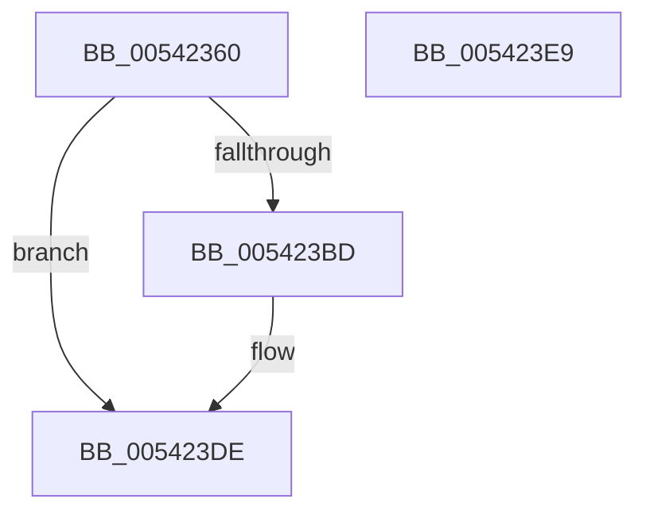

# HalpTranslateToLegacyMcaException

- RVA: `0x00542360`–`0x005423EA` (길이 `138` bytes)
- VA: `0x0000000140542360`
- 실행 섹션: `.text`
- PDB 이름 있음: `예`; PDB Function 태그: `아니요`
- unwind 정보 RVA: `0x0005CAAC`
- 디코드: `39`개 명령, `138/138` bytes 표시
- 미해석 바이트: `0` (있으면 어셈블리에 `.byte`로 보존)

> 이 문서는 커널 이미지의 기계어와 PDB 기호를 분석해 생성했습니다. 4번과 5번은 함수 원형과 자료형을 바이너리 사용 방식에서 추정한 C 해석이며 원본 소스 복구 결과는 아닙니다.

## 1. Dependencies

- 직접 호출 지점: **2**; 고유 호출 대상: **2**
- 직접 호출자로 확인된 함수: **1**
- RIP 상대 이미지 참조: **0**

### Outgoing calls
- `0x0054237C` → [memset](../6C/memset_function_006C6C40.md) (function, `0x006C6C40`)
- `0x005423D9` → [memcpy](../6C/memcpy_function_006C6840.md) (function, `0x006C6840`)

### Direct callers
- [HalpMcaReportError](HalpMcaReportError_function_00541D04.md) at `0x00541DDE`

### Static image references
- 디코드된 RIP-relative 메모리 참조가 없습니다.

## 2. Other-region calls and transfers

- 다른 실행 섹션으로 향하는 call: **0**
- 별도 외부 분기/꼬리 이동을 확인하지 못했습니다.

## 3. Assembly (complete function range)

```asm
00542360  48 89 5C 24 08                  mov qword ptr [rsp + 8], rbx
00542365  57                              push rdi
00542366  48 83 EC 20                     sub rsp, 0x20
0054236A  48 8B F9                        mov rdi, rcx
0054236D  48 8B DA                        mov rbx, rdx
00542370  48 8D 4A 08                     lea rcx, [rdx + 8]
00542374  41 B8 F8 00 00 00               mov r8d, 0xf8
0054237A  33 D2                           xor edx, edx
0054237C  E8 BF 48 18 00                  call 0x1406c6c40
00542381  B8 01 00 00 00                  mov eax, 1
00542386  89 03                           mov dword ptr [rbx], eax
00542388  89 43 04                        mov dword ptr [rbx + 4], eax
0054238B  48 8B 47 08                     mov rax, qword ptr [rdi + 8]
0054238F  48 89 43 08                     mov qword ptr [rbx + 8], rax
00542393  8B 47 10                        mov eax, dword ptr [rdi + 0x10]
00542396  89 43 10                        mov dword ptr [rbx + 0x10], eax
00542399  8A 47 24                        mov al, byte ptr [rdi + 0x24]
0054239C  88 43 18                        mov byte ptr [rbx + 0x18], al
0054239F  48 8B 47 28                     mov rax, qword ptr [rdi + 0x28]
005423A3  48 89 43 20                     mov qword ptr [rbx + 0x20], rax
005423A7  48 8B 47 30                     mov rax, qword ptr [rdi + 0x30]
005423AB  48 89 43 28                     mov qword ptr [rbx + 0x28], rax
005423AF  48 8B 47 38                     mov rax, qword ptr [rdi + 0x38]
005423B3  48 89 43 30                     mov qword ptr [rbx + 0x30], rax
005423B7  83 7F 40 00                     cmp dword ptr [rdi + 0x40], 0
005423BB  74 21                           je 0x1405423de
005423BD  C7 03 02 00 00 00               mov dword ptr [rbx], 2
005423C3  48 8D 57 48                     lea rdx, [rdi + 0x48]
005423C7  8B 47 40                        mov eax, dword ptr [rdi + 0x40]
005423CA  48 8D 4B 40                     lea rcx, [rbx + 0x40]
005423CE  89 43 38                        mov dword ptr [rbx + 0x38], eax
005423D1  44 8B 47 40                     mov r8d, dword ptr [rdi + 0x40]
005423D5  49 C1 E0 03                     shl r8, 3
005423D9  E8 62 44 18 00                  call 0x1406c6840
005423DE  48 8B 5C 24 30                  mov rbx, qword ptr [rsp + 0x30]
005423E3  48 83 C4 20                     add rsp, 0x20
005423E7  5F                              pop rdi
005423E8  C3                              ret
005423E9  CC                              int3
```

## 4. C-style interpretation (structured pseudocode)

```c
__int64 __fastcall HalpTranslateToLegacyMcaException(__int64 a1, __int64 a2)
{
    __int64 result;
    __int64 v_rsp;
    unsigned __int64 v_stack_p8;

    v_stack_p8 = v_rbx;
    v_rsp = (v_rsp) - (32);
    a2 = 0;
    result = memset(a2 + 8, a2, 248, a4);
    *(unsigned int *)(a2) = 1;
    *(unsigned int *)(a2 + 4) = 1;
    *(unsigned __int64 *)(a2 + 8) = *(unsigned __int64 *)(a1 + 8);
    *(unsigned int *)(a2 + 16) = (unsigned int)((unsigned int)(*(unsigned int *)(a1 + 16)));
    *(unsigned __int8 *)(a2 + 24) = (unsigned __int8)(*(unsigned __int8 *)(a1 + 36));
    *(unsigned __int64 *)(a2 + 32) = *(unsigned __int64 *)(a1 + 40);
    *(unsigned __int64 *)(a2 + 40) = *(unsigned __int64 *)(a1 + 48);
    *(unsigned __int64 *)(a2 + 48) = *(unsigned __int64 *)(a1 + 56);
    result = *(unsigned __int64 *)(a1 + 56);
    if ((*(unsigned int *)(a1 + 64)) != 0) {
        *(unsigned int *)(a2) = 2;
        a2 = a1 + 72;
        result = *(unsigned int *)(a1 + 64);
        a1 = a2 + 64;
        *(unsigned int *)(a2 + 56) = (unsigned int)(result);
        a3 = *(unsigned int *)(a1 + 64);
        a3 = (a3) << (3);
        result = memcpy(a1, a2, a3, a4);
    }
    v_rsp = (v_rsp) + (32);
    return result;
}
```

## 5. (Beta) C Style

```c
int64_t HalpTranslateToLegacyMcaException(void *Arg1, void *Arg2)
{
    uint8_t *arg1 = (uint8_t *)Arg1;
    uint8_t *arg2 = (uint8_t *)Arg2;

    int64_t result;
    int64_t local_rsp;
    uint64_t v_stack_p8;

    v_stack_p8 = local_rbx;
    local_rsp = (local_rsp) - (32);
    Arg2 = 0;
    result = memset(Arg2 + 8, Arg2, 248, a4);
    *(uint32_t *)(arg2) = 1;
    *(uint32_t *)(arg2 + 0x4) = 1;
    *(uint64_t *)(arg2 + 0x8) = *(uint64_t *)(arg1 + 0x8);
    *(uint32_t *)(arg2 + 0x10) = (uint32_t)((uint32_t)(*(uint32_t *)(arg1 + 0x10)));
    *(uint8_t *)(arg2 + 0x18) = (uint8_t)(*(uint8_t *)(arg1 + 0x24));
    *(uint64_t *)(arg2 + 0x20) = *(uint64_t *)(arg1 + 0x28);
    *(uint64_t *)(arg2 + 0x28) = *(uint64_t *)(arg1 + 0x30);
    *(uint64_t *)(arg2 + 0x30) = *(uint64_t *)(arg1 + 0x38);
    result = *(uint64_t *)(arg1 + 0x38);
    if ((*(uint32_t *)(arg1 + 0x40)) != 0) {
        *(uint32_t *)(arg2) = 2;
        Arg2 = Arg1 + 72;
        result = *(uint32_t *)(arg1 + 0x40);
        Arg1 = Arg2 + 64;
        *(uint32_t *)(arg2 + 0x38) = (uint32_t)(result);
        a3 = *(uint32_t *)(arg1 + 0x40);
        a3 = (a3) << (3);
        result = memcpy(Arg1, Arg2, a3, a4);
    }
    local_rsp = (local_rsp) + (32);
    return result;
}
```

### 관측된 메모리 오프셋

구조체 형식이 확인되지 않은 접근은 인자 기준의 오프셋으로만 기록했습니다.

| 기준 인자 | 오프셋 표현 | 폭 (bit) | 접근 |
|---|---:|---:|---|
| `Arg1` | `+ 0x8` | `64` | `R` |
| `Arg1` | `+ 0x10` | `32` | `R` |
| `Arg1` | `+ 0x24` | `8` | `R` |
| `Arg1` | `+ 0x28` | `64` | `R` |
| `Arg1` | `+ 0x30` | `64` | `R` |
| `Arg1` | `+ 0x38` | `64` | `R` |
| `Arg1` | `+ 0x40` | `32` | `R` |
| `Arg1` | `+ 0x48` | `64` | `R` |
| `Arg2` | `+ 0x0` | `32` | `W` |
| `Arg2` | `+ 0x4` | `32` | `W` |
| `Arg2` | `+ 0x8` | `64` | `R` |
| `Arg2` | `+ 0x8` | `64` | `W` |
| `Arg2` | `+ 0x10` | `32` | `W` |
| `Arg2` | `+ 0x18` | `8` | `W` |
| `Arg2` | `+ 0x20` | `64` | `W` |
| `Arg2` | `+ 0x28` | `64` | `W` |
| `Arg2` | `+ 0x30` | `64` | `W` |
| `Arg2` | `+ 0x38` | `32` | `W` |
| `Arg2` | `+ 0x40` | `64` | `R` |

## 6. Execution-region graph

[열기: 2D/3D 그래프와 함수 탐색 컨트롤 패널](../../../control-panel.html?section=text&rva=0x00542360&view=graph)

- 2D 그래프는 위에서 아래로 흐르고, 3D 그래프는 빈 공간을 드래그해 회전합니다. Shift+드래그는 이동, 휠은 확대·축소, 함수 노드 선택은 대상 보고서 이동입니다.

### Static fallback


