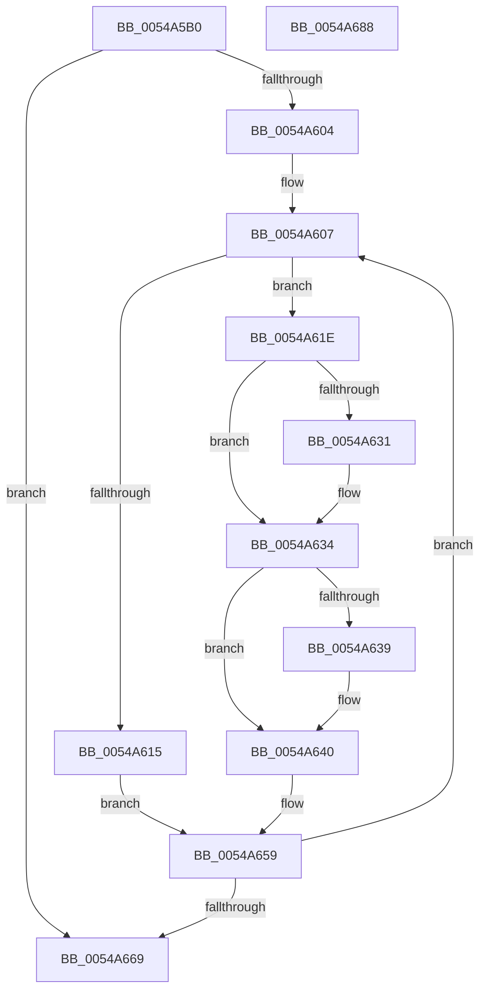

# HalpTscAdvSynchCalculateRemoteDeltas

- RVA: `0x0054A5B0`–`0x0054A689` (길이 `217` bytes)
- VA: `0x000000014054A5B0`
- 실행 섹션: `.text`
- PDB 이름 있음: `예`; PDB Function 태그: `아니요`
- unwind 정보 RVA: `0x000C3F04`
- 디코드: `61`개 명령, `217/217` bytes 표시
- 미해석 바이트: `0` (있으면 어셈블리에 `.byte`로 보존)

> 이 문서는 커널 이미지의 기계어와 PDB 기호를 분석해 생성했습니다. 4번과 5번은 함수 원형과 자료형을 바이너리 사용 방식에서 추정한 C 해석이며 원본 소스 복구 결과는 아닙니다.

## 1. Dependencies

- 직접 호출 지점: **2**; 고유 호출 대상: **2**
- 직접 호출자로 확인된 함수: **1**
- RIP 상대 이미지 참조: **2**

### Outgoing calls
- `0x0054A624` → [HalpTscAdvSynchCalculateRemoteDelta](../49/HalpTscAdvSynchCalculateRemoteDelta_function_004946E4.md) (function, `0x004946E4`)
- `0x0054A654` → [HalpTscTraceProcessorDelta](HalpTscTraceProcessorDelta_function_0054B184.md) (function, `0x0054B184`)

### Direct callers
- [HalpTscAdvSynchLeader](HalpTscAdvSynchLeader_function_0054A690.md) at `0x0054A71E`
- [HalpTscAdvSynchLeader](HalpTscAdvSynchLeader_function_0054A690.md) at `0x0054A7AF`

### Static image references
- `0x0054A5E9` → RVA `0x00FC2218` (`.data`; read)
- `0x0054A5F4` → RVA `0x00FC21F0` (`.data`; read)

## 2. Other-region calls and transfers

- 다른 실행 섹션으로 향하는 call: **0**
- 별도 외부 분기/꼬리 이동을 확인하지 못했습니다.

## 3. Assembly (complete function range)

```asm
0054A5B0  48 8B C4                        mov rax, rsp
0054A5B3  48 89 58 08                     mov qword ptr [rax + 8], rbx
0054A5B7  48 89 70 10                     mov qword ptr [rax + 0x10], rsi
0054A5BB  48 89 78 18                     mov qword ptr [rax + 0x18], rdi
0054A5BF  4C 89 60 20                     mov qword ptr [rax + 0x20], r12
0054A5C3  41 55                           push r13
0054A5C5  41 56                           push r14
0054A5C7  41 57                           push r15
0054A5C9  48 83 EC 20                     sub rsp, 0x20
0054A5CD  65 48 8B 04 25 20 00 00 00      mov rax, qword ptr gs:[0x20]
0054A5D6  33 DB                           xor ebx, ebx
0054A5D8  48 83 21 00                     and qword ptr [rcx], 0
0054A5DC  4D 8B E8                        mov r13, r8
0054A5DF  48 83 22 00                     and qword ptr [rdx], 0
0054A5E3  4C 8B F2                        mov r14, rdx
0054A5E6  4C 8B F9                        mov r15, rcx
0054A5E9  48 8B 35 28 7C A7 00            mov rsi, qword ptr [rip + 0xa77c28]
0054A5F0  44 8B 48 24                     mov r9d, dword ptr [rax + 0x24]
0054A5F4  4C 8B 25 F5 7B A7 00            mov r12, qword ptr [rip + 0xa77bf5]
0054A5FB  45 89 08                        mov dword ptr [r8], r9d
0054A5FE  39 5C 24 68                     cmp dword ptr [rsp + 0x68], ebx
0054A602  76 65                           jbe 0x14054a669
0054A604  49 8B FC                        mov rdi, r12
0054A607  65 48 8B 04 25 20 00 00 00      mov rax, qword ptr gs:[0x20]
0054A610  3B 58 24                        cmp ebx, dword ptr [rax + 0x24]
0054A613  75 09                           jne 0x14054a61e
0054A615  48 83 26 00                     and qword ptr [rsi], 0
0054A619  83 27 00                        and dword ptr [rdi], 0
0054A61C  EB 3B                           jmp 0x14054a659
0054A61E  49 8D 14 9C                     lea rdx, [r12 + rbx*4]
0054A622  8B CB                           mov ecx, ebx
0054A624  E8 BB A0 F4 FF                  call 0x1404946e4
0054A629  48 89 06                        mov qword ptr [rsi], rax
0054A62C  49 3B 07                        cmp rax, qword ptr [r15]
0054A62F  7D 03                           jge 0x14054a634
0054A631  49 89 07                        mov qword ptr [r15], rax
0054A634  49 3B 06                        cmp rax, qword ptr [r14]
0054A637  7E 07                           jle 0x14054a640
0054A639  49 89 06                        mov qword ptr [r14], rax
0054A63C  41 89 5D 00                     mov dword ptr [r13], ebx
0054A640  65 48 8B 0C 25 20 00 00 00      mov rcx, qword ptr gs:[0x20]
0054A649  4C 8B C0                        mov r8, rax
0054A64C  44 8B 0F                        mov r9d, dword ptr [rdi]
0054A64F  8B D3                           mov edx, ebx
0054A651  8B 49 24                        mov ecx, dword ptr [rcx + 0x24]
0054A654  E8 2B 0B 00 00                  call 0x14054b184
0054A659  FF C3                           inc ebx
0054A65B  48 83 C6 08                     add rsi, 8
0054A65F  48 83 C7 04                     add rdi, 4
0054A663  3B 5C 24 68                     cmp ebx, dword ptr [rsp + 0x68]
0054A667  72 9E                           jb 0x14054a607
0054A669  48 8B 5C 24 40                  mov rbx, qword ptr [rsp + 0x40]
0054A66E  48 8B 74 24 48                  mov rsi, qword ptr [rsp + 0x48]
0054A673  48 8B 7C 24 50                  mov rdi, qword ptr [rsp + 0x50]
0054A678  4C 8B 64 24 58                  mov r12, qword ptr [rsp + 0x58]
0054A67D  48 83 C4 20                     add rsp, 0x20
0054A681  41 5F                           pop r15
0054A683  41 5E                           pop r14
0054A685  41 5D                           pop r13
0054A687  C3                              ret
0054A688  CC                              int3
```

## 4. C-style interpretation (structured pseudocode)

```c
__int64 __fastcall HalpTscAdvSynchCalculateRemoteDeltas(__int64 a1, __int64 a2, __int64 a3, __int64 a4, __int64 a5, unsigned int a6)
{
    __int64 result;
    __int64 v_rbx;
    __int64 v_rdi;
    __int64 v_rsi;
    __int64 v_rsp;
    unsigned __int64 v_stack_p10;
    unsigned __int64 v_stack_p18;
    unsigned __int64 v_stack_p20;
    unsigned __int64 v_stack_p8;

    *(unsigned __int64 *)(v_rsp + 8) = v_rbx;
    *(unsigned __int64 *)(v_rsp + 16) = v_rsi;
    *(unsigned __int64 *)(v_rsp + 24) = v_rdi;
    *(unsigned __int64 *)(v_rsp + 32) = v_r12;
    v_rsp = (v_rsp) - (32);
    v_rbx = 0;
    *(unsigned int *)(a3) = (unsigned int)((unsigned int)(*(unsigned int *)(*(unsigned __int64 *)(gs_base + (0 + 32)) + 36)));
    if (a6 <= 0) goto loc_0054A669;
loc_0054A607:
    if (0 != (*(unsigned int *)(*(unsigned __int64 *)(gs_base + (0 + 32)) + 36))) goto loc_0054A61E;
    goto loc_0054A659;
loc_0054A61E:
    result = HalpTscAdvSynchCalculateRemoteDelta(0, *(unsigned __int64 *)(v_rip + 10976245) + v_rbx * 4, a3, (unsigned int)(*(unsigned int *)(*(unsigned __int64 *)(gs_base + (0 + 32)) + 36)));
    *(unsigned __int64 *)(*(unsigned __int64 *)(v_rip + 10976296)) = result;
    if (result < (*(unsigned __int64 *)(a1))) {
        *(unsigned __int64 *)(a1) = result;
    }
    if (result >= = (*(unsigned __int64 *)(a2))) {
        *(unsigned __int64 *)(a2) = result;
        *(unsigned int *)(a3) = 0;
    }
    result = HalpTscTraceProcessorDelta((unsigned int)(*(unsigned int *)(*(unsigned __int64 *)(gs_base + (0 + 32)) + 36)), 0, result, (unsigned int)(*(unsigned int *)(*(unsigned __int64 *)(v_rip + 10976245))));
loc_0054A659:
    v_rbx = (unsigned int)((v_rbx) + 1);
    v_rsi = (*(unsigned __int64 *)(v_rip + 10976296)) + (8);
    v_rdi = (*(unsigned __int64 *)(v_rip + 10976245)) + (4);
    if (((unsigned int)(v_rbx)) < a6) goto loc_0054A607;
loc_0054A669:
    v_rsp = (v_rsp) + (32);
    return result;
}
```

## 5. (Beta) C Style

```c
int64_t HalpTscAdvSynchCalculateRemoteDeltas(void *Arg1, void *Arg2, void *Arg3, int64_t Arg4, uint64_t Arg5, uint32_t Arg6)
{
    uint8_t *arg1 = (uint8_t *)Arg1;
    uint8_t *arg2 = (uint8_t *)Arg2;
    uint8_t *arg3 = (uint8_t *)Arg3;

    int64_t result;
    int64_t local_rbx;
    int64_t local_rdi;
    int64_t local_rsi;
    int64_t local_rsp;
    uint64_t v_stack_p10;
    uint64_t v_stack_p18;
    uint64_t v_stack_p20;
    uint64_t v_stack_p8;

    *(uint64_t *)(local_rsp + 0x8) = local_rbx;
    *(uint64_t *)(local_rsp + 0x10) = local_rsi;
    *(uint64_t *)(local_rsp + 0x18) = local_rdi;
    *(uint64_t *)(local_rsp + 0x20) = local_r12;
    local_rsp = (local_rsp) - (32);
    local_rbx = 0;
    *(uint32_t *)(arg3) = (uint32_t)((uint32_t)(*(uint32_t *)(*(uint64_t *)(gs_base + (0 + 0x20)) + 0x24)));
    if (Arg6 <= 0) goto loc_0054A669;
loc_0054A607:
    if (0 != (*(uint32_t *)(*(uint64_t *)(gs_base + (0 + 0x20)) + 0x24))) goto loc_0054A61E;
    goto loc_0054A659;
loc_0054A61E:
    result = HalpTscAdvSynchCalculateRemoteDelta(0, *(uint64_t *)(v_rip + 0xA77BF5) + local_rbx * 4, Arg3, (uint32_t)(*(uint32_t *)(*(uint64_t *)(gs_base + (0 + 0x20)) + 0x24)));
    *(uint64_t *)(*(uint64_t *)(v_rip + 0xA77C28)) = result;
    if (result < (*(uint64_t *)(arg1))) {
        *(uint64_t *)(arg1) = result;
    }
    if (result >= = (*(uint64_t *)(arg2))) {
        *(uint64_t *)(arg2) = result;
        *(uint32_t *)(arg3) = 0;
    }
    result = HalpTscTraceProcessorDelta((uint32_t)(*(uint32_t *)(*(uint64_t *)(gs_base + (0 + 0x20)) + 0x24)), 0, result, (uint32_t)(*(uint32_t *)(*(uint64_t *)(v_rip + 0xA77BF5))));
loc_0054A659:
    local_rbx = (uint32_t)((local_rbx) + 1);
    local_rsi = (*(uint64_t *)(v_rip + 0xA77C28)) + (8);
    local_rdi = (*(uint64_t *)(v_rip + 0xA77BF5)) + (4);
    if (((uint32_t)(local_rbx)) < Arg6) goto loc_0054A607;
loc_0054A669:
    local_rsp = (local_rsp) + (32);
    return result;
}
```

### 관측된 메모리 오프셋

구조체 형식이 확인되지 않은 접근은 인자 기준의 오프셋으로만 기록했습니다.

| 기준 인자 | 오프셋 표현 | 폭 (bit) | 접근 |
|---|---:|---:|---|
| `Arg1` | `+ 0x0` | `64` | `R` |
| `Arg1` | `+ 0x0` | `64` | `R/W` |
| `Arg1` | `+ 0x0` | `64` | `W` |
| `Arg2` | `+ 0x0` | `64` | `R` |
| `Arg2` | `+ 0x0` | `64` | `R/W` |
| `Arg2` | `+ 0x0` | `64` | `W` |
| `Arg3` | `+ 0x0` | `32` | `W` |

## 6. Execution-region graph

[열기: 2D/3D 그래프와 함수 탐색 컨트롤 패널](../../../control-panel.html?section=text&rva=0x0054A5B0&view=graph)

- 2D 그래프는 위에서 아래로 흐르고, 3D 그래프는 빈 공간을 드래그해 회전합니다. Shift+드래그는 이동, 휠은 확대·축소, 함수 노드 선택은 대상 보고서 이동입니다.

### Static fallback


