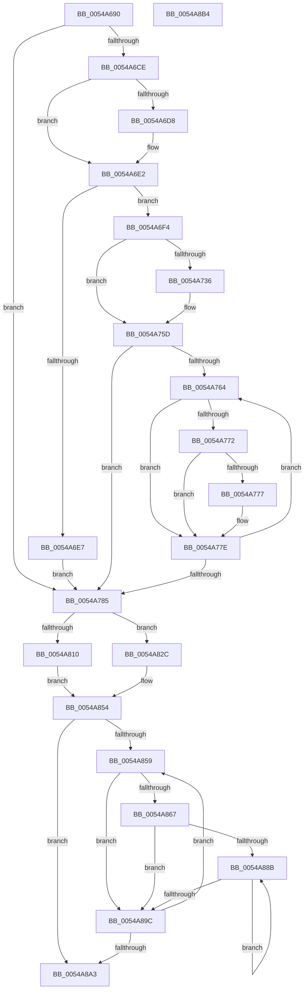

# HalpTscAdvSynchLeader

- RVA: `0x0054A690`–`0x0054A8B5` (길이 `549` bytes)
- VA: `0x000000014054A690`
- 실행 섹션: `.text`
- PDB 이름 있음: `예`; PDB Function 태그: `아니요`
- unwind 정보 RVA: `0x000C3EEC`
- 디코드: `142`개 명령, `549/549` bytes 표시
- 미해석 바이트: `0` (있으면 어셈블리에 `.byte`로 보존)

> 이 문서는 커널 이미지의 기계어와 PDB 기호를 분석해 생성했습니다. 4번과 5번은 함수 원형과 자료형을 바이너리 사용 방식에서 추정한 C 해석이며 원본 소스 복구 결과는 아닙니다.

## 1. Dependencies

- 직접 호출 지점: **12**; 고유 호출 대상: **7**
- 직접 호출자로 확인된 함수: **1**
- RIP 상대 이미지 참조: **8**

### Outgoing calls
- `0x0054A6B6` → [HalpTscAdvSynchReadTimeStamp](HalpTscAdvSynchReadTimeStamp_function_0054A8BC.md) (function, `0x0054A8BC`)
- `0x0054A6EA` → [HalpTscAdvSynchToLeader](../49/HalpTscAdvSynchToLeader_function_00494494.md) (function, `0x00494494`)
- `0x0054A71E` → [HalpTscAdvSynchCalculateRemoteDeltas](HalpTscAdvSynchCalculateRemoteDeltas_function_0054A5B0.md) (function, `0x0054A5B0`)
- `0x0054A739` → [HalpTscAdvSynchReadTimeStamp](HalpTscAdvSynchReadTimeStamp_function_0054A8BC.md) (function, `0x0054A8BC`)
- `0x0054A74A` → [HalpTscAdvSynchReadTimeStamp](HalpTscAdvSynchReadTimeStamp_function_0054A8BC.md) (function, `0x0054A8BC`)
- `0x0054A758` → [HalpTscAdvSynchToTarget](HalpTscAdvSynchToTarget_function_0054A978.md) (function, `0x0054A978`)
- `0x0054A779` → [HalpTscAdvSynchToLeader](../49/HalpTscAdvSynchToLeader_function_00494494.md) (function, `0x00494494`)
- `0x0054A7AF` → [HalpTscAdvSynchCalculateRemoteDeltas](HalpTscAdvSynchCalculateRemoteDeltas_function_0054A5B0.md) (function, `0x0054A5B0`)
- `0x0054A7B7` → [HalpTscAdvSynchReadTimeStamp](HalpTscAdvSynchReadTimeStamp_function_0054A8BC.md) (function, `0x0054A8BC`)
- `0x0054A7EE` → [HalpFindTimer](HalpFindTimer_function_005488D0.md) (function, `0x005488D0`)
- `0x0054A825` → [HalpTscTraceStatus](HalpTscTraceStatus_function_0054B368.md) (function, `0x0054B368`)
- `0x0054A848` → [HalpTscTraceSynchronizationSummary](HalpTscTraceSynchronizationSummary_function_0054B404.md) (function, `0x0054B404`)

### Direct callers
- [HalpTscSynchronizationWorker](HalpTscSynchronizationWorker_function_0054B090.md) at `0x0054B149`

### Static image references
- `0x0054A6BB` → RVA `0x00E0A800` (`.data`; read)
- `0x0054A6CE` → RVA `0x00E0A7FC` (`.data`; read)
- `0x0054A6D8` → RVA `0x00E0A7FC` (`.data`; write)
- `0x0054A7FE` → RVA `0x00FC2210` (`.data`; read)
- `0x0054A804` → RVA `0x00FC2228` (`.data`; write)
- `0x0054A817` → RVA `0x00021710` (`.rdata`; read)
- `0x0054A81E` → RVA `0x00FC2200` (`.data`; write)
- `0x0054A867` → RVA `0x00FC2238` (`.data`; read)

## 2. Other-region calls and transfers

- 다른 실행 섹션으로 향하는 call: **0**
- 별도 외부 분기/꼬리 이동을 확인하지 못했습니다.

## 3. Assembly (complete function range)

```asm
0054A690  48 89 5C 24 20                  mov qword ptr [rsp + 0x20], rbx
0054A695  55                              push rbp
0054A696  56                              push rsi
0054A697  57                              push rdi
0054A698  41 56                           push r14
0054A69A  41 57                           push r15
0054A69C  48 8B EC                        mov rbp, rsp
0054A69F  48 83 EC 30                     sub rsp, 0x30
0054A6A3  65 48 8B 04 25 20 00 00 00      mov rax, qword ptr gs:[0x20]
0054A6AC  48 8B F9                        mov rdi, rcx
0054A6AF  44 8B 78 24                     mov r15d, dword ptr [rax + 0x24]
0054A6B3  41 8B CF                        mov ecx, r15d
0054A6B6  E8 01 02 00 00                  call 0x14054a8bc
0054A6BB  8A 15 3F 01 8C 00               mov dl, byte ptr [rip + 0x8c013f]
0054A6C1  33 DB                           xor ebx, ebx
0054A6C3  4C 8B F0                        mov r14, rax
0054A6C6  84 D2                           test dl, dl
0054A6C8  0F 84 B7 00 00 00               je 0x14054a785
0054A6CE  8B 15 28 01 8C 00               mov edx, dword ptr [rip + 0x8c0128]
0054A6D4  85 D2                           test edx, edx
0054A6D6  75 0A                           jne 0x14054a6e2
0054A6D8  C7 05 1A 01 8C 00 F4 01 00 00   mov dword ptr [rip + 0x8c011a], 0x1f4
0054A6E2  38 5F 22                        cmp byte ptr [rdi + 0x22], bl
0054A6E5  74 0D                           je 0x14054a6f4
0054A6E7  8B 4F 24                        mov ecx, dword ptr [rdi + 0x24]
0054A6EA  E8 A5 9D F4 FF                  call 0x140494494
0054A6EF  E9 91 00 00 00                  jmp 0x14054a785
0054A6F4  65 48 8B 04 25 20 00 00 00      mov rax, qword ptr gs:[0x20]
0054A6FD  4C 8D 45 30                     lea r8, [rbp + 0x30]
0054A701  48 8D 4D 38                     lea rcx, [rbp + 0x38]
0054A705  48 89 5D 38                     mov qword ptr [rbp + 0x38], rbx
0054A709  48 89 5D 40                     mov qword ptr [rbp + 0x40], rbx
0054A70D  8B 50 24                        mov edx, dword ptr [rax + 0x24]
0054A710  8B 47 28                        mov eax, dword ptr [rdi + 0x28]
0054A713  89 55 30                        mov dword ptr [rbp + 0x30], edx
0054A716  48 8D 55 40                     lea rdx, [rbp + 0x40]
0054A71A  89 44 24 28                     mov dword ptr [rsp + 0x28], eax
0054A71E  E8 8D FE FF FF                  call 0x14054a5b0
0054A723  65 48 8B 04 25 20 00 00 00      mov rax, qword ptr gs:[0x20]
0054A72C  44 8B 55 30                     mov r10d, dword ptr [rbp + 0x30]
0054A730  44 3B 50 24                     cmp r10d, dword ptr [rax + 0x24]
0054A734  74 27                           je 0x14054a75d
0054A736  41 8B CF                        mov ecx, r15d
0054A739  E8 7E 01 00 00                  call 0x14054a8bc
0054A73E  4C 8B C8                        mov r9, rax
0054A741  41 8B CA                        mov ecx, r10d
0054A744  4D 2B CE                        sub r9, r14
0054A747  45 8B FA                        mov r15d, r10d
0054A74A  E8 6D 01 00 00                  call 0x14054a8bc
0054A74F  4C 8B F0                        mov r14, rax
0054A752  41 8B CA                        mov ecx, r10d
0054A755  4D 2B F1                        sub r14, r9
0054A758  E8 1B 02 00 00                  call 0x14054a978
0054A75D  8B F3                           mov esi, ebx
0054A75F  39 5F 28                        cmp dword ptr [rdi + 0x28], ebx
0054A762  76 21                           jbe 0x14054a785
0054A764  65 48 8B 04 25 20 00 00 00      mov rax, qword ptr gs:[0x20]
0054A76D  3B 70 24                        cmp esi, dword ptr [rax + 0x24]
0054A770  74 0C                           je 0x14054a77e
0054A772  3B 75 30                        cmp esi, dword ptr [rbp + 0x30]
0054A775  74 07                           je 0x14054a77e
0054A777  8B CE                           mov ecx, esi
0054A779  E8 16 9D F4 FF                  call 0x140494494
0054A77E  FF C6                           inc esi
0054A780  3B 77 28                        cmp esi, dword ptr [rdi + 0x28]
0054A783  72 DF                           jb 0x14054a764
0054A785  65 48 8B 04 25 20 00 00 00      mov rax, qword ptr gs:[0x20]
0054A78E  4C 8D 45 30                     lea r8, [rbp + 0x30]
0054A792  48 8D 55 40                     lea rdx, [rbp + 0x40]
0054A796  48 89 5D 38                     mov qword ptr [rbp + 0x38], rbx
0054A79A  48 89 5D 40                     mov qword ptr [rbp + 0x40], rbx
0054A79E  8B 48 24                        mov ecx, dword ptr [rax + 0x24]
0054A7A1  8B 47 28                        mov eax, dword ptr [rdi + 0x28]
0054A7A4  89 4D 30                        mov dword ptr [rbp + 0x30], ecx
0054A7A7  48 8D 4D 38                     lea rcx, [rbp + 0x38]
0054A7AB  89 44 24 28                     mov dword ptr [rsp + 0x28], eax
0054A7AF  E8 FC FD FF FF                  call 0x14054a5b0
0054A7B4  41 8B CF                        mov ecx, r15d
0054A7B7  E8 00 01 00 00                  call 0x14054a8bc
0054A7BC  65 48 8B 0C 25 18 00 00 00      mov rcx, qword ptr gs:[0x18]
0054A7C5  49 2B C6                        sub rax, r14
0054A7C8  33 D2                           xor edx, edx
0054A7CA  C7 44 24 20 01 00 00 00         mov dword ptr [rsp + 0x20], 1
0054A7D2  48 69 C0 40 42 0F 00            imul rax, rax, 0xf4240
0054A7D9  45 33 C9                        xor r9d, r9d
0054A7DC  45 33 C0                        xor r8d, r8d
0054A7DF  48 F7 B1 C0 00 00 00            div qword ptr [rcx + 0xc0]
0054A7E6  33 D2                           xor edx, edx
0054A7E8  4C 8B F0                        mov r14, rax
0054A7EB  8D 4A 05                        lea ecx, [rdx + 5]
0054A7EE  E8 DD E0 FF FF                  call 0x1405488d0
0054A7F3  48 8B 55 40                     mov rdx, qword ptr [rbp + 0x40]
0054A7F7  48 8B F0                        mov rsi, rax
0054A7FA  48 2B 55 38                     sub rdx, qword ptr [rbp + 0x38]
0054A7FE  8B 0D 0C 7A A7 00               mov ecx, dword ptr [rip + 0xa77a0c]
0054A804  48 89 15 1D 7A A7 00            mov qword ptr [rip + 0xa77a1d], rdx
0054A80B  48 3B D1                        cmp rdx, rcx
0054A80E  76 1C                           jbe 0x14054a82c
0054A810  83 A0 B8 00 00 00 DF            and dword ptr [rax + 0xb8], 0xffffffdf
0054A817  48 8D 0D F2 6E AD FF            lea rcx, [rip - 0x52910e]
0054A81E  C6 05 DB 79 A7 00 01            mov byte ptr [rip + 0xa779db], 1
0054A825  E8 3E 0B 00 00                  call 0x14054b368
0054A82A  EB 28                           jmp 0x14054a854
0054A82C  65 48 8B 0C 25 20 00 00 00      mov rcx, qword ptr gs:[0x20]
0054A835  44 8B 4D 38                     mov r9d, dword ptr [rbp + 0x38]
0054A839  44 8B 45 40                     mov r8d, dword ptr [rbp + 0x40]
0054A83D  8B 55 30                        mov edx, dword ptr [rbp + 0x30]
0054A840  8B 49 24                        mov ecx, dword ptr [rcx + 0x24]
0054A843  44 89 74 24 20                  mov dword ptr [rsp + 0x20], r14d
0054A848  E8 B7 0B 00 00                  call 0x14054b404
0054A84D  83 8E B8 00 00 00 20            or dword ptr [rsi + 0xb8], 0x20
0054A854  39 5F 28                        cmp dword ptr [rdi + 0x28], ebx
0054A857  76 4A                           jbe 0x14054a8a3
0054A859  65 48 8B 04 25 20 00 00 00      mov rax, qword ptr gs:[0x20]
0054A862  3B 58 24                        cmp ebx, dword ptr [rax + 0x24]
0054A865  74 35                           je 0x14054a89c
0054A867  48 8B 0D CA 79 A7 00            mov rcx, qword ptr [rip + 0xa779ca]
0054A86E  B8 07 00 00 00                  mov eax, 7
0054A873  8B D3                           mov edx, ebx
0054A875  48 C1 E2 07                     shl rdx, 7
0054A879  87 04 0A                        xchg dword ptr [rdx + rcx], eax
0054A87C  48 8B 0D B5 79 A7 00            mov rcx, qword ptr [rip + 0xa779b5]
0054A883  8B 04 0A                        mov eax, dword ptr [rdx + rcx]
0054A886  83 F8 07                        cmp eax, 7
0054A889  75 11                           jne 0x14054a89c
0054A88B  F3 90                           pause
0054A88D  48 8B 05 A4 79 A7 00            mov rax, qword ptr [rip + 0xa779a4]
0054A894  8B 0C 02                        mov ecx, dword ptr [rdx + rax]
0054A897  83 F9 07                        cmp ecx, 7
0054A89A  74 EF                           je 0x14054a88b
0054A89C  FF C3                           inc ebx
0054A89E  3B 5F 28                        cmp ebx, dword ptr [rdi + 0x28]
0054A8A1  72 B6                           jb 0x14054a859
0054A8A3  48 8B 5C 24 78                  mov rbx, qword ptr [rsp + 0x78]
0054A8A8  48 83 C4 30                     add rsp, 0x30
0054A8AC  41 5F                           pop r15
0054A8AE  41 5E                           pop r14
0054A8B0  5F                              pop rdi
0054A8B1  5E                              pop rsi
0054A8B2  5D                              pop rbp
0054A8B3  C3                              ret
0054A8B4  CC                              int3
```

## 4. C-style interpretation (structured pseudocode)

```c
__int64 __fastcall HalpTscAdvSynchLeader(__int64 a1)
{
    __int64 result;
    __int64 v_r14;
    __int64 v_r15;
    __int64 v_rbx;
    __int64 v_rsi;
    __int64 v_rsp;
    unsigned int v_stack_m30;
    unsigned int v_stack_m38;
    unsigned __int64 v_stack_p10;
    unsigned __int64 v_stack_p18;
    unsigned __int64 v_stack_p20;
    unsigned __int64 v_stack_p8;

    v_stack_p20 = v_rbx;
    v_rsp = (v_rsp) - (48);
    result = HalpTscAdvSynchReadTimeStamp((unsigned int)((unsigned int)((unsigned int)(*(unsigned int *)(*(unsigned __int64 *)(gs_base + (0 + 32)) + 36)))), a2, a3, a4);
    v_rbx = 0;
    if ((unsigned __int8)(*(unsigned __int8 *)(v_rip + 9175359)) == 0) goto loc_0054A785;
    if ((unsigned int)((unsigned int)(*(unsigned int *)(v_rip + 9175336))) == 0) {
        *(unsigned int *)(v_rip + 9175322) = 500;
    }
    if ((*(unsigned __int8 *)(a1 + 34)) == 0) goto loc_0054A6F4;
    result = HalpTscAdvSynchToLeader((unsigned int)(*(unsigned int *)(a1 + 36)), (unsigned int)(*(unsigned int *)(v_rip + 9175336)), a3, a4);
    goto loc_0054A785;
loc_0054A6F4:
    v_stack_p10 = 0;
    v_stack_p18 = 0;
    v_stack_p8 = (unsigned int)((unsigned int)(*(unsigned int *)(*(unsigned __int64 *)(gs_base + (0 + 32)) + 36)));
    v_stack_m30 = (unsigned int)((unsigned int)(*(unsigned int *)(a1 + 40)));
    result = HalpTscAdvSynchCalculateRemoteDeltas(v_stack_p10, v_stack_p18, v_stack_p8, a4);
    result = *(unsigned __int64 *)(gs_base + (0 + 32));
    v_r14 = result;
    v_r15 = (unsigned int)(*(unsigned int *)(*(unsigned __int64 *)(gs_base + (0 + 32)) + 36));
    if (((unsigned int)((unsigned int)(v_stack_p8))) != (*(unsigned int *)(*(unsigned __int64 *)(gs_base + (0 + 32)) + 36))) {
        a1 = (unsigned int)((unsigned int)(*(unsigned int *)(*(unsigned __int64 *)(gs_base + (0 + 32)) + 36)));
        result = HalpTscAdvSynchReadTimeStamp(a1, v_stack_p18, v_stack_p8, a4);
        a4 = result;
        a1 = (unsigned int)((unsigned int)(v_stack_p8));
        a4 = (a4) - (result);
        v_r15 = (unsigned int)((unsigned int)(v_stack_p8));
        result = HalpTscAdvSynchReadTimeStamp(a1, v_stack_p18, v_stack_p8, a4);
        v_r14 = result;
        a1 = (unsigned int)((unsigned int)(v_stack_p8));
        v_r14 = (v_r14) - (a4);
        result = HalpTscAdvSynchToTarget(a1, v_stack_p18, v_stack_p8, a4);
    }
    if ((*(unsigned int *)(a1 + 40)) <= 0) goto loc_0054A785;
loc_0054A764:
    if (0 == (*(unsigned int *)(*(unsigned __int64 *)(gs_base + (0 + 32)) + 36))) goto loc_0054A77E;
    result = *(unsigned __int64 *)(gs_base + (0 + 32));
    if (0 != v_stack_p8) {
        a1 = 0;
        result = HalpTscAdvSynchToLeader(a1, v_stack_p18, v_stack_p8, a4);
    }
    v_rsi = (unsigned int)((0) + 1);
    if (((unsigned int)(v_rsi)) < (*(unsigned int *)(a1 + 40))) goto loc_0054A764;
loc_0054A785:
    v_stack_p10 = 0;
    v_stack_p18 = 0;
    v_stack_p8 = (unsigned int)((unsigned int)(*(unsigned int *)(*(unsigned __int64 *)(gs_base + (0 + 32)) + 36)));
    v_stack_m30 = (unsigned int)((unsigned int)(*(unsigned int *)(a1 + 40)));
    result = HalpTscAdvSynchCalculateRemoteDeltas(v_stack_p10, v_stack_p18, v_stack_p8, a4);
    result = HalpTscAdvSynchReadTimeStamp((unsigned int)((unsigned int)(v_r15)), v_stack_p18, v_stack_p8, a4);
    result = (result) - (v_r14);
    a2 = 0;
    v_stack_m38 = 1;
    result = (result) * (result);
    a4 = 0;
    a3 = 0;
    a2 = 0;
    result = HalpFindTimer(a2 + 5, a2, a3, a4);
    a2 = (v_stack_p18) - (v_stack_p10);
    *(unsigned __int64 *)(v_rip + 10975773) = a2;
    if (a2 <= ((unsigned int)(*(unsigned int *)(v_rip + 10975756)))) goto loc_0054A82C;
    *(unsigned __int8 *)(v_rip + 10975707) = 1;
    result = HalpTscTraceStatus(v_rip - 5411086, a2, a3, a4);
    goto loc_0054A854;
loc_0054A82C:
    v_stack_m38 = (unsigned int)(result);
    result = HalpTscTraceSynchronizationSummary((unsigned int)(*(unsigned int *)(*(unsigned __int64 *)(gs_base + (0 + 32)) + 36)), (unsigned int)(v_stack_p8), (unsigned int)(v_stack_p18), (unsigned int)(v_stack_p10));
loc_0054A854:
    if ((*(unsigned int *)(a1 + 40)) <= 0) goto loc_0054A8A3;
loc_0054A859:
    if (0 == (*(unsigned int *)(*(unsigned __int64 *)(gs_base + (0 + 32)) + 36))) goto loc_0054A89C;
    a2 = (0) << (7);
    if (((unsigned int)((unsigned int)(*(unsigned int *)(a2 + *(unsigned __int64 *)(v_rip + 10975669) * 1)))) != 7) goto loc_0054A89C;
loc_0054A88B:
    if (((unsigned int)((unsigned int)(*(unsigned int *)(a2 + *(unsigned __int64 *)(v_rip + 10975652) * 1)))) == 7) goto loc_0054A88B;
loc_0054A89C:
    v_rbx = (unsigned int)((v_rbx) + 1);
    if (((unsigned int)(v_rbx)) < (*(unsigned int *)(a1 + 40))) goto loc_0054A859;
loc_0054A8A3:
    v_rsp = (v_rsp) + (48);
    return *(unsigned __int64 *)(v_rip + 10975652);
}
```

## 5. (Beta) C Style

```c
int64_t HalpTscAdvSynchLeader(void *Arg1)
{
    uint8_t *arg1 = (uint8_t *)Arg1;

    int64_t result;
    int64_t local_r14;
    int64_t local_r15;
    int64_t local_rbx;
    int64_t local_rsi;
    int64_t local_rsp;
    uint32_t v_stack_m30;
    uint32_t v_stack_m38;
    uint64_t v_stack_p10;
    uint64_t v_stack_p18;
    uint64_t v_stack_p20;
    uint64_t v_stack_p8;

    v_stack_p20 = local_rbx;
    local_rsp = (local_rsp) - (48);
    result = HalpTscAdvSynchReadTimeStamp((uint32_t)((uint32_t)((uint32_t)(*(uint32_t *)(*(uint64_t *)(gs_base + (0 + 0x20)) + 0x24)))), a2, a3, a4);
    local_rbx = 0;
    if ((uint8_t)(*(uint8_t *)(v_rip + 0x8C013F)) == 0) goto loc_0054A785;
    if ((uint32_t)((uint32_t)(*(uint32_t *)(v_rip + 0x8C0128))) == 0) {
        *(uint32_t *)(v_rip + 0x8C011A) = 500;
    }
    if ((*(uint8_t *)(arg1 + 0x22)) == 0) goto loc_0054A6F4;
    result = HalpTscAdvSynchToLeader((uint32_t)(*(uint32_t *)(arg1 + 0x24)), (uint32_t)(*(uint32_t *)(v_rip + 0x8C0128)), a3, a4);
    goto loc_0054A785;
loc_0054A6F4:
    v_stack_p10 = 0;
    v_stack_p18 = 0;
    v_stack_p8 = (uint32_t)((uint32_t)(*(uint32_t *)(*(uint64_t *)(gs_base + (0 + 0x20)) + 0x24)));
    v_stack_m30 = (uint32_t)((uint32_t)(*(uint32_t *)(arg1 + 0x28)));
    result = HalpTscAdvSynchCalculateRemoteDeltas(v_stack_p10, v_stack_p18, v_stack_p8, a4);
    result = *(uint64_t *)(gs_base + (0 + 0x20));
    local_r14 = result;
    local_r15 = (uint32_t)(*(uint32_t *)(*(uint64_t *)(gs_base + (0 + 0x20)) + 0x24));
    if (((uint32_t)((uint32_t)(v_stack_p8))) != (*(uint32_t *)(*(uint64_t *)(gs_base + (0 + 0x20)) + 0x24))) {
        Arg1 = (uint32_t)((uint32_t)(*(uint32_t *)(*(uint64_t *)(gs_base + (0 + 0x20)) + 0x24)));
        result = HalpTscAdvSynchReadTimeStamp(Arg1, v_stack_p18, v_stack_p8, a4);
        a4 = result;
        Arg1 = (uint32_t)((uint32_t)(v_stack_p8));
        a4 = (a4) - (result);
        local_r15 = (uint32_t)((uint32_t)(v_stack_p8));
        result = HalpTscAdvSynchReadTimeStamp(Arg1, v_stack_p18, v_stack_p8, a4);
        local_r14 = result;
        Arg1 = (uint32_t)((uint32_t)(v_stack_p8));
        local_r14 = (local_r14) - (a4);
        result = HalpTscAdvSynchToTarget(Arg1, v_stack_p18, v_stack_p8, a4);
    }
    if ((*(uint32_t *)(arg1 + 0x28)) <= 0) goto loc_0054A785;
loc_0054A764:
    if (0 == (*(uint32_t *)(*(uint64_t *)(gs_base + (0 + 0x20)) + 0x24))) goto loc_0054A77E;
    result = *(uint64_t *)(gs_base + (0 + 0x20));
    if (0 != v_stack_p8) {
        Arg1 = 0;
        result = HalpTscAdvSynchToLeader(Arg1, v_stack_p18, v_stack_p8, a4);
    }
    local_rsi = (uint32_t)((0) + 1);
    if (((uint32_t)(local_rsi)) < (*(uint32_t *)(arg1 + 0x28))) goto loc_0054A764;
loc_0054A785:
    v_stack_p10 = 0;
    v_stack_p18 = 0;
    v_stack_p8 = (uint32_t)((uint32_t)(*(uint32_t *)(*(uint64_t *)(gs_base + (0 + 0x20)) + 0x24)));
    v_stack_m30 = (uint32_t)((uint32_t)(*(uint32_t *)(arg1 + 0x28)));
    result = HalpTscAdvSynchCalculateRemoteDeltas(v_stack_p10, v_stack_p18, v_stack_p8, a4);
    result = HalpTscAdvSynchReadTimeStamp((uint32_t)((uint32_t)(local_r15)), v_stack_p18, v_stack_p8, a4);
    result = (result) - (local_r14);
    a2 = 0;
    v_stack_m38 = 1;
    result = (result) * (result);
    a4 = 0;
    a3 = 0;
    a2 = 0;
    result = HalpFindTimer(a2 + 5, a2, a3, a4);
    a2 = (v_stack_p18) - (v_stack_p10);
    *(uint64_t *)(v_rip + 0xA77A1D) = a2;
    if (a2 <= ((uint32_t)(*(uint32_t *)(v_rip + 0xA77A0C)))) goto loc_0054A82C;
    *(uint8_t *)(v_rip + 0xA779DB) = 1;
    result = HalpTscTraceStatus(v_rip - 5411086, a2, a3, a4);
    goto loc_0054A854;
loc_0054A82C:
    v_stack_m38 = (uint32_t)(result);
    result = HalpTscTraceSynchronizationSummary((uint32_t)(*(uint32_t *)(*(uint64_t *)(gs_base + (0 + 0x20)) + 0x24)), (uint32_t)(v_stack_p8), (uint32_t)(v_stack_p18), (uint32_t)(v_stack_p10));
loc_0054A854:
    if ((*(uint32_t *)(arg1 + 0x28)) <= 0) goto loc_0054A8A3;
loc_0054A859:
    if (0 == (*(uint32_t *)(*(uint64_t *)(gs_base + (0 + 0x20)) + 0x24))) goto loc_0054A89C;
    a2 = (0) << (7);
    if (((uint32_t)((uint32_t)(*(uint32_t *)(a2 + *(uint64_t *)(v_rip + 0xA779B5) * 1)))) != 7) goto loc_0054A89C;
loc_0054A88B:
    if (((uint32_t)((uint32_t)(*(uint32_t *)(a2 + *(uint64_t *)(v_rip + 0xA779A4) * 1)))) == 7) goto loc_0054A88B;
loc_0054A89C:
    local_rbx = (uint32_t)((local_rbx) + 1);
    if (((uint32_t)(local_rbx)) < (*(uint32_t *)(arg1 + 0x28))) goto loc_0054A859;
loc_0054A8A3:
    local_rsp = (local_rsp) + (48);
    return *(uint64_t *)(v_rip + 0xA779A4);
}
```

### 관측된 메모리 오프셋

구조체 형식이 확인되지 않은 접근은 인자 기준의 오프셋으로만 기록했습니다.

| 기준 인자 | 오프셋 표현 | 폭 (bit) | 접근 |
|---|---:|---:|---|
| `Arg1` | `+ 0x22` | `8` | `R` |
| `Arg1` | `+ 0x24` | `32` | `R` |
| `Arg1` | `+ 0x28` | `32` | `R` |

## 6. Execution-region graph

[열기: 2D/3D 그래프와 함수 탐색 컨트롤 패널](../../../control-panel.html?section=text&rva=0x0054A690&view=graph)

- 2D 그래프는 위에서 아래로 흐르고, 3D 그래프는 빈 공간을 드래그해 회전합니다. Shift+드래그는 이동, 휠은 확대·축소, 함수 노드 선택은 대상 보고서 이동입니다.

### Static fallback


