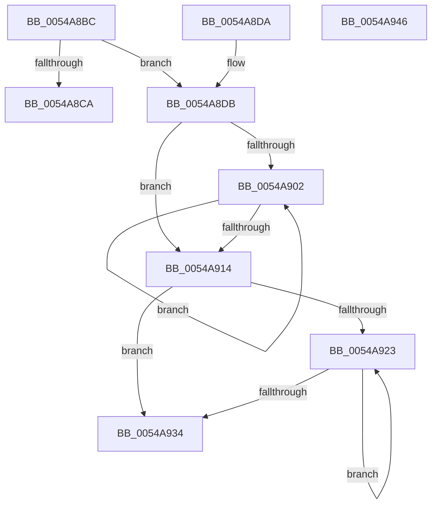

# HalpTscAdvSynchReadTimeStamp

- RVA: `0x0054A8BC`–`0x0054A947` (길이 `139` bytes)
- VA: `0x000000014054A8BC`
- 실행 섹션: `.text`
- PDB 이름 있음: `예`; PDB Function 태그: `아니요`
- unwind 정보 RVA: `0x000DB714`
- 디코드: `38`개 명령, `139/139` bytes 표시
- 미해석 바이트: `0` (있으면 어셈블리에 `.byte`로 보존)

> 이 문서는 커널 이미지의 기계어와 PDB 기호를 분석해 생성했습니다. 4번과 5번은 함수 원형과 자료형을 바이너리 사용 방식에서 추정한 C 해석이며 원본 소스 복구 결과는 아닙니다.

## 1. Dependencies

- 직접 호출 지점: **0**; 고유 호출 대상: **0**
- 직접 호출자로 확인된 함수: **1**
- RIP 상대 이미지 참조: **1**

### Outgoing calls
- 직접 디코드된 call 명령이 없습니다.

### Direct callers
- [HalpTscAdvSynchLeader](HalpTscAdvSynchLeader_function_0054A690.md) at `0x0054A6B6`
- [HalpTscAdvSynchLeader](HalpTscAdvSynchLeader_function_0054A690.md) at `0x0054A739`
- [HalpTscAdvSynchLeader](HalpTscAdvSynchLeader_function_0054A690.md) at `0x0054A74A`
- [HalpTscAdvSynchLeader](HalpTscAdvSynchLeader_function_0054A690.md) at `0x0054A7B7`

### Static image references
- `0x0054A8E3` → RVA `0x00FC2238` (`.data`; read)

## 2. Other-region calls and transfers

- 다른 실행 섹션으로 향하는 call: **0**
- 별도 외부 분기/꼬리 이동을 확인하지 못했습니다.

## 3. Assembly (complete function range)

```asm
0054A8BC  65 48 8B 04 25 20 00 00 00      mov rax, qword ptr gs:[0x20]
0054A8C5  3B 48 24                        cmp ecx, dword ptr [rax + 0x24]
0054A8C8  75 11                           jne 0x14054a8db
0054A8CA  0F 20 D0                        mov rax, cr2
0054A8CD  0F 22 D0                        mov cr2, rax
0054A8D0  0F 31                           rdtsc
0054A8D2  48 C1 E2 20                     shl rdx, 0x20
0054A8D6  48 0B C2                        or rax, rdx
0054A8D9  C3                              ret
0054A8DA  CC                              int3
0054A8DB  44 8B C1                        mov r8d, ecx
0054A8DE  B8 06 00 00 00                  mov eax, 6
0054A8E3  48 8B 0D 4E 79 A7 00            mov rcx, qword ptr [rip + 0xa7794e]
0054A8EA  49 C1 E0 07                     shl r8, 7
0054A8EE  41 87 04 08                     xchg dword ptr [r8 + rcx], eax
0054A8F2  48 8B 0D 3F 79 A7 00            mov rcx, qword ptr [rip + 0xa7793f]
0054A8F9  41 8B 04 08                     mov eax, dword ptr [r8 + rcx]
0054A8FD  83 F8 06                        cmp eax, 6
0054A900  75 12                           jne 0x14054a914
0054A902  F3 90                           pause
0054A904  48 8B 05 2D 79 A7 00            mov rax, qword ptr [rip + 0xa7792d]
0054A90B  41 8B 0C 00                     mov ecx, dword ptr [r8 + rax]
0054A90F  83 F9 06                        cmp ecx, 6
0054A912  74 EE                           je 0x14054a902
0054A914  48 8B 05 1D 79 A7 00            mov rax, qword ptr [rip + 0xa7791d]
0054A91B  41 8B 0C 00                     mov ecx, dword ptr [r8 + rax]
0054A91F  85 C9                           test ecx, ecx
0054A921  74 11                           je 0x14054a934
0054A923  F3 90                           pause
0054A925  48 8B 0D 0C 79 A7 00            mov rcx, qword ptr [rip + 0xa7790c]
0054A92C  41 8B 14 08                     mov edx, dword ptr [r8 + rcx]
0054A930  85 D2                           test edx, edx
0054A932  75 EF                           jne 0x14054a923
0054A934  F0 83 0C 24 00                  lock or dword ptr [rsp], 0
0054A939  48 8B 05 F8 78 A7 00            mov rax, qword ptr [rip + 0xa778f8]
0054A940  49 8B 44 00 08                  mov rax, qword ptr [r8 + rax + 8]
0054A945  C3                              ret
0054A946  CC                              int3
```

## 4. C-style interpretation (structured pseudocode)

```c
__int64 __fastcall HalpTscAdvSynchReadTimeStamp(int a1, __int64 a2)
{
    __int64 result;
    unsigned int v_stack_p0;

    if (a1 != (*(unsigned int *)(*(unsigned __int64 *)(gs_base + (0 + 32)) + 36))) goto loc_0054A8DB;
    a2 = (a2) << (32);
    result = (v_cr2) | (a2);
    return result;
loc_0054A8DB:
    a3 = ((unsigned int)(a1)) << (7);
    if (((unsigned int)((unsigned int)(*(unsigned int *)(a3 + *(unsigned __int64 *)(v_rip + 10975551) * 1)))) != 6) goto loc_0054A914;
loc_0054A902:
    if (((unsigned int)((unsigned int)(*(unsigned int *)(a3 + *(unsigned __int64 *)(v_rip + 10975533) * 1)))) == 6) goto loc_0054A902;
loc_0054A914:
    if ((unsigned int)((unsigned int)(*(unsigned int *)(a3 + *(unsigned __int64 *)(v_rip + 10975517) * 1))) == 0) goto loc_0054A934;
loc_0054A923:
    if ((unsigned int)((unsigned int)(*(unsigned int *)(a3 + *(unsigned __int64 *)(v_rip + 10975500) * 1))) != 0) goto loc_0054A923;
loc_0054A934:
    return *(unsigned __int64 *)(a3 + *(unsigned __int64 *)(v_rip + 10975480) * 1 + 8);
}
```

## 5. (Beta) C Style

```c
int64_t HalpTscAdvSynchReadTimeStamp(int32_t Arg1, int64_t Arg2)
{
    int64_t result;
    uint32_t v_stack_p0;

    if (Arg1 != (*(uint32_t *)(*(uint64_t *)(gs_base + (0 + 0x20)) + 0x24))) goto loc_0054A8DB;
    Arg2 = (Arg2) << (32);
    result = (v_cr2) | (Arg2);
    return result;
loc_0054A8DB:
    a3 = ((uint32_t)(Arg1)) << (7);
    if (((uint32_t)((uint32_t)(*(uint32_t *)(a3 + *(uint64_t *)(v_rip + 0xA7793F) * 1)))) != 6) goto loc_0054A914;
loc_0054A902:
    if (((uint32_t)((uint32_t)(*(uint32_t *)(a3 + *(uint64_t *)(v_rip + 0xA7792D) * 1)))) == 6) goto loc_0054A902;
loc_0054A914:
    if ((uint32_t)((uint32_t)(*(uint32_t *)(a3 + *(uint64_t *)(v_rip + 0xA7791D) * 1))) == 0) goto loc_0054A934;
loc_0054A923:
    if ((uint32_t)((uint32_t)(*(uint32_t *)(a3 + *(uint64_t *)(v_rip + 0xA7790C) * 1))) != 0) goto loc_0054A923;
loc_0054A934:
    return *(uint64_t *)(a3 + *(uint64_t *)(v_rip + 0xA778F8) * 1 + 0x8);
}
```

## 6. Execution-region graph

[열기: 2D/3D 그래프와 함수 탐색 컨트롤 패널](../../../control-panel.html?section=text&rva=0x0054A8BC&view=graph)

- 2D 그래프는 위에서 아래로 흐르고, 3D 그래프는 빈 공간을 드래그해 회전합니다. Shift+드래그는 이동, 휠은 확대·축소, 함수 노드 선택은 대상 보고서 이동입니다.

### Static fallback


