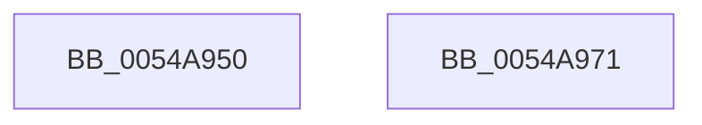

# HalpTscAdvSynchSkewCounter

- RVA: `0x0054A950`–`0x0054A972` (길이 `34` bytes)
- VA: `0x000000014054A950`
- 실행 섹션: `.text`
- PDB 이름 있음: `예`; PDB Function 태그: `아니요`
- unwind 정보 RVA: `0x000DB714`
- 디코드: `12`개 명령, `34/34` bytes 표시
- 미해석 바이트: `0` (있으면 어셈블리에 `.byte`로 보존)

> 이 문서는 커널 이미지의 기계어와 PDB 기호를 분석해 생성했습니다. 4번과 5번은 함수 원형과 자료형을 바이너리 사용 방식에서 추정한 C 해석이며 원본 소스 복구 결과는 아닙니다.

## 1. Dependencies

- 직접 호출 지점: **0**; 고유 호출 대상: **0**
- 직접 호출자로 확인된 함수: **3**
- RIP 상대 이미지 참조: **0**

### Outgoing calls
- 직접 디코드된 call 명령이 없습니다.

### Direct callers
- [HalpTscAdvSynchTarget](../49/HalpTscAdvSynchTarget_function_00492A44.md) at `0x00492B57`
- [HalpTscAdvSynchToTarget](HalpTscAdvSynchToTarget_function_0054A978.md) at `0x0054A9A6`
- [HalpTscAdvSynchToTarget](HalpTscAdvSynchToTarget_function_0054A978.md) at `0x0054A9EA`
- [HalpTscAdvSynchToTarget](HalpTscAdvSynchToTarget_function_0054A978.md) at `0x0054AA8A`
- [sub_006F7118](../6F/Unknown_function_006F7118.md) at `0x006F7135`

### Static image references
- 디코드된 RIP-relative 메모리 참조가 없습니다.

## 2. Other-region calls and transfers

- 다른 실행 섹션으로 향하는 call: **0**
- 별도 외부 분기/꼬리 이동을 확인하지 못했습니다.

## 3. Assembly (complete function range)

```asm
0054A950  0F 20 D0                        mov rax, cr2
0054A953  0F 22 D0                        mov cr2, rax
0054A956  0F 31                           rdtsc
0054A958  48 C1 E2 20                     shl rdx, 0x20
0054A95C  48 0B C2                        or rax, rdx
0054A95F  48 03 C1                        add rax, rcx
0054A962  B9 10 00 00 00                  mov ecx, 0x10
0054A967  48 8B D0                        mov rdx, rax
0054A96A  48 C1 EA 20                     shr rdx, 0x20
0054A96E  0F 30                           wrmsr
0054A970  C3                              ret
0054A971  CC                              int3
```

## 4. C-style interpretation (structured pseudocode)

```c
__int64 __fastcall HalpTscAdvSynchSkewCounter(__int64 a1, __int64 a2)
{
    __int64 result;

    a2 = (a2) << (32);
    result = (v_cr2) | (a2);
    result = (result) + (a1);
    a2 = (result) >> (32);
    return result;
}
```

## 5. (Beta) C Style

```c
int64_t HalpTscAdvSynchSkewCounter(int64_t Arg1, int64_t Arg2)
{
    int64_t result;

    Arg2 = (Arg2) << (32);
    result = (v_cr2) | (Arg2);
    result = (result) + (Arg1);
    Arg2 = (result) >> (32);
    return result;
}
```

## 6. Execution-region graph

[열기: 2D/3D 그래프와 함수 탐색 컨트롤 패널](../../../control-panel.html?section=text&rva=0x0054A950&view=graph)

- 2D 그래프는 위에서 아래로 흐르고, 3D 그래프는 빈 공간을 드래그해 회전합니다. Shift+드래그는 이동, 휠은 확대·축소, 함수 노드 선택은 대상 보고서 이동입니다.

### Static fallback


