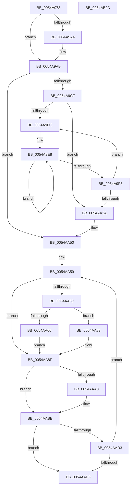

# HalpTscAdvSynchToTarget

- RVA: `0x0054A978`–`0x0054AB0E` (길이 `406` bytes)
- VA: `0x000000014054A978`
- 실행 섹션: `.text`
- PDB 이름 있음: `예`; PDB Function 태그: `아니요`
- unwind 정보 RVA: `0x000847EC`
- 디코드: `112`개 명령, `406/406` bytes 표시
- 미해석 바이트: `0` (있으면 어셈블리에 `.byte`로 보존)

> 이 문서는 커널 이미지의 기계어와 PDB 기호를 분석해 생성했습니다. 4번과 5번은 함수 원형과 자료형을 바이너리 사용 방식에서 추정한 C 해석이며 원본 소스 복구 결과는 아닙니다.

## 1. Dependencies

- 직접 호출 지점: **7**; 고유 호출 대상: **3**
- 직접 호출자로 확인된 함수: **1**
- RIP 상대 이미지 참조: **4**

### Outgoing calls
- `0x0054A9A6` → [HalpTscAdvSynchSkewCounter](HalpTscAdvSynchSkewCounter_function_0054A950.md) (function, `0x0054A950`)
- `0x0054A9B0` → [HalpTscAdvSynchCalculateRemoteDelta](../49/HalpTscAdvSynchCalculateRemoteDelta_function_004946E4.md) (function, `0x004946E4`)
- `0x0054A9EA` → [HalpTscAdvSynchSkewCounter](HalpTscAdvSynchSkewCounter_function_0054A950.md) (function, `0x0054A950`)
- `0x0054A9FA` → [HalpTscAdvSynchCalculateRemoteDelta](../49/HalpTscAdvSynchCalculateRemoteDelta_function_004946E4.md) (function, `0x004946E4`)
- `0x0054AA8A` → [HalpTscAdvSynchSkewCounter](HalpTscAdvSynchSkewCounter_function_0054A950.md) (function, `0x0054A950`)
- `0x0054AA94` → [HalpTscAdvSynchCalculateRemoteDelta](../49/HalpTscAdvSynchCalculateRemoteDelta_function_004946E4.md) (function, `0x004946E4`)
- `0x0054AAB9` → [HalpTscTraceProcessorSynchronization](HalpTscTraceProcessorSynchronization_function_0054B268.md) (function, `0x0054B268`)

### Direct callers
- [HalpTscAdvSynchLeader](HalpTscAdvSynchLeader_function_0054A690.md) at `0x0054A758`

### Static image references
- `0x0054A99B` → RVA `0x00FC2244` (`.data`; read)
- `0x0054A9CF` → RVA `0x00E0A7F8` (`.data`; read)
- `0x0054AA46` → RVA `0x00FC2208` (`.data`; read)
- `0x0054AAF3` → RVA `0x00FC21F8` (`.data`; read)

## 2. Other-region calls and transfers

- 다른 실행 섹션으로 향하는 call: **0**
- 별도 외부 분기/꼬리 이동을 확인하지 못했습니다.

## 3. Assembly (complete function range)

```asm
0054A978  48 8B C4                        mov rax, rsp
0054A97B  48 89 58 08                     mov qword ptr [rax + 8], rbx
0054A97F  48 89 68 10                     mov qword ptr [rax + 0x10], rbp
0054A983  48 89 70 18                     mov qword ptr [rax + 0x18], rsi
0054A987  48 89 78 20                     mov qword ptr [rax + 0x20], rdi
0054A98B  41 54                           push r12
0054A98D  41 56                           push r14
0054A98F  41 57                           push r15
0054A991  48 83 EC 30                     sub rsp, 0x30
0054A995  45 33 E4                        xor r12d, r12d
0054A998  44 8B F9                        mov r15d, ecx
0054A99B  44 38 25 A2 78 A7 00            cmp byte ptr [rip + 0xa778a2], r12b
0054A9A2  75 07                           jne 0x14054a9ab
0054A9A4  33 C9                           xor ecx, ecx
0054A9A6  E8 A5 FF FF FF                  call 0x14054a950
0054A9AB  33 D2                           xor edx, edx
0054A9AD  41 8B CF                        mov ecx, r15d
0054A9B0  E8 2F 9D F4 FF                  call 0x1404946e4
0054A9B5  44 38 25 88 78 A7 00            cmp byte ptr [rip + 0xa77888], r12b
0054A9BC  48 8B F0                        mov rsi, rax
0054A9BF  48 BB FF FF FF FF FF FF FF 7F   movabs rbx, 0x7fffffffffffffff
0054A9C9  0F 85 81 00 00 00               jne 0x14054aa50
0054A9CF  8B 0D 23 FE 8B 00               mov ecx, dword ptr [rip + 0x8bfe23]
0054A9D5  41 8B FC                        mov edi, r12d
0054A9D8  85 C9                           test ecx, ecx
0054A9DA  74 5E                           je 0x14054aa3a
0054A9DC  48 8B EB                        mov rbp, rbx
0054A9DF  41 B8 64 00 00 00               mov r8d, 0x64
0054A9E5  48 8B DE                        mov rbx, rsi
0054A9E8  33 C9                           xor ecx, ecx
0054A9EA  E8 61 FF FF FF                  call 0x14054a950
0054A9EF  49 83 E8 01                     sub r8, 1
0054A9F3  75 F3                           jne 0x14054a9e8
0054A9F5  33 D2                           xor edx, edx
0054A9F7  41 8B CF                        mov ecx, r15d
0054A9FA  E8 E5 9C F4 FF                  call 0x1404946e4
0054A9FF  48 8B C8                        mov rcx, rax
0054AA02  48 8B F0                        mov rsi, rax
0054AA05  48 2B CB                        sub rcx, rbx
0054AA08  48 B8 0B D7 A3 70 3D 0A D7 A3   movabs rax, 0xa3d70a3d70a3d70b
0054AA12  48 F7 E9                        imul rcx
0054AA15  48 8D 1C 11                     lea rbx, [rcx + rdx]
0054AA19  48 C1 FB 06                     sar rbx, 6
0054AA1D  48 8B C3                        mov rax, rbx
0054AA20  48 C1 E8 3F                     shr rax, 0x3f
0054AA24  48 03 D8                        add rbx, rax
0054AA27  8B 05 CB FD 8B 00               mov eax, dword ptr [rip + 0x8bfdcb]
0054AA2D  48 3B DD                        cmp rbx, rbp
0054AA30  48 0F 4D DD                     cmovge rbx, rbp
0054AA34  FF C7                           inc edi
0054AA36  3B F8                           cmp edi, eax
0054AA38  72 A2                           jb 0x14054a9dc
0054AA3A  65 48 8B 04 25 20 00 00 00      mov rax, qword ptr gs:[0x20]
0054AA43  8B 48 24                        mov ecx, dword ptr [rax + 0x24]
0054AA46  48 8B 05 BB 77 A7 00            mov rax, qword ptr [rip + 0xa777bb]
0054AA4D  89 1C 88                        mov dword ptr [rax + rcx*4], ebx
0054AA50  41 8B FC                        mov edi, r12d
0054AA53  4D 8B F4                        mov r14, r12
0054AA56  41 8B EC                        mov ebp, r12d
0054AA59  85 FF                           test edi, edi
0054AA5B  75 32                           jne 0x14054aa8f
0054AA5D  44 38 25 E0 77 A7 00            cmp byte ptr [rip + 0xa777e0], r12b
0054AA64  74 1D                           je 0x14054aa83
0054AA66  4C 8B F6                        mov r14, rsi
0054AA69  8D 4F 3B                        lea ecx, [rdi + 0x3b]
0054AA6C  0F 32                           rdmsr
0054AA6E  48 C1 E2 20                     shl rdx, 0x20
0054AA72  48 0B C2                        or rax, rdx
0054AA75  48 03 C6                        add rax, rsi
0054AA78  48 8B D0                        mov rdx, rax
0054AA7B  48 C1 EA 20                     shr rdx, 0x20
0054AA7F  0F 30                           wrmsr
0054AA81  EB 0C                           jmp 0x14054aa8f
0054AA83  4C 8D 34 33                     lea r14, [rbx + rsi]
0054AA87  49 8B CE                        mov rcx, r14
0054AA8A  E8 C1 FE FF FF                  call 0x14054a950
0054AA8F  33 D2                           xor edx, edx
0054AA91  41 8B CF                        mov ecx, r15d
0054AA94  E8 4B 9C F4 FF                  call 0x1404946e4
0054AA99  48 8B F0                        mov rsi, rax
0054AA9C  85 FF                           test edi, edi
0054AA9E  75 1E                           jne 0x14054aabe
0054AAA0  65 48 8B 14 25 20 00 00 00      mov rdx, qword ptr gs:[0x20]
0054AAA9  4D 8B CE                        mov r9, r14
0054AAAC  4C 8B C0                        mov r8, rax
0054AAAF  89 6C 24 20                     mov dword ptr [rsp + 0x20], ebp
0054AAB3  41 8B CF                        mov ecx, r15d
0054AAB6  8B 52 24                        mov edx, dword ptr [rdx + 0x24]
0054AAB9  E8 AA 07 00 00                  call 0x14054b268
0054AABE  FF C7                           inc edi
0054AAC0  48 8D 46 18                     lea rax, [rsi + 0x18]
0054AAC4  48 83 F8 30                     cmp rax, 0x30
0054AAC8  41 0F 47 FC                     cmova edi, r12d
0054AACC  FF C5                           inc ebp
0054AACE  83 FD 32                        cmp ebp, 0x32
0054AAD1  73 05                           jae 0x14054aad8
0054AAD3  83 FF 02                        cmp edi, 2
0054AAD6  72 81                           jb 0x14054aa59
0054AAD8  65 48 8B 04 25 20 00 00 00      mov rax, qword ptr gs:[0x20]
0054AAE1  48 8B 5C 24 50                  mov rbx, qword ptr [rsp + 0x50]
0054AAE6  48 8B 74 24 60                  mov rsi, qword ptr [rsp + 0x60]
0054AAEB  48 8B 7C 24 68                  mov rdi, qword ptr [rsp + 0x68]
0054AAF0  8B 48 24                        mov ecx, dword ptr [rax + 0x24]
0054AAF3  48 8B 05 FE 76 A7 00            mov rax, qword ptr [rip + 0xa776fe]
0054AAFA  89 2C 88                        mov dword ptr [rax + rcx*4], ebp
0054AAFD  48 8B 6C 24 58                  mov rbp, qword ptr [rsp + 0x58]
0054AB02  48 83 C4 30                     add rsp, 0x30
0054AB06  41 5F                           pop r15
0054AB08  41 5E                           pop r14
0054AB0A  41 5C                           pop r12
0054AB0C  C3                              ret
0054AB0D  CC                              int3
```

## 4. C-style interpretation (structured pseudocode)

```c
__int64 __fastcall HalpTscAdvSynchToTarget(int a1, int a2)
{
    __int64 result;
    __int64 v_r12;
    __int64 v_rbp;
    __int64 v_rbx;
    __int64 v_rdi;
    __int64 v_rsp;
    unsigned int v_stack_m28;
    unsigned __int64 v_stack_p10;
    unsigned __int64 v_stack_p18;
    unsigned __int64 v_stack_p20;
    unsigned __int64 v_stack_p8;

    *(unsigned __int64 *)(v_rsp + 8) = v_rbx;
    *(unsigned __int64 *)(v_rsp + 16) = v_rbp;
    *(unsigned __int64 *)(v_rsp + 24) = v_rsi;
    *(unsigned __int64 *)(v_rsp + 32) = v_rdi;
    v_rsp = (v_rsp) - (48);
    v_r12 = 0;
    result = v_rsp;
    if ((*(unsigned __int8 *)(v_rip + 10975394)) == 0) {
        a1 = 0;
        result = HalpTscAdvSynchSkewCounter(a1, a2, a3, a4);
    }
    a2 = 0;
    result = HalpTscAdvSynchCalculateRemoteDelta((unsigned int)((unsigned int)((unsigned int)(a1))), a2, a3, a4);
    if ((*(unsigned __int8 *)(v_rip + 10975368)) != 0) goto loc_0054AA50;
    if ((unsigned int)((unsigned int)(*(unsigned int *)(v_rip + 9174563))) == 0) goto loc_0054AA3A;
loc_0054A9DC:
loc_0054A9E8:
    a1 = 0;
    result = HalpTscAdvSynchSkewCounter(a1, a2, 100, a4);
    a3 = (100) - (1);
    if (condition_is_not_equal) goto loc_0054A9E8;
    a2 = 0;
    result = HalpTscAdvSynchCalculateRemoteDelta((unsigned int)((unsigned int)((unsigned int)(a1))), a2, a3, a4);
    a1 = (result) - (result);
    v_rbx = (a1 + a2 * 1) >> (6);
    result = (v_rbx) >> (63);
    v_rbx = (v_rbx) + (result);
    if (v_rbx >= v_rbx) { v_rbx = v_rbx; }
    v_rdi = (unsigned int)((0) + 1);
    if (((unsigned int)(v_rdi)) < ((unsigned int)((unsigned int)(*(unsigned int *)(v_rip + 9174475))))) goto loc_0054A9DC;
loc_0054AA3A:
    *(unsigned int *)(*(unsigned __int64 *)(v_rip + 10975163) + (unsigned int)(*(unsigned int *)(*(unsigned __int64 *)(gs_base + (0 + 32)) + 36)) * 4) = (unsigned int)(v_rbx);
loc_0054AA50:
loc_0054AA59:
    if (0 != 0) goto loc_0054AA8F;
    if ((*(unsigned __int8 *)(v_rip + 10975200)) == 0) goto loc_0054AA83;
    a2 = (a2) << (32);
    result = (*(unsigned __int64 *)(v_rip + 10975163)) | (a2);
    result = (result) + (result);
    a2 = (result) >> (32);
    goto loc_0054AA8F;
loc_0054AA83:
    result = HalpTscAdvSynchSkewCounter(v_rbx + result * 1, a2, a3, a4);
loc_0054AA8F:
    a2 = 0;
    result = HalpTscAdvSynchCalculateRemoteDelta((unsigned int)((unsigned int)((unsigned int)(a1))), a2, a3, a4);
    if (0 == 0) {
        a2 = *(unsigned __int64 *)(gs_base + (0 + 32));
        a4 = v_rbx + result * 1;
        a3 = result;
        v_stack_m28 = 0;
        a1 = (unsigned int)((unsigned int)(a1));
        a2 = *(unsigned int *)(a2 + 36);
        result = HalpTscTraceProcessorSynchronization(a1, a2, a3, a4);
    }
    v_rdi = (unsigned int)((0) + 1);
    if ((result + 24) > 48) { v_rdi = 0; }
    v_rbp = (unsigned int)((0) + 1);
    if (((unsigned int)(v_rbp)) >= 50) goto loc_0054AAD8;
    if (((unsigned int)(v_rdi)) < 2) goto loc_0054AA59;
loc_0054AAD8:
    *(unsigned int *)(*(unsigned __int64 *)(v_rip + 10974974) + (unsigned int)(*(unsigned int *)(*(unsigned __int64 *)(gs_base + (0 + 32)) + 36)) * 4) = (unsigned int)(v_rbp);
    v_rsp = (v_rsp) + (48);
    return *(unsigned __int64 *)(v_rip + 10974974);
}
```

## 5. (Beta) C Style

```c
int64_t HalpTscAdvSynchToTarget(int32_t Arg1, int32_t Arg2)
{
    int64_t result;
    int64_t local_r12;
    int64_t local_rbp;
    int64_t local_rbx;
    int64_t local_rdi;
    int64_t local_rsp;
    uint32_t v_stack_m28;
    uint64_t v_stack_p10;
    uint64_t v_stack_p18;
    uint64_t v_stack_p20;
    uint64_t v_stack_p8;

    *(uint64_t *)(local_rsp + 0x8) = local_rbx;
    *(uint64_t *)(local_rsp + 0x10) = local_rbp;
    *(uint64_t *)(local_rsp + 0x18) = local_rsi;
    *(uint64_t *)(local_rsp + 0x20) = local_rdi;
    local_rsp = (local_rsp) - (48);
    local_r12 = 0;
    result = local_rsp;
    if ((*(uint8_t *)(v_rip + 0xA778A2)) == 0) {
        Arg1 = 0;
        result = HalpTscAdvSynchSkewCounter(Arg1, Arg2, a3, a4);
    }
    Arg2 = 0;
    result = HalpTscAdvSynchCalculateRemoteDelta((uint32_t)((uint32_t)((uint32_t)(Arg1))), Arg2, a3, a4);
    if ((*(uint8_t *)(v_rip + 0xA77888)) != 0) goto loc_0054AA50;
    if ((uint32_t)((uint32_t)(*(uint32_t *)(v_rip + 0x8BFE23))) == 0) goto loc_0054AA3A;
loc_0054A9DC:
loc_0054A9E8:
    Arg1 = 0;
    result = HalpTscAdvSynchSkewCounter(Arg1, Arg2, 100, a4);
    a3 = (100) - (1);
    if (condition_is_not_equal) goto loc_0054A9E8;
    Arg2 = 0;
    result = HalpTscAdvSynchCalculateRemoteDelta((uint32_t)((uint32_t)((uint32_t)(Arg1))), Arg2, a3, a4);
    Arg1 = (result) - (result);
    local_rbx = (Arg1 + Arg2 * 1) >> (6);
    result = (local_rbx) >> (63);
    local_rbx = (local_rbx) + (result);
    if (local_rbx >= local_rbx) { local_rbx = local_rbx; }
    local_rdi = (uint32_t)((0) + 1);
    if (((uint32_t)(local_rdi)) < ((uint32_t)((uint32_t)(*(uint32_t *)(v_rip + 0x8BFDCB))))) goto loc_0054A9DC;
loc_0054AA3A:
    *(uint32_t *)(*(uint64_t *)(v_rip + 0xA777BB) + (uint32_t)(*(uint32_t *)(*(uint64_t *)(gs_base + (0 + 0x20)) + 0x24)) * 4) = (uint32_t)(local_rbx);
loc_0054AA50:
loc_0054AA59:
    if (0 != 0) goto loc_0054AA8F;
    if ((*(uint8_t *)(v_rip + 0xA777E0)) == 0) goto loc_0054AA83;
    Arg2 = (Arg2) << (32);
    result = (*(uint64_t *)(v_rip + 0xA777BB)) | (Arg2);
    result = (result) + (result);
    Arg2 = (result) >> (32);
    goto loc_0054AA8F;
loc_0054AA83:
    result = HalpTscAdvSynchSkewCounter(local_rbx + result * 1, Arg2, a3, a4);
loc_0054AA8F:
    Arg2 = 0;
    result = HalpTscAdvSynchCalculateRemoteDelta((uint32_t)((uint32_t)((uint32_t)(Arg1))), Arg2, a3, a4);
    if (0 == 0) {
        Arg2 = *(uint64_t *)(gs_base + (0 + 0x20));
        a4 = local_rbx + result * 1;
        a3 = result;
        v_stack_m28 = 0;
        Arg1 = (uint32_t)((uint32_t)(Arg1));
        Arg2 = *(uint32_t *)(Arg2 + 0x24);
        result = HalpTscTraceProcessorSynchronization(Arg1, Arg2, a3, a4);
    }
    local_rdi = (uint32_t)((0) + 1);
    if ((result + 24) > 48) { local_rdi = 0; }
    local_rbp = (uint32_t)((0) + 1);
    if (((uint32_t)(local_rbp)) >= 50) goto loc_0054AAD8;
    if (((uint32_t)(local_rdi)) < 2) goto loc_0054AA59;
loc_0054AAD8:
    *(uint32_t *)(*(uint64_t *)(v_rip + 0xA776FE) + (uint32_t)(*(uint32_t *)(*(uint64_t *)(gs_base + (0 + 0x20)) + 0x24)) * 4) = (uint32_t)(local_rbp);
    local_rsp = (local_rsp) + (48);
    return *(uint64_t *)(v_rip + 0xA776FE);
}
```

## 6. Execution-region graph

[열기: 2D/3D 그래프와 함수 탐색 컨트롤 패널](../../../control-panel.html?section=text&rva=0x0054A978&view=graph)

- 2D 그래프는 위에서 아래로 흐르고, 3D 그래프는 빈 공간을 드래그해 회전합니다. Shift+드래그는 이동, 휠은 확대·축소, 함수 노드 선택은 대상 보고서 이동입니다.

### Static fallback


