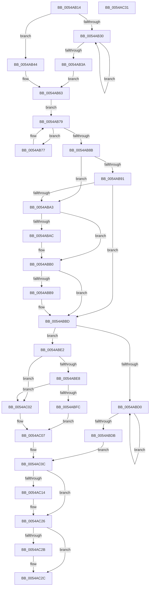

# HalpTscCompatibilitySynchronization

- RVA: `0x0054AB14`–`0x0054AC32` (길이 `286` bytes)
- VA: `0x000000014054AB14`
- 실행 섹션: `.text`
- PDB 이름 있음: `예`; PDB Function 태그: `아니요`
- unwind 정보 RVA: `0x0005C788`
- 디코드: `84`개 명령, `286/286` bytes 표시
- 미해석 바이트: `0` (있으면 어셈블리에 `.byte`로 보존)

> 이 문서는 커널 이미지의 기계어와 PDB 기호를 분석해 생성했습니다. 4번과 5번은 함수 원형과 자료형을 바이너리 사용 방식에서 추정한 C 해석이며 원본 소스 복구 결과는 아닙니다.

## 1. Dependencies

- 직접 호출 지점: **1**; 고유 호출 대상: **1**
- 직접 호출자로 확인된 함수: **1**
- RIP 상대 이미지 참조: **0**

### Outgoing calls
- `0x0054AB1B` → [HalpDisableInterrupts](../25/HalpDisableInterrupts_function_002521A0.md) (function, `0x002521A0`)

### Direct callers
- [HalpTscSynchronizationWorker](HalpTscSynchronizationWorker_function_0054B090.md) at `0x0054B0ED`

### Static image references
- 디코드된 RIP-relative 메모리 참조가 없습니다.

## 2. Other-region calls and transfers

- 다른 실행 섹션으로 향하는 call: **0**
- 별도 외부 분기/꼬리 이동을 확인하지 못했습니다.

## 3. Assembly (complete function range)

```asm
0054AB14  48 83 EC 28                     sub rsp, 0x28
0054AB18  4C 8B C1                        mov r8, rcx
0054AB1B  E8 80 76 D0 FF                  call 0x1402521a0
0054AB20  44 8A D8                        mov r11b, al
0054AB23  83 CA FF                        or edx, 0xffffffff
0054AB26  F0 41 0F C1 10                  lock xadd dword ptr [r8], edx
0054AB2B  83 FA 01                        cmp edx, 1
0054AB2E  74 14                           je 0x14054ab44
0054AB30  F3 90                           pause
0054AB32  41 8B 08                        mov ecx, dword ptr [r8]
0054AB35  83 F9 FF                        cmp ecx, -1
0054AB38  75 F6                           jne 0x14054ab30
0054AB3A  45 33 C9                        xor r9d, r9d
0054AB3D  F0 44 09 0C 24                  lock or dword ptr [rsp], r9d
0054AB42  EB 1F                           jmp 0x14054ab63
0054AB44  41 8B 40 28                     mov eax, dword ptr [r8 + 0x28]
0054AB48  45 33 C9                        xor r9d, r9d
0054AB4B  45 89 48 04                     mov dword ptr [r8 + 4], r9d
0054AB4F  41 89 40 08                     mov dword ptr [r8 + 8], eax
0054AB53  4D 89 48 18                     mov qword ptr [r8 + 0x18], r9
0054AB57  49 C7 40 10 FF FF FF FF         mov qword ptr [r8 + 0x10], 0xffffffffffffffff
0054AB5F  F0 41 FF 08                     lock dec dword ptr [r8]
0054AB63  0F 20 D0                        mov rax, cr2
0054AB66  0F 22 D0                        mov cr2, rax
0054AB69  0F 31                           rdtsc
0054AB6B  48 C1 E2 20                     shl rdx, 0x20
0054AB6F  48 0B C2                        or rax, rdx
0054AB72  4C 8B D0                        mov r10, rax
0054AB75  EB 02                           jmp 0x14054ab79
0054AB77  F3 90                           pause
0054AB79  65 48 8B 14 25 20 00 00 00      mov rdx, qword ptr gs:[0x20]
0054AB82  41 8B 48 04                     mov ecx, dword ptr [r8 + 4]
0054AB86  3B 4A 24                        cmp ecx, dword ptr [rdx + 0x24]
0054AB89  75 EC                           jne 0x14054ab77
0054AB8B  45 38 48 22                     cmp byte ptr [r8 + 0x22], r9b
0054AB8F  74 12                           je 0x14054aba3
0054AB91  65 48 8B 04 25 20 00 00 00      mov rax, qword ptr gs:[0x20]
0054AB9A  8B 48 24                        mov ecx, dword ptr [rax + 0x24]
0054AB9D  41 39 48 24                     cmp dword ptr [r8 + 0x24], ecx
0054ABA1  74 1A                           je 0x14054abbd
0054ABA3  49 8B 40 10                     mov rax, qword ptr [r8 + 0x10]
0054ABA7  4C 3B D0                        cmp r10, rax
0054ABAA  73 04                           jae 0x14054abb0
0054ABAC  4D 89 50 10                     mov qword ptr [r8 + 0x10], r10
0054ABB0  49 8B 40 18                     mov rax, qword ptr [r8 + 0x18]
0054ABB4  4C 3B D0                        cmp r10, rax
0054ABB7  76 04                           jbe 0x14054abbd
0054ABB9  4D 89 50 18                     mov qword ptr [r8 + 0x18], r10
0054ABBD  F0 41 FF 40 04                  lock inc dword ptr [r8 + 4]
0054ABC2  83 C8 FF                        or eax, 0xffffffff
0054ABC5  F0 41 0F C1 40 08               lock xadd dword ptr [r8 + 8], eax
0054ABCB  83 F8 01                        cmp eax, 1
0054ABCE  74 12                           je 0x14054abe2
0054ABD0  F3 90                           pause
0054ABD2  41 8B 40 08                     mov eax, dword ptr [r8 + 8]
0054ABD6  83 F8 FF                        cmp eax, -1
0054ABD9  75 F5                           jne 0x14054abd0
0054ABDB  F0 44 09 0C 24                  lock or dword ptr [rsp], r9d
0054ABE0  EB 2A                           jmp 0x14054ac0c
0054ABE2  45 38 48 21                     cmp byte ptr [r8 + 0x21], r9b
0054ABE6  75 1A                           jne 0x14054ac02
0054ABE8  49 8B 48 18                     mov rcx, qword ptr [r8 + 0x18]
0054ABEC  49 8B 40 10                     mov rax, qword ptr [r8 + 0x10]
0054ABF0  48 2B C8                        sub rcx, rax
0054ABF3  48 81 F9 40 42 0F 00            cmp rcx, 0xf4240
0054ABFA  76 06                           jbe 0x14054ac02
0054ABFC  45 88 48 20                     mov byte ptr [r8 + 0x20], r9b
0054AC00  EB 05                           jmp 0x14054ac07
0054AC02  41 C6 40 20 01                  mov byte ptr [r8 + 0x20], 1
0054AC07  F0 41 FF 48 08                  lock dec dword ptr [r8 + 8]
0054AC0C  41 8A 40 20                     mov al, byte ptr [r8 + 0x20]
0054AC10  84 C0                           test al, al
0054AC12  74 12                           je 0x14054ac26
0054AC14  49 8B 50 18                     mov rdx, qword ptr [r8 + 0x18]
0054AC18  B9 10 00 00 00                  mov ecx, 0x10
0054AC1D  48 8B C2                        mov rax, rdx
0054AC20  48 C1 EA 20                     shr rdx, 0x20
0054AC24  0F 30                           wrmsr
0054AC26  45 84 DB                        test r11b, r11b
0054AC29  74 01                           je 0x14054ac2c
0054AC2B  FB                              sti
0054AC2C  48 83 C4 28                     add rsp, 0x28
0054AC30  C3                              ret
0054AC31  CC                              int3
```

## 4. C-style interpretation (structured pseudocode)

```c
__int64 __fastcall HalpTscCompatibilitySynchronization(__int64 a1, int a2, __int64 a3, int a4)
{
    __int64 result;
    __int64 v_rsp;
    unsigned int v_stack_m28;

    v_rsp = (v_rsp) - (40);
    result = HalpDisableInterrupts(a1, a2, a1, a4);
    a2 = (unsigned int)((a2) | (0xFFFFFFFFULL));
    if (a2 == 1) goto loc_0054AB44;
loc_0054AB30:
    if (((unsigned int)((unsigned int)(*(unsigned int *)(a1)))) != -1) goto loc_0054AB30;
    a4 = 0;
    goto loc_0054AB63;
loc_0054AB44:
    a4 = 0;
    *(unsigned int *)(a1 + 4) = 0;
    *(unsigned int *)(a1 + 8) = (unsigned int)((unsigned int)(*(unsigned int *)(a1 + 40)));
    *(unsigned __int64 *)(a1 + 24) = 0;
    *(unsigned __int64 *)(a1 + 16) = -1;
loc_0054AB63:
    a2 = (a2) << (32);
    result = (v_cr2) | (a2);
    goto loc_0054AB79;
loc_0054AB77:
loc_0054AB79:
    if (((unsigned int)((unsigned int)(*(unsigned int *)(a1 + 4)))) != (*(unsigned int *)(*(unsigned __int64 *)(gs_base + (0 + 32)) + 36))) goto loc_0054AB77;
    if ((*(unsigned __int8 *)(a1 + 34)) == 0) goto loc_0054ABA3;
    if ((*(unsigned int *)(a1 + 36)) == ((unsigned int)((unsigned int)(*(unsigned int *)(*(unsigned __int64 *)(gs_base + (0 + 32)) + 36))))) goto loc_0054ABBD;
loc_0054ABA3:
    if (result < (*(unsigned __int64 *)(a1 + 16))) {
        *(unsigned __int64 *)(a1 + 16) = result;
    }
    if (result >= = (*(unsigned __int64 *)(a1 + 24))) {
        *(unsigned __int64 *)(a1 + 24) = result;
    }
    result = (unsigned int)((*(unsigned __int64 *)(a1 + 24)) | (0xFFFFFFFFULL));
    if (((unsigned int)(result)) == 1) goto loc_0054ABE2;
loc_0054ABD0:
    if (((unsigned int)((unsigned int)(*(unsigned int *)(a1 + 8)))) != -1) goto loc_0054ABD0;
    goto loc_0054AC0C;
loc_0054ABE2:
    if ((*(unsigned __int8 *)(a1 + 33)) != 0) goto loc_0054AC02;
    a1 = (*(unsigned __int64 *)(a1 + 24)) - (*(unsigned __int64 *)(a1 + 16));
    if (a1 <= 0xF4240ULL) goto loc_0054AC02;
    *(unsigned __int8 *)(a1 + 32) = 0;
    goto loc_0054AC07;
loc_0054AC02:
    *(unsigned __int8 *)(a1 + 32) = 1;
loc_0054AC07:
loc_0054AC0C:
    result = *(unsigned __int8 *)(a1 + 32);
    if ((unsigned __int8)(*(unsigned __int8 *)(a1 + 32)) != 0) {
        a2 = *(unsigned __int64 *)(a1 + 24);
        a1 = 16;
        result = a2;
        a2 = (a2) >> (32);
    }
    if ((unsigned __int8)((unsigned __int8)(result)) != 0) {
    }
    v_rsp = (v_rsp) + (40);
    return result;
}
```

## 5. (Beta) C Style

```c
int64_t HalpTscCompatibilitySynchronization(int64_t Arg1, int32_t Arg2, int64_t Arg3, int32_t Arg4)
{
    int64_t result;
    int64_t local_rsp;
    uint32_t v_stack_m28;

    local_rsp = (local_rsp) - (40);
    result = HalpDisableInterrupts(Arg1, Arg2, Arg1, Arg4);
    Arg2 = (uint32_t)((Arg2) | (0xFFFFFFFFULL));
    if (Arg2 == 1) goto loc_0054AB44;
loc_0054AB30:
    if (((uint32_t)((uint32_t)(*(uint32_t *)(Arg1)))) != -1) goto loc_0054AB30;
    Arg4 = 0;
    goto loc_0054AB63;
loc_0054AB44:
    Arg4 = 0;
    *(uint32_t *)(Arg1 + 0x4) = 0;
    *(uint32_t *)(Arg1 + 0x8) = (uint32_t)((uint32_t)(*(uint32_t *)(Arg1 + 0x28)));
    *(uint64_t *)(Arg1 + 0x18) = 0;
    *(uint64_t *)(Arg1 + 0x10) = -1;
loc_0054AB63:
    Arg2 = (Arg2) << (32);
    result = (v_cr2) | (Arg2);
    goto loc_0054AB79;
loc_0054AB77:
loc_0054AB79:
    if (((uint32_t)((uint32_t)(*(uint32_t *)(Arg1 + 0x4)))) != (*(uint32_t *)(*(uint64_t *)(gs_base + (0 + 0x20)) + 0x24))) goto loc_0054AB77;
    if ((*(uint8_t *)(Arg1 + 0x22)) == 0) goto loc_0054ABA3;
    if ((*(uint32_t *)(Arg1 + 0x24)) == ((uint32_t)((uint32_t)(*(uint32_t *)(*(uint64_t *)(gs_base + (0 + 0x20)) + 0x24))))) goto loc_0054ABBD;
loc_0054ABA3:
    if (result < (*(uint64_t *)(Arg1 + 0x10))) {
        *(uint64_t *)(Arg1 + 0x10) = result;
    }
    if (result >= = (*(uint64_t *)(Arg1 + 0x18))) {
        *(uint64_t *)(Arg1 + 0x18) = result;
    }
    result = (uint32_t)((*(uint64_t *)(Arg1 + 0x18)) | (0xFFFFFFFFULL));
    if (((uint32_t)(result)) == 1) goto loc_0054ABE2;
loc_0054ABD0:
    if (((uint32_t)((uint32_t)(*(uint32_t *)(Arg1 + 0x8)))) != -1) goto loc_0054ABD0;
    goto loc_0054AC0C;
loc_0054ABE2:
    if ((*(uint8_t *)(Arg1 + 0x21)) != 0) goto loc_0054AC02;
    Arg1 = (*(uint64_t *)(Arg1 + 0x18)) - (*(uint64_t *)(Arg1 + 0x10));
    if (Arg1 <= 0xF4240ULL) goto loc_0054AC02;
    *(uint8_t *)(Arg1 + 0x20) = 0;
    goto loc_0054AC07;
loc_0054AC02:
    *(uint8_t *)(Arg1 + 0x20) = 1;
loc_0054AC07:
loc_0054AC0C:
    result = *(uint8_t *)(Arg1 + 0x20);
    if ((uint8_t)(*(uint8_t *)(Arg1 + 0x20)) != 0) {
        Arg2 = *(uint64_t *)(Arg1 + 0x18);
        Arg1 = 16;
        result = Arg2;
        Arg2 = (Arg2) >> (32);
    }
    if ((uint8_t)((uint8_t)(result)) != 0) {
    }
    local_rsp = (local_rsp) + (40);
    return result;
}
```

## 6. Execution-region graph

[열기: 2D/3D 그래프와 함수 탐색 컨트롤 패널](../../../control-panel.html?section=text&rva=0x0054AB14&view=graph)

- 2D 그래프는 위에서 아래로 흐르고, 3D 그래프는 빈 공간을 드래그해 회전합니다. Shift+드래그는 이동, 휠은 확대·축소, 함수 노드 선택은 대상 보고서 이동입니다.

### Static fallback


