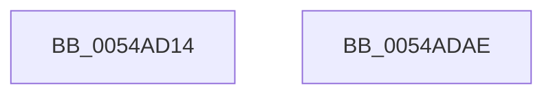

# HalpTscFallbackToPlatformSource

- RVA: `0x0054AD14`–`0x0054ADAF` (길이 `155` bytes)
- VA: `0x000000014054AD14`
- 실행 섹션: `.text`
- PDB 이름 있음: `예`; PDB Function 태그: `아니요`
- unwind 정보 RVA: `0x000BCD84`
- 디코드: `38`개 명령, `155/155` bytes 표시
- 미해석 바이트: `0` (있으면 어셈블리에 `.byte`로 보존)

> 이 문서는 커널 이미지의 기계어와 PDB 기호를 분석해 생성했습니다. 4번과 5번은 함수 원형과 자료형을 바이너리 사용 방식에서 추정한 C 해석이며 원본 소스 복구 결과는 아닙니다.

## 1. Dependencies

- 직접 호출 지점: **7**; 고유 호출 대상: **7**
- 직접 호출자로 확인된 함수: **2**
- RIP 상대 이미지 참조: **3**

### Outgoing calls
- `0x0054AD44` → [KeQueryActiveProcessorCountEx](../24/KeQueryActiveProcessorCountEx_function_00249EF0.md) (function, `0x00249EF0`)
- `0x0054AD5C` → [KeAcquireSpinLockRaiseToDpc](../20/KeAcquireSpinLockRaiseToDpc_function_00208470.md) (function, `0x00208470`)
- `0x0054AD6F` → [KeIpiGenericCall](../47/KeIpiGenericCall_function_00471720.md) (function, `0x00471720`)
- `0x0054AD74` → [HalpTimerSchedulePeriodicQueries](../53/HalpTimerSchedulePeriodicQueries_function_0053D388.md) (function, `0x0053D388`)
- `0x0054AD82` → [KeReleaseSpinLock](../39/KeReleaseSpinLock_function_00392BA0.md) (function, `0x00392BA0`)
- `0x0054AD8C` → [HalpTscTraceStatus](HalpTscTraceStatus_function_0054B368.md) (function, `0x0054B368`)
- `0x0054AD99` → [_security_check_cookie](../6A/_security_check_cookie_function_006AC640.md) (function, `0x006AC640`)

### Direct callers
- [HalpTimerReportIdleStateUsage](../4B/HalpTimerReportIdleStateUsage_function_004BF5C0.md) at `0x004BF60D`
- [HalpTimerInitSystem](../53/HalpTimerInitSystem_function_0053CB70.md) at `0x0053CCDD`

### Static image references
- `0x0054AD23` → RVA `0x00E0A740` (`.data`; read)
- `0x0054AD4D` → RVA `0x00FC2220` (`.data`; read)
- `0x0054AD68` → RVA `0x0054AC40` (`HalpTscFallback`; read)

## 2. Other-region calls and transfers

- 다른 실행 섹션으로 향하는 call: **0**
- 별도 외부 분기/꼬리 이동을 확인하지 못했습니다.

## 3. Assembly (complete function range)

```asm
0054AD14  48 89 5C 24 18                  mov qword ptr [rsp + 0x18], rbx
0054AD19  48 89 74 24 20                  mov qword ptr [rsp + 0x20], rsi
0054AD1E  57                              push rdi
0054AD1F  48 83 EC 40                     sub rsp, 0x40
0054AD23  48 8B 05 16 FA 8B 00            mov rax, qword ptr [rip + 0x8bfa16]
0054AD2A  48 33 C4                        xor rax, rsp
0054AD2D  48 89 44 24 30                  mov qword ptr [rsp + 0x30], rax
0054AD32  48 8B F9                        mov rdi, rcx
0054AD35  0F 57 C0                        xorps xmm0, xmm0
0054AD38  B9 FF FF 00 00                  mov ecx, 0xffff
0054AD3D  8B F2                           mov esi, edx
0054AD3F  0F 11 44 24 20                  movups xmmword ptr [rsp + 0x20], xmm0
0054AD44  E8 A7 F1 CF FF                  call 0x140249ef0
0054AD49  89 44 24 24                     mov dword ptr [rsp + 0x24], eax
0054AD4D  48 8D 0D CC 74 A7 00            lea rcx, [rip + 0xa774cc]
0054AD54  8B 44 24 24                     mov eax, dword ptr [rsp + 0x24]
0054AD58  89 44 24 20                     mov dword ptr [rsp + 0x20], eax
0054AD5C  E8 0F D7 CB FF                  call 0x140208470
0054AD61  48 8D 54 24 20                  lea rdx, [rsp + 0x20]
0054AD66  8A D8                           mov bl, al
0054AD68  48 8D 0D D1 FE FF FF            lea rcx, [rip - 0x12f]
0054AD6F  E8 AC 69 F2 FF                  call 0x140471720
0054AD74  E8 0F 26 FF FF                  call 0x14053d388
0054AD79  8A D3                           mov dl, bl
0054AD7B  48 8D 0D 9E 74 A7 00            lea rcx, [rip + 0xa7749e]
0054AD82  E8 19 7E E4 FF                  call 0x140392ba0
0054AD87  8B D6                           mov edx, esi
0054AD89  48 8B CF                        mov rcx, rdi
0054AD8C  E8 D7 05 00 00                  call 0x14054b368
0054AD91  48 8B 4C 24 30                  mov rcx, qword ptr [rsp + 0x30]
0054AD96  48 33 CC                        xor rcx, rsp
0054AD99  E8 A2 18 16 00                  call 0x1406ac640
0054AD9E  48 8B 5C 24 60                  mov rbx, qword ptr [rsp + 0x60]
0054ADA3  48 8B 74 24 68                  mov rsi, qword ptr [rsp + 0x68]
0054ADA8  48 83 C4 40                     add rsp, 0x40
0054ADAC  5F                              pop rdi
0054ADAD  C3                              ret
0054ADAE  CC                              int3
```

## 4. C-style interpretation (structured pseudocode)

```c
__int64 __fastcall HalpTscFallbackToPlatformSource(__int64 a1, int a2)
{
    __int64 result;
    __int64 v_rsp;
    unsigned __int64 v_stack_m18;
    unsigned int v_stack_m24;
    unsigned __int64 v_stack_m28;
    unsigned __int64 v_stack_p18;
    unsigned __int64 v_stack_p20;

    v_stack_p18 = v_rbx;
    v_stack_p20 = v_rsi;
    v_rsp = (v_rsp) - (64);
    result = (*(unsigned __int64 *)(v_rip + 9173526)) ^ (v_rsp);
    v_stack_m18 = result;
    v_stack_m28 = v_xmm0;
    result = KeQueryActiveProcessorCountEx((unsigned int)(0xFFFFULL), a2, a3, a4);
    v_stack_m24 = (unsigned int)(result);
    v_stack_m28 = (unsigned int)((unsigned int)(v_stack_m24));
    result = KeAcquireSpinLockRaiseToDpc(v_rip + 10974412, a2, a3, a4);
    result = KeIpiGenericCall(v_rip - 303, v_stack_m28, a3, a4);
    result = HalpTimerSchedulePeriodicQueries(v_rip - 303, v_stack_m28, a3, a4);
    result = KeReleaseSpinLock(v_rip + 10974366, (unsigned __int8)((unsigned __int8)(result)), a3, a4);
    result = HalpTscTraceStatus(a1, (unsigned int)((unsigned int)((unsigned int)(a2))), a3, a4);
    a1 = (v_stack_m18) ^ (v_rsp);
    result = _security_check_cookie(a1, (unsigned int)((unsigned int)((unsigned int)(a2))), a3, a4);
    v_rsp = (v_rsp) + (64);
    return result;
}
```

## 5. (Beta) C Style

```c
int64_t HalpTscFallbackToPlatformSource(int64_t Arg1, int32_t Arg2)
{
    int64_t result;
    int64_t local_rsp;
    uint64_t v_stack_m18;
    uint32_t v_stack_m24;
    uint64_t v_stack_m28;
    uint64_t v_stack_p18;
    uint64_t v_stack_p20;

    v_stack_p18 = local_rbx;
    v_stack_p20 = local_rsi;
    local_rsp = (local_rsp) - (64);
    result = (*(uint64_t *)(v_rip + 0x8BFA16)) ^ (local_rsp);
    v_stack_m18 = result;
    v_stack_m28 = v_xmm0;
    result = KeQueryActiveProcessorCountEx((uint32_t)(0xFFFFULL), Arg2, a3, a4);
    v_stack_m24 = (uint32_t)(result);
    v_stack_m28 = (uint32_t)((uint32_t)(v_stack_m24));
    result = KeAcquireSpinLockRaiseToDpc(v_rip + 10974412, Arg2, a3, a4);
    result = KeIpiGenericCall(v_rip - 303, v_stack_m28, a3, a4);
    result = HalpTimerSchedulePeriodicQueries(v_rip - 303, v_stack_m28, a3, a4);
    result = KeReleaseSpinLock(v_rip + 10974366, (uint8_t)((uint8_t)(result)), a3, a4);
    result = HalpTscTraceStatus(Arg1, (uint32_t)((uint32_t)((uint32_t)(Arg2))), a3, a4);
    Arg1 = (v_stack_m18) ^ (local_rsp);
    result = _security_check_cookie(Arg1, (uint32_t)((uint32_t)((uint32_t)(Arg2))), a3, a4);
    local_rsp = (local_rsp) + (64);
    return result;
}
```

## 6. Execution-region graph

[열기: 2D/3D 그래프와 함수 탐색 컨트롤 패널](../../../control-panel.html?section=text&rva=0x0054AD14&view=graph)

- 2D 그래프는 위에서 아래로 흐르고, 3D 그래프는 빈 공간을 드래그해 회전합니다. Shift+드래그는 이동, 휠은 확대·축소, 함수 노드 선택은 대상 보고서 이동입니다.

### Static fallback


