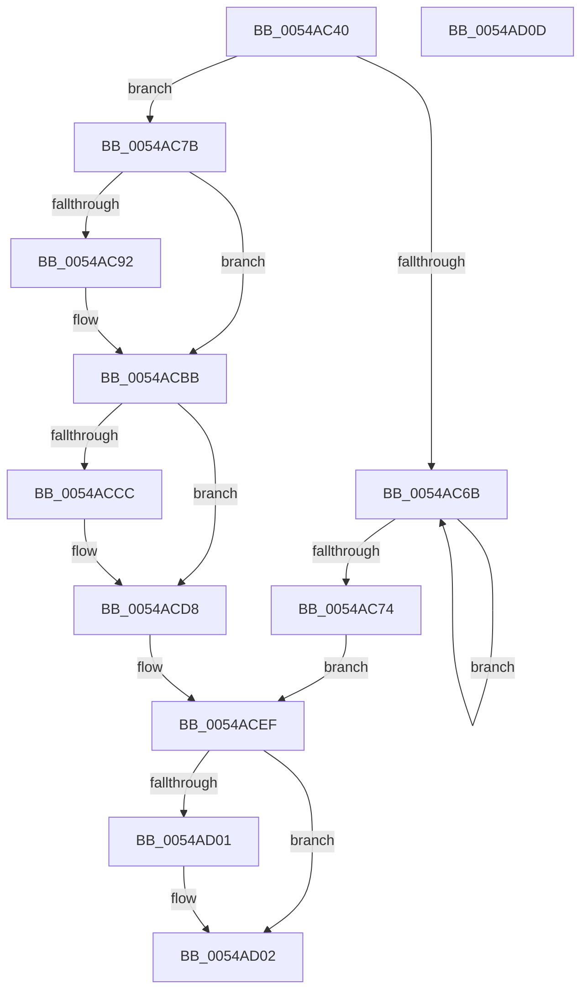

# HalpTscFallback

- RVA: `0x0054AC40`–`0x0054AD0E` (길이 `206` bytes)
- VA: `0x000000014054AC40`
- 실행 섹션: `.text`
- PDB 이름 있음: `예`; PDB Function 태그: `아니요`
- unwind 정보 RVA: `0x000C3EDC`
- 디코드: `54`개 명령, `206/206` bytes 표시
- 미해석 바이트: `0` (있으면 어셈블리에 `.byte`로 보존)

> 이 문서는 커널 이미지의 기계어와 PDB 기호를 분석해 생성했습니다. 4번과 5번은 함수 원형과 자료형을 바이너리 사용 방식에서 추정한 C 해석이며 원본 소스 복구 결과는 아닙니다.

## 1. Dependencies

- 직접 호출 지점: **6**; 고유 호출 대상: **6**
- 직접 호출자로 확인된 함수: **0**
- RIP 상대 이미지 참조: **7**

### Outgoing calls
- `0x0054AC57` → [HalpDisableInterrupts](../25/HalpDisableInterrupts_function_002521A0.md) (function, `0x002521A0`)
- `0x0054AC7D` → [KeQueryPerformanceCounter](../37/KeQueryPerformanceCounter_function_0037E7E0.md) (function, `0x0037E7E0`)
- `0x0054ACB5` → [KeBugCheckEx](../4F/KeBugCheckEx_function_004FD660.md) (function, `0x004FD660`)
- `0x0054ACCC` → [HalpTimerCalculateMaximumAllowableDrift](HalpTimerCalculateMaximumAllowableDrift_function_00548A60.md) (function, `0x00548A60`)
- `0x0054ACE7` → [RtlSetSystemGlobalData](../43/RtlSetSystemGlobalData_function_00435AF0.md) (function, `0x00435AF0`)
- `0x0054ACF7` → [HalCalibratePerformanceCounter](../53/HalCalibratePerformanceCounter_function_0053C010.md) (function, `0x0053C010`)

### Direct callers
- 이 함수 시작 RVA로 연결되는 직접 call은 확인되지 않았습니다. 간접 호출은 완전히 역산할 수 없습니다.

### Static image references
- `0x0054AC86` → RVA `0x00FC40C0` (`.data`; read)
- `0x0054AC92` → RVA `0x00FC413C` (`.data`; read)
- `0x0054AC98` → RVA `0x00FC4120` (`.data`; read)
- `0x0054AC9F` → RVA `0x00FC3FD0` (`.data`; read)
- `0x0054ACBB` → RVA `0x00FC4140` (`.data`; read)
- `0x0054ACC3` → RVA `0x00FC3FD0` (`.data`; write)
- `0x0054ACD1` → RVA `0x00FC40D0` (`.data`; write)

## 2. Other-region calls and transfers

- 다른 실행 섹션으로 향하는 call: **0**
- 별도 외부 분기/꼬리 이동을 확인하지 못했습니다.

## 3. Assembly (complete function range)

```asm
0054AC40  48 8B C4                        mov rax, rsp
0054AC43  48 89 58 18                     mov qword ptr [rax + 0x18], rbx
0054AC47  48 89 48 08                     mov qword ptr [rax + 8], rcx
0054AC4B  57                              push rdi
0054AC4C  48 83 EC 30                     sub rsp, 0x30
0054AC50  C6 40 10 00                     mov byte ptr [rax + 0x10], 0
0054AC54  48 8B D9                        mov rbx, rcx
0054AC57  E8 44 75 D0 FF                  call 0x1402521a0
0054AC5C  40 8A F8                        mov dil, al
0054AC5F  83 C9 FF                        or ecx, 0xffffffff
0054AC62  F0 0F C1 0B                     lock xadd dword ptr [rbx], ecx
0054AC66  83 F9 01                        cmp ecx, 1
0054AC69  74 10                           je 0x14054ac7b
0054AC6B  F3 90                           pause
0054AC6D  8B 0B                           mov ecx, dword ptr [rbx]
0054AC6F  83 F9 FF                        cmp ecx, -1
0054AC72  75 F7                           jne 0x14054ac6b
0054AC74  F0 83 0C 24 00                  lock or dword ptr [rsp], 0
0054AC79  EB 74                           jmp 0x14054acef
0054AC7B  33 C9                           xor ecx, ecx
0054AC7D  E8 5E 3B E3 FF                  call 0x14037e7e0
0054AC82  48 89 43 08                     mov qword ptr [rbx + 8], rax
0054AC86  48 8B 05 33 94 A7 00            mov rax, qword ptr [rip + 0xa79433]
0054AC8D  48 85 C0                        test rax, rax
0054AC90  75 29                           jne 0x14054acbb
0054AC92  8B 05 A4 94 A7 00               mov eax, dword ptr [rip + 0xa794a4]
0054AC98  4C 8D 0D 81 94 A7 00            lea r9, [rip + 0xa79481]
0054AC9F  4C 8B 05 2A 93 A7 00            mov r8, qword ptr [rip + 0xa7932a]
0054ACA6  BA 00 10 00 00                  mov edx, 0x1000
0054ACAB  B9 5C 00 00 00                  mov ecx, 0x5c
0054ACB0  48 89 44 24 20                  mov qword ptr [rsp + 0x20], rax
0054ACB5  E8 A6 29 FB FF                  call 0x1404fd660
0054ACBA  CC                              int3
0054ACBB  48 83 3D 7D 94 A7 00 00         cmp qword ptr [rip + 0xa7947d], 0
0054ACC3  48 89 05 06 93 A7 00            mov qword ptr [rip + 0xa79306], rax
0054ACCA  74 0C                           je 0x14054acd8
0054ACCC  E8 8F DD FF FF                  call 0x140548a60
0054ACD1  48 89 05 F8 93 A7 00            mov qword ptr [rip + 0xa793f8], rax
0054ACD8  41 B8 01 00 00 00               mov r8d, 1
0054ACDE  48 8D 54 24 48                  lea rdx, [rsp + 0x48]
0054ACE3  41 8D 48 0F                     lea ecx, [r8 + 0xf]
0054ACE7  E8 04 AE EE FF                  call 0x140435af0
0054ACEC  F0 FF 0B                        lock dec dword ptr [rbx]
0054ACEF  48 8B 53 08                     mov rdx, qword ptr [rbx + 8]
0054ACF3  48 8D 4B 04                     lea rcx, [rbx + 4]
0054ACF7  E8 14 13 FF FF                  call 0x14053c010
0054ACFC  40 84 FF                        test dil, dil
0054ACFF  74 01                           je 0x14054ad02
0054AD01  FB                              sti
0054AD02  48 8B 5C 24 50                  mov rbx, qword ptr [rsp + 0x50]
0054AD07  48 83 C4 30                     add rsp, 0x30
0054AD0B  5F                              pop rdi
0054AD0C  C3                              ret
0054AD0D  CC                              int3
```

## 4. C-style interpretation (structured pseudocode)

```c
__int64 __fastcall HalpTscFallback(__int64 a1)
{
    __int64 result;
    __int64 v_rsp;
    unsigned __int64 v_stack_m18;
    unsigned int v_stack_m38;
    unsigned __int64 v_stack_p10;
    unsigned __int64 v_stack_p18;

    *(unsigned __int64 *)(v_rsp + 24) = v_rbx;
    *(unsigned __int64 *)(v_rsp + 8) = a1;
    v_rsp = (v_rsp) - (48);
    *(unsigned __int8 *)(v_rsp + 16) = 0;
    result = HalpDisableInterrupts(a1, a2, a3, a4);
    a1 = (unsigned int)((a1) | (0xFFFFFFFFULL));
    if (((unsigned int)(a1)) == 1) goto loc_0054AC7B;
loc_0054AC6B:
    if (((unsigned int)((unsigned int)(*(unsigned int *)(a1)))) != -1) goto loc_0054AC6B;
    goto loc_0054ACEF;
loc_0054AC7B:
    a1 = 0;
    result = KeQueryPerformanceCounter(a1, a2, a3, a4);
    *(unsigned __int64 *)(a1 + 8) = result;
    result = *(unsigned __int64 *)(v_rip + 10982451);
    if (*(unsigned __int64 *)(v_rip + 10982451) == 0) {
        result = *(unsigned int *)(v_rip + 10982564);
        a4 = v_rip + 10982529;
        a3 = *(unsigned __int64 *)(v_rip + 10982186);
        a2 = 0x1000ULL;
        a1 = 92;
        v_stack_m18 = result;
        result = KeBugCheckEx(a1, a2, a3, a4);
    }
    *(unsigned __int64 *)(v_rip + 10982150) = result;
    if ((*(unsigned __int64 *)(v_rip + 10982525)) != 0) {
        result = HalpTimerCalculateMaximumAllowableDrift(a1, a2, a3, a4);
        *(unsigned __int64 *)(v_rip + 10982392) = result;
    }
    result = RtlSetSystemGlobalData(1 + 15, v_stack_p10, 1, a4);
loc_0054ACEF:
    result = HalCalibratePerformanceCounter(a1 + 4, *(unsigned __int64 *)(a1 + 8), 1, a4);
    if ((unsigned __int8)((unsigned __int8)(result)) != 0) {
    }
    v_rsp = (v_rsp) + (48);
    return result;
}
```

## 5. (Beta) C Style

```c
int64_t HalpTscFallback(void *Arg1)
{
    uint8_t *arg1 = (uint8_t *)Arg1;

    int64_t result;
    int64_t local_rsp;
    uint64_t v_stack_m18;
    uint32_t v_stack_m38;
    uint64_t v_stack_p10;
    uint64_t v_stack_p18;

    *(uint64_t *)(local_rsp + 0x18) = local_rbx;
    *(void **)(local_rsp + 0x8) = Arg1;
    local_rsp = (local_rsp) - (48);
    *(uint8_t *)(local_rsp + 0x10) = 0;
    result = HalpDisableInterrupts(Arg1, a2, a3, a4);
    Arg1 = (uint32_t)((Arg1) | (0xFFFFFFFFULL));
    if (((uint32_t)(Arg1)) == 1) goto loc_0054AC7B;
loc_0054AC6B:
    if (((uint32_t)((uint32_t)(*(uint32_t *)(arg1)))) != -1) goto loc_0054AC6B;
    goto loc_0054ACEF;
loc_0054AC7B:
    Arg1 = 0;
    result = KeQueryPerformanceCounter(Arg1, a2, a3, a4);
    *(uint64_t *)(arg1 + 0x8) = result;
    result = *(uint64_t *)(v_rip + 0xA79433);
    if (*(uint64_t *)(v_rip + 0xA79433) == 0) {
        result = *(uint32_t *)(v_rip + 0xA794A4);
        a4 = v_rip + 10982529;
        a3 = *(uint64_t *)(v_rip + 0xA7932A);
        a2 = 0x1000ULL;
        Arg1 = 92;
        v_stack_m18 = result;
        result = KeBugCheckEx(Arg1, a2, a3, a4);
    }
    *(uint64_t *)(v_rip + 0xA79306) = result;
    if ((*(uint64_t *)(v_rip + 0xA7947D)) != 0) {
        result = HalpTimerCalculateMaximumAllowableDrift(Arg1, a2, a3, a4);
        *(uint64_t *)(v_rip + 0xA793F8) = result;
    }
    result = RtlSetSystemGlobalData(1 + 15, v_stack_p10, 1, a4);
loc_0054ACEF:
    result = HalCalibratePerformanceCounter(Arg1 + 4, *(uint64_t *)(arg1 + 0x8), 1, a4);
    if ((uint8_t)((uint8_t)(result)) != 0) {
    }
    local_rsp = (local_rsp) + (48);
    return result;
}
```

### 관측된 메모리 오프셋

구조체 형식이 확인되지 않은 접근은 인자 기준의 오프셋으로만 기록했습니다.

| 기준 인자 | 오프셋 표현 | 폭 (bit) | 접근 |
|---|---:|---:|---|
| `Arg1` | `+ 0x0` | `32` | `R` |
| `Arg1` | `+ 0x0` | `32` | `R/W` |
| `Arg1` | `+ 0x4` | `64` | `R` |
| `Arg1` | `+ 0x8` | `64` | `R` |
| `Arg1` | `+ 0x8` | `64` | `W` |

## 6. Execution-region graph

[열기: 2D/3D 그래프와 함수 탐색 컨트롤 패널](../../../control-panel.html?section=text&rva=0x0054AC40&view=graph)

- 2D 그래프는 위에서 아래로 흐르고, 3D 그래프는 빈 공간을 드래그해 회전합니다. Shift+드래그는 이동, 휠은 확대·축소, 함수 노드 선택은 대상 보고서 이동입니다.

### Static fallback


