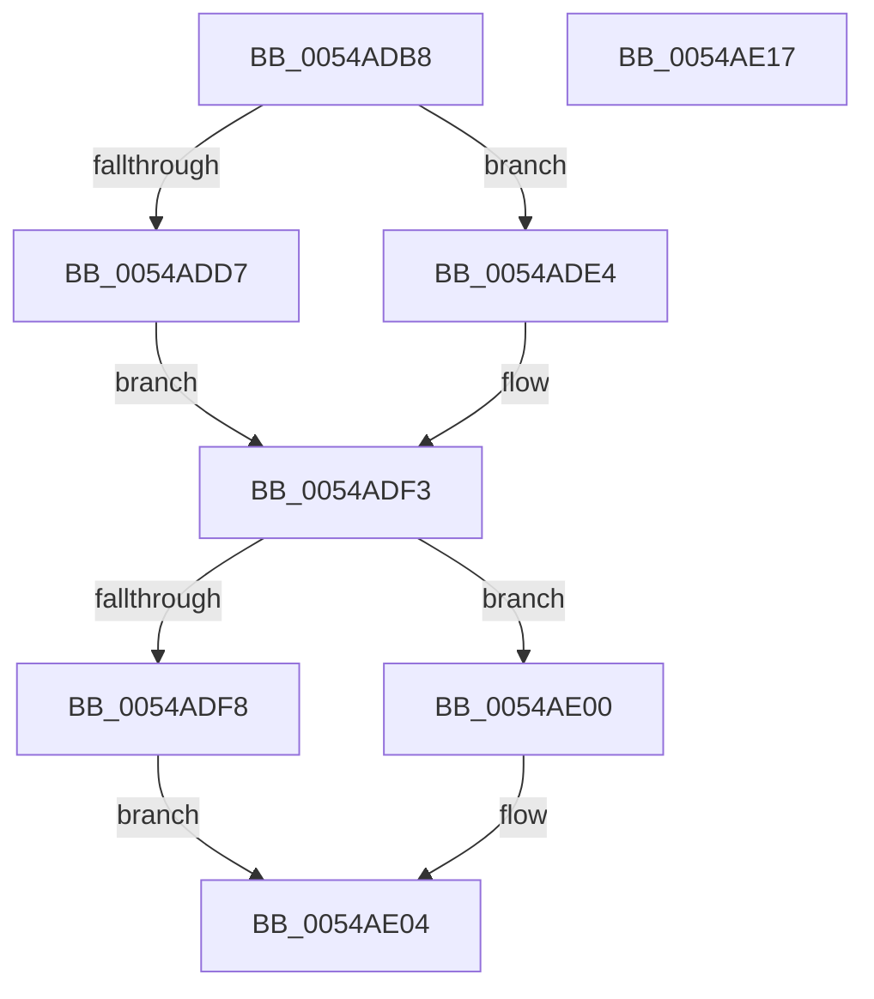

# HalpTscInitializeSynchronizationContext

- RVA: `0x0054ADB8`–`0x0054AE18` (길이 `96` bytes)
- VA: `0x000000014054ADB8`
- 실행 섹션: `.text`
- PDB 이름 있음: `예`; PDB Function 태그: `아니요`
- unwind 정보 RVA: `0x00060BC4`
- 디코드: `32`개 명령, `96/96` bytes 표시
- 미해석 바이트: `0` (있으면 어셈블리에 `.byte`로 보존)

> 이 문서는 커널 이미지의 기계어와 PDB 기호를 분석해 생성했습니다. 4번과 5번은 함수 원형과 자료형을 바이너리 사용 방식에서 추정한 C 해석이며 원본 소스 복구 결과는 아닙니다.

## 1. Dependencies

- 직접 호출 지점: **1**; 고유 호출 대상: **1**
- 직접 호출자로 확인된 함수: **2**
- RIP 상대 이미지 참조: **0**

### Outgoing calls
- `0x0054ADE9` → [KeQueryActiveProcessorCountEx](../24/KeQueryActiveProcessorCountEx_function_00249EF0.md) (function, `0x00249EF0`)

### Direct callers
- [HalpTscSynchronization](HalpTscSynchronization_function_0054AFC0.md) at `0x0054B021`
- [HalpPostSleepMP](../../pagelk/B5/HalpPostSleepMP_function_00B5ECC4.md) at `0x00B5ED7B`

### Static image references
- 디코드된 RIP-relative 메모리 참조가 없습니다.

## 2. Other-region calls and transfers

- 다른 실행 섹션으로 향하는 call: **0**
- 별도 외부 분기/꼬리 이동을 확인하지 못했습니다.

## 3. Assembly (complete function range)

```asm
0054ADB8  48 89 5C 24 08                  mov qword ptr [rsp + 8], rbx
0054ADBD  48 89 74 24 10                  mov qword ptr [rsp + 0x10], rsi
0054ADC2  57                              push rdi
0054ADC3  48 83 EC 20                     sub rsp, 0x20
0054ADC7  33 FF                           xor edi, edi
0054ADC9  88 51 21                        mov byte ptr [rcx + 0x21], dl
0054ADCC  49 8B F0                        mov rsi, r8
0054ADCF  48 8B D9                        mov rbx, rcx
0054ADD2  4D 85 C9                        test r9, r9
0054ADD5  74 0D                           je 0x14054ade4
0054ADD7  41 8B 01                        mov eax, dword ptr [r9]
0054ADDA  89 01                           mov dword ptr [rcx], eax
0054ADDC  41 8B 01                        mov eax, dword ptr [r9]
0054ADDF  89 41 28                        mov dword ptr [rcx + 0x28], eax
0054ADE2  EB 0F                           jmp 0x14054adf3
0054ADE4  B9 FF FF 00 00                  mov ecx, 0xffff
0054ADE9  E8 02 F1 CF FF                  call 0x140249ef0
0054ADEE  89 43 28                        mov dword ptr [rbx + 0x28], eax
0054ADF1  89 03                           mov dword ptr [rbx], eax
0054ADF3  48 85 F6                        test rsi, rsi
0054ADF6  74 08                           je 0x14054ae00
0054ADF8  C6 43 22 01                     mov byte ptr [rbx + 0x22], 1
0054ADFC  8B 3E                           mov edi, dword ptr [rsi]
0054ADFE  EB 04                           jmp 0x14054ae04
0054AE00  40 88 7B 22                     mov byte ptr [rbx + 0x22], dil
0054AE04  89 7B 24                        mov dword ptr [rbx + 0x24], edi
0054AE07  48 8B 5C 24 30                  mov rbx, qword ptr [rsp + 0x30]
0054AE0C  48 8B 74 24 38                  mov rsi, qword ptr [rsp + 0x38]
0054AE11  48 83 C4 20                     add rsp, 0x20
0054AE15  5F                              pop rdi
0054AE16  C3                              ret
0054AE17  CC                              int3
```

## 4. C-style interpretation (structured pseudocode)

```c
__int64 __fastcall HalpTscInitializeSynchronizationContext(__int64 a1, unsigned __int8 a2, __int64 a3, __int64 a4)
{
    __int64 result;
    __int64 v_rdi;
    __int64 v_rsp;
    unsigned __int64 v_stack_p10;
    unsigned __int64 v_stack_p8;

    v_stack_p8 = v_rbx;
    v_stack_p10 = v_rsi;
    v_rsp = (v_rsp) - (32);
    v_rdi = 0;
    *(unsigned __int8 *)(a1 + 33) = a2;
    if (a4 == 0) goto loc_0054ADE4;
    *(unsigned int *)(a1) = (unsigned int)((unsigned int)(*(unsigned int *)(a4)));
    *(unsigned int *)(a1 + 40) = (unsigned int)((unsigned int)(*(unsigned int *)(a4)));
    goto loc_0054ADF3;
loc_0054ADE4:
    result = KeQueryActiveProcessorCountEx((unsigned int)(0xFFFFULL), a2, a3, a4);
    *(unsigned int *)(a1 + 40) = (unsigned int)(result);
    *(unsigned int *)(a1) = (unsigned int)(result);
loc_0054ADF3:
    if (a3 == 0) goto loc_0054AE00;
    *(unsigned __int8 *)(a1 + 34) = 1;
    goto loc_0054AE04;
loc_0054AE00:
    *(unsigned __int8 *)(a1 + 34) = (unsigned __int8)((unsigned int)(*(unsigned int *)(a3)));
loc_0054AE04:
    *(unsigned int *)(a1 + 36) = (unsigned int)((unsigned int)(*(unsigned int *)(a3)));
    v_rsp = (v_rsp) + (32);
    return result;
}
```

## 5. (Beta) C Style

```c
int64_t HalpTscInitializeSynchronizationContext(void *Arg1, uint8_t Arg2, int64_t Arg3, int64_t Arg4)
{
    uint8_t *arg1 = (uint8_t *)Arg1;

    int64_t result;
    int64_t local_rdi;
    int64_t local_rsp;
    uint64_t v_stack_p10;
    uint64_t v_stack_p8;

    v_stack_p8 = local_rbx;
    v_stack_p10 = local_rsi;
    local_rsp = (local_rsp) - (32);
    local_rdi = 0;
    *(uint8_t *)(arg1 + 0x21) = Arg2;
    if (Arg4 == 0) goto loc_0054ADE4;
    *(uint32_t *)(arg1) = (uint32_t)((uint32_t)(*(uint32_t *)(Arg4)));
    *(uint32_t *)(arg1 + 0x28) = (uint32_t)((uint32_t)(*(uint32_t *)(Arg4)));
    goto loc_0054ADF3;
loc_0054ADE4:
    result = KeQueryActiveProcessorCountEx((uint32_t)(0xFFFFULL), Arg2, Arg3, Arg4);
    *(uint32_t *)(arg1 + 0x28) = (uint32_t)(result);
    *(uint32_t *)(arg1) = (uint32_t)(result);
loc_0054ADF3:
    if (Arg3 == 0) goto loc_0054AE00;
    *(uint8_t *)(arg1 + 0x22) = 1;
    goto loc_0054AE04;
loc_0054AE00:
    *(uint8_t *)(arg1 + 0x22) = (uint8_t)((uint32_t)(*(uint32_t *)(Arg3)));
loc_0054AE04:
    *(uint32_t *)(arg1 + 0x24) = (uint32_t)((uint32_t)(*(uint32_t *)(Arg3)));
    local_rsp = (local_rsp) + (32);
    return result;
}
```

### 관측된 메모리 오프셋

구조체 형식이 확인되지 않은 접근은 인자 기준의 오프셋으로만 기록했습니다.

| 기준 인자 | 오프셋 표현 | 폭 (bit) | 접근 |
|---|---:|---:|---|
| `Arg1` | `+ 0x0` | `32` | `W` |
| `Arg1` | `+ 0x21` | `8` | `W` |
| `Arg1` | `+ 0x22` | `8` | `W` |
| `Arg1` | `+ 0x24` | `32` | `W` |
| `Arg1` | `+ 0x28` | `32` | `W` |

## 6. Execution-region graph

[열기: 2D/3D 그래프와 함수 탐색 컨트롤 패널](../../../control-panel.html?section=text&rva=0x0054ADB8&view=graph)

- 2D 그래프는 위에서 아래로 흐르고, 3D 그래프는 빈 공간을 드래그해 회전합니다. Shift+드래그는 이동, 휠은 확대·축소, 함수 노드 선택은 대상 보고서 이동입니다.

### Static fallback


