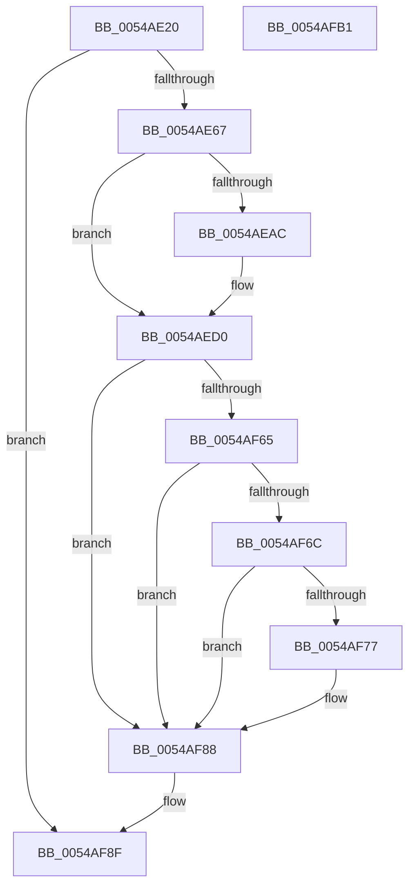

# HalpTscReserveResources

- RVA: `0x0054AE20`–`0x0054AFB2` (길이 `402` bytes)
- VA: `0x000000014054AE20`
- 실행 섹션: `.text`
- PDB 이름 있음: `예`; PDB Function 태그: `아니요`
- unwind 정보 RVA: `0x000C3B3C`
- 디코드: `99`개 명령, `402/402` bytes 표시
- 미해석 바이트: `0` (있으면 어셈블리에 `.byte`로 보존)

> 이 문서는 커널 이미지의 기계어와 PDB 기호를 분석해 생성했습니다. 4번과 5번은 함수 원형과 자료형을 바이너리 사용 방식에서 추정한 C 해석이며 원본 소스 복구 결과는 아닙니다.

## 1. Dependencies

- 직접 호출 지점: **6**; 고유 호출 대상: **6**
- 직접 호출자로 확인된 함수: **1**
- RIP 상대 이미지 참조: **11**

### Outgoing calls
- `0x0054AE4C` → [HalpQueryMaximumRegisteredProcessorCount](HalpQueryMaximumRegisteredProcessorCount_function_00543BE8.md) (function, `0x00543BE8`)
- `0x0054AE9F` → [HalpMmAllocCtxAlloc](../3E/HalpMmAllocCtxAlloc_function_003E10B8.md) (function, `0x003E10B8`)
- `0x0054AECA` → [KeBugCheckEx](../4F/KeBugCheckEx_function_004FD660.md) (function, `0x004FD660`)
- `0x0054AED8` → [memset](../6C/memset_function_006C6C40.md) (function, `0x006C6C40`)
- `0x0054AF5C` → [HalpGetCpuInfo](../49/HalpGetCpuInfo_function_00498A70.md) (function, `0x00498A70`)
- `0x0054AF97` → [_security_check_cookie](../6A/_security_check_cookie_function_006AC640.md) (function, `0x006AC640`)

### Direct callers
- [HalpTimerInitSystem](../53/HalpTimerInitSystem_function_0053CB70.md) at `0x0053CD8F`

### Static image references
- `0x0054AE34` → RVA `0x00E0A740` (`.data`; read)
- `0x0054AE45` → RVA `0x00FC2220` (`.data`; write)
- `0x0054AE51` → RVA `0x00FC3FD0` (`.data`; read)
- `0x0054AEAC` → RVA `0x00023E60` (`.rdata`; read)
- `0x0054AEE5` → RVA `0x00FC2218` (`.data`; write)
- `0x0054AEEF` → RVA `0x00FC2210` (`.data`; write)
- `0x0054AF02` → RVA `0x00FC21F0` (`.data`; write)
- `0x0054AF2A` → RVA `0x00FC21F8` (`.data`; write)
- `0x0054AF40` → RVA `0x00FC2208` (`.data`; write)
- `0x0054AF55` → RVA `0x00FC2238` (`.data`; write)
- `0x0054AF88` → RVA `0x00FC2244` (`.data`; write)

## 2. Other-region calls and transfers

- 다른 실행 섹션으로 향하는 call: **0**
- 별도 외부 분기/꼬리 이동을 확인하지 못했습니다.

## 3. Assembly (complete function range)

```asm
0054AE20  48 89 5C 24 08                  mov qword ptr [rsp + 8], rbx
0054AE25  48 89 6C 24 10                  mov qword ptr [rsp + 0x10], rbp
0054AE2A  48 89 74 24 18                  mov qword ptr [rsp + 0x18], rsi
0054AE2F  57                              push rdi
0054AE30  48 83 EC 50                     sub rsp, 0x50
0054AE34  48 8B 05 05 F9 8B 00            mov rax, qword ptr [rip + 0x8bf905]
0054AE3B  48 33 C4                        xor rax, rsp
0054AE3E  48 89 44 24 48                  mov qword ptr [rsp + 0x48], rax
0054AE43  33 FF                           xor edi, edi
0054AE45  48 89 3D D4 73 A7 00            mov qword ptr [rip + 0xa773d4], rdi
0054AE4C  E8 97 8D FF FF                  call 0x140543be8
0054AE51  48 8B 0D 78 91 A7 00            mov rcx, qword ptr [rip + 0xa79178]
0054AE58  8B F0                           mov esi, eax
0054AE5A  83 B9 E4 00 00 00 05            cmp dword ptr [rcx + 0xe4], 5
0054AE61  0F 85 28 01 00 00               jne 0x14054af8f
0054AE67  B8 F8 FF FF FF                  mov eax, 0xfffffff8
0054AE6C  8D 14 B5 00 00 00 00            lea edx, [rsi*4]
0054AE73  8D 0C F5 07 00 00 00            lea ecx, [rsi*8 + 7]
0054AE7A  8B DE                           mov ebx, esi
0054AE7C  03 CA                           add ecx, edx
0054AE7E  C1 E3 07                        shl ebx, 7
0054AE81  23 C8                           and ecx, eax
0054AE83  81 C3 87 00 00 00               add ebx, 0x87
0054AE89  83 C1 07                        add ecx, 7
0054AE8C  03 CA                           add ecx, edx
0054AE8E  83 C2 07                        add edx, 7
0054AE91  23 C8                           and ecx, eax
0054AE93  03 D1                           add edx, ecx
0054AE95  23 D0                           and edx, eax
0054AE97  03 DA                           add ebx, edx
0054AE99  48 23 D8                        and rbx, rax
0054AE9C  48 8B D3                        mov rdx, rbx
0054AE9F  E8 14 62 E9 FF                  call 0x1403e10b8
0054AEA4  48 8B E8                        mov rbp, rax
0054AEA7  48 85 C0                        test rax, rax
0054AEAA  75 24                           jne 0x14054aed0
0054AEAC  4C 8D 0D AD 8F AD FF            lea r9, [rip - 0x527053]
0054AEB3  48 C7 44 24 20 65 01 00 00      mov qword ptr [rsp + 0x20], 0x165
0054AEBC  41 B8 00 AB 00 00               mov r8d, 0xab00
0054AEC2  48 8B D3                        mov rdx, rbx
0054AEC5  B9 AC 00 00 00                  mov ecx, 0xac
0054AECA  E8 91 27 FB FF                  call 0x1404fd660
0054AECF  CC                              int3
0054AED0  4C 8B C3                        mov r8, rbx
0054AED3  33 D2                           xor edx, edx
0054AED5  48 8B CD                        mov rcx, rbp
0054AED8  E8 63 BD 17 00                  call 0x1406c6c40
0054AEDD  48 8D 04 F5 07 00 00 00         lea rax, [rsi*8 + 7]
0054AEE5  48 89 2D 2C 73 A7 00            mov qword ptr [rip + 0xa7732c], rbp
0054AEEC  48 03 C5                        add rax, rbp
0054AEEF  C7 05 17 73 A7 00 00 04 00 00   mov dword ptr [rip + 0xa77317], 0x400
0054AEF9  48 83 E0 F8                     and rax, 0xfffffffffffffff8
0054AEFD  40 88 7C 24 30                  mov byte ptr [rsp + 0x30], dil
0054AF02  48 89 05 E7 72 A7 00            mov qword ptr [rip + 0xa772e7], rax
0054AF09  48 8D 0C B5 07 00 00 00         lea rcx, [rsi*4 + 7]
0054AF11  4C 8D 4C 24 30                  lea r9, [rsp + 0x30]
0054AF16  45 33 C0                        xor r8d, r8d
0054AF19  33 D2                           xor edx, edx
0054AF1B  48 8D 04 B0                     lea rax, [rax + rsi*4]
0054AF1F  48 83 C0 07                     add rax, 7
0054AF23  48 83 E0 F8                     and rax, 0xfffffffffffffff8
0054AF27  48 03 C8                        add rcx, rax
0054AF2A  48 89 05 C7 72 A7 00            mov qword ptr [rip + 0xa772c7], rax
0054AF31  48 83 E1 F8                     and rcx, 0xfffffffffffffff8
0054AF35  48 8D 04 B5 07 00 00 00         lea rax, [rsi*4 + 7]
0054AF3D  48 03 C1                        add rax, rcx
0054AF40  48 89 0D C1 72 A7 00            mov qword ptr [rip + 0xa772c1], rcx
0054AF47  48 83 E0 F8                     and rax, 0xfffffffffffffff8
0054AF4B  33 C9                           xor ecx, ecx
0054AF4D  48 83 C0 78                     add rax, 0x78
0054AF51  48 83 E0 80                     and rax, 0xffffffffffffff80
0054AF55  48 89 05 DC 72 A7 00            mov qword ptr [rip + 0xa772dc], rax
0054AF5C  E8 0F DB F4 FF                  call 0x140498a70
0054AF61  84 C0                           test al, al
0054AF63  74 23                           je 0x14054af88
0054AF65  80 7C 24 30 02                  cmp byte ptr [rsp + 0x30], 2
0054AF6A  75 1C                           jne 0x14054af88
0054AF6C  33 C0                           xor eax, eax
0054AF6E  33 C9                           xor ecx, ecx
0054AF70  0F A2                           cpuid
0054AF72  83 F8 07                        cmp eax, 7
0054AF75  72 11                           jb 0x14054af88
0054AF77  33 C9                           xor ecx, ecx
0054AF79  B8 07 00 00 00                  mov eax, 7
0054AF7E  0F A2                           cpuid
0054AF80  D0 EB                           shr bl, 1
0054AF82  80 E3 01                        and bl, 1
0054AF85  40 8A FB                        mov dil, bl
0054AF88  40 88 3D B5 72 A7 00            mov byte ptr [rip + 0xa772b5], dil
0054AF8F  48 8B 4C 24 48                  mov rcx, qword ptr [rsp + 0x48]
0054AF94  48 33 CC                        xor rcx, rsp
0054AF97  E8 A4 16 16 00                  call 0x1406ac640
0054AF9C  48 8B 5C 24 60                  mov rbx, qword ptr [rsp + 0x60]
0054AFA1  48 8B 6C 24 68                  mov rbp, qword ptr [rsp + 0x68]
0054AFA6  48 8B 74 24 70                  mov rsi, qword ptr [rsp + 0x70]
0054AFAB  48 83 C4 50                     add rsp, 0x50
0054AFAF  5F                              pop rdi
0054AFB0  C3                              ret
0054AFB1  CC                              int3
```

## 4. C-style interpretation (structured pseudocode)

```c
__int64 __fastcall HalpTscReserveResources(void)
{
    __int64 result;
    __int64 v_rbx;
    __int64 v_rdi;
    __int64 v_rsp;
    unsigned __int64 v_stack_m10;
    unsigned __int8 v_stack_m28;
    unsigned __int64 v_stack_m38;
    unsigned __int64 v_stack_p10;
    unsigned __int64 v_stack_p18;
    unsigned __int64 v_stack_p8;

    v_stack_p8 = v_rbx;
    v_stack_p10 = v_rbp;
    v_stack_p18 = v_rsi;
    v_rsp = (v_rsp) - (80);
    result = (*(unsigned __int64 *)(v_rip + 9173253)) ^ (v_rsp);
    v_stack_m10 = result;
    v_rdi = 0;
    *(unsigned __int64 *)(v_rip + 10974164) = 0;
    result = HalpQueryMaximumRegisteredProcessorCount(a1, a2, a3, a4);
    if ((*(unsigned int *)(*(unsigned __int64 *)(v_rip + 10981752) + 228)) != 5) goto loc_0054AF8F;
    a1 = (unsigned int)(((unsigned int)((unsigned int)(result)) * 8 + 7) + ((unsigned int)((unsigned int)((unsigned int)(result)) * 4)));
    v_rbx = (unsigned int)(((unsigned int)((unsigned int)((unsigned int)((unsigned int)(result))))) << (7));
    a1 = (unsigned int)((a1) & ((unsigned int)((unsigned int)(0xFFFFFFF8ULL))));
    v_rbx = (unsigned int)((v_rbx) + (135));
    a1 = (unsigned int)((a1) + (7));
    a1 = (unsigned int)((a1) + ((unsigned int)((unsigned int)((unsigned int)(result)) * 4)));
    a2 = (unsigned int)(((unsigned int)((unsigned int)(result)) * 4) + (7));
    a1 = (unsigned int)((a1) & ((unsigned int)((unsigned int)(0xFFFFFFF8ULL))));
    a2 = (unsigned int)((a2) + ((unsigned int)(a1)));
    a2 = (unsigned int)((a2) & ((unsigned int)((unsigned int)(0xFFFFFFF8ULL))));
    v_rbx = (unsigned int)((v_rbx) + ((unsigned int)(a2)));
    v_rbx = (v_rbx) & ((unsigned int)(0xFFFFFFF8ULL));
    result = HalpMmAllocCtxAlloc(a1, v_rbx, a3, a4);
    if (result == 0) {
        a4 = v_rip - 5402707;
        v_stack_m38 = 357;
        a3 = 0xAB00ULL;
        a2 = v_rbx;
        a1 = 172;
        result = KeBugCheckEx(a1, a2, a3, a4);
    }
    a2 = 0;
    result = memset(result, a2, v_rbx, a4);
    *(unsigned __int64 *)(v_rip + 10973996) = result;
    result = ((unsigned int)((unsigned int)(result)) * 8 + 7) + (result);
    *(unsigned int *)(v_rip + 10973975) = 0x400ULL;
    result = (result) & (-8);
    v_stack_m28 = 0;
    *(unsigned __int64 *)(v_rip + 10973927) = result;
    a3 = 0;
    a2 = 0;
    result = (result + (unsigned int)((unsigned int)(result)) * 4) + (7);
    result = (result) & (-8);
    a1 = ((unsigned int)((unsigned int)(result)) * 4 + 7) + (result);
    *(unsigned __int64 *)(v_rip + 10973895) = result;
    a1 = (a1) & (-8);
    result = ((unsigned int)((unsigned int)(result)) * 4 + 7) + (a1);
    *(unsigned __int64 *)(v_rip + 10973889) = a1;
    result = (result) & (-8);
    a1 = 0;
    result = (result) + (120);
    result = (result) & (-128);
    *(unsigned __int64 *)(v_rip + 10973916) = result;
    result = HalpGetCpuInfo(a1, a2, a3, v_stack_m28);
    if ((unsigned __int8)(result) == 0) goto loc_0054AF88;
    if (v_stack_m28 != 2) goto loc_0054AF88;
    result = 0;
    a1 = 0;
    if (0 >= 7) {
        a1 = 0;
        result = 7;
        v_rbx = (unsigned __int8)((v_rbx) >> (1));
        v_rbx = (unsigned __int8)((v_rbx) & (1));
        v_rdi = (unsigned __int8)(v_rbx);
    }
    *(unsigned __int8 *)(v_rip + 10973877) = (unsigned __int8)(v_rdi);
loc_0054AF8F:
    a1 = (v_stack_m10) ^ (v_rsp);
    result = _security_check_cookie(a1, a2, a3, v_stack_m28);
    v_rsp = (v_rsp) + (80);
    return result;
}
```

## 5. (Beta) C Style

```c
void HalpTscReserveResources(void)
{
    int64_t result;
    int64_t local_rbx;
    int64_t local_rdi;
    int64_t local_rsp;
    uint64_t v_stack_m10;
    uint8_t v_stack_m28;
    uint64_t v_stack_m38;
    uint64_t v_stack_p10;
    uint64_t v_stack_p18;
    uint64_t v_stack_p8;

    v_stack_p8 = local_rbx;
    v_stack_p10 = local_rbp;
    v_stack_p18 = local_rsi;
    local_rsp = (local_rsp) - (80);
    result = (*(uint64_t *)(v_rip + 0x8BF905)) ^ (local_rsp);
    v_stack_m10 = result;
    local_rdi = 0;
    *(uint64_t *)(v_rip + 0xA773D4) = 0;
    result = HalpQueryMaximumRegisteredProcessorCount(a1, a2, a3, a4);
    if ((*(uint32_t *)(*(uint64_t *)(v_rip + 0xA79178) + 0xE4)) != 5) goto loc_0054AF8F;
    a1 = (uint32_t)(((uint32_t)((uint32_t)(result)) * 8 + 7) + ((uint32_t)((uint32_t)((uint32_t)(result)) * 4)));
    local_rbx = (uint32_t)(((uint32_t)((uint32_t)((uint32_t)((uint32_t)(result))))) << (7));
    a1 = (uint32_t)((a1) & ((uint32_t)((uint32_t)(0xFFFFFFF8ULL))));
    local_rbx = (uint32_t)((local_rbx) + (135));
    a1 = (uint32_t)((a1) + (7));
    a1 = (uint32_t)((a1) + ((uint32_t)((uint32_t)((uint32_t)(result)) * 4)));
    a2 = (uint32_t)(((uint32_t)((uint32_t)(result)) * 4) + (7));
    a1 = (uint32_t)((a1) & ((uint32_t)((uint32_t)(0xFFFFFFF8ULL))));
    a2 = (uint32_t)((a2) + ((uint32_t)(a1)));
    a2 = (uint32_t)((a2) & ((uint32_t)((uint32_t)(0xFFFFFFF8ULL))));
    local_rbx = (uint32_t)((local_rbx) + ((uint32_t)(a2)));
    local_rbx = (local_rbx) & ((uint32_t)(0xFFFFFFF8ULL));
    result = HalpMmAllocCtxAlloc(a1, local_rbx, a3, a4);
    if (result == 0) {
        a4 = v_rip - 5402707;
        v_stack_m38 = 357;
        a3 = 0xAB00ULL;
        a2 = local_rbx;
        a1 = 172;
        result = KeBugCheckEx(a1, a2, a3, a4);
    }
    a2 = 0;
    result = memset(result, a2, local_rbx, a4);
    *(uint64_t *)(v_rip + 0xA7732C) = result;
    result = ((uint32_t)((uint32_t)(result)) * 8 + 7) + (result);
    *(uint32_t *)(v_rip + 0xA77317) = 0x400ULL;
    result = (result) & (-8);
    v_stack_m28 = 0;
    *(uint64_t *)(v_rip + 0xA772E7) = result;
    a3 = 0;
    a2 = 0;
    result = (result + (uint32_t)((uint32_t)(result)) * 4) + (7);
    result = (result) & (-8);
    a1 = ((uint32_t)((uint32_t)(result)) * 4 + 7) + (result);
    *(uint64_t *)(v_rip + 0xA772C7) = result;
    a1 = (a1) & (-8);
    result = ((uint32_t)((uint32_t)(result)) * 4 + 7) + (a1);
    *(uint64_t *)(v_rip + 0xA772C1) = a1;
    result = (result) & (-8);
    a1 = 0;
    result = (result) + (120);
    result = (result) & (-128);
    *(uint64_t *)(v_rip + 0xA772DC) = result;
    result = HalpGetCpuInfo(a1, a2, a3, v_stack_m28);
    if ((uint8_t)(result) == 0) goto loc_0054AF88;
    if (v_stack_m28 != 2) goto loc_0054AF88;
    result = 0;
    a1 = 0;
    if (0 >= 7) {
        a1 = 0;
        result = 7;
        local_rbx = (uint8_t)((local_rbx) >> (1));
        local_rbx = (uint8_t)((local_rbx) & (1));
        local_rdi = (uint8_t)(local_rbx);
    }
    *(uint8_t *)(v_rip + 0xA772B5) = (uint8_t)(local_rdi);
loc_0054AF8F:
    a1 = (v_stack_m10) ^ (local_rsp);
    result = _security_check_cookie(a1, a2, a3, v_stack_m28);
    local_rsp = (local_rsp) + (80);
    return result;
}
```

## 6. Execution-region graph

[열기: 2D/3D 그래프와 함수 탐색 컨트롤 패널](../../../control-panel.html?section=text&rva=0x0054AE20&view=graph)

- 2D 그래프는 위에서 아래로 흐르고, 3D 그래프는 빈 공간을 드래그해 회전합니다. Shift+드래그는 이동, 휠은 확대·축소, 함수 노드 선택은 대상 보고서 이동입니다.

### Static fallback


