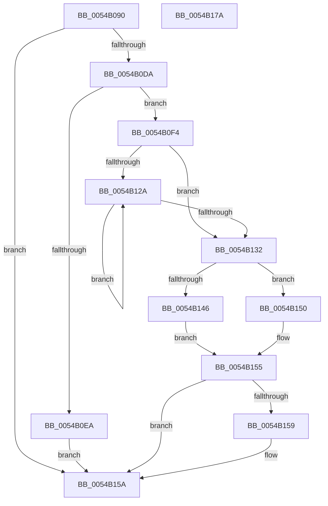

# HalpTscSynchronizationWorker

- RVA: `0x0054B090`–`0x0054B17B` (길이 `235` bytes)
- VA: `0x000000014054B090`
- 실행 섹션: `.text`
- PDB 이름 있음: `예`; PDB Function 태그: `아니요`
- unwind 정보 RVA: `0x000C3F24`
- 디코드: `57`개 명령, `235/235` bytes 표시
- 미해석 바이트: `0` (있으면 어셈블리에 `.byte`로 보존)

> 이 문서는 커널 이미지의 기계어와 PDB 기호를 분석해 생성했습니다. 4번과 5번은 함수 원형과 자료형을 바이너리 사용 방식에서 추정한 C 해석이며 원본 소스 복구 결과는 아닙니다.

## 1. Dependencies

- 직접 호출 지점: **6**; 고유 호출 대상: **6**
- 직접 호출자로 확인된 함수: **1**
- RIP 상대 이미지 참조: **4**

### Outgoing calls
- `0x0054B0C7` → [memset](../6C/memset_function_006C6C40.md) (function, `0x006C6C40`)
- `0x0054B0ED` → [HalpTscCompatibilitySynchronization](HalpTscCompatibilitySynchronization_function_0054AB14.md) (function, `0x0054AB14`)
- `0x0054B117` → [HalpDisableInterrupts](../25/HalpDisableInterrupts_function_002521A0.md) (function, `0x002521A0`)
- `0x0054B149` → [HalpTscAdvSynchLeader](HalpTscAdvSynchLeader_function_0054A690.md) (function, `0x0054A690`)
- `0x0054B150` → [HalpTscAdvSynchTarget](../49/HalpTscAdvSynchTarget_function_00492A44.md) (function, `0x00492A44`)
- `0x0054B164` → [_security_check_cookie](../6A/_security_check_cookie_function_006AC640.md) (function, `0x006AC640`)

### Direct callers
- [HalpPostSleepMP](../../pagelk/B5/HalpPostSleepMP_function_00B5ECC4.md) at `0x00B5EE5F`

### Static image references
- `0x0054B0A6` → RVA `0x00E0A740` (`.data`; read)
- `0x0054B0DA` → RVA `0x00FC3FD0` (`.data`; read)
- `0x0054B107` → RVA `0x00FC2238` (`.data`; read)
- `0x0054B13B` → RVA `0x00E1035C` (`.data`; read)

## 2. Other-region calls and transfers

- 다른 실행 섹션으로 향하는 call: **0**
- 별도 외부 분기/꼬리 이동을 확인하지 못했습니다.

## 3. Assembly (complete function range)

```asm
0054B090  48 89 5C 24 10                  mov qword ptr [rsp + 0x10], rbx
0054B095  55                              push rbp
0054B096  48 81 EC 70 01 00 00            sub rsp, 0x170
0054B09D  48 8D 6C 24 60                  lea rbp, [rsp + 0x60]
0054B0A2  48 83 E5 C0                     and rbp, 0xffffffffffffffc0
0054B0A6  48 8B 05 93 F6 8B 00            mov rax, qword ptr [rip + 0x8bf693]
0054B0AD  48 33 C4                        xor rax, rsp
0054B0B0  48 89 85 00 01 00 00            mov qword ptr [rbp + 0x100], rax
0054B0B7  48 89 4D 00                     mov qword ptr [rbp], rcx
0054B0BB  33 D2                           xor edx, edx
0054B0BD  48 8D 4D 40                     lea rcx, [rbp + 0x40]
0054B0C1  41 B8 C0 00 00 00               mov r8d, 0xc0
0054B0C7  E8 74 BB 17 00                  call 0x1406c6c40
0054B0CC  48 8B 55 00                     mov rdx, qword ptr [rbp]
0054B0D0  83 7A 28 02                     cmp dword ptr [rdx + 0x28], 2
0054B0D4  0F 82 80 00 00 00               jb 0x14054b15a
0054B0DA  48 8B 05 EF 8E A7 00            mov rax, qword ptr [rip + 0xa78eef]
0054B0E1  83 B8 E4 00 00 00 05            cmp dword ptr [rax + 0xe4], 5
0054B0E8  74 0A                           je 0x14054b0f4
0054B0EA  48 8B CA                        mov rcx, rdx
0054B0ED  E8 22 FA FF FF                  call 0x14054ab14
0054B0F2  EB 66                           jmp 0x14054b15a
0054B0F4  65 48 8B 04 25 20 00 00 00      mov rax, qword ptr gs:[0x20]
0054B0FD  4C 8D 85 80 00 00 00            lea r8, [rbp + 0x80]
0054B104  8B 48 24                        mov ecx, dword ptr [rax + 0x24]
0054B107  48 8B 05 2A 71 A7 00            mov rax, qword ptr [rip + 0xa7712a]
0054B10E  48 C1 E1 07                     shl rcx, 7
0054B112  4C 89 44 01 10                  mov qword ptr [rcx + rax + 0x10], r8
0054B117  E8 84 70 D0 FF                  call 0x1402521a0
0054B11C  8A D8                           mov bl, al
0054B11E  83 C9 FF                        or ecx, 0xffffffff
0054B121  F0 0F C1 0A                     lock xadd dword ptr [rdx], ecx
0054B125  83 F9 01                        cmp ecx, 1
0054B128  74 08                           je 0x14054b132
0054B12A  F3 90                           pause
0054B12C  8B 0A                           mov ecx, dword ptr [rdx]
0054B12E  85 C9                           test ecx, ecx
0054B130  75 F8                           jne 0x14054b12a
0054B132  65 48 8B 0C 25 20 00 00 00      mov rcx, qword ptr gs:[0x20]
0054B13B  8B 05 1B 52 8C 00               mov eax, dword ptr [rip + 0x8c521b]
0054B141  39 41 24                        cmp dword ptr [rcx + 0x24], eax
0054B144  75 0A                           jne 0x14054b150
0054B146  48 8B CA                        mov rcx, rdx
0054B149  E8 42 F5 FF FF                  call 0x14054a690
0054B14E  EB 05                           jmp 0x14054b155
0054B150  E8 EF 78 F4 FF                  call 0x140492a44
0054B155  84 DB                           test bl, bl
0054B157  74 01                           je 0x14054b15a
0054B159  FB                              sti
0054B15A  48 8B 8D 00 01 00 00            mov rcx, qword ptr [rbp + 0x100]
0054B161  48 33 CC                        xor rcx, rsp
0054B164  E8 D7 14 16 00                  call 0x1406ac640
0054B169  48 8B 9C 24 88 01 00 00         mov rbx, qword ptr [rsp + 0x188]
0054B171  48 81 C4 70 01 00 00            add rsp, 0x170
0054B178  5D                              pop rbp
0054B179  C3                              ret
0054B17A  CC                              int3
```

## 4. C-style interpretation (structured pseudocode)

```c
__int64 __fastcall HalpTscSynchronizationWorker(__int64 a1, int a2)
{
    __int64 result;
    __int64 v_rbp;
    __int64 v_rsp;
    unsigned __int64 v_stack_m118;
    unsigned __int64 v_stack_m18;
    unsigned __int64 v_stack_m98;
    unsigned __int64 v_stack_mD8;
    unsigned __int64 v_stack_p10;

    v_stack_p10 = v_rbx;
    v_rsp = (v_rsp) - (368);
    v_rbp = (v_stack_m118) & (-64);
    result = (*(unsigned __int64 *)(v_rip + 9172627)) ^ (v_rsp);
    v_stack_m18 = result;
    v_stack_m118 = a1;
    a2 = 0;
    result = memset(v_stack_mD8, a2, 192, a4);
    if ((*(unsigned int *)(v_stack_m118 + 40)) < 2) goto loc_0054B15A;
    if ((*(unsigned int *)(*(unsigned __int64 *)(v_rip + 10981103) + 228)) == 5) goto loc_0054B0F4;
    result = HalpTscCompatibilitySynchronization(v_stack_m118, v_stack_m118, 192, a4);
    goto loc_0054B15A;
loc_0054B0F4:
    a1 = ((unsigned int)(*(unsigned int *)(*(unsigned __int64 *)(gs_base + (0 + 32)) + 36))) << (7);
    *(unsigned __int64 *)(a1 + *(unsigned __int64 *)(v_rip + 10973482) * 1 + 16) = v_stack_m98;
    result = HalpDisableInterrupts(a1, v_stack_m118, v_stack_m98, a4);
    a1 = (unsigned int)((a1) | (0xFFFFFFFFULL));
    if (((unsigned int)(a1)) == 1) goto loc_0054B132;
loc_0054B12A:
    if ((unsigned int)((unsigned int)(*(unsigned int *)(v_stack_m118))) != 0) goto loc_0054B12A;
loc_0054B132:
    if ((*(unsigned int *)(*(unsigned __int64 *)(gs_base + (0 + 32)) + 36)) != ((unsigned int)((unsigned int)(*(unsigned int *)(v_rip + 9196059))))) goto loc_0054B150;
    result = HalpTscAdvSynchLeader(v_stack_m118, v_stack_m118, v_stack_m98, a4);
    goto loc_0054B155;
loc_0054B150:
    result = HalpTscAdvSynchTarget(v_stack_m118, v_stack_m118, v_stack_m98, a4);
loc_0054B155:
    if ((unsigned __int8)((unsigned __int8)(result)) != 0) {
    }
    a1 = (v_stack_m18) ^ (v_rsp);
    result = _security_check_cookie(a1, v_stack_m118, v_stack_m98, a4);
    v_rsp = (v_rsp) + (368);
    return result;
}
```

## 5. (Beta) C Style

```c
int64_t HalpTscSynchronizationWorker(int64_t Arg1, int32_t Arg2)
{
    int64_t result;
    int64_t local_rbp;
    int64_t local_rsp;
    uint64_t v_stack_m118;
    uint64_t v_stack_m18;
    uint64_t v_stack_m98;
    uint64_t v_stack_mD8;
    uint64_t v_stack_p10;

    v_stack_p10 = local_rbx;
    local_rsp = (local_rsp) - (368);
    local_rbp = (v_stack_m118) & (-64);
    result = (*(uint64_t *)(v_rip + 0x8BF693)) ^ (local_rsp);
    v_stack_m18 = result;
    v_stack_m118 = Arg1;
    Arg2 = 0;
    result = memset(v_stack_mD8, Arg2, 192, a4);
    if ((*(uint32_t *)(v_stack_m118 + 0x28)) < 2) goto loc_0054B15A;
    if ((*(uint32_t *)(*(uint64_t *)(v_rip + 0xA78EEF) + 0xE4)) == 5) goto loc_0054B0F4;
    result = HalpTscCompatibilitySynchronization(v_stack_m118, v_stack_m118, 192, a4);
    goto loc_0054B15A;
loc_0054B0F4:
    Arg1 = ((uint32_t)(*(uint32_t *)(*(uint64_t *)(gs_base + (0 + 0x20)) + 0x24))) << (7);
    *(uint64_t *)(Arg1 + *(uint64_t *)(v_rip + 0xA7712A) * 1 + 0x10) = v_stack_m98;
    result = HalpDisableInterrupts(Arg1, v_stack_m118, v_stack_m98, a4);
    Arg1 = (uint32_t)((Arg1) | (0xFFFFFFFFULL));
    if (((uint32_t)(Arg1)) == 1) goto loc_0054B132;
loc_0054B12A:
    if ((uint32_t)((uint32_t)(*(uint32_t *)(v_stack_m118))) != 0) goto loc_0054B12A;
loc_0054B132:
    if ((*(uint32_t *)(*(uint64_t *)(gs_base + (0 + 0x20)) + 0x24)) != ((uint32_t)((uint32_t)(*(uint32_t *)(v_rip + 0x8C521B))))) goto loc_0054B150;
    result = HalpTscAdvSynchLeader(v_stack_m118, v_stack_m118, v_stack_m98, a4);
    goto loc_0054B155;
loc_0054B150:
    result = HalpTscAdvSynchTarget(v_stack_m118, v_stack_m118, v_stack_m98, a4);
loc_0054B155:
    if ((uint8_t)((uint8_t)(result)) != 0) {
    }
    Arg1 = (v_stack_m18) ^ (local_rsp);
    result = _security_check_cookie(Arg1, v_stack_m118, v_stack_m98, a4);
    local_rsp = (local_rsp) + (368);
    return result;
}
```

## 6. Execution-region graph

[열기: 2D/3D 그래프와 함수 탐색 컨트롤 패널](../../../control-panel.html?section=text&rva=0x0054B090&view=graph)

- 2D 그래프는 위에서 아래로 흐르고, 3D 그래프는 빈 공간을 드래그해 회전합니다. Shift+드래그는 이동, 휠은 확대·축소, 함수 노드 선택은 대상 보고서 이동입니다.

### Static fallback


