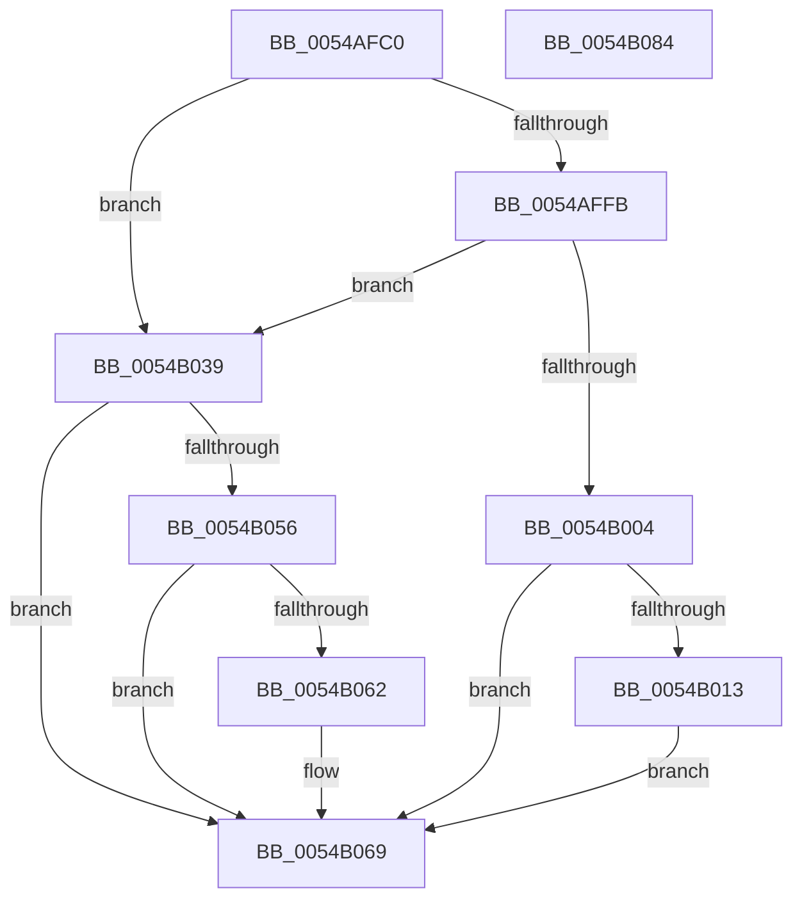

# HalpTscSynchronization

- RVA: `0x0054AFC0`–`0x0054B085` (길이 `197` bytes)
- VA: `0x000000014054AFC0`
- 실행 섹션: `.text`
- PDB 이름 있음: `예`; PDB Function 태그: `아니요`
- unwind 정보 RVA: `0x000C3F48`
- 디코드: `49`개 명령, `197/197` bytes 표시
- 미해석 바이트: `0` (있으면 어셈블리에 `.byte`로 보존)

> 이 문서는 커널 이미지의 기계어와 PDB 기호를 분석해 생성했습니다. 4번과 5번은 함수 원형과 자료형을 바이너리 사용 방식에서 추정한 C 해석이며 원본 소스 복구 결과는 아닙니다.

## 1. Dependencies

- 직접 호출 지점: **6**; 고유 호출 대상: **6**
- 직접 호출자로 확인된 함수: **0**
- RIP 상대 이미지 참조: **3**

### Outgoing calls
- `0x0054AFFB` → [HviIsXboxNanovisorPresent](../66/HviIsXboxNanovisorPresent_function_00666980.md) (function, `0x00666980`)
- `0x0054B009` → [KeQueryActiveProcessorCountEx](../24/KeQueryActiveProcessorCountEx_function_00249EF0.md) (function, `0x00249EF0`)
- `0x0054B021` → [HalpTscInitializeSynchronizationContext](HalpTscInitializeSynchronizationContext_function_0054ADB8.md) (function, `0x0054ADB8`)
- `0x0054B032` → [KeIpiGenericCall](../47/KeIpiGenericCall_function_00471720.md) (function, `0x00471720`)
- `0x0054B04C` → [HalpFindTimer](HalpFindTimer_function_005488D0.md) (function, `0x005488D0`)
- `0x0054B071` → [_security_check_cookie](../6A/_security_check_cookie_function_006AC640.md) (function, `0x006AC640`)

### Direct callers
- 이 함수 시작 RVA로 연결되는 직접 call은 확인되지 않았습니다. 간접 호출은 완전히 역산할 수 없습니다.

### Static image references
- `0x0054AFCA` → RVA `0x00E0A740` (`.data`; read)
- `0x0054AFD9` → RVA `0x00FC1C88` (`.data`; read)
- `0x0054B02B` → RVA `0x0054B090` (`HalpTscSynchronizationWorker`; read)

## 2. Other-region calls and transfers

- 다른 실행 섹션으로 향하는 call: **0**
- 별도 외부 분기/꼬리 이동을 확인하지 못했습니다.

## 3. Assembly (complete function range)

```asm
0054AFC0  48 89 5C 24 08                  mov qword ptr [rsp + 8], rbx
0054AFC5  57                              push rdi
0054AFC6  48 83 EC 70                     sub rsp, 0x70
0054AFCA  48 8B 05 6F F7 8B 00            mov rax, qword ptr [rip + 0x8bf76f]
0054AFD1  48 33 C4                        xor rax, rsp
0054AFD4  48 89 44 24 60                  mov qword ptr [rsp + 0x60], rax
0054AFD9  48 83 3D A7 6C A7 00 00         cmp qword ptr [rip + 0xa76ca7], 0
0054AFE1  0F 57 C0                        xorps xmm0, xmm0
0054AFE4  0F 11 44 24 30                  movups xmmword ptr [rsp + 0x30], xmm0
0054AFE9  48 8B DA                        mov rbx, rdx
0054AFEC  40 8A F9                        mov dil, cl
0054AFEF  0F 11 44 24 40                  movups xmmword ptr [rsp + 0x40], xmm0
0054AFF4  0F 11 44 24 50                  movups xmmword ptr [rsp + 0x50], xmm0
0054AFF9  75 3E                           jne 0x14054b039
0054AFFB  E8 80 B9 11 00                  call 0x140666980
0054B000  84 C0                           test al, al
0054B002  75 35                           jne 0x14054b039
0054B004  B9 FF FF 00 00                  mov ecx, 0xffff
0054B009  E8 E2 EE CF FF                  call 0x140249ef0
0054B00E  83 F8 02                        cmp eax, 2
0054B011  72 56                           jb 0x14054b069
0054B013  45 33 C9                        xor r9d, r9d
0054B016  48 8D 4C 24 30                  lea rcx, [rsp + 0x30]
0054B01B  4C 8B C3                        mov r8, rbx
0054B01E  40 8A D7                        mov dl, dil
0054B021  E8 92 FD FF FF                  call 0x14054adb8
0054B026  48 8D 54 24 30                  lea rdx, [rsp + 0x30]
0054B02B  48 8D 0D 5E 00 00 00            lea rcx, [rip + 0x5e]
0054B032  E8 E9 66 F2 FF                  call 0x140471720
0054B037  EB 30                           jmp 0x14054b069
0054B039  33 D2                           xor edx, edx
0054B03B  C7 44 24 20 01 00 00 00         mov dword ptr [rsp + 0x20], 1
0054B043  45 33 C9                        xor r9d, r9d
0054B046  45 33 C0                        xor r8d, r8d
0054B049  8D 4A 05                        lea ecx, [rdx + 5]
0054B04C  E8 7F D8 FF FF                  call 0x1405488d0
0054B051  48 85 C0                        test rax, rax
0054B054  74 13                           je 0x14054b069
0054B056  F7 80 E0 00 00 00 00 60 00 00   test dword ptr [rax + 0xe0], 0x6000
0054B060  75 07                           jne 0x14054b069
0054B062  83 88 B8 00 00 00 20            or dword ptr [rax + 0xb8], 0x20
0054B069  48 8B 4C 24 60                  mov rcx, qword ptr [rsp + 0x60]
0054B06E  48 33 CC                        xor rcx, rsp
0054B071  E8 CA 15 16 00                  call 0x1406ac640
0054B076  48 8B 9C 24 80 00 00 00         mov rbx, qword ptr [rsp + 0x80]
0054B07E  48 83 C4 70                     add rsp, 0x70
0054B082  5F                              pop rdi
0054B083  C3                              ret
0054B084  CC                              int3
```

## 4. C-style interpretation (structured pseudocode)

```c
__int64 __fastcall HalpTscSynchronization(unsigned __int8 a1, __int64 a2, __int64 a3, int a4)
{
    __int64 result;
    __int64 v_rsp;
    unsigned __int64 v_stack_m18;
    unsigned __int64 v_stack_m28;
    unsigned __int64 v_stack_m38;
    unsigned __int64 v_stack_m48;
    unsigned int v_stack_m58;
    unsigned __int64 v_stack_p8;

    v_stack_p8 = v_rbx;
    v_rsp = (v_rsp) - (112);
    result = (*(unsigned __int64 *)(v_rip + 9172847)) ^ (v_rsp);
    v_stack_m18 = result;
    v_stack_m48 = v_xmm0;
    v_stack_m38 = v_xmm0;
    v_stack_m28 = v_xmm0;
    if ((*(unsigned __int64 *)(v_rip + 10972327)) != 0) goto loc_0054B039;
    result = HviIsXboxNanovisorPresent(a1, a2, a3, a4);
    if ((unsigned __int8)(result) != 0) goto loc_0054B039;
    result = KeQueryActiveProcessorCountEx((unsigned int)(0xFFFFULL), a2, a3, a4);
    if (((unsigned int)(result)) < 2) goto loc_0054B069;
    a4 = 0;
    result = HalpTscInitializeSynchronizationContext(v_stack_m48, a1, a2, a4);
    result = KeIpiGenericCall(v_rip + 94, v_stack_m48, a2, a4);
    goto loc_0054B069;
loc_0054B039:
    a2 = 0;
    v_stack_m58 = 1;
    a4 = 0;
    a3 = 0;
    result = HalpFindTimer(a2 + 5, a2, a3, a4);
    if (result == 0) goto loc_0054B069;
    if (((*(unsigned int *)(result + 224)) & (0x6000ULL)) == 0) {
    }
    a1 = (v_stack_m18) ^ (v_rsp);
    result = _security_check_cookie(a1, a2, a3, a4);
    v_rsp = (v_rsp) + (112);
    return result;
}
```

## 5. (Beta) C Style

```c
int64_t HalpTscSynchronization(uint8_t Arg1, int64_t Arg2, int64_t Arg3, int32_t Arg4)
{
    int64_t result;
    int64_t local_rsp;
    uint64_t v_stack_m18;
    uint64_t v_stack_m28;
    uint64_t v_stack_m38;
    uint64_t v_stack_m48;
    uint32_t v_stack_m58;
    uint64_t v_stack_p8;

    v_stack_p8 = local_rbx;
    local_rsp = (local_rsp) - (112);
    result = (*(uint64_t *)(v_rip + 0x8BF76F)) ^ (local_rsp);
    v_stack_m18 = result;
    v_stack_m48 = v_xmm0;
    v_stack_m38 = v_xmm0;
    v_stack_m28 = v_xmm0;
    if ((*(uint64_t *)(v_rip + 0xA76CA7)) != 0) goto loc_0054B039;
    result = HviIsXboxNanovisorPresent(Arg1, Arg2, Arg3, Arg4);
    if ((uint8_t)(result) != 0) goto loc_0054B039;
    result = KeQueryActiveProcessorCountEx((uint32_t)(0xFFFFULL), Arg2, Arg3, Arg4);
    if (((uint32_t)(result)) < 2) goto loc_0054B069;
    Arg4 = 0;
    result = HalpTscInitializeSynchronizationContext(v_stack_m48, Arg1, Arg2, Arg4);
    result = KeIpiGenericCall(v_rip + 94, v_stack_m48, Arg2, Arg4);
    goto loc_0054B069;
loc_0054B039:
    Arg2 = 0;
    v_stack_m58 = 1;
    Arg4 = 0;
    Arg3 = 0;
    result = HalpFindTimer(Arg2 + 5, Arg2, Arg3, Arg4);
    if (result == 0) goto loc_0054B069;
    if (((*(uint32_t *)(result + 0xE0)) & (0x6000ULL)) == 0) {
    }
    Arg1 = (v_stack_m18) ^ (local_rsp);
    result = _security_check_cookie(Arg1, Arg2, Arg3, Arg4);
    local_rsp = (local_rsp) + (112);
    return result;
}
```

## 6. Execution-region graph

[열기: 2D/3D 그래프와 함수 탐색 컨트롤 패널](../../../control-panel.html?section=text&rva=0x0054AFC0&view=graph)

- 2D 그래프는 위에서 아래로 흐르고, 3D 그래프는 빈 공간을 드래그해 회전합니다. Shift+드래그는 이동, 휠은 확대·축소, 함수 노드 선택은 대상 보고서 이동입니다.

### Static fallback


