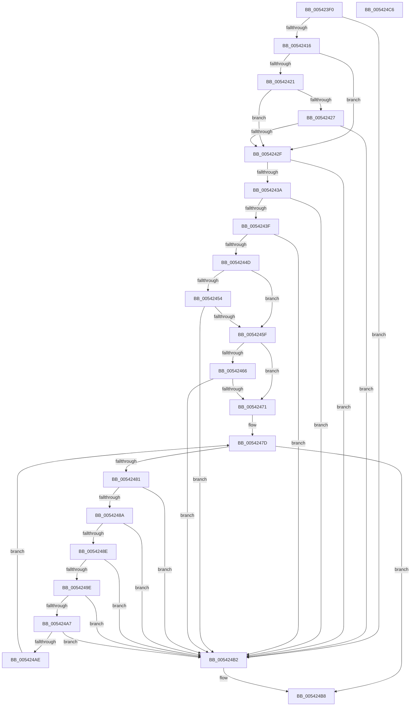

# HalpVerifyGenericError

- RVA: `0x005423F0`–`0x005424C7` (길이 `215` bytes)
- VA: `0x00000001405423F0`
- 실행 섹션: `.text`
- PDB 이름 있음: `예`; PDB Function 태그: `아니요`
- unwind 정보 RVA: `0x000950EC`
- 디코드: `66`개 명령, `215/215` bytes 표시
- 미해석 바이트: `0` (있으면 어셈블리에 `.byte`로 보존)

> 이 문서는 커널 이미지의 기계어와 PDB 기호를 분석해 생성했습니다. 4번과 5번은 함수 원형과 자료형을 바이너리 사용 방식에서 추정한 C 해석이며 원본 소스 복구 결과는 아닙니다.

## 1. Dependencies

- 직접 호출 지점: **0**; 고유 호출 대상: **0**
- 직접 호출자로 확인된 함수: **1**
- RIP 상대 이미지 참조: **0**

### Outgoing calls
- 직접 디코드된 call 명령이 없습니다.

### Direct callers
- [HalpGetMcaExtendedLogStatusBlock](HalpGetMcaExtendedLogStatusBlock_function_005412EC.md) at `0x005413A3`

### Static image references
- 디코드된 RIP-relative 메모리 참조가 없습니다.

## 2. Other-region calls and transfers

- 다른 실행 섹션으로 향하는 call: **0**
- 별도 외부 분기/꼬리 이동을 확인하지 못했습니다.

## 3. Assembly (complete function range)

```asm
005423F0  48 89 5C 24 08                  mov qword ptr [rsp + 8], rbx
005423F5  48 89 7C 24 10                  mov qword ptr [rsp + 0x10], rdi
005423FA  4C 8B D2                        mov r10, rdx
005423FD  41 B9 14 00 00 00               mov r9d, 0x14
00542403  48 8B D1                        mov rdx, rcx
00542406  41 8B 5A 0C                     mov ebx, dword ptr [r10 + 0xc]
0054240A  83 C3 14                        add ebx, 0x14
0054240D  41 3B D9                        cmp ebx, r9d
00542410  0F 82 9C 00 00 00               jb 0x1405424b2
00542416  41 8B 42 04                     mov eax, dword ptr [r10 + 4]
0054241A  45 33 C0                        xor r8d, r8d
0054241D  85 C0                           test eax, eax
0054241F  74 0E                           je 0x14054242f
00542421  45 39 42 08                     cmp dword ptr [r10 + 8], r8d
00542425  74 08                           je 0x14054242f
00542427  3B D8                           cmp ebx, eax
00542429  0F 87 83 00 00 00               ja 0x1405424b2
0054242F  41 8B 4A 08                     mov ecx, dword ptr [r10 + 8]
00542433  8D 3C 01                        lea edi, [rcx + rax]
00542436  3B F8                           cmp edi, eax
00542438  72 78                           jb 0x1405424b2
0054243A  83 F9 20                        cmp ecx, 0x20
0054243D  72 73                           jb 0x1405424b2
0054243F  4C 8B 5A 28                     mov r11, qword ptr [rdx + 0x28]
00542443  48 8B C8                        mov rcx, rax
00542446  4E 39 5C 10 08                  cmp qword ptr [rax + r10 + 8], r11
0054244B  75 65                           jne 0x1405424b2
0054244D  49 0F BA E3 3B                  bt r11, 0x3b
00542452  73 0B                           jae 0x14054245f
00542454  48 8B 42 38                     mov rax, qword ptr [rdx + 0x38]
00542458  4A 39 44 11 18                  cmp qword ptr [rcx + r10 + 0x18], rax
0054245D  75 53                           jne 0x1405424b2
0054245F  49 0F BA E3 3A                  bt r11, 0x3a
00542464  73 0B                           jae 0x140542471
00542466  48 8B 42 30                     mov rax, qword ptr [rdx + 0x30]
0054246A  4A 39 44 11 10                  cmp qword ptr [rcx + r10 + 0x10], rax
0054246F  75 41                           jne 0x1405424b2
00542471  41 8B 12                        mov edx, dword ptr [r10]
00542474  C1 EA 04                        shr edx, 4
00542477  81 E2 FF 03 00 00               and edx, 0x3ff
0054247D  85 D2                           test edx, edx
0054247F  74 37                           je 0x1405424b8
00542481  41 8D 41 48                     lea eax, [r9 + 0x48]
00542485  41 3B C1                        cmp eax, r9d
00542488  72 28                           jb 0x1405424b2
0054248A  3B C3                           cmp eax, ebx
0054248C  77 24                           ja 0x1405424b2
0054248E  41 8B C1                        mov eax, r9d
00542491  42 8B 4C 10 18                  mov ecx, dword ptr [rax + r10 + 0x18]
00542496  83 C1 48                        add ecx, 0x48
00542499  83 F9 48                        cmp ecx, 0x48
0054249C  72 14                           jb 0x1405424b2
0054249E  41 8D 04 09                     lea eax, [r9 + rcx]
005424A2  41 3B C1                        cmp eax, r9d
005424A5  72 0B                           jb 0x1405424b2
005424A7  44 8B C8                        mov r9d, eax
005424AA  3B C7                           cmp eax, edi
005424AC  77 04                           ja 0x1405424b2
005424AE  FF CA                           dec edx
005424B0  EB CB                           jmp 0x14054247d
005424B2  41 B8 0D 00 00 C0               mov r8d, 0xc000000d
005424B8  48 8B 5C 24 08                  mov rbx, qword ptr [rsp + 8]
005424BD  41 8B C0                        mov eax, r8d
005424C0  48 8B 7C 24 10                  mov rdi, qword ptr [rsp + 0x10]
005424C5  C3                              ret
005424C6  CC                              int3
```

## 4. C-style interpretation (structured pseudocode)

```c
__int64 __fastcall HalpVerifyGenericError(__int64 a1, __int64 a2, int a3)
{
    __int64 v_rbx;
    unsigned __int64 v_stack_p10;
    unsigned __int64 v_stack_p8;

    v_stack_p8 = v_rbx;
    v_stack_p10 = v_rdi;
    v_rbx = (unsigned int)(((unsigned int)(*(unsigned int *)(a2 + 12))) + (20));
    if (((unsigned int)(v_rbx)) < 20) goto loc_005424B2;
    a3 = 0;
    if ((unsigned int)((unsigned int)(*(unsigned int *)(a2 + 4))) == 0) goto loc_0054242F;
    if ((*(unsigned int *)(a2 + 8)) == 0) goto loc_0054242F;
    if (((unsigned int)(v_rbx)) > ((unsigned int)((unsigned int)(*(unsigned int *)(a2 + 4))))) goto loc_005424B2;
loc_0054242F:
    if (((unsigned int)((unsigned int)(*(unsigned int *)(a2 + 8)) + (unsigned int)(*(unsigned int *)(a2 + 4)) * 1)) < ((unsigned int)((unsigned int)(*(unsigned int *)(a2 + 4))))) goto loc_005424B2;
    if (((unsigned int)((unsigned int)(*(unsigned int *)(a2 + 8)))) < 32) goto loc_005424B2;
    if ((*(unsigned __int64 *)((unsigned int)(*(unsigned int *)(a2 + 4)) + a2 * 1 + 8)) != (*(unsigned __int64 *)(a1 + 40))) goto loc_005424B2;
    if ((*(unsigned __int64 *)((unsigned int)(*(unsigned int *)(a2 + 4)) + a2 * 1 + 8)) >= (*(unsigned __int64 *)(a1 + 40))) goto loc_0054245F;
    if ((*(unsigned __int64 *)((unsigned int)(*(unsigned int *)(a2 + 4)) + a2 * 1 + 24)) != (*(unsigned __int64 *)(a1 + 56))) goto loc_005424B2;
loc_0054245F:
    if ((*(unsigned __int64 *)((unsigned int)(*(unsigned int *)(a2 + 4)) + a2 * 1 + 24)) >= (*(unsigned __int64 *)(a1 + 56))) goto loc_00542471;
    if ((*(unsigned __int64 *)((unsigned int)(*(unsigned int *)(a2 + 4)) + a2 * 1 + 16)) != (*(unsigned __int64 *)(a1 + 48))) goto loc_005424B2;
loc_00542471:
    a2 = (unsigned int)(((unsigned int)(*(unsigned int *)(a2))) >> (4));
    a2 = (unsigned int)((a2) & (0x3FFULL));
loc_0054247D:
    if ((unsigned int)(a2) == 0) goto loc_005424B8;
    if (((unsigned int)(20 + 72)) < 20) goto loc_005424B2;
    if (((unsigned int)(20 + 72)) > ((unsigned int)(v_rbx))) goto loc_005424B2;
    a1 = (unsigned int)(((unsigned int)(*(unsigned int *)(20 + a2 * 1 + 24))) + (72));
    if (((unsigned int)(a1)) < 72) goto loc_005424B2;
    if (((unsigned int)(20 + a1 * 1)) < 20) goto loc_005424B2;
    if (((unsigned int)(20 + a1 * 1)) > ((unsigned int)((unsigned int)(*(unsigned int *)(a2 + 8)) + (unsigned int)(*(unsigned int *)(a2 + 4)) * 1))) goto loc_005424B2;
    a2 = (unsigned int)((a2) - 1);
    goto loc_0054247D;
loc_005424B2:
loc_005424B8:
    return (unsigned int)((unsigned int)((unsigned int)(0xC000000DULL)));
}
```

## 5. (Beta) C Style

```c
int64_t HalpVerifyGenericError(void *Arg1, void *Arg2, int32_t Arg3)
{
    uint8_t *arg1 = (uint8_t *)Arg1;
    uint8_t *arg2 = (uint8_t *)Arg2;

    int64_t local_rbx;
    uint64_t v_stack_p10;
    uint64_t v_stack_p8;

    v_stack_p8 = local_rbx;
    v_stack_p10 = local_rdi;
    local_rbx = (uint32_t)(((uint32_t)(*(uint32_t *)(arg2 + 0xC))) + (20));
    if (((uint32_t)(local_rbx)) < 20) goto loc_005424B2;
    Arg3 = 0;
    if ((uint32_t)((uint32_t)(*(uint32_t *)(arg2 + 0x4))) == 0) goto loc_0054242F;
    if ((*(uint32_t *)(arg2 + 0x8)) == 0) goto loc_0054242F;
    if (((uint32_t)(local_rbx)) > ((uint32_t)((uint32_t)(*(uint32_t *)(arg2 + 0x4))))) goto loc_005424B2;
loc_0054242F:
    if (((uint32_t)((uint32_t)(*(uint32_t *)(arg2 + 0x8)) + (uint32_t)(*(uint32_t *)(arg2 + 0x4)) * 1)) < ((uint32_t)((uint32_t)(*(uint32_t *)(arg2 + 0x4))))) goto loc_005424B2;
    if (((uint32_t)((uint32_t)(*(uint32_t *)(arg2 + 0x8)))) < 32) goto loc_005424B2;
    if ((*(uint64_t *)((uint32_t)(*(uint32_t *)(arg2 + 0x4)) + arg2 * 1 + 0x8)) != (*(uint64_t *)(arg1 + 0x28))) goto loc_005424B2;
    if ((*(uint64_t *)((uint32_t)(*(uint32_t *)(arg2 + 0x4)) + arg2 * 1 + 0x8)) >= (*(uint64_t *)(arg1 + 0x28))) goto loc_0054245F;
    if ((*(uint64_t *)((uint32_t)(*(uint32_t *)(arg2 + 0x4)) + arg2 * 1 + 0x18)) != (*(uint64_t *)(arg1 + 0x38))) goto loc_005424B2;
loc_0054245F:
    if ((*(uint64_t *)((uint32_t)(*(uint32_t *)(arg2 + 0x4)) + arg2 * 1 + 0x18)) >= (*(uint64_t *)(arg1 + 0x38))) goto loc_00542471;
    if ((*(uint64_t *)((uint32_t)(*(uint32_t *)(arg2 + 0x4)) + arg2 * 1 + 0x10)) != (*(uint64_t *)(arg1 + 0x30))) goto loc_005424B2;
loc_00542471:
    Arg2 = (uint32_t)(((uint32_t)(*(uint32_t *)(arg2))) >> (4));
    Arg2 = (uint32_t)((Arg2) & (0x3FFULL));
loc_0054247D:
    if ((uint32_t)(Arg2) == 0) goto loc_005424B8;
    if (((uint32_t)(20 + 72)) < 20) goto loc_005424B2;
    if (((uint32_t)(20 + 72)) > ((uint32_t)(local_rbx))) goto loc_005424B2;
    Arg1 = (uint32_t)(((uint32_t)(*(uint32_t *)(20 + arg2 * 1 + 0x18))) + (72));
    if (((uint32_t)(Arg1)) < 72) goto loc_005424B2;
    if (((uint32_t)(20 + Arg1 * 1)) < 20) goto loc_005424B2;
    if (((uint32_t)(20 + Arg1 * 1)) > ((uint32_t)((uint32_t)(*(uint32_t *)(arg2 + 0x8)) + (uint32_t)(*(uint32_t *)(arg2 + 0x4)) * 1))) goto loc_005424B2;
    Arg2 = (uint32_t)((Arg2) - 1);
    goto loc_0054247D;
loc_005424B2:
loc_005424B8:
    return (uint32_t)((uint32_t)((uint32_t)(0xC000000DULL)));
}
```

### 관측된 메모리 오프셋

구조체 형식이 확인되지 않은 접근은 인자 기준의 오프셋으로만 기록했습니다.

| 기준 인자 | 오프셋 표현 | 폭 (bit) | 접근 |
|---|---:|---:|---|
| `Arg1` | `+ 0x28` | `64` | `R` |
| `Arg1` | `+ 0x30` | `64` | `R` |
| `Arg1` | `+ 0x38` | `64` | `R` |
| `Arg2` | `+ 0x0` | `32` | `R` |
| `Arg2` | `+ 0x4` | `32` | `R` |
| `Arg2` | `+ 0x8` | `32` | `R` |
| `Arg2` | `+ 0xC` | `32` | `R` |

## 6. Execution-region graph

[열기: 2D/3D 그래프와 함수 탐색 컨트롤 패널](../../../control-panel.html?section=text&rva=0x005423F0&view=graph)

- 2D 그래프는 위에서 아래로 흐르고, 3D 그래프는 빈 공간을 드래그해 회전합니다. Shift+드래그는 이동, 휠은 확대·축소, 함수 노드 선택은 대상 보고서 이동입니다.

### Static fallback


