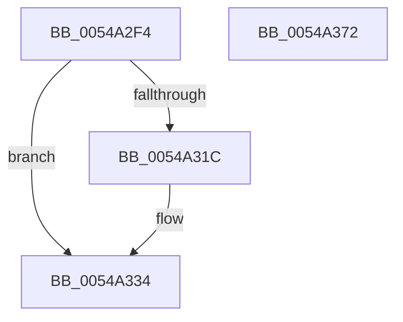

# HalpVpptInitializePhysicalTimer

- RVA: `0x0054A2F4`–`0x0054A373` (길이 `127` bytes)
- VA: `0x000000014054A2F4`
- 실행 섹션: `.text`
- PDB 이름 있음: `예`; PDB Function 태그: `아니요`
- unwind 정보 RVA: `0x00064C80`
- 디코드: `29`개 명령, `127/127` bytes 표시
- 미해석 바이트: `0` (있으면 어셈블리에 `.byte`로 보존)

> 이 문서는 커널 이미지의 기계어와 PDB 기호를 분석해 생성했습니다. 4번과 5번은 함수 원형과 자료형을 바이너리 사용 방식에서 추정한 C 해석이며 원본 소스 복구 결과는 아닙니다.

## 1. Dependencies

- 직접 호출 지점: **5**; 고유 호출 대상: **5**
- 직접 호출자로 확인된 함수: **1**
- RIP 상대 이미지 참조: **6**

### Outgoing calls
- `0x0054A301` → [HalpAcquireHighLevelLock](../2D/HalpAcquireHighLevelLock_function_002D2390.md) (function, `0x002D2390`)
- `0x0054A32E` → [ExtEnvCriticalFailure](../56/ExtEnvCriticalFailure_function_00561300.md) (function, `0x00561300`)
- `0x0054A345` → [HalpTimerGetInternalData](../20/HalpTimerGetInternalData_function_00209500.md) (function, `0x00209500`)
- `0x0054A351` → [guard_dispatch_icall](../6B/guard_dispatch_icall_function_006BAAD0.md) (function, `0x006BAAD0`)
- `0x0054A365` → [HalpReleaseHighLevelLock](../2D/HalpReleaseHighLevelLock_function_002D1C58.md) (function, `0x002D1C58`)

### Direct callers
- [HalpTimerInitializeVpptClockTimer](../4F/HalpTimerInitializeVpptClockTimer_function_004F8100.md) at `0x004F8114`

### Static image references
- `0x0054A2FA` → RVA `0x00FC2290` (`.data`; read)
- `0x0054A306` → RVA `0x00FC2260` (`.data`; read)
- `0x0054A30D` → RVA `0x00FC2298` (`.data`; write)
- `0x0054A327` → RVA `0x00FC2248` (`.data`; read)
- `0x0054A33B` → RVA `0x00FC2250` (`.data`; read/write)
- `0x0054A356` → RVA `0x00FC2298` (`.data`; read)

## 2. Other-region calls and transfers

- 다른 실행 섹션으로 향하는 call: **0**
- 별도 외부 분기/꼬리 이동을 확인하지 못했습니다.

## 3. Assembly (complete function range)

```asm
0054A2F4  40 53                           push rbx
0054A2F6  48 83 EC 30                     sub rsp, 0x30
0054A2FA  48 8D 0D 8F 7F A7 00            lea rcx, [rip + 0xa77f8f]
0054A301  E8 8A 80 D8 FF                  call 0x1402d2390
0054A306  4C 8D 0D 53 7F A7 00            lea r9, [rip + 0xa77f53]
0054A30D  88 05 85 7F A7 00               mov byte ptr [rip + 0xa77f85], al
0054A313  4C 39 0D 46 7F A7 00            cmp qword ptr [rip + 0xa77f46], r9
0054A31A  74 18                           je 0x14054a334
0054A31C  48 83 64 24 20 00               and qword ptr [rsp + 0x20], 0
0054A322  BA 15 01 00 00                  mov edx, 0x115
0054A327  4C 8B 05 1A 7F A7 00            mov r8, qword ptr [rip + 0xa77f1a]
0054A32E  E8 CD 6F 01 00                  call 0x140561300
0054A333  CC                              int3
0054A334  48 8B 15 0D 7F A7 00            mov rdx, qword ptr [rip + 0xa77f0d]
0054A33B  83 0D 0E 7F A7 00 FF            or dword ptr [rip + 0xa77f0e], 0xffffffff
0054A342  48 8B CA                        mov rcx, rdx
0054A345  E8 B6 F1 CB FF                  call 0x140209500
0054A34A  48 8B C8                        mov rcx, rax
0054A34D  48 8B 42 68                     mov rax, qword ptr [rdx + 0x68]
0054A351  E8 7A 07 17 00                  call 0x1406baad0
0054A356  8A 15 3C 7F A7 00               mov dl, byte ptr [rip + 0xa77f3c]
0054A35C  48 8D 0D 2D 7F A7 00            lea rcx, [rip + 0xa77f2d]
0054A363  8B D8                           mov ebx, eax
0054A365  E8 EE 78 D8 FF                  call 0x1402d1c58
0054A36A  8B C3                           mov eax, ebx
0054A36C  48 83 C4 30                     add rsp, 0x30
0054A370  5B                              pop rbx
0054A371  C3                              ret
0054A372  CC                              int3
```

## 4. C-style interpretation (structured pseudocode)

```c
__int64 __fastcall HalpVpptInitializePhysicalTimer(void)
{
    __int64 result;
    __int64 v_rsp;
    unsigned __int64 v_stack_m18;

    v_rsp = (v_rsp) - (48);
    result = HalpAcquireHighLevelLock(v_rip + 10977167, a2, a3, a4);
    *(unsigned __int8 *)(v_rip + 10977157) = (unsigned __int8)(result);
    if ((*(unsigned __int64 *)(v_rip + 10977094)) != (v_rip + 10977107)) {
        a2 = 277;
        a3 = *(unsigned __int64 *)(v_rip + 10977050);
        result = ExtEnvCriticalFailure(v_rip + 10977167, a2, a3, v_rip + 10977107);
    }
    result = HalpTimerGetInternalData(*(unsigned __int64 *)(v_rip + 10977037), *(unsigned __int64 *)(v_rip + 10977037), a3, v_rip + 10977107);
    result = guard_dispatch_icall(result, *(unsigned __int64 *)(v_rip + 10977037), a3, v_rip + 10977107);
    result = HalpReleaseHighLevelLock(v_rip + 10977069, *(unsigned __int8 *)(v_rip + 10977084), a3, v_rip + 10977107);
    v_rsp = (v_rsp) + (48);
    return (unsigned int)((unsigned int)((unsigned int)((unsigned int)(result))));
}
```

## 5. (Beta) C Style

```c
void HalpVpptInitializePhysicalTimer(void)
{
    int64_t result;
    int64_t local_rsp;
    uint64_t v_stack_m18;

    local_rsp = (local_rsp) - (48);
    result = HalpAcquireHighLevelLock(v_rip + 10977167, a2, a3, a4);
    *(uint8_t *)(v_rip + 0xA77F85) = (uint8_t)(result);
    if ((*(uint64_t *)(v_rip + 0xA77F46)) != (v_rip + 10977107)) {
        a2 = 277;
        a3 = *(uint64_t *)(v_rip + 0xA77F1A);
        result = ExtEnvCriticalFailure(v_rip + 10977167, a2, a3, v_rip + 10977107);
    }
    result = HalpTimerGetInternalData(*(uint64_t *)(v_rip + 0xA77F0D), *(uint64_t *)(v_rip + 0xA77F0D), a3, v_rip + 10977107);
    result = guard_dispatch_icall(result, *(uint64_t *)(v_rip + 0xA77F0D), a3, v_rip + 10977107);
    result = HalpReleaseHighLevelLock(v_rip + 10977069, *(uint8_t *)(v_rip + 0xA77F3C), a3, v_rip + 10977107);
    local_rsp = (local_rsp) + (48);
    return (uint32_t)((uint32_t)((uint32_t)((uint32_t)(result))));
}
```

## 6. Execution-region graph

[열기: 2D/3D 그래프와 함수 탐색 컨트롤 패널](../../../control-panel.html?section=text&rva=0x0054A2F4&view=graph)

- 2D 그래프는 위에서 아래로 흐르고, 3D 그래프는 빈 공간을 드래그해 회전합니다. Shift+드래그는 이동, 휠은 확대·축소, 함수 노드 선택은 대상 보고서 이동입니다.

### Static fallback


