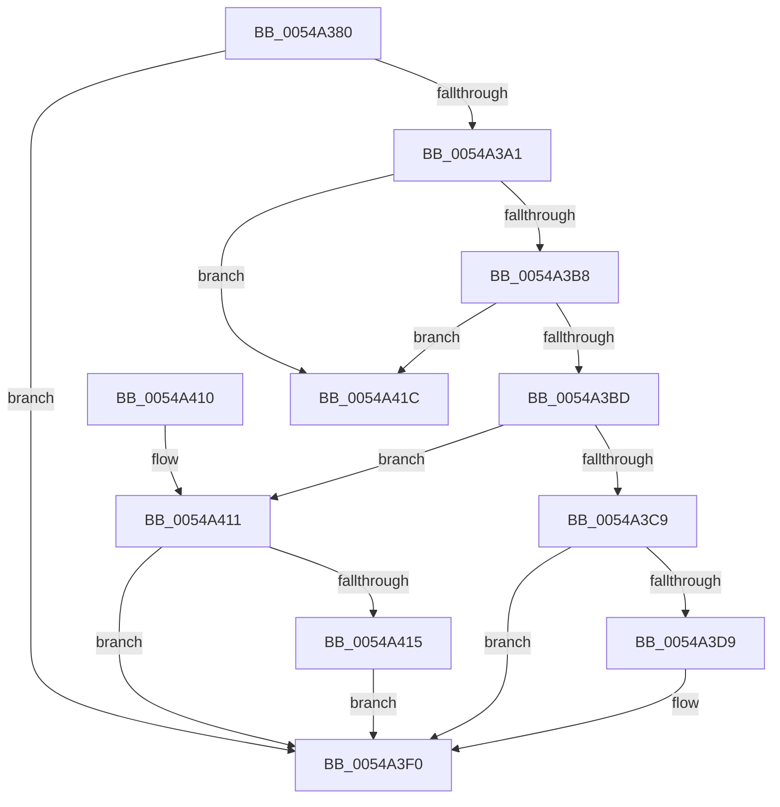

# HalpVpptStop

- RVA: `0x0054A380`–`0x0054A423` (길이 `163` bytes)
- VA: `0x000000014054A380`
- 실행 섹션: `.text`
- PDB 이름 있음: `예`; PDB Function 태그: `아니요`
- unwind 정보 RVA: `0x0006F13C`
- 디코드: `43`개 명령, `163/163` bytes 표시
- 미해석 바이트: `0` (있으면 어셈블리에 `.byte`로 보존)

> 이 문서는 커널 이미지의 기계어와 PDB 기호를 분석해 생성했습니다. 4번과 5번은 함수 원형과 자료형을 바이너리 사용 방식에서 추정한 C 해석이며 원본 소스 복구 결과는 아닙니다.

## 1. Dependencies

- 직접 호출 지점: **5**; 고유 호출 대상: **5**
- 직접 호출자로 확인된 함수: **0**
- RIP 상대 이미지 참조: **5**

### Outgoing calls
- `0x0054A390` → [HalpAcquireHighLevelLock](../2D/HalpAcquireHighLevelLock_function_002D2390.md) (function, `0x002D2390`)
- `0x0054A3DC` → [HalpTimerGetInternalData](../20/HalpTimerGetInternalData_function_00209500.md) (function, `0x00209500`)
- `0x0054A3EB` → [guard_dispatch_icall](../6B/guard_dispatch_icall_function_006BAAD0.md) (function, `0x006BAAD0`)
- `0x0054A405` → [HalpReleaseHighLevelLock](../2D/HalpReleaseHighLevelLock_function_002D1C58.md) (function, `0x002D1C58`)
- `0x0054A415` → [HalpVpptUpdatePhysicalTimer](../2D/HalpVpptUpdatePhysicalTimer_function_002D23D8.md) (function, `0x002D23D8`)

### Direct callers
- 이 함수 시작 RVA로 연결되는 직접 call은 확인되지 않았습니다. 간접 호출은 완전히 역산할 수 없습니다.

### Static image references
- `0x0054A389` → RVA `0x00FC2290` (`.data`; read)
- `0x0054A395` → RVA `0x00FC2298` (`.data`; write)
- `0x0054A3A1` → RVA `0x00FC2260` (`.data`; read)
- `0x0054A3C9` → RVA `0x00FC2248` (`.data`; read)
- `0x0054A3FF` → RVA `0x00FC2298` (`.data`; read)

## 2. Other-region calls and transfers

- 다른 실행 섹션으로 향하는 call: **0**
- 별도 외부 분기/꼬리 이동을 확인하지 못했습니다.

## 3. Assembly (complete function range)

```asm
0054A380  40 53                           push rbx
0054A382  48 83 EC 20                     sub rsp, 0x20
0054A386  48 8B D9                        mov rbx, rcx
0054A389  48 8D 0D 00 7F A7 00            lea rcx, [rip + 0xa77f00]
0054A390  E8 FB 7F D8 FF                  call 0x1402d2390
0054A395  88 05 FD 7E A7 00               mov byte ptr [rip + 0xa77efd], al
0054A39B  80 7B 18 00                     cmp byte ptr [rbx + 0x18], 0
0054A39F  74 4F                           je 0x14054a3f0
0054A3A1  48 39 1D B8 7E A7 00            cmp qword ptr [rip + 0xa77eb8], rbx
0054A3A8  48 8B 0B                        mov rcx, qword ptr [rbx]
0054A3AB  48 8B 43 08                     mov rax, qword ptr [rbx + 8]
0054A3AF  0F 94 C2                        sete dl
0054A3B2  48 39 59 08                     cmp qword ptr [rcx + 8], rbx
0054A3B6  75 64                           jne 0x14054a41c
0054A3B8  48 39 18                        cmp qword ptr [rax], rbx
0054A3BB  75 5F                           jne 0x14054a41c
0054A3BD  48 89 08                        mov qword ptr [rax], rcx
0054A3C0  48 89 41 08                     mov qword ptr [rcx + 8], rax
0054A3C4  48 3B C1                        cmp rax, rcx
0054A3C7  75 48                           jne 0x14054a411
0054A3C9  48 8B 15 78 7E A7 00            mov rdx, qword ptr [rip + 0xa77e78]
0054A3D0  83 BA E4 00 00 00 03            cmp dword ptr [rdx + 0xe4], 3
0054A3D7  74 17                           je 0x14054a3f0
0054A3D9  48 8B CA                        mov rcx, rdx
0054A3DC  E8 1F F1 CB FF                  call 0x140209500
0054A3E1  48 8B C8                        mov rcx, rax
0054A3E4  48 8B 82 88 00 00 00            mov rax, qword ptr [rdx + 0x88]
0054A3EB  E8 E0 06 17 00                  call 0x1406baad0
0054A3F0  83 63 14 00                     and dword ptr [rbx + 0x14], 0
0054A3F4  48 8D 0D 95 7E A7 00            lea rcx, [rip + 0xa77e95]
0054A3FB  C6 43 18 00                     mov byte ptr [rbx + 0x18], 0
0054A3FF  8A 15 93 7E A7 00               mov dl, byte ptr [rip + 0xa77e93]
0054A405  E8 4E 78 D8 FF                  call 0x1402d1c58
0054A40A  48 83 C4 20                     add rsp, 0x20
0054A40E  5B                              pop rbx
0054A40F  C3                              ret
0054A410  CC                              int3
0054A411  84 D2                           test dl, dl
0054A413  74 DB                           je 0x14054a3f0
0054A415  E8 BE 7F D8 FF                  call 0x1402d23d8
0054A41A  EB D4                           jmp 0x14054a3f0
0054A41C  B9 03 00 00 00                  mov ecx, 3
0054A421  CD 29                           int 0x29
```

## 4. C-style interpretation (structured pseudocode)

```c
__int64 __fastcall HalpVpptStop(__int64 a1)
{
    __int64 result;
    __int64 v_rsp;

    v_rsp = (v_rsp) - (32);
    result = HalpAcquireHighLevelLock(v_rip + 10977024, a2, a3, a4);
    *(unsigned __int8 *)(v_rip + 10977021) = (unsigned __int8)(result);
    if ((*(unsigned __int8 *)(a1 + 24)) == 0) goto loc_0054A3F0;
    a2 = ((*(unsigned __int64 *)(v_rip + 10976952)) == a1) ? 1 : 0;
    if ((*(unsigned __int64 *)(*(unsigned __int64 *)(a1) + 8)) != a1) goto loc_0054A41C;
    if ((*(unsigned __int64 *)(*(unsigned __int64 *)(a1 + 8))) != a1) goto loc_0054A41C;
    *(unsigned __int64 *)(*(unsigned __int64 *)(a1 + 8)) = *(unsigned __int64 *)(a1);
    *(unsigned __int64 *)(*(unsigned __int64 *)(a1) + 8) = *(unsigned __int64 *)(a1 + 8);
    if ((*(unsigned __int64 *)(a1 + 8)) != (*(unsigned __int64 *)(a1))) goto loc_0054A411;
    result = *(unsigned __int64 *)(a1 + 8);
    if ((*(unsigned int *)(*(unsigned __int64 *)(v_rip + 10976888) + 228)) != 3) {
        a1 = *(unsigned __int64 *)(v_rip + 10976888);
        result = HalpTimerGetInternalData(a1, *(unsigned __int64 *)(v_rip + 10976888), a3, a4);
        a1 = result;
        result = *(unsigned __int64 *)(*(unsigned __int64 *)(v_rip + 10976888) + 136);
        result = guard_dispatch_icall(a1, *(unsigned __int64 *)(v_rip + 10976888), a3, a4);
    }
    *(unsigned __int8 *)(a1 + 24) = 0;
    result = HalpReleaseHighLevelLock(v_rip + 10976917, *(unsigned __int8 *)(v_rip + 10976915), a3, a4);
    v_rsp = (v_rsp) + (32);
    return result;
loc_0054A411:
    if ((unsigned __int8)(*(unsigned __int8 *)(v_rip + 10976915)) == 0) goto loc_0054A3F0;
    result = HalpVpptUpdatePhysicalTimer(v_rip + 10976917, *(unsigned __int8 *)(v_rip + 10976915), a3, a4);
    goto loc_0054A3F0;
loc_0054A41C:
    return result;
}
```

## 5. (Beta) C Style

```c
int64_t HalpVpptStop(void *Arg1)
{
    uint8_t *arg1 = (uint8_t *)Arg1;

    int64_t result;
    int64_t local_rsp;

    local_rsp = (local_rsp) - (32);
    result = HalpAcquireHighLevelLock(v_rip + 10977024, a2, a3, a4);
    *(uint8_t *)(v_rip + 0xA77EFD) = (uint8_t)(result);
    if ((*(uint8_t *)(arg1 + 0x18)) == 0) goto loc_0054A3F0;
    a2 = ((*(uint64_t *)(v_rip + 0xA77EB8)) == Arg1) ? 1 : 0;
    if ((*(uint64_t *)(*(uint64_t *)(arg1) + 0x8)) != Arg1) goto loc_0054A41C;
    if ((*(uint64_t *)(*(uint64_t *)(arg1 + 0x8))) != Arg1) goto loc_0054A41C;
    *(uint64_t *)(*(uint64_t *)(arg1 + 0x8)) = *(uint64_t *)(arg1);
    *(uint64_t *)(*(uint64_t *)(arg1) + 0x8) = *(uint64_t *)(arg1 + 0x8);
    if ((*(uint64_t *)(arg1 + 0x8)) != (*(uint64_t *)(arg1))) goto loc_0054A411;
    result = *(uint64_t *)(arg1 + 0x8);
    if ((*(uint32_t *)(*(uint64_t *)(v_rip + 0xA77E78) + 0xE4)) != 3) {
        Arg1 = *(uint64_t *)(v_rip + 0xA77E78);
        result = HalpTimerGetInternalData(Arg1, *(uint64_t *)(v_rip + 0xA77E78), a3, a4);
        Arg1 = result;
        result = *(uint64_t *)(*(uint64_t *)(v_rip + 0xA77E78) + 0x88);
        result = guard_dispatch_icall(Arg1, *(uint64_t *)(v_rip + 0xA77E78), a3, a4);
    }
    *(uint8_t *)(arg1 + 0x18) = 0;
    result = HalpReleaseHighLevelLock(v_rip + 10976917, *(uint8_t *)(v_rip + 0xA77E93), a3, a4);
    local_rsp = (local_rsp) + (32);
    return result;
loc_0054A411:
    if ((uint8_t)(*(uint8_t *)(v_rip + 0xA77E93)) == 0) goto loc_0054A3F0;
    result = HalpVpptUpdatePhysicalTimer(v_rip + 10976917, *(uint8_t *)(v_rip + 0xA77E93), a3, a4);
    goto loc_0054A3F0;
loc_0054A41C:
    return result;
}
```

### 관측된 메모리 오프셋

구조체 형식이 확인되지 않은 접근은 인자 기준의 오프셋으로만 기록했습니다.

| 기준 인자 | 오프셋 표현 | 폭 (bit) | 접근 |
|---|---:|---:|---|
| `Arg1` | `+ 0x0` | `64` | `R` |
| `Arg1` | `+ 0x8` | `64` | `R` |
| `Arg1` | `+ 0x14` | `32` | `R/W` |
| `Arg1` | `+ 0x18` | `8` | `R` |
| `Arg1` | `+ 0x18` | `8` | `W` |

## 6. Execution-region graph

[열기: 2D/3D 그래프와 함수 탐색 컨트롤 패널](../../../control-panel.html?section=text&rva=0x0054A380&view=graph)

- 2D 그래프는 위에서 아래로 흐르고, 3D 그래프는 빈 공간을 드래그해 회전합니다. Shift+드래그는 이동, 휠은 확대·축소, 함수 노드 선택은 대상 보고서 이동입니다.

### Static fallback


