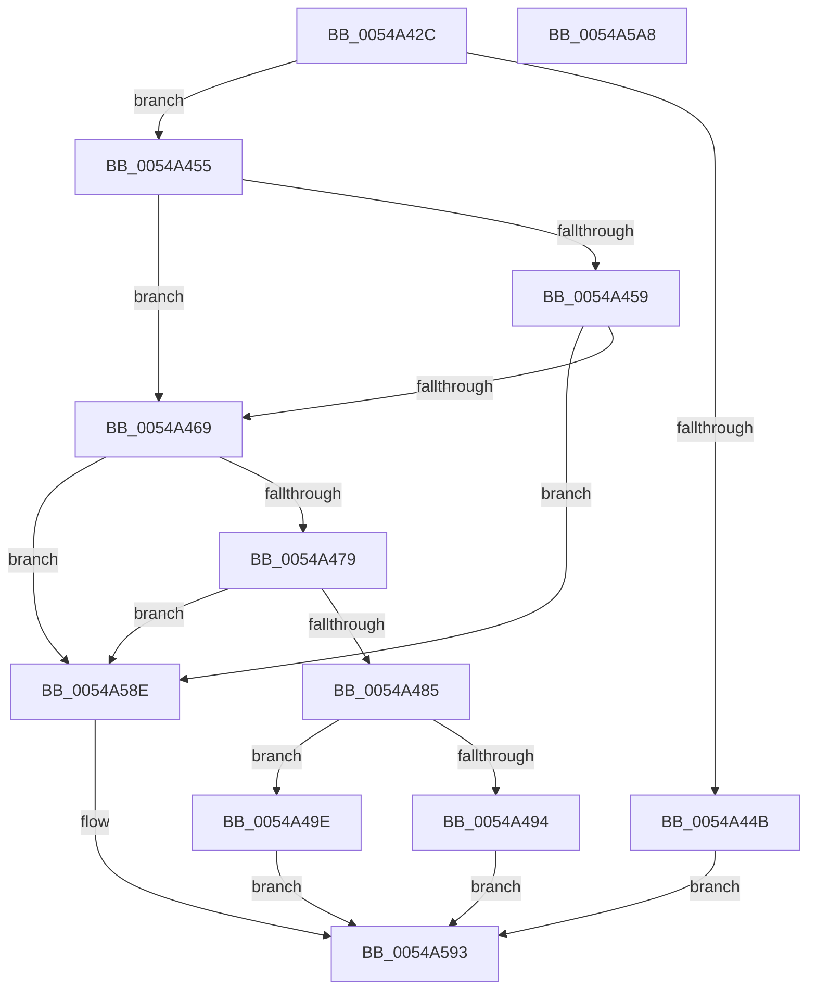

# HalpVpptTimerRegister

- RVA: `0x0054A42C`–`0x0054A5A9` (길이 `381` bytes)
- VA: `0x000000014054A42C`
- 실행 섹션: `.text`
- PDB 이름 있음: `예`; PDB Function 태그: `아니요`
- unwind 정보 RVA: `0x000C3EC4`
- 디코드: `83`개 명령, `381/381` bytes 표시
- 미해석 바이트: `0` (있으면 어셈블리에 `.byte`로 보존)

> 이 문서는 커널 이미지의 기계어와 PDB 기호를 분석해 생성했습니다. 4번과 5번은 함수 원형과 자료형을 바이너리 사용 방식에서 추정한 C 해석이며 원본 소스 복구 결과는 아닙니다.

## 1. Dependencies

- 직접 호출 지점: **3**; 고유 호출 대상: **3**
- 직접 호출자로 확인된 함수: **1**
- RIP 상대 이미지 참조: **11**

### Outgoing calls
- `0x0054A4B3` → [ExtEnvInitializeSpinLock](../56/ExtEnvInitializeSpinLock_function_00561434.md) (function, `0x00561434`)
- `0x0054A4D9` → [memset](../6C/memset_function_006C6C40.md) (function, `0x006C6C40`)
- `0x0054A587` → [HalpTimerRegister](../56/HalpTimerRegister_function_005616BC.md) (function, `0x005616BC`)

### Direct callers
- [HalpTimerSelectRoles](../53/HalpTimerSelectRoles_function_0053D4B0.md) at `0x0053D688`
- [HalpTimerSelectRoles](../53/HalpTimerSelectRoles_function_0053D4B0.md) at `0x0053D700`

### Static image references
- `0x0054A48A` → RVA `0x00FC2270` (`.data`; read/write)
- `0x0054A49E` → RVA `0x00FC2250` (`.data`; read/write)
- `0x0054A4A5` → RVA `0x00FC2280` (`.data`; read)
- `0x0054A4AC` → RVA `0x00FC2248` (`.data`; write)
- `0x0054A4B8` → RVA `0x00FC2260` (`.data`; read)
- `0x0054A4C7` → RVA `0x00FC2268` (`.data`; write)
- `0x0054A4D2` → RVA `0x00FC2260` (`.data`; write)
- `0x0054A4E2` → RVA `0x0054A2D0` (`HalpVpptInitialize`; read)
- `0x0054A4FB` → RVA `0x004AFFE0` (`HalpVpptArmTimer`; read)
- `0x0054A50F` → RVA `0x0054A380` (`HalpVpptStop`; read)
- `0x0054A521` → RVA `0x002D2230` (`HalpVpptAcknowledgeInterrupt`; read)

## 2. Other-region calls and transfers

- 다른 실행 섹션으로 향하는 call: **0**
- 별도 외부 분기/꼬리 이동을 확인하지 못했습니다.

## 3. Assembly (complete function range)

```asm
0054A42C  48 89 5C 24 08                  mov qword ptr [rsp + 8], rbx
0054A431  48 89 7C 24 10                  mov qword ptr [rsp + 0x10], rdi
0054A436  55                              push rbp
0054A437  48 8D 6C 24 A9                  lea rbp, [rsp - 0x57]
0054A43C  48 81 EC E0 00 00 00            sub rsp, 0xe0
0054A443  48 8B D9                        mov rbx, rcx
0054A446  48 85 C9                        test rcx, rcx
0054A449  75 0A                           jne 0x14054a455
0054A44B  B8 0D 00 00 C0                  mov eax, 0xc000000d
0054A450  E9 3E 01 00 00                  jmp 0x14054a593
0054A455  84 D2                           test dl, dl
0054A457  74 10                           je 0x14054a469
0054A459  F7 81 E0 00 00 00 00 80 00 00   test dword ptr [rcx + 0xe0], 0x8000
0054A463  0F 84 25 01 00 00               je 0x14054a58e
0054A469  8B B9 E0 00 00 00               mov edi, dword ptr [rcx + 0xe0]
0054A46F  40 F6 C7 01                     test dil, 1
0054A473  0F 85 15 01 00 00               jne 0x14054a58e
0054A479  81 E7 00 0B 00 00               and edi, 0xb00
0054A47F  0F 84 09 01 00 00               je 0x14054a58e
0054A485  B8 01 00 00 00                  mov eax, 1
0054A48A  87 05 E0 7D A7 00               xchg dword ptr [rip + 0xa77de0], eax
0054A490  85 C0                           test eax, eax
0054A492  74 0A                           je 0x14054a49e
0054A494  B8 18 07 00 C0                  mov eax, 0xc0000718
0054A499  E9 F5 00 00 00                  jmp 0x14054a593
0054A49E  83 0D AB 7D A7 00 FF            or dword ptr [rip + 0xa77dab], 0xffffffff
0054A4A5  48 8D 0D D4 7D A7 00            lea rcx, [rip + 0xa77dd4]
0054A4AC  48 89 1D 95 7D A7 00            mov qword ptr [rip + 0xa77d95], rbx
0054A4B3  E8 7C 6F 01 00                  call 0x140561434
0054A4B8  48 8D 05 A1 7D A7 00            lea rax, [rip + 0xa77da1]
0054A4BF  33 D2                           xor edx, edx
0054A4C1  41 B8 90 00 00 00               mov r8d, 0x90
0054A4C7  48 89 05 9A 7D A7 00            mov qword ptr [rip + 0xa77d9a], rax
0054A4CE  48 8D 4D 97                     lea rcx, [rbp - 0x69]
0054A4D2  48 89 05 87 7D A7 00            mov qword ptr [rip + 0xa77d87], rax
0054A4D9  E8 62 C7 17 00                  call 0x1406c6c40
0054A4DE  83 65 23 00                     and dword ptr [rbp + 0x23], 0
0054A4E2  48 8D 05 E7 FD FF FF            lea rax, [rip - 0x219]
0054A4E9  48 89 45 9F                     mov qword ptr [rbp - 0x61], rax
0054A4ED  48 8D 4D 97                     lea rcx, [rbp - 0x69]
0054A4F1  0F 57 C0                        xorps xmm0, xmm0
0054A4F4  C7 45 97 01 00 00 00            mov dword ptr [rbp - 0x69], 1
0054A4FB  48 8D 05 DE 5A F6 FF            lea rax, [rip - 0x9a522]
0054A502  C7 45 9B 90 00 00 00            mov dword ptr [rbp - 0x65], 0x90
0054A509  48 89 45 B7                     mov qword ptr [rbp - 0x49], rax
0054A50D  33 D2                           xor edx, edx
0054A50F  48 8D 05 6A FE FF FF            lea rax, [rip - 0x196]
0054A516  C7 45 FB 40 00 00 00            mov dword ptr [rbp - 5], 0x40
0054A51D  48 89 45 BF                     mov qword ptr [rbp - 0x41], rax
0054A521  48 8D 05 08 7D D8 FF            lea rax, [rip - 0x2782f8]
0054A528  48 89 45 AF                     mov qword ptr [rbp - 0x51], rax
0054A52C  8B 83 E0 00 00 00               mov eax, dword ptr [rbx + 0xe0]
0054A532  25 00 80 00 00                  and eax, 0x8000
0054A537  C7 45 F7 30 00 00 00            mov dword ptr [rbp - 9], 0x30
0054A53E  0B C7                           or eax, edi
0054A540  C7 45 1F 0C 00 00 00            mov dword ptr [rbp + 0x1f], 0xc
0054A547  0D 31 00 21 00                  or eax, 0x210031
0054A54C  48 C7 45 FF 80 96 98 00         mov qword ptr [rbp - 1], 0x989680
0054A554  89 45 0B                        mov dword ptr [rbp + 0xb], eax
0054A557  8B 43 60                        mov eax, dword ptr [rbx + 0x60]
0054A55A  89 45 1B                        mov dword ptr [rbp + 0x1b], eax
0054A55D  8B 43 5C                        mov eax, dword ptr [rbx + 0x5c]
0054A560  89 45 17                        mov dword ptr [rbp + 0x17], eax
0054A563  8B 43 58                        mov eax, dword ptr [rbx + 0x58]
0054A566  89 45 13                        mov dword ptr [rbp + 0x13], eax
0054A569  8B 43 54                        mov eax, dword ptr [rbx + 0x54]
0054A56C  89 45 0F                        mov dword ptr [rbp + 0xf], eax
0054A56F  48 8D 45 27                     lea rax, [rbp + 0x27]
0054A573  0F 11 45 37                     movups xmmword ptr [rbp + 0x37], xmm0
0054A577  83 4D 37 FF                     or dword ptr [rbp + 0x37], 0xffffffff
0054A57B  48 89 45 EF                     mov qword ptr [rbp - 0x11], rax
0054A57F  0F 11 45 27                     movups xmmword ptr [rbp + 0x27], xmm0
0054A583  0F 11 45 47                     movups xmmword ptr [rbp + 0x47], xmm0
0054A587  E8 30 71 01 00                  call 0x1405616bc
0054A58C  EB 05                           jmp 0x14054a593
0054A58E  B8 BB 00 00 C0                  mov eax, 0xc00000bb
0054A593  4C 8D 9C 24 E0 00 00 00         lea r11, [rsp + 0xe0]
0054A59B  49 8B 5B 10                     mov rbx, qword ptr [r11 + 0x10]
0054A59F  49 8B 7B 18                     mov rdi, qword ptr [r11 + 0x18]
0054A5A3  49 8B E3                        mov rsp, r11
0054A5A6  5D                              pop rbp
0054A5A7  C3                              ret
0054A5A8  CC                              int3
```

## 4. C-style interpretation (structured pseudocode)

```c
__int64 __fastcall HalpVpptTimerRegister(__int64 a1, int a2)
{
    __int64 result;
    __int64 v_rdi;
    __int64 v_rsp;
    unsigned __int64 v_stack_m18;
    unsigned __int64 v_stack_m28;
    unsigned __int64 v_stack_m38;
    unsigned int v_stack_m3C;
    unsigned int v_stack_m40;
    unsigned int v_stack_m44;
    unsigned int v_stack_m48;
    unsigned int v_stack_m4C;
    unsigned int v_stack_m50;
    unsigned int v_stack_m54;
    unsigned __int64 v_stack_m5F;
    unsigned __int64 v_stack_m60;
    unsigned int v_stack_m64;
    unsigned int v_stack_m68;
    unsigned __int64 v_stack_m70;
    unsigned __int64 v_stack_m8;
    unsigned __int64 v_stack_mA0;
    unsigned __int64 v_stack_mA8;
    unsigned __int64 v_stack_mB0;
    unsigned __int64 v_stack_mC0;
    unsigned int v_stack_mC4;
    unsigned __int64 v_stack_mC8;
    unsigned __int64 v_stack_p10;
    unsigned __int64 v_stack_p8;

    v_stack_p8 = v_rbx;
    v_stack_p10 = v_rdi;
    v_rsp = (v_rsp) - (224);
    if (a1 != 0) goto loc_0054A455;
    goto loc_0054A593;
loc_0054A455:
    if ((unsigned __int8)(a2) == 0) goto loc_0054A469;
    if (((*(unsigned int *)(a1 + 224)) & (0x8000ULL)) == 0) goto loc_0054A58E;
loc_0054A469:
    if ((((unsigned __int8)((unsigned int)(*(unsigned int *)(a1 + 224)))) & (1)) != 0) goto loc_0054A58E;
    v_rdi = (unsigned int)(((unsigned int)(*(unsigned int *)(a1 + 224))) & (0xB00ULL));
    if (condition_is_equal) goto loc_0054A58E;
    if (1 == 0) goto loc_0054A49E;
    goto loc_0054A593;
loc_0054A49E:
    *(unsigned __int64 *)(v_rip + 10976661) = a1;
    result = ExtEnvInitializeSpinLock(v_rip + 10976724, a2, a3, a4);
    a2 = 0;
    *(unsigned __int64 *)(v_rip + 10976666) = v_rip + 10976673;
    *(unsigned __int64 *)(v_rip + 10976647) = v_rip + 10976673;
    result = memset(v_stack_mC8, a2, 144, a4);
    v_stack_mC0 = v_rip - 537;
    v_stack_mC8 = 1;
    v_stack_mC4 = 144;
    v_stack_mA8 = v_rip - 632098;
    a2 = 0;
    v_stack_m64 = 64;
    v_stack_mA0 = v_rip - 406;
    v_stack_mB0 = v_rip - 2589432;
    result = (unsigned int)(((unsigned int)(*(unsigned int *)(a1 + 224))) & (0x8000ULL));
    v_stack_m68 = 48;
    result = (unsigned int)((result) | ((unsigned int)(v_rdi)));
    v_stack_m40 = 12;
    result = (unsigned int)((result) | (0x210031ULL));
    v_stack_m60 = 0x989680ULL;
    v_stack_m54 = (unsigned int)(result);
    v_stack_m44 = (unsigned int)((unsigned int)(*(unsigned int *)(a1 + 96)));
    v_stack_m48 = (unsigned int)((unsigned int)(*(unsigned int *)(a1 + 92)));
    v_stack_m4C = (unsigned int)((unsigned int)(*(unsigned int *)(a1 + 88)));
    v_stack_m50 = (unsigned int)((unsigned int)(*(unsigned int *)(a1 + 84)));
    v_stack_m28 = v_xmm0;
    v_stack_m70 = v_stack_m38;
    v_stack_m38 = v_xmm0;
    v_stack_m18 = v_xmm0;
    result = HalpTimerRegister(v_stack_mC8, a2, 144, a4);
    goto loc_0054A593;
loc_0054A58E:
loc_0054A593:
    return (unsigned int)(0xC00000BBULL);
}
```

## 5. (Beta) C Style

```c
int64_t HalpVpptTimerRegister(void *Arg1, int32_t Arg2)
{
    uint8_t *arg1 = (uint8_t *)Arg1;

    int64_t result;
    int64_t local_rdi;
    int64_t local_rsp;
    uint64_t v_stack_m18;
    uint64_t v_stack_m28;
    uint64_t v_stack_m38;
    uint32_t v_stack_m3C;
    uint32_t v_stack_m40;
    uint32_t v_stack_m44;
    uint32_t v_stack_m48;
    uint32_t v_stack_m4C;
    uint32_t v_stack_m50;
    uint32_t v_stack_m54;
    uint64_t v_stack_m5F;
    uint64_t v_stack_m60;
    uint32_t v_stack_m64;
    uint32_t v_stack_m68;
    uint64_t v_stack_m70;
    uint64_t v_stack_m8;
    uint64_t v_stack_mA0;
    uint64_t v_stack_mA8;
    uint64_t v_stack_mB0;
    uint64_t v_stack_mC0;
    uint32_t v_stack_mC4;
    uint64_t v_stack_mC8;
    uint64_t v_stack_p10;
    uint64_t v_stack_p8;

    v_stack_p8 = local_rbx;
    v_stack_p10 = local_rdi;
    local_rsp = (local_rsp) - (224);
    if (Arg1 != NULL) goto loc_0054A455;
    goto loc_0054A593;
loc_0054A455:
    if ((uint8_t)(Arg2) == 0) goto loc_0054A469;
    if (((*(uint32_t *)(arg1 + 0xE0)) & (0x8000ULL)) == 0) goto loc_0054A58E;
loc_0054A469:
    if ((((uint8_t)((uint32_t)(*(uint32_t *)(arg1 + 0xE0)))) & (1)) != 0) goto loc_0054A58E;
    local_rdi = (uint32_t)(((uint32_t)(*(uint32_t *)(arg1 + 0xE0))) & (0xB00ULL));
    if (condition_is_equal) goto loc_0054A58E;
    if (1 == 0) goto loc_0054A49E;
    goto loc_0054A593;
loc_0054A49E:
    *(void **)(v_rip + 0xA77D95) = Arg1;
    result = ExtEnvInitializeSpinLock(v_rip + 10976724, Arg2, a3, a4);
    Arg2 = 0;
    *(uint64_t *)(v_rip + 0xA77D9A) = v_rip + 10976673;
    *(uint64_t *)(v_rip + 0xA77D87) = v_rip + 10976673;
    result = memset(v_stack_mC8, Arg2, 144, a4);
    v_stack_mC0 = v_rip - 537;
    v_stack_mC8 = 1;
    v_stack_mC4 = 144;
    v_stack_mA8 = v_rip - 632098;
    Arg2 = 0;
    v_stack_m64 = 64;
    v_stack_mA0 = v_rip - 406;
    v_stack_mB0 = v_rip - 2589432;
    result = (uint32_t)(((uint32_t)(*(uint32_t *)(arg1 + 0xE0))) & (0x8000ULL));
    v_stack_m68 = 48;
    result = (uint32_t)((result) | ((uint32_t)(local_rdi)));
    v_stack_m40 = 12;
    result = (uint32_t)((result) | (0x210031ULL));
    v_stack_m60 = 0x989680ULL;
    v_stack_m54 = (uint32_t)(result);
    v_stack_m44 = (uint32_t)((uint32_t)(*(uint32_t *)(arg1 + 0x60)));
    v_stack_m48 = (uint32_t)((uint32_t)(*(uint32_t *)(arg1 + 0x5C)));
    v_stack_m4C = (uint32_t)((uint32_t)(*(uint32_t *)(arg1 + 0x58)));
    v_stack_m50 = (uint32_t)((uint32_t)(*(uint32_t *)(arg1 + 0x54)));
    v_stack_m28 = v_xmm0;
    v_stack_m70 = v_stack_m38;
    v_stack_m38 = v_xmm0;
    v_stack_m18 = v_xmm0;
    result = HalpTimerRegister(v_stack_mC8, Arg2, 144, a4);
    goto loc_0054A593;
loc_0054A58E:
loc_0054A593:
    return (uint32_t)(0xC00000BBULL);
}
```

### 관측된 메모리 오프셋

구조체 형식이 확인되지 않은 접근은 인자 기준의 오프셋으로만 기록했습니다.

| 기준 인자 | 오프셋 표현 | 폭 (bit) | 접근 |
|---|---:|---:|---|
| `Arg1` | `+ 0x54` | `32` | `R` |
| `Arg1` | `+ 0x58` | `32` | `R` |
| `Arg1` | `+ 0x5C` | `32` | `R` |
| `Arg1` | `+ 0x60` | `32` | `R` |
| `Arg1` | `+ 0xE0` | `32` | `R` |

## 6. Execution-region graph

[열기: 2D/3D 그래프와 함수 탐색 컨트롤 패널](../../../control-panel.html?section=text&rva=0x0054A42C&view=graph)

- 2D 그래프는 위에서 아래로 흐르고, 3D 그래프는 빈 공간을 드래그해 회전합니다. Shift+드래그는 이동, 휠은 확대·축소, 함수 노드 선택은 대상 보고서 이동입니다.

### Static fallback


