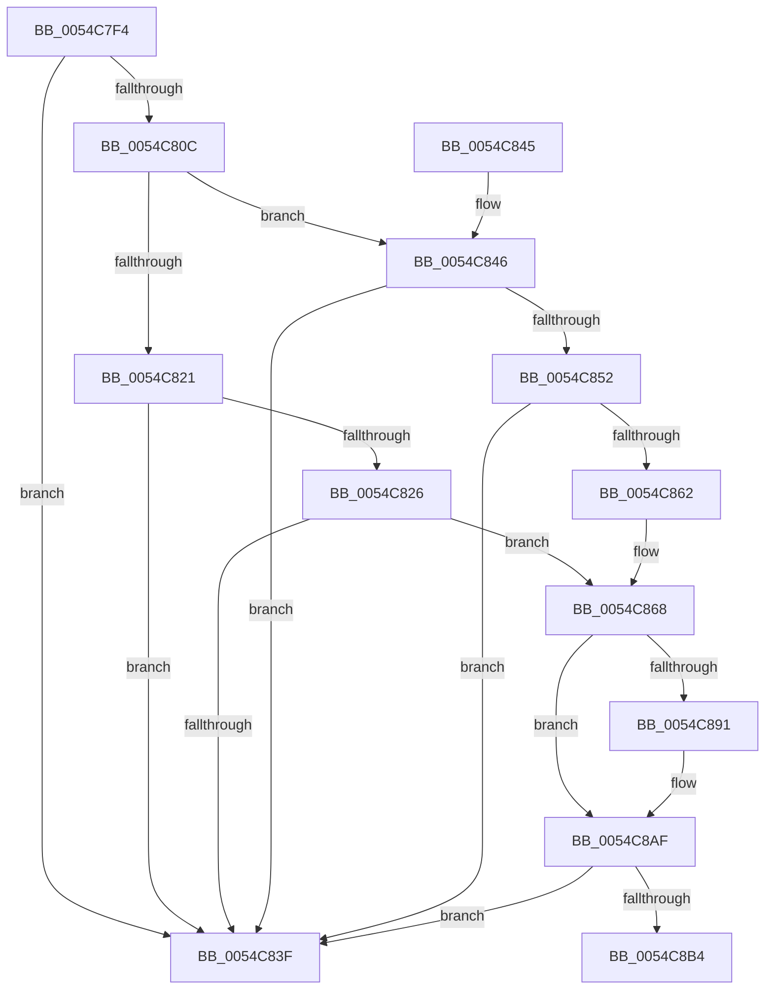

# HalpWatchdogCheckPreResetNMI

- RVA: `0x0054C7F4`–`0x0054C8D2` (길이 `222` bytes)
- VA: `0x000000014054C7F4`
- 실행 섹션: `.text`
- PDB 이름 있음: `예`; PDB Function 태그: `아니요`
- unwind 정보 RVA: `0x000C3FF0`
- 디코드: `57`개 명령, `222/222` bytes 표시
- 미해석 바이트: `0` (있으면 어셈블리에 `.byte`로 보존)

> 이 문서는 커널 이미지의 기계어와 PDB 기호를 분석해 생성했습니다. 4번과 5번은 함수 원형과 자료형을 바이너리 사용 방식에서 추정한 C 해석이며 원본 소스 복구 결과는 아닙니다.

## 1. Dependencies

- 직접 호출 지점: **3**; 고유 호출 대상: **2**
- 직접 호출자로 확인된 함수: **1**
- RIP 상대 이미지 참조: **4**

### Outgoing calls
- `0x0054C877` → [RtlGetInterruptTimePrecise](../20/RtlGetInterruptTimePrecise_function_0020A4C0.md) (function, `0x0020A4C0`)
- `0x0054C8A9` → [KeBugCheckEx](../4F/KeBugCheckEx_function_004FD660.md) (function, `0x004FD660`)
- `0x0054C8CC` → [KeBugCheckEx](../4F/KeBugCheckEx_function_004FD660.md) (function, `0x004FD660`)

### Direct callers
- [HalpPreprocessNmi](../55/HalpPreprocessNmi_function_0055B400.md) at `0x0055B40D`

### Static image references
- `0x0054C800` → RVA `0x00FC4028` (`.data`; read)
- `0x0054C829` → RVA `0x00FC2188` (`.data`; read)
- `0x0054C836` → RVA `0x00FC2168` (`.data`; read)
- `0x0054C891` → RVA `0x00F21FB0` (`.data`; read)

## 2. Other-region calls and transfers

- 다른 실행 섹션으로 향하는 call: **0**
- 별도 외부 분기/꼬리 이동을 확인하지 못했습니다.

## 3. Assembly (complete function range)

```asm
0054C7F4  40 53                           push rbx
0054C7F6  48 83 EC 30                     sub rsp, 0x30
0054C7FA  48 83 64 24 40 00               and qword ptr [rsp + 0x40], 0
0054C800  48 8B 05 21 78 A7 00            mov rax, qword ptr [rip + 0xa77821]
0054C807  48 85 C0                        test rax, rax
0054C80A  74 33                           je 0x14054c83f
0054C80C  8B 88 E4 00 00 00               mov ecx, dword ptr [rax + 0xe4]
0054C812  48 BB 08 00 00 00 80 F7 FF FF   movabs rbx, 0xfffff78000000008
0054C81C  83 F9 08                        cmp ecx, 8
0054C81F  74 25                           je 0x14054c846
0054C821  83 F9 0D                        cmp ecx, 0xd
0054C824  75 19                           jne 0x14054c83f
0054C826  48 8B 03                        mov rax, qword ptr [rbx]
0054C829  48 2B 05 58 59 A7 00            sub rax, qword ptr [rip + 0xa75958]
0054C830  48 05 00 E1 F5 05               add rax, 0x5f5e100
0054C836  48 3B 05 2B 59 A7 00            cmp rax, qword ptr [rip + 0xa7592b]
0054C83D  77 29                           ja 0x14054c868
0054C83F  48 83 C4 30                     add rsp, 0x30
0054C843  5B                              pop rbx
0054C844  C3                              ret
0054C845  CC                              int3
0054C846  65 8B 04 25 A4 01 00 00         mov eax, dword ptr gs:[0x1a4]
0054C84E  85 C0                           test eax, eax
0054C850  75 ED                           jne 0x14054c83f
0054C852  B9 12 01 00 40                  mov ecx, 0x40000112
0054C857  0F 32                           rdmsr
0054C859  48 C1 E2 20                     shl rdx, 0x20
0054C85D  48 0B C2                        or rax, rdx
0054C860  74 DD                           je 0x14054c83f
0054C862  33 C0                           xor eax, eax
0054C864  33 D2                           xor edx, edx
0054C866  0F 30                           wrmsr
0054C868  48 8B 1B                        mov rbx, qword ptr [rbx]
0054C86B  48 8D 4C 24 40                  lea rcx, [rsp + 0x40]
0054C870  48 2B 1D 11 59 A7 00            sub rbx, qword ptr [rip + 0xa75911]
0054C877  E8 44 DC CB FF                  call 0x14020a4c0
0054C87C  48 8B 0D A5 77 A7 00            mov rcx, qword ptr [rip + 0xa777a5]
0054C883  4C 8B C0                        mov r8, rax
0054C886  8B 81 E4 00 00 00               mov eax, dword ptr [rcx + 0xe4]
0054C88C  83 F8 08                        cmp eax, 8
0054C88F  75 1E                           jne 0x14054c8af
0054C891  8B 0D 19 57 9D 00               mov ecx, dword ptr [rip + 0x9d5719]
0054C897  48 8B D3                        mov rdx, rbx
0054C89A  4C 8B 4C 24 40                  mov r9, qword ptr [rsp + 0x40]
0054C89F  48 89 4C 24 20                  mov qword ptr [rsp + 0x20], rcx
0054C8A4  B9 CA 01 00 00                  mov ecx, 0x1ca
0054C8A9  E8 B2 0D FB FF                  call 0x1404fd660
0054C8AE  CC                              int3
0054C8AF  83 F8 0D                        cmp eax, 0xd
0054C8B2  75 8B                           jne 0x14054c83f
0054C8B4  8B 05 F6 56 9D 00               mov eax, dword ptr [rip + 0x9d56f6]
0054C8BA  48 8B D3                        mov rdx, rbx
0054C8BD  4C 8B 4C 24 40                  mov r9, qword ptr [rsp + 0x40]
0054C8C2  B9 CF 01 00 00                  mov ecx, 0x1cf
0054C8C7  48 89 44 24 20                  mov qword ptr [rsp + 0x20], rax
0054C8CC  E8 8F 0D FB FF                  call 0x1404fd660
0054C8D1  CC                              int3
```

## 4. C-style interpretation (structured pseudocode)

```c
__int64 __fastcall HalpWatchdogCheckPreResetNMI(__int64 a1, __int64 a2)
{
    __int64 result;
    __int64 v_rbx;
    __int64 v_rsp;
    unsigned __int64 v_stack_p20;
    unsigned __int64 v_stack_p40;
    unsigned __int64 v_stack_p8;

    v_rsp = (v_rsp) - (48);
    if (*(unsigned __int64 *)(v_rip + 10975265) == 0) goto loc_0054C83F;
    if (((unsigned int)((unsigned int)(*(unsigned int *)(*(unsigned __int64 *)(v_rip + 10975265) + 228)))) == 8) goto loc_0054C846;
    if (((unsigned int)((unsigned int)(*(unsigned int *)(*(unsigned __int64 *)(v_rip + 10975265) + 228)))) != 13) goto loc_0054C83F;
    result = (*(unsigned __int64 *)(v_rbx)) - (*(unsigned __int64 *)(v_rip + 10967384));
    result = (result) + (0x5F5E100ULL);
    if (result > (*(unsigned __int64 *)(v_rip + 10967339))) goto loc_0054C868;
loc_0054C83F:
    v_rsp = (v_rsp) + (48);
    return result;
loc_0054C846:
    if ((unsigned int)((unsigned int)(*(unsigned int *)(gs_base + (0 + 420)))) != 0) goto loc_0054C83F;
    a2 = (a2) << (32);
    result = ((unsigned int)(*(unsigned int *)(gs_base + (0 + 420)))) | (a2);
    if (condition_is_equal) goto loc_0054C83F;
    result = 0;
    a2 = 0;
loc_0054C868:
    v_rbx = (*(unsigned __int64 *)(v_rbx)) - (*(unsigned __int64 *)(v_rip + 10967313));
    result = RtlGetInterruptTimePrecise(v_stack_p40, a2, a3, a4);
    result = (unsigned int)(*(unsigned int *)(*(unsigned __int64 *)(v_rip + 10975141) + 228));
    if (((unsigned int)((unsigned int)(*(unsigned int *)(*(unsigned __int64 *)(v_rip + 10975141) + 228)))) == 8) {
        a1 = *(unsigned int *)(v_rip + 10311449);
        a2 = v_rbx;
        a4 = v_stack_p40;
        v_stack_p20 = a1;
        a1 = 458;
        result = KeBugCheckEx(a1, a2, result, a4);
    }
    if (((unsigned int)(result)) != 13) goto loc_0054C83F;
    v_stack_p20 = (unsigned int)(*(unsigned int *)(v_rip + 10311414));
    result = KeBugCheckEx(463, v_rbx, result, v_stack_p40);
    return result;
}
```

## 5. (Beta) C Style

```c
int64_t HalpWatchdogCheckPreResetNMI(int64_t Arg1, int64_t Arg2)
{
    int64_t result;
    int64_t local_rbx;
    int64_t local_rsp;
    uint64_t v_stack_p20;
    uint64_t v_stack_p40;
    uint64_t v_stack_p8;

    local_rsp = (local_rsp) - (48);
    if (*(uint64_t *)(v_rip + 0xA77821) == 0) goto loc_0054C83F;
    if (((uint32_t)((uint32_t)(*(uint32_t *)(*(uint64_t *)(v_rip + 0xA77821) + 0xE4)))) == 8) goto loc_0054C846;
    if (((uint32_t)((uint32_t)(*(uint32_t *)(*(uint64_t *)(v_rip + 0xA77821) + 0xE4)))) != 13) goto loc_0054C83F;
    result = (*(uint64_t *)(local_rbx)) - (*(uint64_t *)(v_rip + 0xA75958));
    result = (result) + (0x5F5E100ULL);
    if (result > (*(uint64_t *)(v_rip + 0xA7592B))) goto loc_0054C868;
loc_0054C83F:
    local_rsp = (local_rsp) + (48);
    return result;
loc_0054C846:
    if ((uint32_t)((uint32_t)(*(uint32_t *)(gs_base + (0 + 0x1A4)))) != 0) goto loc_0054C83F;
    Arg2 = (Arg2) << (32);
    result = ((uint32_t)(*(uint32_t *)(gs_base + (0 + 0x1A4)))) | (Arg2);
    if (condition_is_equal) goto loc_0054C83F;
    result = 0;
    Arg2 = 0;
loc_0054C868:
    local_rbx = (*(uint64_t *)(local_rbx)) - (*(uint64_t *)(v_rip + 0xA75911));
    result = RtlGetInterruptTimePrecise(v_stack_p40, Arg2, a3, a4);
    result = (uint32_t)(*(uint32_t *)(*(uint64_t *)(v_rip + 0xA777A5) + 0xE4));
    if (((uint32_t)((uint32_t)(*(uint32_t *)(*(uint64_t *)(v_rip + 0xA777A5) + 0xE4)))) == 8) {
        Arg1 = *(uint32_t *)(v_rip + 0x9D5719);
        Arg2 = local_rbx;
        a4 = v_stack_p40;
        v_stack_p20 = Arg1;
        Arg1 = 458;
        result = KeBugCheckEx(Arg1, Arg2, result, a4);
    }
    if (((uint32_t)(result)) != 13) goto loc_0054C83F;
    v_stack_p20 = (uint32_t)(*(uint32_t *)(v_rip + 0x9D56F6));
    result = KeBugCheckEx(463, local_rbx, result, v_stack_p40);
    return result;
}
```

## 6. Execution-region graph

[열기: 2D/3D 그래프와 함수 탐색 컨트롤 패널](../../../control-panel.html?section=text&rva=0x0054C7F4&view=graph)

- 2D 그래프는 위에서 아래로 흐르고, 3D 그래프는 빈 공간을 드래그해 회전합니다. Shift+드래그는 이동, 휠은 확대·축소, 함수 노드 선택은 대상 보고서 이동입니다.

### Static fallback


