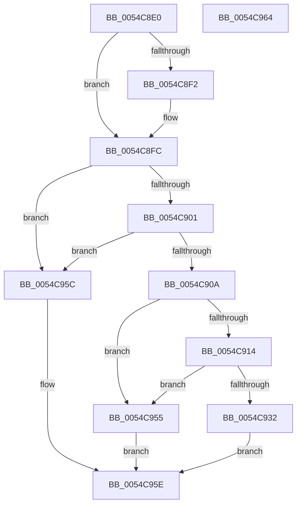

# HalpWatchdogDelayExpiration

- RVA: `0x0054C8E0`–`0x0054C965` (길이 `133` bytes)
- VA: `0x000000014054C8E0`
- 실행 섹션: `.text`
- PDB 이름 있음: `예`; PDB Function 태그: `아니요`
- unwind 정보 RVA: `0x00064C80`
- 디코드: `36`개 명령, `133/133` bytes 표시
- 미해석 바이트: `0` (있으면 어셈블리에 `.byte`로 보존)

> 이 문서는 커널 이미지의 기계어와 PDB 기호를 분석해 생성했습니다. 4번과 5번은 함수 원형과 자료형을 바이너리 사용 방식에서 추정한 C 해석이며 원본 소스 복구 결과는 아닙니다.

## 1. Dependencies

- 직접 호출 지점: **2**; 고유 호출 대상: **2**
- 직접 호출자로 확인된 함수: **0**
- RIP 상대 이미지 참조: **6**

### Outgoing calls
- `0x0054C919` → [RtlGetInterruptTimePrecise](../20/RtlGetInterruptTimePrecise_function_0020A4C0.md) (function, `0x0020A4C0`)
- `0x0054C94E` → [HalpSetTimer](../42/HalpSetTimer_function_0042BD30.md) (function, `0x0042BD30`)

### Direct callers
- 이 함수 시작 RVA로 연결되는 직접 call은 확인되지 않았습니다. 간접 호출은 완전히 역산할 수 없습니다.

### Static image references
- `0x0054C8E6` → RVA `0x00FC4028` (`.data`; read)
- `0x0054C8F2` → RVA `0x00FC2178` (`.data`; read)
- `0x0054C901` → RVA `0x00FC2184` (`.data`; read)
- `0x0054C90A` → RVA `0x00FC4060` (`.data`; read)
- `0x0054C91E` → RVA `0x00FC2188` (`.data`; read)
- `0x0054C932` → RVA `0x00FC2168` (`.data`; read)

## 2. Other-region calls and transfers

- 다른 실행 섹션으로 향하는 call: **0**
- 별도 외부 분기/꼬리 이동을 확인하지 못했습니다.

## 3. Assembly (complete function range)

```asm
0054C8E0  40 53                           push rbx
0054C8E2  48 83 EC 30                     sub rsp, 0x30
0054C8E6  48 8B 1D 3B 77 A7 00            mov rbx, qword ptr [rip + 0xa7773b]
0054C8ED  48 85 C9                        test rcx, rcx
0054C8F0  74 0A                           je 0x14054c8fc
0054C8F2  48 8B 05 7F 58 A7 00            mov rax, qword ptr [rip + 0xa7587f]
0054C8F9  48 89 01                        mov qword ptr [rcx], rax
0054C8FC  48 85 DB                        test rbx, rbx
0054C8FF  74 5B                           je 0x14054c95c
0054C901  80 3D 7C 58 A7 00 00            cmp byte ptr [rip + 0xa7587c], 0
0054C908  74 52                           je 0x14054c95c
0054C90A  8B 05 50 77 A7 00               mov eax, dword ptr [rip + 0xa77750]
0054C910  85 C0                           test eax, eax
0054C912  74 41                           je 0x14054c955
0054C914  48 8D 4C 24 40                  lea rcx, [rsp + 0x40]
0054C919  E8 A2 DB CB FF                  call 0x14020a4c0
0054C91E  4C 8B 05 63 58 A7 00            mov r8, qword ptr [rip + 0xa75863]
0054C925  B9 00 5E D0 B2                  mov ecx, 0xb2d05e00
0054C92A  4C 03 C1                        add r8, rcx
0054C92D  4C 3B C0                        cmp r8, rax
0054C930  72 23                           jb 0x14054c955
0054C932  4C 8B 05 2F 58 A7 00            mov r8, qword ptr [rip + 0xa7582f]
0054C939  48 8D 44 24 40                  lea rax, [rsp + 0x40]
0054C93E  41 B1 01                        mov r9b, 1
0054C941  48 89 44 24 20                  mov qword ptr [rsp + 0x20], rax
0054C946  BA 03 00 00 00                  mov edx, 3
0054C94B  48 8B CB                        mov rcx, rbx
0054C94E  E8 DD F3 ED FF                  call 0x14042bd30
0054C953  EB 09                           jmp 0x14054c95e
0054C955  B8 01 00 00 C0                  mov eax, 0xc0000001
0054C95A  EB 02                           jmp 0x14054c95e
0054C95C  33 C0                           xor eax, eax
0054C95E  48 83 C4 30                     add rsp, 0x30
0054C962  5B                              pop rbx
0054C963  C3                              ret
0054C964  CC                              int3
```

## 4. C-style interpretation (structured pseudocode)

```c
__int64 __fastcall HalpWatchdogDelayExpiration(__int64 a1)
{
    __int64 result;
    __int64 v_rsp;
    unsigned __int64 v_stack_m18;
    unsigned __int64 v_stack_p8;

    v_rsp = (v_rsp) - (48);
    if (a1 != 0) {
        result = *(unsigned __int64 *)(v_rip + 10967167);
        *(unsigned __int64 *)(a1) = result;
    }
    if (*(unsigned __int64 *)(v_rip + 10975035) == 0) goto loc_0054C95C;
    if ((*(unsigned __int8 *)(v_rip + 10967164)) == 0) goto loc_0054C95C;
    if ((unsigned int)((unsigned int)(*(unsigned int *)(v_rip + 10975056))) == 0) goto loc_0054C955;
    result = RtlGetInterruptTimePrecise(v_stack_p8, a2, a3, a4);
    a3 = (*(unsigned __int64 *)(v_rip + 10967139)) + ((unsigned int)(0xB2D05E00ULL));
    if (a3 < result) goto loc_0054C955;
    v_stack_m18 = v_stack_p8;
    result = HalpSetTimer(*(unsigned __int64 *)(v_rip + 10975035), 3, *(unsigned __int64 *)(v_rip + 10967087), 1);
    goto loc_0054C95E;
loc_0054C955:
    goto loc_0054C95E;
loc_0054C95C:
    result = 0;
loc_0054C95E:
    v_rsp = (v_rsp) + (48);
    return result;
}
```

## 5. (Beta) C Style

```c
int64_t HalpWatchdogDelayExpiration(int64_t Arg1)
{
    int64_t result;
    int64_t local_rsp;
    uint64_t v_stack_m18;
    uint64_t v_stack_p8;

    local_rsp = (local_rsp) - (48);
    if (Arg1 != 0) {
        result = *(uint64_t *)(v_rip + 0xA7587F);
        *(uint64_t *)(Arg1) = result;
    }
    if (*(uint64_t *)(v_rip + 0xA7773B) == 0) goto loc_0054C95C;
    if ((*(uint8_t *)(v_rip + 0xA7587C)) == 0) goto loc_0054C95C;
    if ((uint32_t)((uint32_t)(*(uint32_t *)(v_rip + 0xA77750))) == 0) goto loc_0054C955;
    result = RtlGetInterruptTimePrecise(v_stack_p8, a2, a3, a4);
    a3 = (*(uint64_t *)(v_rip + 0xA75863)) + ((uint32_t)(0xB2D05E00ULL));
    if (a3 < result) goto loc_0054C955;
    v_stack_m18 = v_stack_p8;
    result = HalpSetTimer(*(uint64_t *)(v_rip + 0xA7773B), 3, *(uint64_t *)(v_rip + 0xA7582F), 1);
    goto loc_0054C95E;
loc_0054C955:
    goto loc_0054C95E;
loc_0054C95C:
    result = 0;
loc_0054C95E:
    local_rsp = (local_rsp) + (48);
    return result;
}
```

## 6. Execution-region graph

[열기: 2D/3D 그래프와 함수 탐색 컨트롤 패널](../../../control-panel.html?section=text&rva=0x0054C8E0&view=graph)

- 2D 그래프는 위에서 아래로 흐르고, 3D 그래프는 빈 공간을 드래그해 회전합니다. Shift+드래그는 이동, 휠은 확대·축소, 함수 노드 선택은 대상 보고서 이동입니다.

### Static fallback


