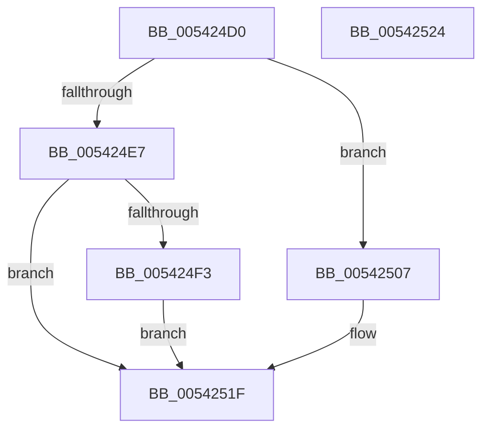

# HalpWheaGetApicId

- RVA: `0x005424D0`–`0x00542525` (길이 `85` bytes)
- VA: `0x00000001405424D0`
- 실행 섹션: `.text`
- PDB 이름 있음: `예`; PDB Function 태그: `아니요`
- unwind 정보 RVA: `0x0005C788`
- 디코드: `22`개 명령, `85/85` bytes 표시
- 미해석 바이트: `0` (있으면 어셈블리에 `.byte`로 보존)

> 이 문서는 커널 이미지의 기계어와 PDB 기호를 분석해 생성했습니다. 4번과 5번은 함수 원형과 자료형을 바이너리 사용 방식에서 추정한 C 해석이며 원본 소스 복구 결과는 아닙니다.

## 1. Dependencies

- 직접 호출 지점: **2**; 고유 호출 대상: **1**
- 직접 호출자로 확인된 함수: **2**
- RIP 상대 이미지 참조: **3**

### Outgoing calls
- `0x005424FB` → [guard_dispatch_icall](../6B/guard_dispatch_icall_function_006BAAD0.md) (function, `0x006BAAD0`)
- `0x00542516` → [guard_dispatch_icall](../6B/guard_dispatch_icall_function_006BAAD0.md) (function, `0x006BAAD0`)

### Direct callers
- [HalpAddMcaToProcessorSpecificSection](HalpAddMcaToProcessorSpecificSection_function_005403D8.md) at `0x00540451`
- [HalpMcaPopulateErrorData](HalpMcaPopulateErrorData_function_005417AC.md) at `0x00541846`

### Static image references
- `0x005424D6` → RVA `0x00FC1C48` (`.data`; read)
- `0x005424E7` → RVA `0x00FC1E78` (`.data`; read)
- `0x00542507` → RVA `0x00E00A28` (`.data`; read)

## 2. Other-region calls and transfers

- 다른 실행 섹션으로 향하는 call: **0**
- 별도 외부 분기/꼬리 이동을 확인하지 못했습니다.

## 3. Assembly (complete function range)

```asm
005424D0  48 83 EC 28                     sub rsp, 0x28
005424D4  33 C0                           xor eax, eax
005424D6  38 05 6C F7 A7 00               cmp byte ptr [rip + 0xa7f76c], al
005424DC  48 89 44 24 40                  mov qword ptr [rsp + 0x40], rax
005424E1  89 44 24 38                     mov dword ptr [rsp + 0x38], eax
005424E5  74 20                           je 0x140542507
005424E7  4C 8B 05 8A F9 A7 00            mov r8, qword ptr [rip + 0xa7f98a]
005424EE  4D 85 C0                        test r8, r8
005424F1  74 2C                           je 0x14054251f
005424F3  48 8D 54 24 40                  lea rdx, [rsp + 0x40]
005424F8  49 8B C0                        mov rax, r8
005424FB  E8 D0 85 17 00                  call 0x1406baad0
00542500  48 8B 44 24 40                  mov rax, qword ptr [rsp + 0x40]
00542505  EB 18                           jmp 0x14054251f
00542507  48 8B 05 1A E5 8B 00            mov rax, qword ptr [rip + 0x8be51a]
0054250E  48 8D 54 24 38                  lea rdx, [rsp + 0x38]
00542513  45 33 C0                        xor r8d, r8d
00542516  E8 B5 85 17 00                  call 0x1406baad0
0054251B  8B 44 24 38                     mov eax, dword ptr [rsp + 0x38]
0054251F  48 83 C4 28                     add rsp, 0x28
00542523  C3                              ret
00542524  CC                              int3
```

## 4. C-style interpretation (structured pseudocode)

```c
__int64 __fastcall HalpWheaGetApicId(void)
{
    __int64 result;
    __int64 v_rsp;
    unsigned int v_stack_p10;
    unsigned __int64 v_stack_p18;

    v_rsp = (v_rsp) - (40);
    result = 0;
    v_stack_p18 = 0;
    v_stack_p10 = 0;
    if ((*(unsigned __int8 *)(v_rip + 11007852)) == 0) goto loc_00542507;
    if (*(unsigned __int64 *)(v_rip + 11008394) == 0) goto loc_0054251F;
    result = guard_dispatch_icall(a1, v_stack_p18, *(unsigned __int64 *)(v_rip + 11008394), a4);
    goto loc_0054251F;
loc_00542507:
    a3 = 0;
    result = guard_dispatch_icall(a1, v_stack_p10, a3, a4);
loc_0054251F:
    v_rsp = (v_rsp) + (40);
    return (unsigned int)(v_stack_p10);
}
```

## 5. (Beta) C Style

```c
void HalpWheaGetApicId(void)
{
    int64_t result;
    int64_t local_rsp;
    uint32_t v_stack_p10;
    uint64_t v_stack_p18;

    local_rsp = (local_rsp) - (40);
    result = 0;
    v_stack_p18 = 0;
    v_stack_p10 = 0;
    if ((*(uint8_t *)(v_rip + 0xA7F76C)) == 0) goto loc_00542507;
    if (*(uint64_t *)(v_rip + 0xA7F98A) == 0) goto loc_0054251F;
    result = guard_dispatch_icall(a1, v_stack_p18, *(uint64_t *)(v_rip + 0xA7F98A), a4);
    goto loc_0054251F;
loc_00542507:
    a3 = 0;
    result = guard_dispatch_icall(a1, v_stack_p10, a3, a4);
loc_0054251F:
    local_rsp = (local_rsp) + (40);
    return (uint32_t)(v_stack_p10);
}
```

## 6. Execution-region graph

[열기: 2D/3D 그래프와 함수 탐색 컨트롤 패널](../../../control-panel.html?section=text&rva=0x005424D0&view=graph)

- 2D 그래프는 위에서 아래로 흐르고, 3D 그래프는 빈 공간을 드래그해 회전합니다. Shift+드래그는 이동, 휠은 확대·축소, 함수 노드 선택은 대상 보고서 이동입니다.

### Static fallback


