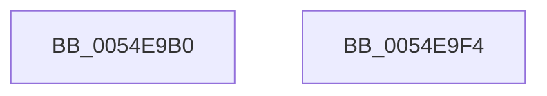

# HalpWheaNativeCpuid

- RVA: `0x0054E9B0`–`0x0054E9F5` (길이 `69` bytes)
- VA: `0x000000014054E9B0`
- 실행 섹션: `.text`
- PDB 이름 있음: `예`; PDB Function 태그: `아니요`
- unwind 정보 RVA: `0x000B64AC`
- 디코드: `21`개 명령, `69/69` bytes 표시
- 미해석 바이트: `0` (있으면 어셈블리에 `.byte`로 보존)

> 이 문서는 커널 이미지의 기계어와 PDB 기호를 분석해 생성했습니다. 4번과 5번은 함수 원형과 자료형을 바이너리 사용 방식에서 추정한 C 해석이며 원본 소스 복구 결과는 아닙니다.

## 1. Dependencies

- 직접 호출 지점: **1**; 고유 호출 대상: **1**
- 직접 호출자로 확인된 함수: **0**
- RIP 상대 이미지 참조: **1**

### Outgoing calls
- `0x0054E9E9` → [_security_check_cookie](../6A/_security_check_cookie_function_006AC640.md) (function, `0x006AC640`)

### Direct callers
- 이 함수 시작 RVA로 연결되는 직접 call은 확인되지 않았습니다. 간접 호출은 완전히 역산할 수 없습니다.

### Static image references
- `0x0054E9B6` → RVA `0x00E0A740` (`.data`; read)

## 2. Other-region calls and transfers

- 다른 실행 섹션으로 향하는 call: **0**
- 별도 외부 분기/꼬리 이동을 확인하지 못했습니다.

## 3. Assembly (complete function range)

```asm
0054E9B0  40 53                           push rbx
0054E9B2  48 83 EC 20                     sub rsp, 0x20
0054E9B6  48 8B 05 83 BD 8B 00            mov rax, qword ptr [rip + 0x8bbd83]
0054E9BD  48 33 C4                        xor rax, rsp
0054E9C0  48 89 44 24 10                  mov qword ptr [rsp + 0x10], rax
0054E9C5  4C 8B 54 24 50                  mov r10, qword ptr [rsp + 0x50]
0054E9CA  8B C2                           mov eax, edx
0054E9CC  4C 8B 5C 24 58                  mov r11, qword ptr [rsp + 0x58]
0054E9D1  33 C9                           xor ecx, ecx
0054E9D3  0F A2                           cpuid
0054E9D5  41 89 00                        mov dword ptr [r8], eax
0054E9D8  41 89 19                        mov dword ptr [r9], ebx
0054E9DB  41 89 0A                        mov dword ptr [r10], ecx
0054E9DE  41 89 13                        mov dword ptr [r11], edx
0054E9E1  48 8B 4C 24 10                  mov rcx, qword ptr [rsp + 0x10]
0054E9E6  48 33 CC                        xor rcx, rsp
0054E9E9  E8 52 DC 15 00                  call 0x1406ac640
0054E9EE  48 83 C4 20                     add rsp, 0x20
0054E9F2  5B                              pop rbx
0054E9F3  C3                              ret
0054E9F4  CC                              int3
```

## 4. C-style interpretation (structured pseudocode)

```c
__int64 __fastcall HalpWheaNativeCpuid(int a1, int a2, __int64 a3, __int64 a4, __int64 a5, __int64 a6)
{
    __int64 result;
    __int64 v_rsp;
    unsigned __int64 v_stack_m18;

    v_rsp = (v_rsp) - (32);
    result = (*(unsigned __int64 *)(v_rip + 9158019)) ^ (v_rsp);
    v_stack_m18 = result;
    a1 = 0;
    *(unsigned int *)(a3) = (unsigned int)((unsigned int)(a2));
    *(unsigned int *)(a4) = (unsigned int)(v_rbx);
    *(unsigned int *)(a5) = 0;
    *(unsigned int *)(a6) = a2;
    a1 = (v_stack_m18) ^ (v_rsp);
    result = _security_check_cookie(a1, a2, a3, a4);
    v_rsp = (v_rsp) + (32);
    return result;
}
```

## 5. (Beta) C Style

```c
int64_t HalpWheaNativeCpuid(int32_t Arg1, int32_t Arg2, void *Arg3, void *Arg4, void *Arg5, void *Arg6)
{
    uint8_t *arg3 = (uint8_t *)Arg3;
    uint8_t *arg4 = (uint8_t *)Arg4;
    uint8_t *arg5 = (uint8_t *)Arg5;
    uint8_t *arg6 = (uint8_t *)Arg6;

    int64_t result;
    int64_t local_rsp;
    uint64_t v_stack_m18;

    local_rsp = (local_rsp) - (32);
    result = (*(uint64_t *)(v_rip + 0x8BBD83)) ^ (local_rsp);
    v_stack_m18 = result;
    Arg1 = 0;
    *(uint32_t *)(arg3) = (uint32_t)((uint32_t)(Arg2));
    *(uint32_t *)(arg4) = (uint32_t)(local_rbx);
    *(uint32_t *)(arg5) = 0;
    *(uint32_t *)(arg6) = Arg2;
    Arg1 = (v_stack_m18) ^ (local_rsp);
    result = _security_check_cookie(Arg1, Arg2, Arg3, Arg4);
    local_rsp = (local_rsp) + (32);
    return result;
}
```

### 관측된 메모리 오프셋

구조체 형식이 확인되지 않은 접근은 인자 기준의 오프셋으로만 기록했습니다.

| 기준 인자 | 오프셋 표현 | 폭 (bit) | 접근 |
|---|---:|---:|---|
| `Arg3` | `+ 0x0` | `32` | `W` |
| `Arg4` | `+ 0x0` | `32` | `W` |
| `Arg5` | `+ 0x0` | `32` | `W` |
| `Arg6` | `+ 0x0` | `32` | `W` |

## 6. Execution-region graph

[열기: 2D/3D 그래프와 함수 탐색 컨트롤 패널](../../../control-panel.html?section=text&rva=0x0054E9B0&view=graph)

- 2D 그래프는 위에서 아래로 흐르고, 3D 그래프는 빈 공간을 드래그해 회전합니다. Shift+드래그는 이동, 휠은 확대·축소, 함수 노드 선택은 대상 보고서 이동입니다.

### Static fallback


