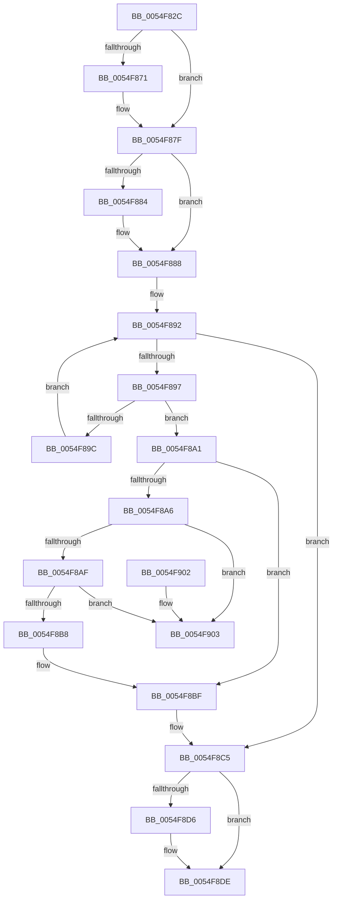

# IommupDeviceGetPasidDevice

- RVA: `0x0054F82C`–`0x0054F90A` (길이 `222` bytes)
- VA: `0x000000014054F82C`
- 실행 섹션: `.text`
- PDB 이름 있음: `예`; PDB Function 태그: `아니요`
- unwind 정보 RVA: `0x00075210`
- 디코드: `68`개 명령, `222/222` bytes 표시
- 미해석 바이트: `0` (있으면 어셈블리에 `.byte`로 보존)

> 이 문서는 커널 이미지의 기계어와 PDB 기호를 분석해 생성했습니다. 4번과 5번은 함수 원형과 자료형을 바이너리 사용 방식에서 추정한 C 해석이며 원본 소스 복구 결과는 아닙니다.

## 1. Dependencies

- 직접 호출 지점: **4**; 고유 호출 대상: **4**
- 직접 호출자로 확인된 함수: **4**
- RIP 상대 이미지 참조: **0**

### Outgoing calls
- `0x0054F861` → [KeAbPreAcquire](../21/KeAbPreAcquire_function_00210230.md) (function, `0x00210230`)
- `0x0054F87A` → [ExfAcquirePushLockExclusiveEx](../20/ExfAcquirePushLockExclusiveEx_function_0020FC90.md) (function, `0x0020FC90`)
- `0x0054F8D9` → [ExfTryToWakePushLock](../26/ExfTryToWakePushLock_function_00265DD0.md) (function, `0x00265DD0`)
- `0x0054F8E1` → [KeAbPostRelease](../2E/KeAbPostRelease_function_002E1600.md) (function, `0x002E1600`)

### Direct callers
- [IommuDomainAttachDeviceEx](../56/IommuDomainAttachDeviceEx_function_00567B60.md) at `0x00567C13`
- [IommuDomainDetachDeviceEx](../56/IommuDomainDetachDeviceEx_function_00567E80.md) at `0x00567EDA`
- [IommupDeviceDisableSvm](../../page/70/IommupDeviceDisableSvm_function_00708A28.md) at `0x00708A51`
- [IommuDeviceDelete](../../page/70/IommuDeviceDelete_function_0070D0D0.md) at `0x0070D184`

### Static image references
- 디코드된 RIP-relative 메모리 참조가 없습니다.

## 2. Other-region calls and transfers

- 다른 실행 섹션으로 향하는 call: **0**
- 별도 외부 분기/꼬리 이동을 확인하지 못했습니다.

## 3. Assembly (complete function range)

```asm
0054F82C  48 89 5C 24 08                  mov qword ptr [rsp + 8], rbx
0054F831  48 89 6C 24 10                  mov qword ptr [rsp + 0x10], rbp
0054F836  48 89 74 24 18                  mov qword ptr [rsp + 0x18], rsi
0054F83B  57                              push rdi
0054F83C  41 56                           push r14
0054F83E  41 57                           push r15
0054F840  48 83 EC 20                     sub rsp, 0x20
0054F844  48 8D 99 78 01 00 00            lea rbx, [rcx + 0x178]
0054F84B  45 8A F8                        mov r15b, r8b
0054F84E  48 8B E9                        mov rbp, rcx
0054F851  33 FF                           xor edi, edi
0054F853  48 8B CB                        mov rcx, rbx
0054F856  49 89 39                        mov qword ptr [r9], rdi
0054F859  45 33 C0                        xor r8d, r8d
0054F85C  33 D2                           xor edx, edx
0054F85E  4D 8B F1                        mov r14, r9
0054F861  E8 CA 09 CC FF                  call 0x140210230
0054F866  F0 48 0F BA 2B 00               lock bts qword ptr [rbx], 0
0054F86C  48 8B F0                        mov rsi, rax
0054F86F  73 0E                           jae 0x14054f87f
0054F871  4C 8B C3                        mov r8, rbx
0054F874  48 8B D0                        mov rdx, rax
0054F877  48 8B CB                        mov rcx, rbx
0054F87A  E8 11 04 CC FF                  call 0x14020fc90
0054F87F  48 85 F6                        test rsi, rsi
0054F882  74 04                           je 0x14054f888
0054F884  C6 46 0A 01                     mov byte ptr [rsi + 0xa], 1
0054F888  48 8D 8D 68 01 00 00            lea rcx, [rbp + 0x168]
0054F88F  48 8B 01                        mov rax, qword ptr [rcx]
0054F892  48 3B C1                        cmp rax, rcx
0054F895  74 2E                           je 0x14054f8c5
0054F897  39 78 30                        cmp dword ptr [rax + 0x30], edi
0054F89A  74 05                           je 0x14054f8a1
0054F89C  48 8B 00                        mov rax, qword ptr [rax]
0054F89F  EB F1                           jmp 0x14054f892
0054F8A1  45 84 FF                        test r15b, r15b
0054F8A4  74 19                           je 0x14054f8bf
0054F8A6  48 8B 10                        mov rdx, qword ptr [rax]
0054F8A9  48 39 42 08                     cmp qword ptr [rdx + 8], rax
0054F8AD  75 54                           jne 0x14054f903
0054F8AF  48 8B 48 08                     mov rcx, qword ptr [rax + 8]
0054F8B3  48 39 01                        cmp qword ptr [rcx], rax
0054F8B6  75 4B                           jne 0x14054f903
0054F8B8  48 89 11                        mov qword ptr [rcx], rdx
0054F8BB  48 89 4A 08                     mov qword ptr [rdx + 8], rcx
0054F8BF  40 B7 01                        mov dil, 1
0054F8C2  49 89 06                        mov qword ptr [r14], rax
0054F8C5  48 83 CA FF                     or rdx, 0xffffffffffffffff
0054F8C9  F0 48 0F C1 13                  lock xadd qword ptr [rbx], rdx
0054F8CE  80 E2 06                        and dl, 6
0054F8D1  80 FA 02                        cmp dl, 2
0054F8D4  75 08                           jne 0x14054f8de
0054F8D6  48 8B CB                        mov rcx, rbx
0054F8D9  E8 F2 64 D1 FF                  call 0x140265dd0
0054F8DE  48 8B CB                        mov rcx, rbx
0054F8E1  E8 1A 1D D9 FF                  call 0x1402e1600
0054F8E6  48 8B 5C 24 40                  mov rbx, qword ptr [rsp + 0x40]
0054F8EB  40 8A C7                        mov al, dil
0054F8EE  48 8B 6C 24 48                  mov rbp, qword ptr [rsp + 0x48]
0054F8F3  48 8B 74 24 50                  mov rsi, qword ptr [rsp + 0x50]
0054F8F8  48 83 C4 20                     add rsp, 0x20
0054F8FC  41 5F                           pop r15
0054F8FE  41 5E                           pop r14
0054F900  5F                              pop rdi
0054F901  C3                              ret
0054F902  CC                              int3
0054F903  B9 03 00 00 00                  mov ecx, 3
0054F908  CD 29                           int 0x29
```

## 4. C-style interpretation (structured pseudocode)

```c
__int64 __fastcall IommupDeviceGetPasidDevice(__int64 a1, int a2, int a3, __int64 a4)
{
    __int64 result;
    __int64 v_rdi;
    __int64 v_rsp;
    unsigned __int64 v_stack_p10;
    unsigned __int64 v_stack_p18;
    unsigned __int64 v_stack_p8;

    v_stack_p8 = v_rbx;
    v_stack_p10 = v_rbp;
    v_stack_p18 = v_rsi;
    v_rsp = (v_rsp) - (32);
    v_rdi = 0;
    *(unsigned __int64 *)(a4) = 0;
    a3 = 0;
    a2 = 0;
    result = KeAbPreAcquire(a1 + 376, a2, a3, a4);
    if (!(condition_is_above_or_equal)) {
        a3 = a1 + 376;
        a2 = result;
        a1 = a1 + 376;
        result = ExfAcquirePushLockExclusiveEx(a1, a2, a3, a4);
    }
    if (result != 0) {
        *(unsigned __int8 *)(result + 10) = 1;
    }
loc_0054F892:
    if ((*(unsigned __int64 *)(a1 + 360)) == (a1 + 360)) goto loc_0054F8C5;
    if ((*(unsigned int *)(*(unsigned __int64 *)(a1 + 360) + 48)) == 0) goto loc_0054F8A1;
    goto loc_0054F892;
loc_0054F8A1:
    if ((unsigned __int8)((unsigned __int8)(a3)) == 0) goto loc_0054F8BF;
    if ((*(unsigned __int64 *)(*(unsigned __int64 *)(*(unsigned __int64 *)(*(unsigned __int64 *)(a1 + 360))) + 8)) != (*(unsigned __int64 *)(*(unsigned __int64 *)(a1 + 360)))) goto loc_0054F903;
    if ((*(unsigned __int64 *)(*(unsigned __int64 *)(*(unsigned __int64 *)(*(unsigned __int64 *)(a1 + 360)) + 8))) != (*(unsigned __int64 *)(*(unsigned __int64 *)(a1 + 360)))) goto loc_0054F903;
    *(unsigned __int64 *)(*(unsigned __int64 *)(*(unsigned __int64 *)(*(unsigned __int64 *)(a1 + 360)) + 8)) = *(unsigned __int64 *)(*(unsigned __int64 *)(*(unsigned __int64 *)(a1 + 360)));
    *(unsigned __int64 *)(*(unsigned __int64 *)(*(unsigned __int64 *)(*(unsigned __int64 *)(a1 + 360))) + 8) = *(unsigned __int64 *)(*(unsigned __int64 *)(*(unsigned __int64 *)(a1 + 360)) + 8);
loc_0054F8BF:
    *(unsigned __int64 *)(a4) = *(unsigned __int64 *)(*(unsigned __int64 *)(a1 + 360));
loc_0054F8C5:
    a2 = (*(unsigned __int64 *)(*(unsigned __int64 *)(*(unsigned __int64 *)(a1 + 360)))) | (-1);
    a2 = (unsigned __int8)((a2) & (6));
    result = *(unsigned __int64 *)(*(unsigned __int64 *)(a1 + 360));
    if (((unsigned __int8)(a2)) == 2) {
        a1 = a1 + 376;
        result = ExfTryToWakePushLock(a1, a2, a3, a4);
    }
    result = KeAbPostRelease(a1 + 376, a2, a3, a4);
    v_rsp = (v_rsp) + (32);
    return 1;
loc_0054F903:
    return 1;
}
```

## 5. (Beta) C Style

```c
int64_t IommupDeviceGetPasidDevice(void *Arg1, int32_t Arg2, int32_t Arg3, void *Arg4)
{
    uint8_t *arg1 = (uint8_t *)Arg1;
    uint8_t *arg4 = (uint8_t *)Arg4;

    int64_t result;
    int64_t local_rdi;
    int64_t local_rsp;
    uint64_t v_stack_p10;
    uint64_t v_stack_p18;
    uint64_t v_stack_p8;

    v_stack_p8 = local_rbx;
    v_stack_p10 = local_rbp;
    v_stack_p18 = local_rsi;
    local_rsp = (local_rsp) - (32);
    local_rdi = 0;
    *(uint64_t *)(arg4) = 0;
    Arg3 = 0;
    Arg2 = 0;
    result = KeAbPreAcquire(Arg1 + 376, Arg2, Arg3, Arg4);
    if (!(condition_is_above_or_equal)) {
        Arg3 = Arg1 + 376;
        Arg2 = result;
        Arg1 = Arg1 + 376;
        result = ExfAcquirePushLockExclusiveEx(Arg1, Arg2, Arg3, Arg4);
    }
    if (result != 0) {
        *(uint8_t *)(result + 0xA) = 1;
    }
loc_0054F892:
    if ((*(uint64_t *)(arg1 + 0x168)) == (Arg1 + 360)) goto loc_0054F8C5;
    if ((*(uint32_t *)(*(uint64_t *)(arg1 + 0x168) + 0x30)) == 0) goto loc_0054F8A1;
    goto loc_0054F892;
loc_0054F8A1:
    if ((uint8_t)((uint8_t)(Arg3)) == 0) goto loc_0054F8BF;
    if ((*(uint64_t *)(*(uint64_t *)(*(uint64_t *)(*(uint64_t *)(arg1 + 0x168))) + 0x8)) != (*(uint64_t *)(*(uint64_t *)(arg1 + 0x168)))) goto loc_0054F903;
    if ((*(uint64_t *)(*(uint64_t *)(*(uint64_t *)(*(uint64_t *)(arg1 + 0x168)) + 0x8))) != (*(uint64_t *)(*(uint64_t *)(arg1 + 0x168)))) goto loc_0054F903;
    *(uint64_t *)(*(uint64_t *)(*(uint64_t *)(*(uint64_t *)(arg1 + 0x168)) + 0x8)) = *(uint64_t *)(*(uint64_t *)(*(uint64_t *)(arg1 + 0x168)));
    *(uint64_t *)(*(uint64_t *)(*(uint64_t *)(*(uint64_t *)(arg1 + 0x168))) + 0x8) = *(uint64_t *)(*(uint64_t *)(*(uint64_t *)(arg1 + 0x168)) + 0x8);
loc_0054F8BF:
    *(uint64_t *)(arg4) = *(uint64_t *)(*(uint64_t *)(arg1 + 0x168));
loc_0054F8C5:
    Arg2 = (*(uint64_t *)(*(uint64_t *)(*(uint64_t *)(arg1 + 0x168)))) | (-1);
    Arg2 = (uint8_t)((Arg2) & (6));
    result = *(uint64_t *)(*(uint64_t *)(arg1 + 0x168));
    if (((uint8_t)(Arg2)) == 2) {
        Arg1 = Arg1 + 376;
        result = ExfTryToWakePushLock(Arg1, Arg2, Arg3, Arg4);
    }
    result = KeAbPostRelease(Arg1 + 376, Arg2, Arg3, Arg4);
    local_rsp = (local_rsp) + (32);
    return 1;
loc_0054F903:
    return 1;
}
```

### 관측된 메모리 오프셋

구조체 형식이 확인되지 않은 접근은 인자 기준의 오프셋으로만 기록했습니다.

| 기준 인자 | 오프셋 표현 | 폭 (bit) | 접근 |
|---|---:|---:|---|
| `Arg1` | `+ 0x0` | `64` | `R` |
| `Arg1` | `+ 0x0` | `64` | `R/W` |
| `Arg1` | `+ 0x168` | `64` | `R` |
| `Arg1` | `+ 0x178` | `64` | `R` |
| `Arg4` | `+ 0x0` | `64` | `W` |

## 6. Execution-region graph

[열기: 2D/3D 그래프와 함수 탐색 컨트롤 패널](../../../control-panel.html?section=text&rva=0x0054F82C&view=graph)

- 2D 그래프는 위에서 아래로 흐르고, 3D 그래프는 빈 공간을 드래그해 회전합니다. Shift+드래그는 이동, 휠은 확대·축소, 함수 노드 선택은 대상 보고서 이동입니다.

### Static fallback


