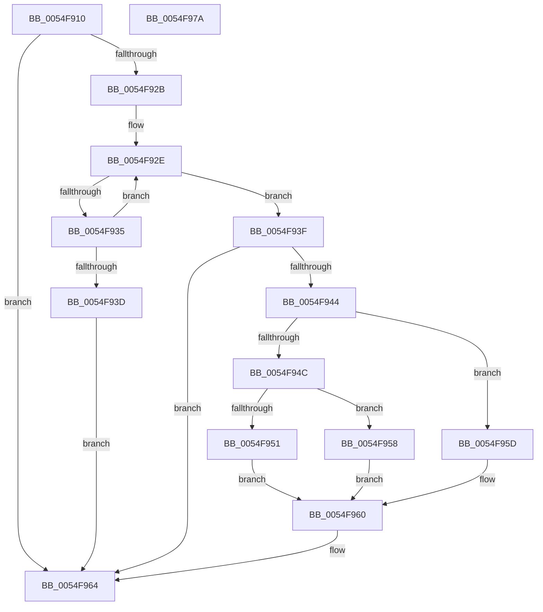

# IommupDeviceGetPasidSettings

- RVA: `0x0054F910`–`0x0054F97B` (길이 `107` bytes)
- VA: `0x000000014054F910`
- 실행 섹션: `.text`
- PDB 이름 있음: `예`; PDB Function 태그: `아니요`
- unwind 정보 RVA: `0x000950EC`
- 디코드: `36`개 명령, `107/107` bytes 표시
- 미해석 바이트: `0` (있으면 어셈블리에 `.byte`로 보존)

> 이 문서는 커널 이미지의 기계어와 PDB 기호를 분석해 생성했습니다. 4번과 5번은 함수 원형과 자료형을 바이너리 사용 방식에서 추정한 C 해석이며 원본 소스 복구 결과는 아닙니다.

## 1. Dependencies

- 직접 호출 지점: **0**; 고유 호출 대상: **0**
- 직접 호출자로 확인된 함수: **2**
- RIP 상대 이미지 참조: **0**

### Outgoing calls
- 직접 디코드된 call 명령이 없습니다.

### Direct callers
- [HalpIommuCreateDevice](HalpIommuCreateDevice_function_0054ED60.md) at `0x0054EED3`
- [IommupDeviceEnablePasidTaggedDma](../../page/70/IommupDeviceEnablePasidTaggedDma_function_00708B74.md) at `0x00708BB0`

### Static image references
- 디코드된 RIP-relative 메모리 참조가 없습니다.

## 2. Other-region calls and transfers

- 다른 실행 섹션으로 향하는 call: **0**
- 별도 외부 분기/꼬리 이동을 확인하지 못했습니다.

## 3. Assembly (complete function range)

```asm
0054F910  48 89 5C 24 08                  mov qword ptr [rsp + 8], rbx
0054F915  48 89 7C 24 10                  mov qword ptr [rsp + 0x10], rdi
0054F91A  45 33 DB                        xor r11d, r11d
0054F91D  41 8B DB                        mov ebx, r11d
0054F920  41 8A FB                        mov dil, r11b
0054F923  41 8A C3                        mov al, r11b
0054F926  48 85 C9                        test rcx, rcx
0054F929  74 39                           je 0x14054f964
0054F92B  4C 8B D1                        mov r10, rcx
0054F92E  41 83 7A 10 03                  cmp dword ptr [r10 + 0x10], 3
0054F933  74 0A                           je 0x14054f93f
0054F935  4D 8B 12                        mov r10, qword ptr [r10]
0054F938  4C 3B D1                        cmp r10, rcx
0054F93B  75 F1                           jne 0x14054f92e
0054F93D  EB 25                           jmp 0x14054f964
0054F93F  4D 85 D2                        test r10, r10
0054F942  74 20                           je 0x14054f964
0054F944  41 8B 4A 18                     mov ecx, dword ptr [r10 + 0x18]
0054F948  85 C9                           test ecx, ecx
0054F94A  74 11                           je 0x14054f95d
0054F94C  83 F9 01                        cmp ecx, 1
0054F94F  74 07                           je 0x14054f958
0054F951  BB 0D 00 00 C0                  mov ebx, 0xc000000d
0054F956  EB 08                           jmp 0x14054f960
0054F958  41 B3 01                        mov r11b, 1
0054F95B  EB 03                           jmp 0x14054f960
0054F95D  40 B7 01                        mov dil, 1
0054F960  41 8A 42 1C                     mov al, byte ptr [r10 + 0x1c]
0054F964  41 88 01                        mov byte ptr [r9], al
0054F967  8B C3                           mov eax, ebx
0054F969  48 8B 5C 24 08                  mov rbx, qword ptr [rsp + 8]
0054F96E  41 88 38                        mov byte ptr [r8], dil
0054F971  48 8B 7C 24 10                  mov rdi, qword ptr [rsp + 0x10]
0054F976  44 88 1A                        mov byte ptr [rdx], r11b
0054F979  C3                              ret
0054F97A  CC                              int3
```

## 4. C-style interpretation (structured pseudocode)

```c
__int64 __fastcall IommupDeviceGetPasidSettings(__int64 a1, __int64 a2, __int64 a3, __int64 a4)
{
    __int64 v_r11;
    unsigned __int64 v_stack_p10;
    unsigned __int64 v_stack_p8;

    v_stack_p8 = v_rbx;
    v_stack_p10 = v_rdi;
    v_r11 = 0;
    if (a1 == 0) goto loc_0054F964;
loc_0054F92E:
    if ((*(unsigned int *)(a1 + 16)) == 3) goto loc_0054F93F;
    if ((*(unsigned __int64 *)(a1)) != a1) goto loc_0054F92E;
    goto loc_0054F964;
loc_0054F93F:
    if (*(unsigned __int64 *)(a1) == 0) goto loc_0054F964;
    if ((unsigned int)((unsigned int)(*(unsigned int *)(*(unsigned __int64 *)(a1) + 24))) == 0) goto loc_0054F95D;
    if (((unsigned int)((unsigned int)(*(unsigned int *)(*(unsigned __int64 *)(a1) + 24)))) == 1) goto loc_0054F958;
    goto loc_0054F960;
loc_0054F958:
    goto loc_0054F960;
loc_0054F95D:
loc_0054F960:
loc_0054F964:
    *(unsigned __int8 *)(a4) = (unsigned __int8)(*(unsigned __int8 *)(*(unsigned __int64 *)(a1) + 28));
    *(unsigned __int8 *)(a3) = 1;
    *(unsigned __int8 *)(a2) = 1;
    return (unsigned int)((unsigned int)((unsigned int)(0xC000000DULL)));
}
```

## 5. (Beta) C Style

```c
int64_t IommupDeviceGetPasidSettings(int64_t Arg1, void *Arg2, void *Arg3, void *Arg4)
{
    uint8_t *arg2 = (uint8_t *)Arg2;
    uint8_t *arg3 = (uint8_t *)Arg3;
    uint8_t *arg4 = (uint8_t *)Arg4;

    int64_t local_r11;
    uint64_t v_stack_p10;
    uint64_t v_stack_p8;

    v_stack_p8 = local_rbx;
    v_stack_p10 = local_rdi;
    local_r11 = 0;
    if (Arg1 == 0) goto loc_0054F964;
loc_0054F92E:
    if ((*(uint32_t *)(Arg1 + 0x10)) == 3) goto loc_0054F93F;
    if ((*(uint64_t *)(Arg1)) != Arg1) goto loc_0054F92E;
    goto loc_0054F964;
loc_0054F93F:
    if (*(uint64_t *)(Arg1) == 0) goto loc_0054F964;
    if ((uint32_t)((uint32_t)(*(uint32_t *)(*(uint64_t *)(Arg1) + 0x18))) == 0) goto loc_0054F95D;
    if (((uint32_t)((uint32_t)(*(uint32_t *)(*(uint64_t *)(Arg1) + 0x18)))) == 1) goto loc_0054F958;
    goto loc_0054F960;
loc_0054F958:
    goto loc_0054F960;
loc_0054F95D:
loc_0054F960:
loc_0054F964:
    *(uint8_t *)(arg4) = (uint8_t)(*(uint8_t *)(*(uint64_t *)(Arg1) + 0x1C));
    *(uint8_t *)(arg3) = 1;
    *(uint8_t *)(arg2) = 1;
    return (uint32_t)((uint32_t)((uint32_t)(0xC000000DULL)));
}
```

### 관측된 메모리 오프셋

구조체 형식이 확인되지 않은 접근은 인자 기준의 오프셋으로만 기록했습니다.

| 기준 인자 | 오프셋 표현 | 폭 (bit) | 접근 |
|---|---:|---:|---|
| `Arg2` | `+ 0x0` | `8` | `W` |
| `Arg3` | `+ 0x0` | `8` | `W` |
| `Arg4` | `+ 0x0` | `8` | `W` |

## 6. Execution-region graph

[열기: 2D/3D 그래프와 함수 탐색 컨트롤 패널](../../../control-panel.html?section=text&rva=0x0054F910&view=graph)

- 2D 그래프는 위에서 아래로 흐르고, 3D 그래프는 빈 공간을 드래그해 회전합니다. Shift+드래그는 이동, 휠은 확대·축소, 함수 노드 선택은 대상 보고서 이동입니다.

### Static fallback


