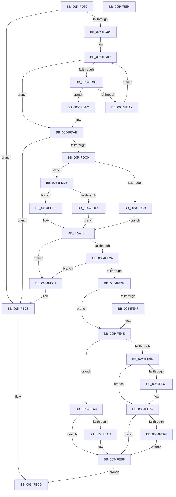

# IommupDomainDetachPasidDevice

- RVA: `0x0054FD50`–`0x0054FEE5` (길이 `405` bytes)
- VA: `0x000000014054FD50`
- 실행 섹션: `.text`
- PDB 이름 있음: `예`; PDB Function 태그: `아니요`
- unwind 정보 RVA: `0x000B8D34`
- 디코드: `118`개 명령, `405/405` bytes 표시
- 미해석 바이트: `0` (있으면 어셈블리에 `.byte`로 보존)

> 이 문서는 커널 이미지의 기계어와 PDB 기호를 분석해 생성했습니다. 4번과 5번은 함수 원형과 자료형을 바이너리 사용 방식에서 추정한 C 해석이며 원본 소스 복구 결과는 아닙니다.

## 1. Dependencies

- 직접 호출 지점: **13**; 고유 호출 대상: **11**
- 직접 호출자로 확인된 함수: **3**
- RIP 상대 이미지 참조: **3**

### Outgoing calls
- `0x0054FD8D` → [ExAcquireSpinLockShared](../24/ExAcquireSpinLockShared_function_0024DCE0.md) (function, `0x0024DCE0`)
- `0x0054FDB3` → [ExReleaseSpinLockShared](../2F/ExReleaseSpinLockShared_function_002F0EF0.md) (function, `0x002F0EF0`)
- `0x0054FDCE` → [IommuSetAddressSpace](../56/IommuSetAddressSpace_function_00566060.md) (function, `0x00566060`)
- `0x0054FDDF` → [IommupHvDetachPasidDeviceDomain](../56/IommupHvDetachPasidDeviceDomain_function_005671B4.md) (function, `0x005671B4`)
- `0x0054FDF6` → [guard_dispatch_icall](../6B/guard_dispatch_icall_function_006BAAD0.md) (function, `0x006BAAD0`)
- `0x0054FE09` → [guard_dispatch_icall](../6B/guard_dispatch_icall_function_006BAAD0.md) (function, `0x006BAAD0`)
- `0x0054FE11` → [ExAcquireSpinLockExclusive](../24/ExAcquireSpinLockExclusive_function_00248690.md) (function, `0x00248690`)
- `0x0054FE3E` → [Feature_DmaAdapterStage1DirectAttach__private_IsEnabledDeviceUsageNoInline](Feature_DmaAdapterStage1DirectAttach__private_IsEnabledDeviceUsageNoInline_function_0054EB38.md) (function, `0x0054EB38`)
- `0x0054FE54` → [ExReleaseSpinLockExclusive](../2C/ExReleaseSpinLockExclusive_function_002C0EF0.md) (function, `0x002C0EF0`)
- `0x0054FE6F` → [IommuDisableDevicePasid](../56/IommuDisableDevicePasid_function_00564E80.md) (function, `0x00564E80`)
- `0x0054FE90` → [HalpIommuGetHardwareDomain](../4D/HalpIommuGetHardwareDomain_function_004D7BCC.md) (function, `0x004D7BCC`)
- `0x0054FEA2` → [HalpIommuDereferenceHardwareDomain](../55/HalpIommuDereferenceHardwareDomain_function_00554E58.md) (function, `0x00554E58`)
- `0x0054FEB3` → [IommupHvDetachPasidDeviceDomain](../56/IommupHvDetachPasidDeviceDomain_function_005671B4.md) (function, `0x005671B4`)

### Direct callers
- [IommuDomainAttachDeviceEx](../56/IommuDomainAttachDeviceEx_function_00567B60.md) at `0x00567C68`
- [IommuDomainDetachDeviceEx](../56/IommuDomainDetachDeviceEx_function_00567E80.md) at `0x00567EEF`
- [IommuDomainDetachPasidDevice](../../page/70/IommuDomainDetachPasidDevice_function_0070D3E0.md) at `0x0070D3F1`

### Static image references
- `0x0054FDC0` → RVA `0x00FC1710` (`.data`; read)
- `0x0054FDE6` → RVA `0x00FC1D70` (`.data`; read)
- `0x0054FDFB` → RVA `0x00FC1D98` (`.data`; read)

## 2. Other-region calls and transfers

- 다른 실행 섹션으로 향하는 call: **0**
- 별도 외부 분기/꼬리 이동을 확인하지 못했습니다.

## 3. Assembly (complete function range)

```asm
0054FD50  48 89 5C 24 10                  mov qword ptr [rsp + 0x10], rbx
0054FD55  48 89 6C 24 18                  mov qword ptr [rsp + 0x18], rbp
0054FD5A  56                              push rsi
0054FD5B  57                              push rdi
0054FD5C  41 54                           push r12
0054FD5E  41 56                           push r14
0054FD60  41 57                           push r15
0054FD62  48 83 EC 30                     sub rsp, 0x30
0054FD66  48 83 64 24 60 00               and qword ptr [rsp + 0x60], 0
0054FD6C  48 8B F9                        mov rdi, rcx
0054FD6F  48 8B 71 18                     mov rsi, qword ptr [rcx + 0x18]
0054FD73  48 8B 69 10                     mov rbp, qword ptr [rcx + 0x10]
0054FD77  4C 8B 79 38                     mov r15, qword ptr [rcx + 0x38]
0054FD7B  48 85 F6                        test rsi, rsi
0054FD7E  0F 84 44 01 00 00               je 0x14054fec8
0054FD84  4C 8D 76 58                     lea r14, [rsi + 0x58]
0054FD88  32 DB                           xor bl, bl
0054FD8A  49 8B CE                        mov rcx, r14
0054FD8D  E8 4E DF CF FF                  call 0x14024dce0
0054FD92  4C 8D 46 48                     lea r8, [rsi + 0x48]
0054FD96  49 8B 10                        mov rdx, qword ptr [r8]
0054FD99  49 3B D0                        cmp rdx, r8
0054FD9C  74 10                           je 0x14054fdae
0054FD9E  48 8D 4A E0                     lea rcx, [rdx - 0x20]
0054FDA2  48 3B CF                        cmp rcx, rdi
0054FDA5  74 05                           je 0x14054fdac
0054FDA7  48 8B 12                        mov rdx, qword ptr [rdx]
0054FDAA  EB ED                           jmp 0x14054fd99
0054FDAC  B3 01                           mov bl, 1
0054FDAE  8A D0                           mov dl, al
0054FDB0  49 8B CE                        mov rcx, r14
0054FDB3  E8 38 11 DA FF                  call 0x1402f0ef0
0054FDB8  84 DB                           test bl, bl
0054FDBA  0F 84 08 01 00 00               je 0x14054fec8
0054FDC0  80 3D 49 19 A7 00 00            cmp byte ptr [rip + 0xa71949], 0
0054FDC7  75 0C                           jne 0x14054fdd5
0054FDC9  33 D2                           xor edx, edx
0054FDCB  49 8B CF                        mov rcx, r15
0054FDCE  E8 8D 62 01 00                  call 0x140566060
0054FDD3  EB 39                           jmp 0x14054fe0e
0054FDD5  8B 57 30                        mov edx, dword ptr [rdi + 0x30]
0054FDD8  85 D2                           test edx, edx
0054FDDA  75 0A                           jne 0x14054fde6
0054FDDC  48 8B CD                        mov rcx, rbp
0054FDDF  E8 D0 73 01 00                  call 0x1405671b4
0054FDE4  EB 28                           jmp 0x14054fe0e
0054FDE6  48 8B 05 83 1F A7 00            mov rax, qword ptr [rip + 0xa71f83]
0054FDED  45 33 C0                        xor r8d, r8d
0054FDF0  48 8B 5F 10                     mov rbx, qword ptr [rdi + 0x10]
0054FDF4  33 C9                           xor ecx, ecx
0054FDF6  E8 D5 AC 16 00                  call 0x1406baad0
0054FDFB  48 8B 05 96 1F A7 00            mov rax, qword ptr [rip + 0xa71f96]
0054FE02  8B 57 30                        mov edx, dword ptr [rdi + 0x30]
0054FE05  48 8B 4B 20                     mov rcx, qword ptr [rbx + 0x20]
0054FE09  E8 C2 AC 16 00                  call 0x1406baad0
0054FE0E  49 8B CE                        mov rcx, r14
0054FE11  E8 7A 88 CF FF                  call 0x140248690
0054FE16  48 8D 5F 20                     lea rbx, [rdi + 0x20]
0054FE1A  44 8A E0                        mov r12b, al
0054FE1D  48 8B 0B                        mov rcx, qword ptr [rbx]
0054FE20  48 39 59 08                     cmp qword ptr [rcx + 8], rbx
0054FE24  0F 85 97 00 00 00               jne 0x14054fec1
0054FE2A  48 8B 53 08                     mov rdx, qword ptr [rbx + 8]
0054FE2E  48 39 1A                        cmp qword ptr [rdx], rbx
0054FE31  0F 85 8A 00 00 00               jne 0x14054fec1
0054FE37  48 89 0A                        mov qword ptr [rdx], rcx
0054FE3A  48 89 51 08                     mov qword ptr [rcx + 8], rdx
0054FE3E  E8 F5 EC FF FF                  call 0x14054eb38
0054FE43  85 C0                           test eax, eax
0054FE45  74 07                           je 0x14054fe4e
0054FE47  48 89 5B 08                     mov qword ptr [rbx + 8], rbx
0054FE4B  48 89 1B                        mov qword ptr [rbx], rbx
0054FE4E  41 8A D4                        mov dl, r12b
0054FE51  49 8B CE                        mov rcx, r14
0054FE54  E8 97 10 D7 FF                  call 0x1402c0ef0
0054FE59  80 3D B0 18 A7 00 00            cmp byte ptr [rip + 0xa718b0], 0
0054FE60  8B 47 30                        mov eax, dword ptr [rdi + 0x30]
0054FE63  75 44                           jne 0x14054fea9
0054FE65  85 C0                           test eax, eax
0054FE67  74 0B                           je 0x14054fe74
0054FE69  48 8B D5                        mov rdx, rbp
0054FE6C  49 8B CF                        mov rcx, r15
0054FE6F  E8 0C 50 01 00                  call 0x140564e80
0054FE74  48 8B 55 20                     mov rdx, qword ptr [rbp + 0x20]
0054FE78  48 8D 44 24 60                  lea rax, [rsp + 0x60]
0054FE7D  48 89 44 24 28                  mov qword ptr [rsp + 0x28], rax
0054FE82  45 33 C9                        xor r9d, r9d
0054FE85  45 33 C0                        xor r8d, r8d
0054FE88  C6 44 24 20 00                  mov byte ptr [rsp + 0x20], 0
0054FE8D  48 8B CE                        mov rcx, rsi
0054FE90  E8 37 7D F8 FF                  call 0x1404d7bcc
0054FE95  48 8B 54 24 60                  mov rdx, qword ptr [rsp + 0x60]
0054FE9A  48 85 D2                        test rdx, rdx
0054FE9D  74 19                           je 0x14054feb8
0054FE9F  48 8B CE                        mov rcx, rsi
0054FEA2  E8 B1 4F 00 00                  call 0x140554e58
0054FEA7  EB 0F                           jmp 0x14054feb8
0054FEA9  85 C0                           test eax, eax
0054FEAB  75 0B                           jne 0x14054feb8
0054FEAD  8D 50 01                        lea edx, [rax + 1]
0054FEB0  48 8B CD                        mov rcx, rbp
0054FEB3  E8 FC 72 01 00                  call 0x1405671b4
0054FEB8  48 83 67 18 00                  and qword ptr [rdi + 0x18], 0
0054FEBD  33 C0                           xor eax, eax
0054FEBF  EB 0C                           jmp 0x14054fecd
0054FEC1  B9 03 00 00 00                  mov ecx, 3
0054FEC6  CD 29                           int 0x29
0054FEC8  B8 EF 00 00 C0                  mov eax, 0xc00000ef
0054FECD  48 8B 5C 24 68                  mov rbx, qword ptr [rsp + 0x68]
0054FED2  48 8B 6C 24 70                  mov rbp, qword ptr [rsp + 0x70]
0054FED7  48 83 C4 30                     add rsp, 0x30
0054FEDB  41 5F                           pop r15
0054FEDD  41 5E                           pop r14
0054FEDF  41 5C                           pop r12
0054FEE1  5F                              pop rdi
0054FEE2  5E                              pop rsi
0054FEE3  C3                              ret
0054FEE4  CC                              int3
```

## 4. C-style interpretation (structured pseudocode)

```c
__int64 __fastcall IommupDomainDetachPasidDevice(__int64 a1, __int64 a2, __int64 a3, int a4)
{
    __int64 result;
    __int64 v_rbx;
    __int64 v_rsp;
    unsigned __int64 v_stack_m30;
    unsigned __int8 v_stack_m38;
    unsigned __int64 v_stack_p10;
    unsigned __int64 v_stack_p18;
    unsigned __int64 v_stack_p8;

    v_stack_p10 = v_rbx;
    v_stack_p18 = v_rbp;
    v_rsp = (v_rsp) - (48);
    if (*(unsigned __int64 *)(a1 + 24) == 0) goto loc_0054FEC8;
    v_rbx = 0;
    result = ExAcquireSpinLockShared(*(unsigned __int64 *)(a1 + 24) + 88, a2, a3, a4);
loc_0054FD99:
    if ((*(unsigned __int64 *)(*(unsigned __int64 *)(a1 + 24) + 72)) == (*(unsigned __int64 *)(a1 + 24) + 72)) goto loc_0054FDAE;
    if ((*(unsigned __int64 *)(*(unsigned __int64 *)(a1 + 24) + 72) - 32) == a1) goto loc_0054FDAC;
    goto loc_0054FD99;
loc_0054FDAC:
loc_0054FDAE:
    result = ExReleaseSpinLockShared(*(unsigned __int64 *)(a1 + 24) + 88, (unsigned __int8)(result), *(unsigned __int64 *)(a1 + 24) + 72, a4);
    if (1 == 0) goto loc_0054FEC8;
    if ((*(unsigned __int8 *)(v_rip + 10950985)) != 0) goto loc_0054FDD5;
    a2 = 0;
    result = IommuSetAddressSpace(*(unsigned __int64 *)(a1 + 56), a2, *(unsigned __int64 *)(a1 + 24) + 72, a4);
    goto loc_0054FE0E;
loc_0054FDD5:
    if ((unsigned int)((unsigned int)(*(unsigned int *)(a1 + 48))) != 0) goto loc_0054FDE6;
    result = IommupHvDetachPasidDeviceDomain(*(unsigned __int64 *)(a1 + 16), (unsigned int)(*(unsigned int *)(a1 + 48)), *(unsigned __int64 *)(a1 + 24) + 72, a4);
    goto loc_0054FE0E;
loc_0054FDE6:
    a3 = 0;
    a1 = 0;
    result = guard_dispatch_icall(a1, (unsigned int)(*(unsigned int *)(a1 + 48)), a3, a4);
    result = guard_dispatch_icall(*(unsigned __int64 *)(*(unsigned __int64 *)(a1 + 16) + 32), (unsigned int)(*(unsigned int *)(a1 + 48)), a3, a4);
loc_0054FE0E:
    result = ExAcquireSpinLockExclusive(*(unsigned __int64 *)(a1 + 24) + 88, (unsigned int)(*(unsigned int *)(a1 + 48)), a3, a4);
    if ((*(unsigned __int64 *)(*(unsigned __int64 *)(a1 + 32) + 8)) != (a1 + 32)) goto loc_0054FEC1;
    if ((*(unsigned __int64 *)(*(unsigned __int64 *)(a1 + 32 + 8))) != (a1 + 32)) goto loc_0054FEC1;
    *(unsigned __int64 *)(*(unsigned __int64 *)(a1 + 32 + 8)) = *(unsigned __int64 *)(a1 + 32);
    *(unsigned __int64 *)(*(unsigned __int64 *)(a1 + 32) + 8) = *(unsigned __int64 *)(a1 + 32 + 8);
    result = Feature_DmaAdapterStage1DirectAttach__private_IsEnabledDeviceUsageNoInline(*(unsigned __int64 *)(a1 + 32), *(unsigned __int64 *)(a1 + 32 + 8), a3, a4);
    if ((unsigned int)(result) != 0) {
        *(unsigned __int64 *)(a1 + 32 + 8) = a1 + 32;
        *(unsigned __int64 *)(a1 + 32) = a1 + 32;
    }
    result = ExReleaseSpinLockExclusive(*(unsigned __int64 *)(a1 + 24) + 88, (unsigned __int8)((unsigned __int8)(result)), a3, a4);
    if ((*(unsigned __int8 *)(v_rip + 10950832)) != 0) goto loc_0054FEA9;
    result = (unsigned int)(*(unsigned int *)(a1 + 48));
    if ((unsigned int)((unsigned int)(*(unsigned int *)(a1 + 48))) != 0) {
        a2 = *(unsigned __int64 *)(a1 + 16);
        a1 = *(unsigned __int64 *)(a1 + 56);
        result = IommuDisableDevicePasid(a1, a2, a3, a4);
    }
    v_stack_m30 = v_stack_p8;
    a4 = 0;
    a3 = 0;
    v_stack_m38 = 0;
    result = HalpIommuGetHardwareDomain(*(unsigned __int64 *)(a1 + 24), *(unsigned __int64 *)(*(unsigned __int64 *)(a1 + 16) + 32), a3, a4);
    if (v_stack_p8 == 0) goto loc_0054FEB8;
    result = HalpIommuDereferenceHardwareDomain(*(unsigned __int64 *)(a1 + 24), v_stack_p8, a3, a4);
    goto loc_0054FEB8;
loc_0054FEA9:
    if ((unsigned int)(result) == 0) {
        a2 = result + 1;
        a1 = *(unsigned __int64 *)(a1 + 16);
        result = IommupHvDetachPasidDeviceDomain(a1, a2, a3, a4);
    }
    result = 0;
    goto loc_0054FECD;
loc_0054FEC1:
loc_0054FEC8:
loc_0054FECD:
    v_rsp = (v_rsp) + (48);
    return (unsigned int)(0xC00000EFULL);
}
```

## 5. (Beta) C Style

```c
int64_t IommupDomainDetachPasidDevice(void *Arg1, int64_t Arg2, int64_t Arg3, int32_t Arg4)
{
    uint8_t *arg1 = (uint8_t *)Arg1;

    int64_t result;
    int64_t local_rbx;
    int64_t local_rsp;
    uint64_t v_stack_m30;
    uint8_t v_stack_m38;
    uint64_t v_stack_p10;
    uint64_t v_stack_p18;
    uint64_t v_stack_p8;

    v_stack_p10 = local_rbx;
    v_stack_p18 = local_rbp;
    local_rsp = (local_rsp) - (48);
    if (*(uint64_t *)(arg1 + 0x18) == 0) goto loc_0054FEC8;
    local_rbx = 0;
    result = ExAcquireSpinLockShared(*(uint64_t *)(arg1 + 0x18) + 88, Arg2, Arg3, Arg4);
loc_0054FD99:
    if ((*(uint64_t *)(*(uint64_t *)(arg1 + 0x18) + 0x48)) == (*(uint64_t *)(arg1 + 0x18) + 72)) goto loc_0054FDAE;
    if ((*(uint64_t *)(*(uint64_t *)(arg1 + 0x18) + 0x48) - 32) == Arg1) goto loc_0054FDAC;
    goto loc_0054FD99;
loc_0054FDAC:
loc_0054FDAE:
    result = ExReleaseSpinLockShared(*(uint64_t *)(arg1 + 0x18) + 88, (uint8_t)(result), *(uint64_t *)(arg1 + 0x18) + 72, Arg4);
    if (1 == 0) goto loc_0054FEC8;
    if ((*(uint8_t *)(v_rip + 0xA71949)) != 0) goto loc_0054FDD5;
    Arg2 = 0;
    result = IommuSetAddressSpace(*(uint64_t *)(arg1 + 0x38), Arg2, *(uint64_t *)(arg1 + 0x18) + 72, Arg4);
    goto loc_0054FE0E;
loc_0054FDD5:
    if ((uint32_t)((uint32_t)(*(uint32_t *)(arg1 + 0x30))) != 0) goto loc_0054FDE6;
    result = IommupHvDetachPasidDeviceDomain(*(uint64_t *)(arg1 + 0x10), (uint32_t)(*(uint32_t *)(arg1 + 0x30)), *(uint64_t *)(arg1 + 0x18) + 72, Arg4);
    goto loc_0054FE0E;
loc_0054FDE6:
    Arg3 = 0;
    Arg1 = 0;
    result = guard_dispatch_icall(Arg1, (uint32_t)(*(uint32_t *)(arg1 + 0x30)), Arg3, Arg4);
    result = guard_dispatch_icall(*(uint64_t *)(*(uint64_t *)(arg1 + 0x10) + 0x20), (uint32_t)(*(uint32_t *)(arg1 + 0x30)), Arg3, Arg4);
loc_0054FE0E:
    result = ExAcquireSpinLockExclusive(*(uint64_t *)(arg1 + 0x18) + 88, (uint32_t)(*(uint32_t *)(arg1 + 0x30)), Arg3, Arg4);
    if ((*(uint64_t *)(*(uint64_t *)(arg1 + 0x20) + 0x8)) != (Arg1 + 32)) goto loc_0054FEC1;
    if ((*(uint64_t *)(*(uint64_t *)(arg1 + 0x20 + 0x8))) != (Arg1 + 32)) goto loc_0054FEC1;
    *(uint64_t *)(*(uint64_t *)(arg1 + 0x20 + 0x8)) = *(uint64_t *)(arg1 + 0x20);
    *(uint64_t *)(*(uint64_t *)(arg1 + 0x20) + 0x8) = *(uint64_t *)(arg1 + 0x20 + 0x8);
    result = Feature_DmaAdapterStage1DirectAttach__private_IsEnabledDeviceUsageNoInline(*(uint64_t *)(arg1 + 0x20), *(uint64_t *)(arg1 + 0x20 + 0x8), Arg3, Arg4);
    if ((uint32_t)(result) != 0) {
        *(void **)(arg1 + 0x20 + 0x8) = Arg1 + 32;
        *(void **)(arg1 + 0x20) = Arg1 + 32;
    }
    result = ExReleaseSpinLockExclusive(*(uint64_t *)(arg1 + 0x18) + 88, (uint8_t)((uint8_t)(result)), Arg3, Arg4);
    if ((*(uint8_t *)(v_rip + 0xA718B0)) != 0) goto loc_0054FEA9;
    result = (uint32_t)(*(uint32_t *)(arg1 + 0x30));
    if ((uint32_t)((uint32_t)(*(uint32_t *)(arg1 + 0x30))) != 0) {
        Arg2 = *(uint64_t *)(arg1 + 0x10);
        Arg1 = *(uint64_t *)(arg1 + 0x38);
        result = IommuDisableDevicePasid(Arg1, Arg2, Arg3, Arg4);
    }
    v_stack_m30 = v_stack_p8;
    Arg4 = 0;
    Arg3 = 0;
    v_stack_m38 = 0;
    result = HalpIommuGetHardwareDomain(*(uint64_t *)(arg1 + 0x18), *(uint64_t *)(*(uint64_t *)(arg1 + 0x10) + 0x20), Arg3, Arg4);
    if (v_stack_p8 == 0) goto loc_0054FEB8;
    result = HalpIommuDereferenceHardwareDomain(*(uint64_t *)(arg1 + 0x18), v_stack_p8, Arg3, Arg4);
    goto loc_0054FEB8;
loc_0054FEA9:
    if ((uint32_t)(result) == 0) {
        Arg2 = result + 1;
        Arg1 = *(uint64_t *)(arg1 + 0x10);
        result = IommupHvDetachPasidDeviceDomain(Arg1, Arg2, Arg3, Arg4);
    }
    result = 0;
    goto loc_0054FECD;
loc_0054FEC1:
loc_0054FEC8:
loc_0054FECD:
    local_rsp = (local_rsp) + (48);
    return (uint32_t)(0xC00000EFULL);
}
```

### 관측된 메모리 오프셋

구조체 형식이 확인되지 않은 접근은 인자 기준의 오프셋으로만 기록했습니다.

| 기준 인자 | 오프셋 표현 | 폭 (bit) | 접근 |
|---|---:|---:|---|
| `Arg1` | `+ 0x0` | `64` | `R` |
| `Arg1` | `+ 0x0` | `64` | `W` |
| `Arg1` | `+ 0x8` | `64` | `R` |
| `Arg1` | `+ 0x8` | `64` | `W` |
| `Arg1` | `+ 0x10` | `64` | `R` |
| `Arg1` | `+ 0x18` | `64` | `R` |
| `Arg1` | `+ 0x18` | `64` | `R/W` |
| `Arg1` | `+ 0x20` | `64` | `R` |
| `Arg1` | `+ 0x30` | `32` | `R` |
| `Arg1` | `+ 0x38` | `64` | `R` |

## 6. Execution-region graph

[열기: 2D/3D 그래프와 함수 탐색 컨트롤 패널](../../../control-panel.html?section=text&rva=0x0054FD50&view=graph)

- 2D 그래프는 위에서 아래로 흐르고, 3D 그래프는 빈 공간을 드래그해 회전합니다. Shift+드래그는 이동, 휠은 확대·축소, 함수 노드 선택은 대상 보고서 이동입니다.

### Static fallback


