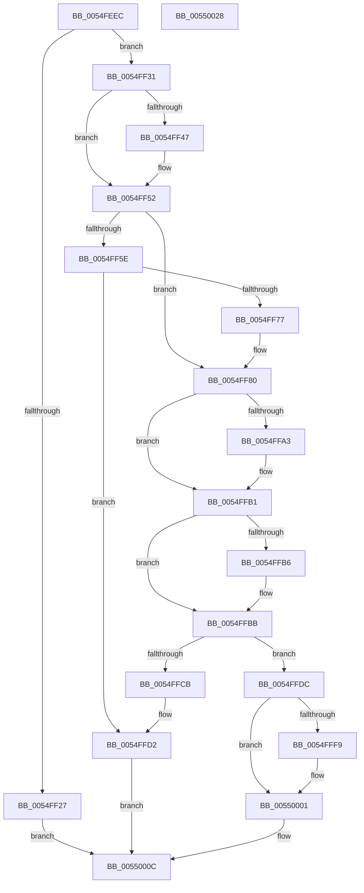

# IommupPasidDeviceCreate

- RVA: `0x0054FEEC`–`0x00550029` (길이 `317` bytes)
- VA: `0x000000014054FEEC`
- 실행 섹션: `.text`
- PDB 이름 있음: `예`; PDB Function 태그: `아니요`
- unwind 정보 RVA: `0x000C4178`
- 디코드: `96`개 명령, `317/317` bytes 표시
- 미해석 바이트: `0` (있으면 어셈블리에 `.byte`로 보존)

> 이 문서는 커널 이미지의 기계어와 PDB 기호를 분석해 생성했습니다. 4번과 5번은 함수 원형과 자료형을 바이너리 사용 방식에서 추정한 C 해석이며 원본 소스 복구 결과는 아닙니다.

## 1. Dependencies

- 직접 호출 지점: **9**; 고유 호출 대상: **9**
- 직접 호출자로 확인된 함수: **2**
- RIP 상대 이미지 참조: **1**

### Outgoing calls
- `0x0054FF1A` → [HalpMmAllocCtxAlloc](../3E/HalpMmAllocCtxAlloc_function_003E10B8.md) (function, `0x003E10B8`)
- `0x0054FF39` → [memset](../6C/memset_function_006C6C40.md) (function, `0x006C6C40`)
- `0x0054FF3E` → [Feature_DmaAdapterStage1DirectAttach__private_IsEnabledDeviceUsageNoInline](Feature_DmaAdapterStage1DirectAttach__private_IsEnabledDeviceUsageNoInline_function_0054EB38.md) (function, `0x0054EB38`)
- `0x0054FF6C` → [IommuGetLibraryContext](../56/IommuGetLibraryContext_function_00565990.md) (function, `0x00565990`)
- `0x0054FF93` → [KeAbPreAcquire](../21/KeAbPreAcquire_function_00210230.md) (function, `0x00210230`)
- `0x0054FFAC` → [ExfAcquirePushLockExclusiveEx](../20/ExfAcquirePushLockExclusiveEx_function_0020FC90.md) (function, `0x0020FC90`)
- `0x0054FFD5` → [HalpMmAllocCtxFree](../3E/HalpMmAllocCtxFree_function_003E1904.md) (function, `0x003E1904`)
- `0x0054FFFC` → [ExfTryToWakePushLock](../26/ExfTryToWakePushLock_function_00265DD0.md) (function, `0x00265DD0`)
- `0x00550004` → [KeAbPostRelease](../2E/KeAbPostRelease_function_002E1600.md) (function, `0x002E1600`)

### Direct callers
- [IommupDeviceEnableSvm](../../page/70/IommupDeviceEnableSvm_function_00708CC4.md) at `0x00708DDE`
- [IommuPasidDeviceCreate](../../page/70/IommuPasidDeviceCreate_function_0070D450.md) at `0x0070D4A9`

### Static image references
- `0x0054FF52` → RVA `0x00FC1710` (`.data`; read)

## 2. Other-region calls and transfers

- 다른 실행 섹션으로 향하는 call: **0**
- 별도 외부 분기/꼬리 이동을 확인하지 못했습니다.

## 3. Assembly (complete function range)

```asm
0054FEEC  48 89 5C 24 08                  mov qword ptr [rsp + 8], rbx
0054FEF1  48 89 6C 24 10                  mov qword ptr [rsp + 0x10], rbp
0054FEF6  56                              push rsi
0054FEF7  57                              push rdi
0054FEF8  41 55                           push r13
0054FEFA  41 56                           push r14
0054FEFC  41 57                           push r15
0054FEFE  48 83 EC 20                     sub rsp, 0x20
0054FF02  33 FF                           xor edi, edi
0054FF04  8B F2                           mov esi, edx
0054FF06  4D 8B F8                        mov r15, r8
0054FF09  48 89 7C 24 68                  mov qword ptr [rsp + 0x68], rdi
0054FF0E  4C 8B E9                        mov r13, rcx
0054FF11  8B EF                           mov ebp, edi
0054FF13  44 8D 77 40                     lea r14d, [rdi + 0x40]
0054FF17  41 8B D6                        mov edx, r14d
0054FF1A  E8 99 11 E9 FF                  call 0x1403e10b8
0054FF1F  48 8B D8                        mov rbx, rax
0054FF22  48 85 C0                        test rax, rax
0054FF25  75 0A                           jne 0x14054ff31
0054FF27  BD 9A 00 00 C0                  mov ebp, 0xc000009a
0054FF2C  E9 DB 00 00 00                  jmp 0x14055000c
0054FF31  4D 8B C6                        mov r8, r14
0054FF34  33 D2                           xor edx, edx
0054FF36  48 8B CB                        mov rcx, rbx
0054FF39  E8 02 6D 17 00                  call 0x1406c6c40
0054FF3E  E8 F5 EB FF FF                  call 0x14054eb38
0054FF43  85 C0                           test eax, eax
0054FF45  74 0B                           je 0x14054ff52
0054FF47  48 8D 43 20                     lea rax, [rbx + 0x20]
0054FF4B  48 89 40 08                     mov qword ptr [rax + 8], rax
0054FF4F  48 89 00                        mov qword ptr [rax], rax
0054FF52  40 38 3D B7 17 A7 00            cmp byte ptr [rip + 0xa717b7], dil
0054FF59  89 73 30                        mov dword ptr [rbx + 0x30], esi
0054FF5C  75 22                           jne 0x14054ff80
0054FF5E  41 8B 55 48                     mov edx, dword ptr [r13 + 0x48]
0054FF62  4C 8D 4C 24 68                  lea r9, [rsp + 0x68]
0054FF67  45 33 C0                        xor r8d, r8d
0054FF6A  8B CE                           mov ecx, esi
0054FF6C  E8 1F 5A 01 00                  call 0x140565990
0054FF71  8B E8                           mov ebp, eax
0054FF73  85 C0                           test eax, eax
0054FF75  78 5B                           js 0x14054ffd2
0054FF77  48 8B 4C 24 68                  mov rcx, qword ptr [rsp + 0x68]
0054FF7C  48 89 4B 38                     mov qword ptr [rbx + 0x38], rcx
0054FF80  49 8D B5 78 01 00 00            lea rsi, [r13 + 0x178]
0054FF87  4C 89 6B 10                     mov qword ptr [rbx + 0x10], r13
0054FF8B  48 8B CE                        mov rcx, rsi
0054FF8E  45 33 C0                        xor r8d, r8d
0054FF91  33 D2                           xor edx, edx
0054FF93  E8 98 02 CC FF                  call 0x140210230
0054FF98  F0 48 0F BA 2E 00               lock bts qword ptr [rsi], 0
0054FF9E  4C 8B F0                        mov r14, rax
0054FFA1  73 0E                           jae 0x14054ffb1
0054FFA3  4C 8B C6                        mov r8, rsi
0054FFA6  48 8B D0                        mov rdx, rax
0054FFA9  48 8B CE                        mov rcx, rsi
0054FFAC  E8 DF FC CB FF                  call 0x14020fc90
0054FFB1  4D 85 F6                        test r14, r14
0054FFB4  74 05                           je 0x14054ffbb
0054FFB6  41 C6 46 0A 01                  mov byte ptr [r14 + 0xa], 1
0054FFBB  49 8D 85 68 01 00 00            lea rax, [r13 + 0x168]
0054FFC2  48 8B 48 08                     mov rcx, qword ptr [rax + 8]
0054FFC6  48 39 01                        cmp qword ptr [rcx], rax
0054FFC9  74 11                           je 0x14054ffdc
0054FFCB  B9 03 00 00 00                  mov ecx, 3
0054FFD0  CD 29                           int 0x29
0054FFD2  48 8B D3                        mov rdx, rbx
0054FFD5  E8 2A 19 E9 FF                  call 0x1403e1904
0054FFDA  EB 30                           jmp 0x14055000c
0054FFDC  48 89 03                        mov qword ptr [rbx], rax
0054FFDF  48 89 4B 08                     mov qword ptr [rbx + 8], rcx
0054FFE3  48 89 19                        mov qword ptr [rcx], rbx
0054FFE6  48 89 58 08                     mov qword ptr [rax + 8], rbx
0054FFEA  48 83 C8 FF                     or rax, 0xffffffffffffffff
0054FFEE  F0 48 0F C1 06                  lock xadd qword ptr [rsi], rax
0054FFF3  24 06                           and al, 6
0054FFF5  3C 02                           cmp al, 2
0054FFF7  75 08                           jne 0x140550001
0054FFF9  48 8B CE                        mov rcx, rsi
0054FFFC  E8 CF 5D D1 FF                  call 0x140265dd0
00550001  48 8B CE                        mov rcx, rsi
00550004  E8 F7 15 D9 FF                  call 0x1402e1600
00550009  48 8B FB                        mov rdi, rbx
0055000C  49 89 3F                        mov qword ptr [r15], rdi
0055000F  8B C5                           mov eax, ebp
00550011  48 8B 5C 24 50                  mov rbx, qword ptr [rsp + 0x50]
00550016  48 8B 6C 24 58                  mov rbp, qword ptr [rsp + 0x58]
0055001B  48 83 C4 20                     add rsp, 0x20
0055001F  41 5F                           pop r15
00550021  41 5E                           pop r14
00550023  41 5D                           pop r13
00550025  5F                              pop rdi
00550026  5E                              pop rsi
00550027  C3                              ret
00550028  CC                              int3
```

## 4. C-style interpretation (structured pseudocode)

```c
__int64 __fastcall IommupPasidDeviceCreate(__int64 a1, int a2, __int64 a3)
{
    __int64 result;
    __int64 v_rdi;
    __int64 v_rsp;
    unsigned __int64 v_stack_p10;
    unsigned __int64 v_stack_p20;
    unsigned __int64 v_stack_p8;

    v_stack_p8 = v_rbx;
    v_stack_p10 = v_rbp;
    v_rsp = (v_rsp) - (32);
    v_rdi = 0;
    v_stack_p20 = 0;
    result = HalpMmAllocCtxAlloc(a1, (unsigned int)((unsigned int)(v_rdi + 64)), a3, a4);
    if (result != 0) goto loc_0054FF31;
    goto loc_0055000C;
loc_0054FF31:
    a2 = 0;
    result = memset(result, a2, v_rdi + 64, a4);
    result = Feature_DmaAdapterStage1DirectAttach__private_IsEnabledDeviceUsageNoInline(result, a2, v_rdi + 64, a4);
    if ((unsigned int)(result) != 0) {
        result = result + 32;
        *(unsigned __int64 *)(result + 8) = result;
        *(unsigned __int64 *)(result) = result;
    }
    *(unsigned int *)(result + 48) = (unsigned int)((unsigned int)(a2));
    if ((*(unsigned __int8 *)(v_rip + 10950583)) != 0) goto loc_0054FF80;
    a3 = 0;
    result = IommuGetLibraryContext((unsigned int)((unsigned int)((unsigned int)(a2))), (unsigned int)(*(unsigned int *)(a1 + 72)), a3, v_stack_p20);
    if (sign_flag) goto loc_0054FFD2;
    *(unsigned __int64 *)(result + 56) = v_stack_p20;
loc_0054FF80:
    *(unsigned __int64 *)(result + 16) = a1;
    a3 = 0;
    a2 = 0;
    result = KeAbPreAcquire(a1 + 376, a2, a3, v_stack_p20);
    if (!(condition_is_above_or_equal)) {
        a3 = a1 + 376;
        a2 = result;
        a1 = a1 + 376;
        result = ExfAcquirePushLockExclusiveEx(a1, a2, a3, v_stack_p20);
    }
    if (result != 0) {
        *(unsigned __int8 *)(result + 10) = 1;
    }
    if ((*(unsigned __int64 *)(*(unsigned __int64 *)(a1 + 360 + 8))) == (a1 + 360)) goto loc_0054FFDC;
loc_0054FFD2:
    result = HalpMmAllocCtxFree(3, result, a3, v_stack_p20);
    goto loc_0055000C;
loc_0054FFDC:
    *(unsigned __int64 *)(result) = result;
    *(unsigned __int64 *)(result + 8) = 3;
    *(unsigned __int64 *)(3) = result;
    *(unsigned __int64 *)(result + 8) = result;
    result = (result) | (-1);
    result = (unsigned __int8)((result) & (6));
    if (((unsigned __int8)(result)) == 2) {
        a1 = a1 + 376;
        result = ExfTryToWakePushLock(a1, result, a3, v_stack_p20);
    }
    result = KeAbPostRelease(a1 + 376, result, a3, v_stack_p20);
loc_0055000C:
    *(unsigned __int64 *)(a3) = result;
    v_rsp = (v_rsp) + (32);
    return (unsigned int)((unsigned int)((unsigned int)((unsigned int)(result))));
}
```

## 5. (Beta) C Style

```c
int64_t IommupPasidDeviceCreate(void *Arg1, int32_t Arg2, void *Arg3)
{
    uint8_t *arg1 = (uint8_t *)Arg1;
    uint8_t *arg3 = (uint8_t *)Arg3;

    int64_t result;
    int64_t local_rdi;
    int64_t local_rsp;
    uint64_t v_stack_p10;
    uint64_t v_stack_p20;
    uint64_t v_stack_p8;

    v_stack_p8 = local_rbx;
    v_stack_p10 = local_rbp;
    local_rsp = (local_rsp) - (32);
    local_rdi = 0;
    v_stack_p20 = 0;
    result = HalpMmAllocCtxAlloc(Arg1, (uint32_t)((uint32_t)(local_rdi + 64)), Arg3, a4);
    if (result != 0) goto loc_0054FF31;
    goto loc_0055000C;
loc_0054FF31:
    Arg2 = 0;
    result = memset(result, Arg2, local_rdi + 64, a4);
    result = Feature_DmaAdapterStage1DirectAttach__private_IsEnabledDeviceUsageNoInline(result, Arg2, local_rdi + 64, a4);
    if ((uint32_t)(result) != 0) {
        result = result + 32;
        *(uint64_t *)(result + 0x8) = result;
        *(uint64_t *)(result) = result;
    }
    *(uint32_t *)(result + 0x30) = (uint32_t)((uint32_t)(Arg2));
    if ((*(uint8_t *)(v_rip + 0xA717B7)) != 0) goto loc_0054FF80;
    Arg3 = 0;
    result = IommuGetLibraryContext((uint32_t)((uint32_t)((uint32_t)(Arg2))), (uint32_t)(*(uint32_t *)(arg1 + 0x48)), Arg3, v_stack_p20);
    if (sign_flag) goto loc_0054FFD2;
    *(uint64_t *)(result + 0x38) = v_stack_p20;
loc_0054FF80:
    *(void **)(result + 0x10) = Arg1;
    Arg3 = 0;
    Arg2 = 0;
    result = KeAbPreAcquire(Arg1 + 376, Arg2, Arg3, v_stack_p20);
    if (!(condition_is_above_or_equal)) {
        Arg3 = Arg1 + 376;
        Arg2 = result;
        Arg1 = Arg1 + 376;
        result = ExfAcquirePushLockExclusiveEx(Arg1, Arg2, Arg3, v_stack_p20);
    }
    if (result != 0) {
        *(uint8_t *)(result + 0xA) = 1;
    }
    if ((*(uint64_t *)(*(uint64_t *)(arg1 + 0x168 + 0x8))) == (Arg1 + 360)) goto loc_0054FFDC;
loc_0054FFD2:
    result = HalpMmAllocCtxFree(3, result, Arg3, v_stack_p20);
    goto loc_0055000C;
loc_0054FFDC:
    *(uint64_t *)(result) = result;
    *(uint64_t *)(result + 0x8) = 3;
    *(uint64_t *)(3) = result;
    *(uint64_t *)(result + 0x8) = result;
    result = (result) | (-1);
    result = (uint8_t)((result) & (6));
    if (((uint8_t)(result)) == 2) {
        Arg1 = Arg1 + 376;
        result = ExfTryToWakePushLock(Arg1, result, Arg3, v_stack_p20);
    }
    result = KeAbPostRelease(Arg1 + 376, result, Arg3, v_stack_p20);
loc_0055000C:
    *(uint64_t *)(arg3) = result;
    local_rsp = (local_rsp) + (32);
    return (uint32_t)((uint32_t)((uint32_t)((uint32_t)(result))));
}
```

### 관측된 메모리 오프셋

구조체 형식이 확인되지 않은 접근은 인자 기준의 오프셋으로만 기록했습니다.

| 기준 인자 | 오프셋 표현 | 폭 (bit) | 접근 |
|---|---:|---:|---|
| `Arg1` | `+ 0x0` | `64` | `R/W` |
| `Arg1` | `+ 0x8` | `64` | `R` |
| `Arg1` | `+ 0x8` | `64` | `W` |
| `Arg1` | `+ 0x48` | `32` | `R` |
| `Arg1` | `+ 0x168` | `64` | `R` |
| `Arg1` | `+ 0x178` | `64` | `R` |
| `Arg3` | `+ 0x0` | `64` | `W` |

## 6. Execution-region graph

[열기: 2D/3D 그래프와 함수 탐색 컨트롤 패널](../../../control-panel.html?section=text&rva=0x0054FEEC&view=graph)

- 2D 그래프는 위에서 아래로 흐르고, 3D 그래프는 빈 공간을 드래그해 회전합니다. Shift+드래그는 이동, 휠은 확대·축소, 함수 노드 선택은 대상 보고서 이동입니다.

### Static fallback


