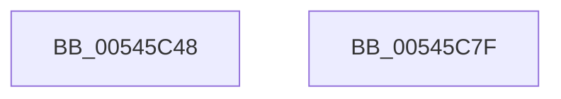

# WRITE_PORT_USHORT_PAIR

- RVA: `0x00545C48`–`0x00545C80` (길이 `56` bytes)
- VA: `0x0000000140545C48`
- 실행 섹션: `.text`
- PDB 이름 있음: `예`; PDB Function 태그: `아니요`
- unwind 정보 RVA: `0x0005CAAC`
- 디코드: `22`개 명령, `56/56` bytes 표시
- 미해석 바이트: `0` (있으면 어셈블리에 `.byte`로 보존)

> 이 문서는 커널 이미지의 기계어와 PDB 기호를 분석해 생성했습니다. 4번과 5번은 함수 원형과 자료형을 바이너리 사용 방식에서 추정한 C 해석이며 원본 소스 복구 결과는 아닙니다.

## 1. Dependencies

- 직접 호출 지점: **1**; 고유 호출 대상: **1**
- 직접 호출자로 확인된 함수: **4**
- RIP 상대 이미지 참조: **0**

### Outgoing calls
- `0x00545C62` → [HalpIoDelay](../6A/HalpIoDelay_function_006AC7E0.md) (function, `0x006AC7E0`)

### Direct callers
- [HalMakeBeep](HalMakeBeep_function_00545B80.md) at `0x00545BFC`
- [HalpECmosReadByte](../55/HalpECmosReadByte_function_00553BD0.md) at `0x00553BE2`
- [HalpECmosWriteByte](../55/HalpECmosWriteByte_function_00553C10.md) at `0x00553C24`
- [HalpPicSetLineState](../56/HalpPicSetLineState_function_0056AA90.md) at `0x0056AB1A`
- [HalpPicSetLineState](../56/HalpPicSetLineState_function_0056AA90.md) at `0x0056AB5B`

### Static image references
- 디코드된 RIP-relative 메모리 참조가 없습니다.

## 2. Other-region calls and transfers

- 다른 실행 섹션으로 향하는 call: **0**
- 별도 외부 분기/꼬리 이동을 확인하지 못했습니다.

## 3. Assembly (complete function range)

```asm
00545C48  48 89 5C 24 08                  mov qword ptr [rsp + 8], rbx
00545C4D  57                              push rdi
00545C4E  48 83 EC 20                     sub rsp, 0x20
00545C52  90                              nop
00545C53  48 8B DA                        mov rbx, rdx
00545C56  0F B7 D1                        movzx edx, cx
00545C59  41 8A C0                        mov al, r8b
00545C5C  EE                              out dx, al
00545C5D  90                              nop
00545C5E  41 0F B7 F8                     movzx edi, r8w
00545C62  E8 79 6B 16 00                  call 0x1406ac7e0
00545C67  0F B7 D3                        movzx edx, bx
00545C6A  66 C1 EF 08                     shr di, 8
00545C6E  48 8B 5C 24 30                  mov rbx, qword ptr [rsp + 0x30]
00545C73  90                              nop
00545C74  40 8A C7                        mov al, dil
00545C77  EE                              out dx, al
00545C78  90                              nop
00545C79  48 83 C4 20                     add rsp, 0x20
00545C7D  5F                              pop rdi
00545C7E  C3                              ret
00545C7F  CC                              int3
```

## 4. C-style interpretation (structured pseudocode)

```c
__int64 __fastcall WRITE_PORT_USHORT_PAIR(unsigned __int16 a1, __int64 a2, unsigned __int16 a3)
{
    __int64 result;
    __int64 v_rdi;
    __int64 v_rsp;
    unsigned __int64 v_stack_p8;

    v_stack_p8 = v_rbx;
    v_rsp = (v_rsp) - (32);
    result = HalpIoDelay(a1, a1, a3, a4);
    v_rdi = (unsigned __int16)((a3) >> (8));
    v_rsp = (v_rsp) + (32);
    return (unsigned __int8)(v_rdi);
}
```

## 5. (Beta) C Style

```c
int64_t WRITE_PORT_USHORT_PAIR(uint16_t Arg1, int64_t Arg2, uint16_t Arg3)
{
    int64_t result;
    int64_t local_rdi;
    int64_t local_rsp;
    uint64_t v_stack_p8;

    v_stack_p8 = local_rbx;
    local_rsp = (local_rsp) - (32);
    result = HalpIoDelay(Arg1, Arg1, Arg3, a4);
    local_rdi = (uint16_t)((Arg3) >> (8));
    local_rsp = (local_rsp) + (32);
    return (uint8_t)(local_rdi);
}
```

## 6. Execution-region graph

[열기: 2D/3D 그래프와 함수 탐색 컨트롤 패널](../../../control-panel.html?section=text&rva=0x00545C48&view=graph)

- 2D 그래프는 위에서 아래로 흐르고, 3D 그래프는 빈 공간을 드래그해 회전합니다. Shift+드래그는 이동, 휠은 확대·축소, 함수 노드 선택은 대상 보고서 이동입니다.

### Static fallback


