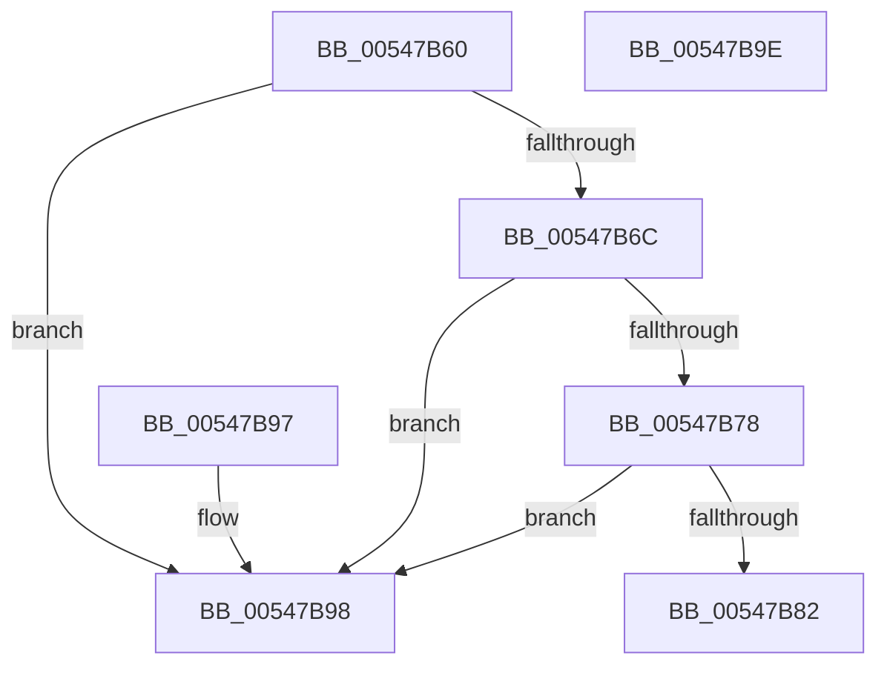

# x86BiosAllocateBuffer

- RVA: `0x00547B60`–`0x00547B9F` (길이 `63` bytes)
- VA: `0x0000000140547B60`
- 실행 섹션: `.text`
- PDB 이름 있음: `예`; PDB Function 태그: `아니요`
- unwind 정보 RVA: `0x000DB714`
- 디코드: `19`개 명령, `63/63` bytes 표시
- 미해석 바이트: `0` (있으면 어셈블리에 `.byte`로 보존)

> 이 문서는 커널 이미지의 기계어와 PDB 기호를 분석해 생성했습니다. 4번과 5번은 함수 원형과 자료형을 바이너리 사용 방식에서 추정한 C 해석이며 원본 소스 복구 결과는 아닙니다.

## 1. Dependencies

- 직접 호출 지점: **0**; 고유 호출 대상: **0**
- 직접 호출자로 확인된 함수: **0**
- RIP 상대 이미지 참조: **4**

### Outgoing calls
- 직접 디코드된 call 명령이 없습니다.

### Direct callers
- 이 함수 시작 RVA로 연결되는 직접 call은 확인되지 않았습니다. 간접 호출은 완전히 역산할 수 없습니다.

### Static image references
- `0x00547B63` → RVA `0x00E10336` (`.data`; read)
- `0x00547B6F` → RVA `0x00E10335` (`.data`; read)
- `0x00547B78` → RVA `0x00E10330` (`.data`; read)
- `0x00547B8F` → RVA `0x00E10335` (`.data`; write)

## 2. Other-region calls and transfers

- 다른 실행 섹션으로 향하는 call: **0**
- 별도 외부 분기/꼬리 이동을 확인하지 못했습니다.

## 3. Assembly (complete function range)

```asm
00547B60  0F AE E8                        lfence
00547B63  80 3D CC 87 8C 00 01            cmp byte ptr [rip + 0x8c87cc], 1
00547B6A  75 2C                           jne 0x140547b98
00547B6C  45 33 D2                        xor r10d, r10d
00547B6F  44 38 15 BF 87 8C 00            cmp byte ptr [rip + 0x8c87bf], r10b
00547B76  75 20                           jne 0x140547b98
00547B78  8B 05 B2 87 8C 00               mov eax, dword ptr [rip + 0x8c87b2]
00547B7E  39 01                           cmp dword ptr [rcx], eax
00547B80  77 16                           ja 0x140547b98
00547B82  66 C7 02 00 20                  mov word ptr [rdx], 0x2000
00547B87  66 45 89 10                     mov word ptr [r8], r10w
00547B8B  89 01                           mov dword ptr [rcx], eax
00547B8D  33 C0                           xor eax, eax
00547B8F  C6 05 9F 87 8C 00 01            mov byte ptr [rip + 0x8c879f], 1
00547B96  C3                              ret
00547B97  CC                              int3
00547B98  B8 9A 00 00 C0                  mov eax, 0xc000009a
00547B9D  C3                              ret
00547B9E  CC                              int3
```

## 4. C-style interpretation (structured pseudocode)

```c
__int64 __fastcall x86BiosAllocateBuffer(__int64 a1, __int64 a2, __int64 a3)
{
    __int64 result;
    __int64 v_r10;

    if ((*(unsigned __int8 *)(v_rip + 9209804)) != 1) goto loc_00547B98;
    v_r10 = 0;
    if ((*(unsigned __int8 *)(v_rip + 9209791)) != 0) goto loc_00547B98;
    if ((*(unsigned int *)(a1)) > ((unsigned int)((unsigned int)(*(unsigned int *)(v_rip + 9209778))))) goto loc_00547B98;
    *(unsigned __int16 *)(a2) = 0x2000ULL;
    *(unsigned __int16 *)(a3) = 0;
    *(unsigned int *)(a1) = (unsigned int)((unsigned int)(*(unsigned int *)(v_rip + 9209778)));
    result = 0;
    *(unsigned __int8 *)(v_rip + 9209759) = 1;
    return result;
loc_00547B98:
    return (unsigned int)(0xC000009AULL);
}
```

## 5. (Beta) C Style

```c
int64_t x86BiosAllocateBuffer(void *Arg1, void *Arg2, void *Arg3)
{
    uint8_t *arg1 = (uint8_t *)Arg1;
    uint8_t *arg2 = (uint8_t *)Arg2;
    uint8_t *arg3 = (uint8_t *)Arg3;

    int64_t result;
    int64_t local_r10;

    if ((*(uint8_t *)(v_rip + 0x8C87CC)) != 1) goto loc_00547B98;
    local_r10 = 0;
    if ((*(uint8_t *)(v_rip + 0x8C87BF)) != 0) goto loc_00547B98;
    if ((*(uint32_t *)(arg1)) > ((uint32_t)((uint32_t)(*(uint32_t *)(v_rip + 0x8C87B2))))) goto loc_00547B98;
    *(uint16_t *)(arg2) = 0x2000ULL;
    *(uint16_t *)(arg3) = 0;
    *(uint32_t *)(arg1) = (uint32_t)((uint32_t)(*(uint32_t *)(v_rip + 0x8C87B2)));
    result = 0;
    *(uint8_t *)(v_rip + 0x8C879F) = 1;
    return result;
loc_00547B98:
    return (uint32_t)(0xC000009AULL);
}
```

### 관측된 메모리 오프셋

구조체 형식이 확인되지 않은 접근은 인자 기준의 오프셋으로만 기록했습니다.

| 기준 인자 | 오프셋 표현 | 폭 (bit) | 접근 |
|---|---:|---:|---|
| `Arg1` | `+ 0x0` | `32` | `R` |
| `Arg1` | `+ 0x0` | `32` | `W` |
| `Arg2` | `+ 0x0` | `16` | `W` |
| `Arg3` | `+ 0x0` | `16` | `W` |

## 6. Execution-region graph

[열기: 2D/3D 그래프와 함수 탐색 컨트롤 패널](../../../control-panel.html?section=text&rva=0x00547B60&view=graph)

- 2D 그래프는 위에서 아래로 흐르고, 3D 그래프는 빈 공간을 드래그해 회전합니다. Shift+드래그는 이동, 휠은 확대·축소, 함수 노드 선택은 대상 보고서 이동입니다.

### Static fallback


