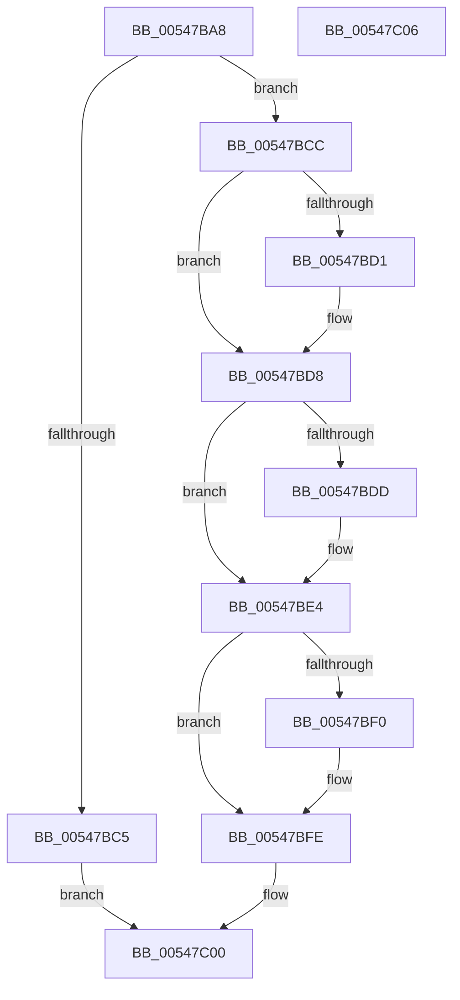

# x86BiosExecuteInterruptShadowed

- RVA: `0x00547BA8`–`0x00547C07` (길이 `95` bytes)
- VA: `0x0000000140547BA8`
- 실행 섹션: `.text`
- PDB 이름 있음: `예`; PDB Function 태그: `아니요`
- unwind 정보 RVA: `0x0005CF00`
- 디코드: `26`개 명령, `95/95` bytes 표시
- 미해석 바이트: `0` (있으면 어셈블리에 `.byte`로 보존)

> 이 문서는 커널 이미지의 기계어와 PDB 기호를 분석해 생성했습니다. 4번과 5번은 함수 원형과 자료형을 바이너리 사용 방식에서 추정한 C 해석이며 원본 소스 복구 결과는 아닙니다.

## 1. Dependencies

- 직접 호출 지점: **2**; 고유 호출 대상: **2**
- 직접 호출자로 확인된 함수: **1**
- RIP 상대 이미지 참조: **6**

### Outgoing calls
- `0x00547BE4` → [XmEmulateInterrupt](../56/XmEmulateInterrupt_function_005600F0.md) (function, `0x005600F0`)
- `0x00547BF9` → [DbgPrint](../35/DbgPrint_function_00358CB0.md) (function, `0x00358CB0`)

### Direct callers
- [x86BiosCall](../53/x86BiosCall_function_0053DD30.md) at `0x0053DD67`

### Static image references
- `0x00547BAE` → RVA `0x00E10336` (`.data`; read)
- `0x00547BB5` → RVA `0x00FC3F88` (`.data`; read)
- `0x00547BBC` → RVA `0x00FC3F80` (`.data`; read)
- `0x00547BD1` → RVA `0x00FC2B28` (`.data`; write)
- `0x00547BDD` → RVA `0x00FC22F0` (`.data`; write)
- `0x00547BF2` → RVA `0x00023E00` (`.rdata`; read)

## 2. Other-region calls and transfers

- 다른 실행 섹션으로 향하는 call: **0**
- 별도 외부 분기/꼬리 이동을 확인하지 못했습니다.

## 3. Assembly (complete function range)

```asm
00547BA8  40 53                           push rbx
00547BAA  48 83 EC 20                     sub rsp, 0x20
00547BAE  80 3D 81 87 8C 00 00            cmp byte ptr [rip + 0x8c8781], 0
00547BB5  48 8B 05 CC C3 A7 00            mov rax, qword ptr [rip + 0xa7c3cc]
00547BBC  4C 8B 05 BD C3 A7 00            mov r8, qword ptr [rip + 0xa7c3bd]
00547BC3  75 07                           jne 0x140547bcc
00547BC5  B8 04 00 00 00                  mov eax, 4
00547BCA  EB 34                           jmp 0x140547c00
00547BCC  4D 85 C0                        test r8, r8
00547BCF  74 07                           je 0x140547bd8
00547BD1  4C 89 05 50 AF A7 00            mov qword ptr [rip + 0xa7af50], r8
00547BD8  48 85 C0                        test rax, rax
00547BDB  74 07                           je 0x140547be4
00547BDD  48 89 05 0C A7 A7 00            mov qword ptr [rip + 0xa7a70c], rax
00547BE4  E8 07 85 01 00                  call 0x1405600f0
00547BE9  8B D8                           mov ebx, eax
00547BEB  83 F8 01                        cmp eax, 1
00547BEE  74 0E                           je 0x140547bfe
00547BF0  8B D0                           mov edx, eax
00547BF2  48 8D 0D 07 C2 AD FF            lea rcx, [rip - 0x523df9]
00547BF9  E8 B2 10 E1 FF                  call 0x140358cb0
00547BFE  8B C3                           mov eax, ebx
00547C00  48 83 C4 20                     add rsp, 0x20
00547C04  5B                              pop rbx
00547C05  C3                              ret
00547C06  CC                              int3
```

## 4. C-style interpretation (structured pseudocode)

```c
__int64 __fastcall x86BiosExecuteInterruptShadowed(void)
{
    __int64 result;
    __int64 v_rsp;

    v_rsp = (v_rsp) - (32);
    if ((*(unsigned __int8 *)(v_rip + 9209729)) != 0) goto loc_00547BCC;
    goto loc_00547C00;
loc_00547BCC:
    if (*(unsigned __int64 *)(v_rip + 10994621) != 0) {
        *(unsigned __int64 *)(v_rip + 10989392) = *(unsigned __int64 *)(v_rip + 10994621);
    }
    if (4 != 0) {
        *(unsigned __int64 *)(v_rip + 10987276) = 4;
    }
    result = XmEmulateInterrupt(a1, a2, *(unsigned __int64 *)(v_rip + 10994621), a4);
    if (((unsigned int)(result)) != 1) {
        a2 = (unsigned int)(result);
        a1 = v_rip - 5389817;
        result = DbgPrint(a1, a2, *(unsigned __int64 *)(v_rip + 10994621), a4);
    }
loc_00547C00:
    v_rsp = (v_rsp) + (32);
    return (unsigned int)((unsigned int)((unsigned int)((unsigned int)(result))));
}
```

## 5. (Beta) C Style

```c
void x86BiosExecuteInterruptShadowed(void)
{
    int64_t result;
    int64_t local_rsp;

    local_rsp = (local_rsp) - (32);
    if ((*(uint8_t *)(v_rip + 0x8C8781)) != 0) goto loc_00547BCC;
    goto loc_00547C00;
loc_00547BCC:
    if (*(uint64_t *)(v_rip + 0xA7C3BD) != 0) {
        *(uint64_t *)(v_rip + 0xA7AF50) = *(uint64_t *)(v_rip + 0xA7C3BD);
    }
    if (4 != 0) {
        *(uint64_t *)(v_rip + 0xA7A70C) = 4;
    }
    result = XmEmulateInterrupt(a1, a2, *(uint64_t *)(v_rip + 0xA7C3BD), a4);
    if (((uint32_t)(result)) != 1) {
        a2 = (uint32_t)(result);
        a1 = v_rip - 5389817;
        result = DbgPrint(a1, a2, *(uint64_t *)(v_rip + 0xA7C3BD), a4);
    }
loc_00547C00:
    local_rsp = (local_rsp) + (32);
    return (uint32_t)((uint32_t)((uint32_t)((uint32_t)(result))));
}
```

## 6. Execution-region graph

[열기: 2D/3D 그래프와 함수 탐색 컨트롤 패널](../../../control-panel.html?section=text&rva=0x00547BA8&view=graph)

- 2D 그래프는 위에서 아래로 흐르고, 3D 그래프는 빈 공간을 드래그해 회전합니다. Shift+드래그는 이동, 휠은 확대·축소, 함수 노드 선택은 대상 보고서 이동입니다.

### Static fallback


