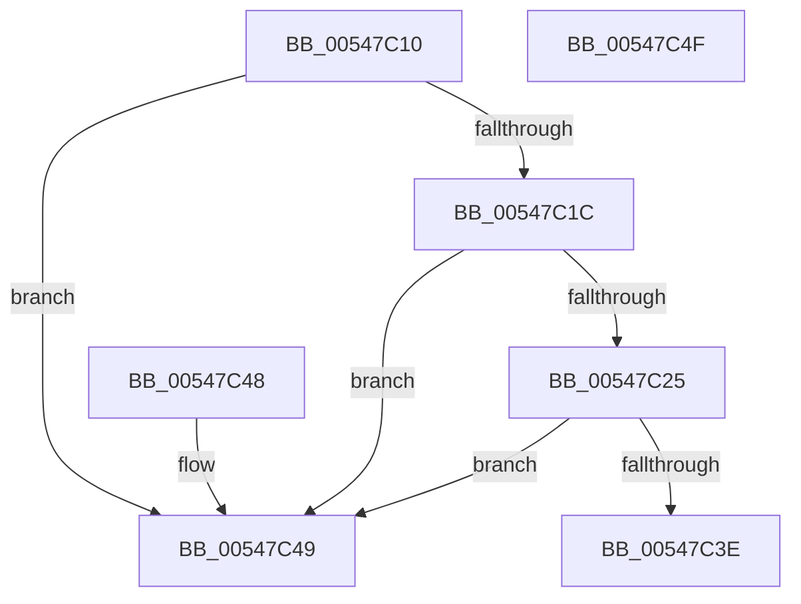

# x86BiosFreeBuffer

- RVA: `0x00547C10`–`0x00547C50` (길이 `64` bytes)
- VA: `0x0000000140547C10`
- 실행 섹션: `.text`
- PDB 이름 있음: `예`; PDB Function 태그: `아니요`
- unwind 정보 RVA: `0x000DB714`
- 디코드: `19`개 명령, `64/64` bytes 표시
- 미해석 바이트: `0` (있으면 어셈블리에 `.byte`로 보존)

> 이 문서는 커널 이미지의 기계어와 PDB 기호를 분석해 생성했습니다. 4번과 5번은 함수 원형과 자료형을 바이너리 사용 방식에서 추정한 C 해석이며 원본 소스 복구 결과는 아닙니다.

## 1. Dependencies

- 직접 호출 지점: **0**; 고유 호출 대상: **0**
- 직접 호출자로 확인된 함수: **0**
- RIP 상대 이미지 참조: **3**

### Outgoing calls
- 직접 디코드된 call 명령이 없습니다.

### Direct callers
- 이 함수 시작 RVA로 연결되는 직접 call은 확인되지 않았습니다. 간접 호출은 완전히 역산할 수 없습니다.

### Static image references
- `0x00547C13` → RVA `0x00E10336` (`.data`; read)
- `0x00547C1C` → RVA `0x00E10335` (`.data`; read)
- `0x00547C3E` → RVA `0x00E10335` (`.data`; write)

## 2. Other-region calls and transfers

- 다른 실행 섹션으로 향하는 call: **0**
- 별도 외부 분기/꼬리 이동을 확인하지 못했습니다.

## 3. Assembly (complete function range)

```asm
00547C10  0F AE E8                        lfence
00547C13  80 3D 1C 87 8C 00 01            cmp byte ptr [rip + 0x8c871c], 1
00547C1A  75 2D                           jne 0x140547c49
00547C1C  80 3D 12 87 8C 00 01            cmp byte ptr [rip + 0x8c8712], 1
00547C23  75 24                           jne 0x140547c49
00547C25  0F B7 C9                        movzx ecx, cx
00547C28  C1 E1 04                        shl ecx, 4
00547C2B  0F B7 C2                        movzx eax, dx
00547C2E  03 C8                           add ecx, eax
00547C30  81 E1 FF FF 0F 00               and ecx, 0xfffff
00547C36  81 F9 00 00 02 00               cmp ecx, 0x20000
00547C3C  75 0B                           jne 0x140547c49
00547C3E  C6 05 F0 86 8C 00 00            mov byte ptr [rip + 0x8c86f0], 0
00547C45  33 C0                           xor eax, eax
00547C47  C3                              ret
00547C48  CC                              int3
00547C49  B8 0D 00 00 C0                  mov eax, 0xc000000d
00547C4E  C3                              ret
00547C4F  CC                              int3
```

## 4. C-style interpretation (structured pseudocode)

```c
__int64 __fastcall x86BiosFreeBuffer(unsigned __int16 a1, unsigned __int16 a2)
{
    __int64 result;

    if ((*(unsigned __int8 *)(v_rip + 9209628)) != 1) goto loc_00547C49;
    if ((*(unsigned __int8 *)(v_rip + 9209618)) != 1) goto loc_00547C49;
    a1 = (unsigned int)((a1) << (4));
    a1 = (unsigned int)((a1) + (a2));
    a1 = (unsigned int)((a1) & (0xFFFFFULL));
    if (a1 != 0x20000ULL) goto loc_00547C49;
    *(unsigned __int8 *)(v_rip + 9209584) = 0;
    result = 0;
    return result;
loc_00547C49:
    return (unsigned int)(0xC000000DULL);
}
```

## 5. (Beta) C Style

```c
int64_t x86BiosFreeBuffer(uint16_t Arg1, uint16_t Arg2)
{
    int64_t result;

    if ((*(uint8_t *)(v_rip + 0x8C871C)) != 1) goto loc_00547C49;
    if ((*(uint8_t *)(v_rip + 0x8C8712)) != 1) goto loc_00547C49;
    Arg1 = (uint32_t)((Arg1) << (4));
    Arg1 = (uint32_t)((Arg1) + (Arg2));
    Arg1 = (uint32_t)((Arg1) & (0xFFFFFULL));
    if (Arg1 != 0x20000ULL) goto loc_00547C49;
    *(uint8_t *)(v_rip + 0x8C86F0) = 0;
    result = 0;
    return result;
loc_00547C49:
    return (uint32_t)(0xC000000DULL);
}
```

## 6. Execution-region graph

[열기: 2D/3D 그래프와 함수 탐색 컨트롤 패널](../../../control-panel.html?section=text&rva=0x00547C10&view=graph)

- 2D 그래프는 위에서 아래로 흐르고, 3D 그래프는 빈 공간을 드래그해 회전합니다. Shift+드래그는 이동, 휠은 확대·축소, 함수 노드 선택은 대상 보고서 이동입니다.

### Static fallback


