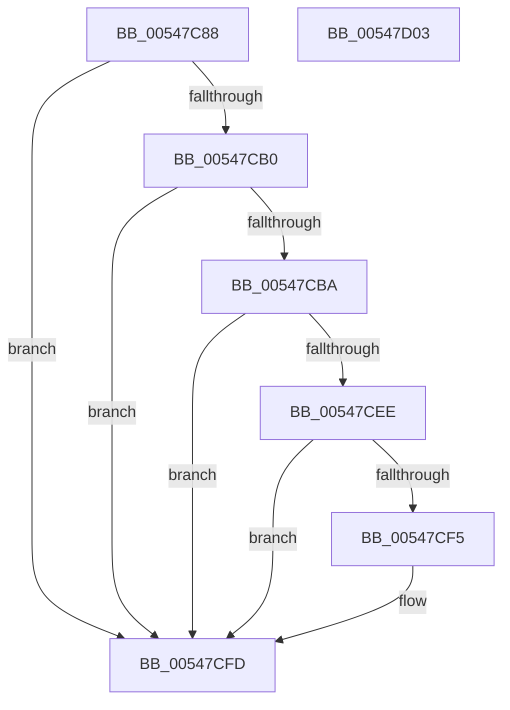

# x86BiosInitializeBiosEx

- RVA: `0x00547C88`–`0x00547D04` (길이 `124` bytes)
- VA: `0x0000000140547C88`
- 실행 섹션: `.text`
- PDB 이름 있음: `예`; PDB Function 태그: `아니요`
- unwind 정보 RVA: `0x0005CF00`
- 디코드: `27`개 명령, `124/124` bytes 표시
- 미해석 바이트: `0` (있으면 어셈블리에 `.byte`로 보존)

> 이 문서는 커널 이미지의 기계어와 PDB 기호를 분석해 생성했습니다. 4번과 5번은 함수 원형과 자료형을 바이너리 사용 방식에서 추정한 C 해석이며 원본 소스 복구 결과는 아닙니다.

## 1. Dependencies

- 직접 호출 지점: **1**; 고유 호출 대상: **1**
- 직접 호출자로 확인된 함수: **1**
- RIP 상대 이미지 참조: **11**

### Outgoing calls
- `0x00547C91` → [x86BiosInitializeBiosShadowed](x86BiosInitializeBiosShadowed_function_00547D0C.md) (function, `0x00547D0C`)

### Direct callers
- [HalInitializeBios](../53/HalInitializeBios_function_0053D9A0.md) at `0x0053DA33`
- [HalInitializeBios](../53/HalInitializeBios_function_0053D9A0.md) at `0x0053DBFE`

### Static image references
- `0x00547C96` → RVA `0x00E10328` (`.data`; read)
- `0x00547C9D` → RVA `0x00E10338` (`.data`; write)
- `0x00547CA4` → RVA `0x00E10330` (`.data`; write)
- `0x00547CB0` → RVA `0x00E00890` (`.data`; read)
- `0x00547CBA` → RVA `0x00547C60` (`x86BiosGetPciBusData`; read)
- `0x00547CC1` → RVA `0x00E10328` (`.data`; write)
- `0x00547CC8` → RVA `0x00FC2300` (`.data`; write)
- `0x00547CCF` → RVA `0x00547EC0` (`x86BiosSetPciBusData`; read)
- `0x00547CD6` → RVA `0x00FC2308` (`.data`; write)
- `0x00547CDD` → RVA `0x00E103FC` (`.data`; read)
- `0x00547CE3` → RVA `0x00E10337` (`.data`; write)

## 2. Other-region calls and transfers

- 다른 실행 섹션으로 향하는 call: **0**
- 별도 외부 분기/꼬리 이동을 확인하지 못했습니다.

## 3. Assembly (complete function range)

```asm
00547C88  40 53                           push rbx
00547C8A  48 83 EC 20                     sub rsp, 0x20
00547C8E  49 8B D9                        mov rbx, r9
00547C91  E8 76 00 00 00                  call 0x140547d0c
00547C96  80 3D 8B 86 8C 00 00            cmp byte ptr [rip + 0x8c868b], 0
00547C9D  48 89 1D 94 86 8C 00            mov qword ptr [rip + 0x8c8694], rbx
00547CA4  C7 05 82 86 8C 00 00 20 00 00   mov dword ptr [rip + 0x8c8682], 0x2000
00547CAE  75 4D                           jne 0x140547cfd
00547CB0  48 83 3D D8 8B 8B 00 00         cmp qword ptr [rip + 0x8b8bd8], 0
00547CB8  74 43                           je 0x140547cfd
00547CBA  48 8D 05 9F FF FF FF            lea rax, [rip - 0x61]
00547CC1  C6 05 60 86 8C 00 01            mov byte ptr [rip + 0x8c8660], 1
00547CC8  48 89 05 31 A6 A7 00            mov qword ptr [rip + 0xa7a631], rax
00547CCF  48 8D 05 EA 01 00 00            lea rax, [rip + 0x1ea]
00547CD6  48 89 05 2B A6 A7 00            mov qword ptr [rip + 0xa7a62b], rax
00547CDD  8B 05 19 87 8C 00               mov eax, dword ptr [rip + 0x8c8719]
00547CE3  C6 05 4D 86 8C 00 FF            mov byte ptr [rip + 0x8c864d], 0xff
00547CEA  85 C0                           test eax, eax
00547CEC  74 0F                           je 0x140547cfd
00547CEE  3D FF 00 00 00                  cmp eax, 0xff
00547CF3  74 08                           je 0x140547cfd
00547CF5  FE C0                           inc al
00547CF7  88 05 3A 86 8C 00               mov byte ptr [rip + 0x8c863a], al
00547CFD  48 83 C4 20                     add rsp, 0x20
00547D01  5B                              pop rbx
00547D02  C3                              ret
00547D03  CC                              int3
```

## 4. C-style interpretation (structured pseudocode)

```c
__int64 __fastcall x86BiosInitializeBiosEx(__int64 a1, __int64 a2, __int64 a3, __int64 a4)
{
    __int64 result;
    __int64 v_rsp;

    v_rsp = (v_rsp) - (32);
    result = x86BiosInitializeBiosShadowed(a1, a2, a3, a4);
    *(unsigned __int64 *)(v_rip + 9209492) = a4;
    *(unsigned int *)(v_rip + 9209474) = 0x2000ULL;
    if ((*(unsigned __int8 *)(v_rip + 9209483)) != 0) goto loc_00547CFD;
    if ((*(unsigned __int64 *)(v_rip + 9145304)) == 0) goto loc_00547CFD;
    *(unsigned __int8 *)(v_rip + 9209440) = 1;
    *(unsigned __int64 *)(v_rip + 10987057) = v_rip - 97;
    *(unsigned __int64 *)(v_rip + 10987051) = v_rip + 490;
    *(unsigned __int8 *)(v_rip + 9209421) = 255;
    if ((unsigned int)((unsigned int)(*(unsigned int *)(v_rip + 9209625))) == 0) goto loc_00547CFD;
    result = (unsigned int)(*(unsigned int *)(v_rip + 9209625));
    if (((unsigned int)((unsigned int)(*(unsigned int *)(v_rip + 9209625)))) != 255) {
        result = (unsigned __int8)(((unsigned int)(*(unsigned int *)(v_rip + 9209625))) + 1);
        *(unsigned __int8 *)(v_rip + 9209402) = (unsigned __int8)(result);
    }
    v_rsp = (v_rsp) + (32);
    return result;
}
```

## 5. (Beta) C Style

```c
int64_t x86BiosInitializeBiosEx(int64_t Arg1, int64_t Arg2, int64_t Arg3, int64_t Arg4)
{
    int64_t result;
    int64_t local_rsp;

    local_rsp = (local_rsp) - (32);
    result = x86BiosInitializeBiosShadowed(Arg1, Arg2, Arg3, Arg4);
    *(uint64_t *)(v_rip + 0x8C8694) = Arg4;
    *(uint32_t *)(v_rip + 0x8C8682) = 0x2000ULL;
    if ((*(uint8_t *)(v_rip + 0x8C868B)) != 0) goto loc_00547CFD;
    if ((*(uint64_t *)(v_rip + 0x8B8BD8)) == 0) goto loc_00547CFD;
    *(uint8_t *)(v_rip + 0x8C8660) = 1;
    *(uint64_t *)(v_rip + 0xA7A631) = v_rip - 97;
    *(uint64_t *)(v_rip + 0xA7A62B) = v_rip + 490;
    *(uint8_t *)(v_rip + 0x8C864D) = 255;
    if ((uint32_t)((uint32_t)(*(uint32_t *)(v_rip + 0x8C8719))) == 0) goto loc_00547CFD;
    result = (uint32_t)(*(uint32_t *)(v_rip + 0x8C8719));
    if (((uint32_t)((uint32_t)(*(uint32_t *)(v_rip + 0x8C8719)))) != 255) {
        result = (uint8_t)(((uint32_t)(*(uint32_t *)(v_rip + 0x8C8719))) + 1);
        *(uint8_t *)(v_rip + 0x8C863A) = (uint8_t)(result);
    }
    local_rsp = (local_rsp) + (32);
    return result;
}
```

## 6. Execution-region graph

[열기: 2D/3D 그래프와 함수 탐색 컨트롤 패널](../../../control-panel.html?section=text&rva=0x00547C88&view=graph)

- 2D 그래프는 위에서 아래로 흐르고, 3D 그래프는 빈 공간을 드래그해 회전합니다. Shift+드래그는 이동, 휠은 확대·축소, 함수 노드 선택은 대상 보고서 이동입니다.

### Static fallback


