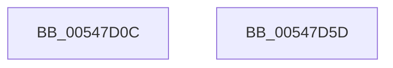

# x86BiosInitializeBiosShadowed

- RVA: `0x00547D0C`–`0x00547D5E` (길이 `82` bytes)
- VA: `0x0000000140547D0C`
- 실행 섹션: `.text`
- PDB 이름 있음: `예`; PDB Function 태그: `아니요`
- unwind 정보 RVA: `0x0006E5F8`
- 디코드: `19`개 명령, `82/82` bytes 표시
- 미해석 바이트: `0` (있으면 어셈블리에 `.byte`로 보존)

> 이 문서는 커널 이미지의 기계어와 PDB 기호를 분석해 생성했습니다. 4번과 5번은 함수 원형과 자료형을 바이너리 사용 방식에서 추정한 C 해석이며 원본 소스 복구 결과는 아닙니다.

## 1. Dependencies

- 직접 호출 지점: **2**; 고유 호출 대상: **2**
- 직접 호출자로 확인된 함수: **1**
- RIP 상대 이미지 참조: **5**

### Outgoing calls
- `0x00547D2B` → [memset](../6C/memset_function_006C6C40.md) (function, `0x006C6C40`)
- `0x00547D46` → [XmInitializeEmulator](../56/XmInitializeEmulator_function_00560188.md) (function, `0x00560188`)

### Direct callers
- [x86BiosInitializeBiosEx](x86BiosInitializeBiosEx_function_00547C88.md) at `0x00547C91`

### Static image references
- `0x00547D19` → RVA `0x00FC2320` (`.data`; read)
- `0x00547D30` → RVA `0x00FC22E8` (`.data`; read/write)
- `0x00547D38` → RVA `0x00FC2B28` (`.data`; write)
- `0x00547D3F` → RVA `0x00FC22F0` (`.data`; write)
- `0x00547D50` → RVA `0x00E10336` (`.data`; write)

## 2. Other-region calls and transfers

- 다른 실행 섹션으로 향하는 call: **0**
- 별도 외부 분기/꼬리 이동을 확인하지 못했습니다.

## 3. Assembly (complete function range)

```asm
00547D0C  48 89 5C 24 08                  mov qword ptr [rsp + 8], rbx
00547D11  57                              push rdi
00547D12  48 83 EC 30                     sub rsp, 0x30
00547D16  49 8B F8                        mov rdi, r8
00547D19  48 8D 0D 00 A6 A7 00            lea rcx, [rip + 0xa7a600]
00547D20  48 8B DA                        mov rbx, rdx
00547D23  41 B8 00 08 00 00               mov r8d, 0x800
00547D29  33 D2                           xor edx, edx
00547D2B  E8 10 EF 17 00                  call 0x1406c6c40
00547D30  48 83 25 B0 A5 A7 00 00         and qword ptr [rip + 0xa7a5b0], 0
00547D38  48 89 1D E9 AD A7 00            mov qword ptr [rip + 0xa7ade9], rbx
00547D3F  48 89 3D AA A5 A7 00            mov qword ptr [rip + 0xa7a5aa], rdi
00547D46  E8 3D 84 01 00                  call 0x140560188
00547D4B  48 8B 5C 24 40                  mov rbx, qword ptr [rsp + 0x40]
00547D50  C6 05 DF 85 8C 00 01            mov byte ptr [rip + 0x8c85df], 1
00547D57  48 83 C4 30                     add rsp, 0x30
00547D5B  5F                              pop rdi
00547D5C  C3                              ret
00547D5D  CC                              int3
```

## 4. C-style interpretation (structured pseudocode)

```c
__int64 __fastcall x86BiosInitializeBiosShadowed(__int64 a1, __int64 a2, __int64 a3)
{
    __int64 result;
    __int64 v_rsp;
    unsigned __int64 v_stack_p8;

    v_stack_p8 = v_rbx;
    v_rsp = (v_rsp) - (48);
    a2 = 0;
    result = memset(v_rip + 10987008, a2, (unsigned int)(0x800ULL), a4);
    *(unsigned __int64 *)(v_rip + 10989033) = 0;
    *(unsigned __int64 *)(v_rip + 10986922) = a3;
    result = XmInitializeEmulator(v_rip + 10987008, a2, (unsigned int)(0x800ULL), a4);
    *(unsigned __int8 *)(v_rip + 9209311) = 1;
    v_rsp = (v_rsp) + (48);
    return result;
}
```

## 5. (Beta) C Style

```c
int64_t x86BiosInitializeBiosShadowed(int64_t Arg1, int64_t Arg2, int64_t Arg3)
{
    int64_t result;
    int64_t local_rsp;
    uint64_t v_stack_p8;

    v_stack_p8 = local_rbx;
    local_rsp = (local_rsp) - (48);
    Arg2 = 0;
    result = memset(v_rip + 10987008, Arg2, (uint32_t)(0x800ULL), a4);
    *(uint64_t *)(v_rip + 0xA7ADE9) = 0;
    *(uint64_t *)(v_rip + 0xA7A5AA) = Arg3;
    result = XmInitializeEmulator(v_rip + 10987008, Arg2, (uint32_t)(0x800ULL), a4);
    *(uint8_t *)(v_rip + 0x8C85DF) = 1;
    local_rsp = (local_rsp) + (48);
    return result;
}
```

## 6. Execution-region graph

[열기: 2D/3D 그래프와 함수 탐색 컨트롤 패널](../../../control-panel.html?section=text&rva=0x00547D0C&view=graph)

- 2D 그래프는 위에서 아래로 흐르고, 3D 그래프는 빈 공간을 드래그해 회전합니다. Shift+드래그는 이동, 휠은 확대·축소, 함수 노드 선택은 대상 보고서 이동입니다.

### Static fallback


