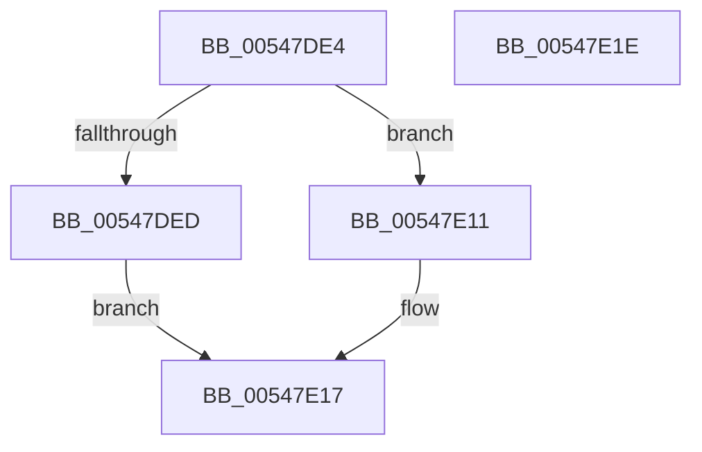

# x86BiosReadCmosPortByte

- RVA: `0x00547DE4`–`0x00547E1F` (길이 `59` bytes)
- VA: `0x0000000140547DE4`
- 실행 섹션: `.text`
- PDB 이름 있음: `예`; PDB Function 태그: `아니요`
- unwind 정보 RVA: `0x0005C788`
- 디코드: `21`개 명령, `59/59` bytes 표시
- 미해석 바이트: `0` (있으면 어셈블리에 `.byte`로 보존)

> 이 문서는 커널 이미지의 기계어와 PDB 기호를 분석해 생성했습니다. 4번과 5번은 함수 원형과 자료형을 바이너리 사용 방식에서 추정한 C 해석이며 원본 소스 복구 결과는 아닙니다.

## 1. Dependencies

- 직접 호출 지점: **2**; 고유 호출 대상: **2**
- 직접 호출자로 확인된 함수: **1**
- RIP 상대 이미지 참조: **1**

### Outgoing calls
- `0x00547DED` → [HalpAcquireCmosSpinLock](../42/HalpAcquireCmosSpinLock_function_0042DEE8.md) (function, `0x0042DEE8`)
- `0x00547E0A` → [HalpReleaseCmosSpinLock](../42/HalpReleaseCmosSpinLock_function_0042DE04.md) (function, `0x0042DE04`)

### Direct callers
- [x86BiosReadCmosPort](x86BiosReadCmosPort_function_00547D64.md) at `0x00547D80`
- [x86BiosReadCmosPort](x86BiosReadCmosPort_function_00547D64.md) at `0x00547D94`
- [x86BiosReadCmosPort](x86BiosReadCmosPort_function_00547D64.md) at `0x00547DA8`
- [x86BiosReadCmosPort](x86BiosReadCmosPort_function_00547D64.md) at `0x00547DB6`

### Static image references
- `0x00547DF2` → RVA `0x00E10334` (`.data`; read)

## 2. Other-region calls and transfers

- 다른 실행 섹션으로 향하는 call: **0**
- 별도 외부 분기/꼬리 이동을 확인하지 못했습니다.

## 3. Assembly (complete function range)

```asm
00547DE4  48 83 EC 28                     sub rsp, 0x28
00547DE8  F6 C1 01                        test cl, 1
00547DEB  74 24                           je 0x140547e11
00547DED  E8 F6 60 EE FF                  call 0x14042dee8
00547DF2  8A 05 3C 85 8C 00               mov al, byte ptr [rip + 0x8c853c]
00547DF8  BA 70 00 00 00                  mov edx, 0x70
00547DFD  90                              nop
00547DFE  EE                              out dx, al
00547DFF  90                              nop
00547E00  BA 71 00 00 00                  mov edx, 0x71
00547E05  90                              nop
00547E06  EC                              in al, dx
00547E07  8A D0                           mov dl, al
00547E09  90                              nop
00547E0A  E8 F5 5F EE FF                  call 0x14042de04
00547E0F  EB 06                           jmp 0x140547e17
00547E11  8A 15 1D 85 8C 00               mov dl, byte ptr [rip + 0x8c851d]
00547E17  8A C2                           mov al, dl
00547E19  48 83 C4 28                     add rsp, 0x28
00547E1D  C3                              ret
00547E1E  CC                              int3
```

## 4. C-style interpretation (structured pseudocode)

```c
__int64 __fastcall x86BiosReadCmosPortByte(unsigned __int8 a1)
{
    __int64 result;
    __int64 v_rsp;

    v_rsp = (v_rsp) - (40);
    if (((a1) & (1)) == 0) goto loc_00547E11;
    result = HalpAcquireCmosSpinLock(a1, a2, a3, a4);
    result = HalpReleaseCmosSpinLock(a1, (unsigned __int8)(*(unsigned __int8 *)(v_rip + 9209148)), a3, a4);
    goto loc_00547E17;
loc_00547E11:
loc_00547E17:
    v_rsp = (v_rsp) + (40);
    return (unsigned __int8)(*(unsigned __int8 *)(v_rip + 9209117));
}
```

## 5. (Beta) C Style

```c
int64_t x86BiosReadCmosPortByte(uint8_t Arg1)
{
    int64_t result;
    int64_t local_rsp;

    local_rsp = (local_rsp) - (40);
    if (((Arg1) & (1)) == 0) goto loc_00547E11;
    result = HalpAcquireCmosSpinLock(Arg1, a2, a3, a4);
    result = HalpReleaseCmosSpinLock(Arg1, (uint8_t)(*(uint8_t *)(v_rip + 0x8C853C)), a3, a4);
    goto loc_00547E17;
loc_00547E11:
loc_00547E17:
    local_rsp = (local_rsp) + (40);
    return (uint8_t)(*(uint8_t *)(v_rip + 0x8C851D));
}
```

## 6. Execution-region graph

[열기: 2D/3D 그래프와 함수 탐색 컨트롤 패널](../../../control-panel.html?section=text&rva=0x00547DE4&view=graph)

- 2D 그래프는 위에서 아래로 흐르고, 3D 그래프는 빈 공간을 드래그해 회전합니다. Shift+드래그는 이동, 휠은 확대·축소, 함수 노드 선택은 대상 보고서 이동입니다.

### Static fallback


