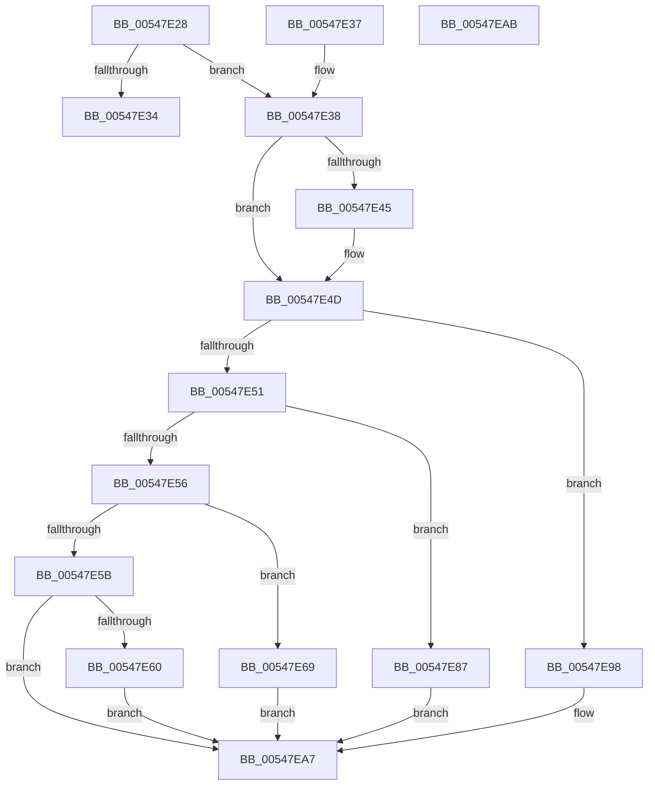

# x86BiosReadPciAddressPort

- RVA: `0x00547E28`–`0x00547EAC` (길이 `132` bytes)
- VA: `0x0000000140547E28`
- 실행 섹션: `.text`
- PDB 이름 있음: `예`; PDB Function 태그: `아니요`
- unwind 정보 RVA: `0x000DB714`
- 디코드: `39`개 명령, `132/132` bytes 표시
- 미해석 바이트: `0` (있으면 어셈블리에 `.byte`로 보존)

> 이 문서는 커널 이미지의 기계어와 PDB 기호를 분석해 생성했습니다. 4번과 5번은 함수 원형과 자료형을 바이너리 사용 방식에서 추정한 C 해석이며 원본 소스 복구 결과는 아닙니다.

## 1. Dependencies

- 직접 호출 지점: **0**; 고유 호출 대상: **0**
- 직접 호출자로 확인된 함수: **1**
- RIP 상대 이미지 참조: **3**

### Outgoing calls
- 직접 디코드된 call 명령이 없습니다.

### Direct callers
- [x86BiosReadIoSpace](../47/x86BiosReadIoSpace_function_00473850.md) at `0x004738D2`

### Static image references
- `0x00547E2B` → RVA `0x00E10328` (`.data`; read)
- `0x00547E60` → RVA `0x00E1032C` (`.data`; read)
- `0x00547E78` → RVA `0x00E1032F` (`.data`; read)

## 2. Other-region calls and transfers

- 다른 실행 섹션으로 향하는 call: **0**
- 별도 외부 분기/꼬리 이동을 확인하지 못했습니다.

## 3. Assembly (complete function range)

```asm
00547E28  45 33 C0                        xor r8d, r8d
00547E2B  44 38 05 F6 84 8C 00            cmp byte ptr [rip + 0x8c84f6], r8b
00547E32  75 04                           jne 0x140547e38
00547E34  33 C0                           xor eax, eax
00547E36  C3                              ret
00547E37  CC                              int3
00547E38  44 0F B7 CA                     movzx r9d, dx
00547E3C  41 8D 04 09                     lea eax, [r9 + rcx]
00547E40  83 F8 03                        cmp eax, 3
00547E43  7E 08                           jle 0x140547e4d
00547E45  B9 03 00 00 00                  mov ecx, 3
00547E4A  41 2B C9                        sub ecx, r9d
00547E4D  85 C9                           test ecx, ecx
00547E4F  74 47                           je 0x140547e98
00547E51  83 E9 01                        sub ecx, 1
00547E54  74 31                           je 0x140547e87
00547E56  83 E9 01                        sub ecx, 1
00547E59  74 0E                           je 0x140547e69
00547E5B  83 F9 01                        cmp ecx, 1
00547E5E  75 47                           jne 0x140547ea7
00547E60  44 8B 05 C5 84 8C 00            mov r8d, dword ptr [rip + 0x8c84c5]
00547E67  EB 3E                           jmp 0x140547ea7
00547E69  0F B7 C2                        movzx eax, dx
00547E6C  48 8D 0D B9 84 8C 00            lea rcx, [rip + 0x8c84b9]
00547E73  44 0F B7 04 08                  movzx r8d, word ptr [rax + rcx]
00547E78  0F B6 05 B0 84 8C 00            movzx eax, byte ptr [rip + 0x8c84b0]
00547E7F  C1 E0 10                        shl eax, 0x10
00547E82  44 0B C0                        or r8d, eax
00547E85  EB 20                           jmp 0x140547ea7
00547E87  0F B7 C2                        movzx eax, dx
00547E8A  48 8D 0D 9B 84 8C 00            lea rcx, [rip + 0x8c849b]
00547E91  44 0F B7 04 08                  movzx r8d, word ptr [rax + rcx]
00547E96  EB 0F                           jmp 0x140547ea7
00547E98  0F B7 C2                        movzx eax, dx
00547E9B  48 8D 0D 8A 84 8C 00            lea rcx, [rip + 0x8c848a]
00547EA2  44 0F B6 04 08                  movzx r8d, byte ptr [rax + rcx]
00547EA7  41 8B C0                        mov eax, r8d
00547EAA  C3                              ret
00547EAB  CC                              int3
```

## 4. C-style interpretation (structured pseudocode)

```c
__int64 __fastcall x86BiosReadPciAddressPort(__int64 a1, unsigned __int16 a2, int a3)
{
    __int64 result;

    a3 = 0;
    if ((*(unsigned __int8 *)(v_rip + 9209078)) != 0) goto loc_00547E38;
    result = 0;
    return result;
loc_00547E38:
    if (((unsigned int)(a2 + a1 * 1)) >= = 3) {
        a1 = 3;
        a1 = (unsigned int)((a1) - (a2));
    }
    if ((unsigned int)(a1) == 0) goto loc_00547E98;
    a1 = (unsigned int)((a1) - (1));
    if (condition_is_equal) goto loc_00547E87;
    a1 = (unsigned int)((a1) - (1));
    if (condition_is_equal) goto loc_00547E69;
    if (((unsigned int)(a1)) != 1) goto loc_00547EA7;
    goto loc_00547EA7;
loc_00547E69:
    result = (unsigned int)((*(unsigned __int8 *)(v_rip + 9209008)) << (16));
    a3 = (unsigned int)((*(unsigned __int16 *)(a2 + v_rip + 9209017 * 1)) | ((unsigned int)(result)));
    goto loc_00547EA7;
loc_00547E87:
    goto loc_00547EA7;
loc_00547E98:
loc_00547EA7:
    return (unsigned int)((unsigned int)(*(unsigned __int8 *)(a2 + v_rip + 9208970 * 1)));
}
```

## 5. (Beta) C Style

```c
int64_t x86BiosReadPciAddressPort(int64_t Arg1, void *Arg2, int32_t Arg3)
{
    uint8_t *arg2 = (uint8_t *)Arg2;

    int64_t result;

    Arg3 = 0;
    if ((*(uint8_t *)(v_rip + 0x8C84F6)) != 0) goto loc_00547E38;
    result = 0;
    return result;
loc_00547E38:
    if (((uint32_t)(Arg2 + Arg1 * 1)) >= = 3) {
        Arg1 = 3;
        Arg1 = (uint32_t)((Arg1) - (Arg2));
    }
    if ((uint32_t)(Arg1) == 0) goto loc_00547E98;
    Arg1 = (uint32_t)((Arg1) - (1));
    if (condition_is_equal) goto loc_00547E87;
    Arg1 = (uint32_t)((Arg1) - (1));
    if (condition_is_equal) goto loc_00547E69;
    if (((uint32_t)(Arg1)) != 1) goto loc_00547EA7;
    goto loc_00547EA7;
loc_00547E69:
    result = (uint32_t)((*(uint8_t *)(v_rip + 0x8C84B0)) << (16));
    Arg3 = (uint32_t)((*(uint16_t *)(arg2 + v_rip + 0x8C84B9 * 1)) | ((uint32_t)(result)));
    goto loc_00547EA7;
loc_00547E87:
    goto loc_00547EA7;
loc_00547E98:
loc_00547EA7:
    return (uint32_t)((uint32_t)(*(uint8_t *)(arg2 + v_rip + 0x8C848A * 1)));
}
```

### 관측된 메모리 오프셋

구조체 형식이 확인되지 않은 접근은 인자 기준의 오프셋으로만 기록했습니다.

| 기준 인자 | 오프셋 표현 | 폭 (bit) | 접근 |
|---|---:|---:|---|
| `Arg2` | `+ 0x0 + rcx*1` | `8` | `R` |
| `Arg2` | `+ 0x0 + rcx*1` | `16` | `R` |
| `Arg2` | `+ 0x0 + rcx*1` | `32` | `R` |

## 6. Execution-region graph

[열기: 2D/3D 그래프와 함수 탐색 컨트롤 패널](../../../control-panel.html?section=text&rva=0x00547E28&view=graph)

- 2D 그래프는 위에서 아래로 흐르고, 3D 그래프는 빈 공간을 드래그해 회전합니다. Shift+드래그는 이동, 휠은 확대·축소, 함수 노드 선택은 대상 보고서 이동입니다.

### Static fallback


