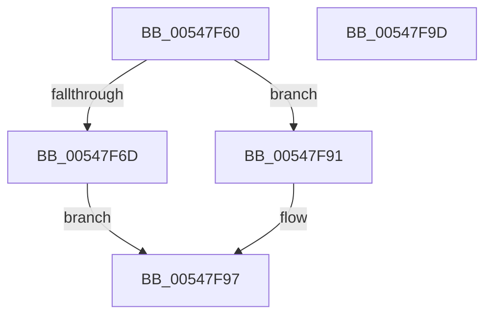

# x86BiosWriteCmosPortByte

- RVA: `0x00547F60`–`0x00547F9E` (길이 `62` bytes)
- VA: `0x0000000140547F60`
- 실행 섹션: `.text`
- PDB 이름 있음: `예`; PDB Function 태그: `아니요`
- unwind 정보 RVA: `0x0005CF00`
- 디코드: `23`개 명령, `62/62` bytes 표시
- 미해석 바이트: `0` (있으면 어셈블리에 `.byte`로 보존)

> 이 문서는 커널 이미지의 기계어와 PDB 기호를 분석해 생성했습니다. 4번과 5번은 함수 원형과 자료형을 바이너리 사용 방식에서 추정한 C 해석이며 원본 소스 복구 결과는 아닙니다.

## 1. Dependencies

- 직접 호출 지점: **2**; 고유 호출 대상: **2**
- 직접 호출자로 확인된 함수: **1**
- RIP 상대 이미지 참조: **2**

### Outgoing calls
- `0x00547F6D` → [HalpAcquireCmosSpinLock](../42/HalpAcquireCmosSpinLock_function_0042DEE8.md) (function, `0x0042DEE8`)
- `0x00547F8A` → [HalpReleaseCmosSpinLock](../42/HalpReleaseCmosSpinLock_function_0042DE04.md) (function, `0x0042DE04`)

### Direct callers
- [x86BiosWriteCmosPort](x86BiosWriteCmosPort_function_00547EE8.md) at `0x00547F0A`
- [x86BiosWriteCmosPort](x86BiosWriteCmosPort_function_00547EE8.md) at `0x00547F20`
- [x86BiosWriteCmosPort](x86BiosWriteCmosPort_function_00547EE8.md) at `0x00547F31`
- [x86BiosWriteCmosPort](x86BiosWriteCmosPort_function_00547EE8.md) at `0x00547F3E`

### Static image references
- `0x00547F72` → RVA `0x00E10334` (`.data`; read)
- `0x00547F91` → RVA `0x00E10334` (`.data`; write)

## 2. Other-region calls and transfers

- 다른 실행 섹션으로 향하는 call: **0**
- 별도 외부 분기/꼬리 이동을 확인하지 못했습니다.

## 3. Assembly (complete function range)

```asm
00547F60  40 53                           push rbx
00547F62  48 83 EC 20                     sub rsp, 0x20
00547F66  8A DA                           mov bl, dl
00547F68  F6 C1 01                        test cl, 1
00547F6B  74 24                           je 0x140547f91
00547F6D  E8 76 5F EE FF                  call 0x14042dee8
00547F72  8A 05 BC 83 8C 00               mov al, byte ptr [rip + 0x8c83bc]
00547F78  BA 70 00 00 00                  mov edx, 0x70
00547F7D  90                              nop
00547F7E  EE                              out dx, al
00547F7F  90                              nop
00547F80  8A C3                           mov al, bl
00547F82  90                              nop
00547F83  BA 71 00 00 00                  mov edx, 0x71
00547F88  EE                              out dx, al
00547F89  90                              nop
00547F8A  E8 75 5E EE FF                  call 0x14042de04
00547F8F  EB 06                           jmp 0x140547f97
00547F91  88 1D 9D 83 8C 00               mov byte ptr [rip + 0x8c839d], bl
00547F97  48 83 C4 20                     add rsp, 0x20
00547F9B  5B                              pop rbx
00547F9C  C3                              ret
00547F9D  CC                              int3
```

## 4. C-style interpretation (structured pseudocode)

```c
__int64 __fastcall x86BiosWriteCmosPortByte(unsigned __int8 a1, unsigned __int8 a2)
{
    __int64 result;
    __int64 v_rsp;

    v_rsp = (v_rsp) - (32);
    if (((a1) & (1)) == 0) goto loc_00547F91;
    result = HalpAcquireCmosSpinLock(a1, a2, a3, a4);
    result = HalpReleaseCmosSpinLock(a1, 113, a3, a4);
    goto loc_00547F97;
loc_00547F91:
    *(unsigned __int8 *)(v_rip + 9208733) = a2;
loc_00547F97:
    v_rsp = (v_rsp) + (32);
    return result;
}
```

## 5. (Beta) C Style

```c
int64_t x86BiosWriteCmosPortByte(uint8_t Arg1, uint8_t Arg2)
{
    int64_t result;
    int64_t local_rsp;

    local_rsp = (local_rsp) - (32);
    if (((Arg1) & (1)) == 0) goto loc_00547F91;
    result = HalpAcquireCmosSpinLock(Arg1, Arg2, a3, a4);
    result = HalpReleaseCmosSpinLock(Arg1, 113, a3, a4);
    goto loc_00547F97;
loc_00547F91:
    *(uint8_t *)(v_rip + 0x8C839D) = Arg2;
loc_00547F97:
    local_rsp = (local_rsp) + (32);
    return result;
}
```

## 6. Execution-region graph

[열기: 2D/3D 그래프와 함수 탐색 컨트롤 패널](../../../control-panel.html?section=text&rva=0x00547F60&view=graph)

- 2D 그래프는 위에서 아래로 흐르고, 3D 그래프는 빈 공간을 드래그해 회전합니다. Shift+드래그는 이동, 휠은 확대·축소, 함수 노드 선택은 대상 보고서 이동입니다.

### Static fallback


