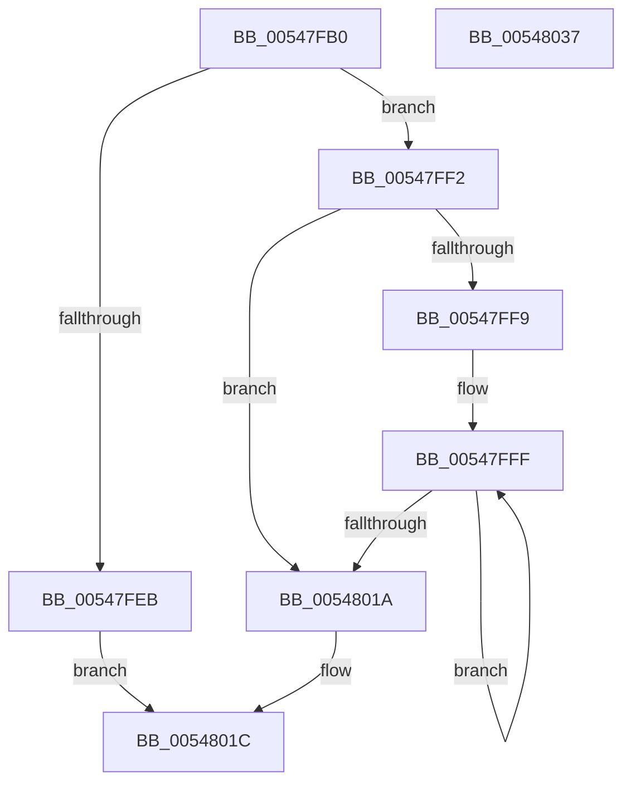

# x86BiosWriteMemory

- RVA: `0x00547FB0`–`0x00548038` (길이 `136` bytes)
- VA: `0x0000000140547FB0`
- 실행 섹션: `.text`
- PDB 이름 있음: `예`; PDB Function 태그: `아니요`
- unwind 정보 RVA: `0x0005E6B4`
- 디코드: `41`개 명령, `136/136` bytes 표시
- 미해석 바이트: `0` (있으면 어셈블리에 `.byte`로 보존)

> 이 문서는 커널 이미지의 기계어와 PDB 기호를 분석해 생성했습니다. 4번과 5번은 함수 원형과 자료형을 바이너리 사용 방식에서 추정한 C 해석이며 원본 소스 복구 결과는 아닙니다.

## 1. Dependencies

- 직접 호출 지점: **1**; 고유 호출 대상: **1**
- 직접 호출자로 확인된 함수: **0**
- RIP 상대 이미지 참조: **0**

### Outgoing calls
- `0x00548005` → [x86BiosTranslateAddress](../47/x86BiosTranslateAddress_function_004736C0.md) (function, `0x004736C0`)

### Direct callers
- 이 함수 시작 RVA로 연결되는 직접 call은 확인되지 않았습니다. 간접 호출은 완전히 역산할 수 없습니다.

### Static image references
- 디코드된 RIP-relative 메모리 참조가 없습니다.

## 2. Other-region calls and transfers

- 다른 실행 섹션으로 향하는 call: **0**
- 별도 외부 분기/꼬리 이동을 확인하지 못했습니다.

## 3. Assembly (complete function range)

```asm
00547FB0  48 8B C4                        mov rax, rsp
00547FB3  48 89 58 08                     mov qword ptr [rax + 8], rbx
00547FB7  48 89 68 10                     mov qword ptr [rax + 0x10], rbp
00547FBB  48 89 70 18                     mov qword ptr [rax + 0x18], rsi
00547FBF  48 89 78 20                     mov qword ptr [rax + 0x20], rdi
00547FC3  41 56                           push r14
00547FC5  48 83 EC 20                     sub rsp, 0x20
00547FC9  0F B7 E9                        movzx ebp, cx
00547FCC  41 8B D9                        mov ebx, r9d
00547FCF  44 8B D5                        mov r10d, ebp
00547FD2  0F B7 FA                        movzx edi, dx
00547FD5  41 C1 E2 04                     shl r10d, 4
00547FD9  49 8B F0                        mov rsi, r8
00547FDC  45 03 D1                        add r10d, r9d
00547FDF  44 03 D7                        add r10d, edi
00547FE2  41 81 FA 00 00 10 00            cmp r10d, 0x100000
00547FE9  76 07                           jbe 0x140547ff2
00547FEB  B8 0D 00 00 C0                  mov eax, 0xc000000d
00547FF0  EB 2A                           jmp 0x14054801c
00547FF2  0F AE E8                        lfence
00547FF5  85 DB                           test ebx, ebx
00547FF7  74 21                           je 0x14054801a
00547FF9  41 BE 01 00 00 00               mov r14d, 1
00547FFF  0F B7 D7                        movzx edx, di
00548002  0F B7 CD                        movzx ecx, bp
00548005  E8 B6 B6 F2 FF                  call 0x1404736c0
0054800A  8A 0E                           mov cl, byte ptr [rsi]
0054800C  66 41 03 FE                     add di, r14w
00548010  49 03 F6                        add rsi, r14
00548013  88 08                           mov byte ptr [rax], cl
00548015  83 C3 FF                        add ebx, -1
00548018  75 E5                           jne 0x140547fff
0054801A  33 C0                           xor eax, eax
0054801C  48 8B 5C 24 30                  mov rbx, qword ptr [rsp + 0x30]
00548021  48 8B 6C 24 38                  mov rbp, qword ptr [rsp + 0x38]
00548026  48 8B 74 24 40                  mov rsi, qword ptr [rsp + 0x40]
0054802B  48 8B 7C 24 48                  mov rdi, qword ptr [rsp + 0x48]
00548030  48 83 C4 20                     add rsp, 0x20
00548034  41 5E                           pop r14
00548036  C3                              ret
00548037  CC                              int3
```

## 4. C-style interpretation (structured pseudocode)

```c
__int64 __fastcall x86BiosWriteMemory(unsigned __int16 a1, unsigned __int16 a2, __int64 a3, int a4)
{
    __int64 result;
    __int64 v_r10;
    __int64 v_rbx;
    __int64 v_rdi;
    __int64 v_rsi;
    __int64 v_rsp;
    unsigned __int64 v_stack_p10;
    unsigned __int64 v_stack_p18;
    unsigned __int64 v_stack_p20;
    unsigned __int64 v_stack_p8;

    *(unsigned __int64 *)(v_rsp + 8) = v_rbx;
    *(unsigned __int64 *)(v_rsp + 16) = v_rbp;
    *(unsigned __int64 *)(v_rsp + 24) = v_rsi;
    *(unsigned __int64 *)(v_rsp + 32) = v_rdi;
    v_rsp = (v_rsp) - (32);
    v_r10 = (unsigned int)(((unsigned int)(a1)) << (4));
    v_r10 = (unsigned int)((v_r10) + (a4));
    v_r10 = (unsigned int)((v_r10) + (a2));
    if (((unsigned int)(v_r10)) <= 0x100000ULL) goto loc_00547FF2;
    goto loc_0054801C;
loc_00547FF2:
    if ((unsigned int)((unsigned int)(a4)) == 0) goto loc_0054801A;
loc_00547FFF:
    result = x86BiosTranslateAddress(a1, a2, a3, a4);
    v_rdi = (unsigned __int16)((a2) + (1));
    v_rsi = (a3) + (1);
    *(unsigned __int8 *)(result) = (unsigned __int8)(*(unsigned __int8 *)(a3));
    v_rbx = (unsigned int)(((unsigned int)(a4)) + (-1));
    if (condition_is_not_equal) goto loc_00547FFF;
loc_0054801A:
    result = 0;
loc_0054801C:
    v_rsp = (v_rsp) + (32);
    return result;
}
```

## 5. (Beta) C Style

```c
int64_t x86BiosWriteMemory(uint16_t Arg1, uint16_t Arg2, void *Arg3, int32_t Arg4)
{
    uint8_t *arg3 = (uint8_t *)Arg3;

    int64_t result;
    int64_t local_r10;
    int64_t local_rbx;
    int64_t local_rdi;
    int64_t local_rsi;
    int64_t local_rsp;
    uint64_t v_stack_p10;
    uint64_t v_stack_p18;
    uint64_t v_stack_p20;
    uint64_t v_stack_p8;

    *(uint64_t *)(local_rsp + 0x8) = local_rbx;
    *(uint64_t *)(local_rsp + 0x10) = local_rbp;
    *(uint64_t *)(local_rsp + 0x18) = local_rsi;
    *(uint64_t *)(local_rsp + 0x20) = local_rdi;
    local_rsp = (local_rsp) - (32);
    local_r10 = (uint32_t)(((uint32_t)(Arg1)) << (4));
    local_r10 = (uint32_t)((local_r10) + (Arg4));
    local_r10 = (uint32_t)((local_r10) + (Arg2));
    if (((uint32_t)(local_r10)) <= 0x100000ULL) goto loc_00547FF2;
    goto loc_0054801C;
loc_00547FF2:
    if ((uint32_t)((uint32_t)(Arg4)) == 0) goto loc_0054801A;
loc_00547FFF:
    result = x86BiosTranslateAddress(Arg1, Arg2, Arg3, Arg4);
    local_rdi = (uint16_t)((Arg2) + (1));
    local_rsi = (Arg3) + (1);
    *(uint8_t *)(result) = (uint8_t)(*(uint8_t *)(arg3));
    local_rbx = (uint32_t)(((uint32_t)(Arg4)) + (-1));
    if (condition_is_not_equal) goto loc_00547FFF;
loc_0054801A:
    result = 0;
loc_0054801C:
    local_rsp = (local_rsp) + (32);
    return result;
}
```

### 관측된 메모리 오프셋

구조체 형식이 확인되지 않은 접근은 인자 기준의 오프셋으로만 기록했습니다.

| 기준 인자 | 오프셋 표현 | 폭 (bit) | 접근 |
|---|---:|---:|---|
| `Arg3` | `+ 0x0` | `8` | `R` |

## 6. Execution-region graph

[열기: 2D/3D 그래프와 함수 탐색 컨트롤 패널](../../../control-panel.html?section=text&rva=0x00547FB0&view=graph)

- 2D 그래프는 위에서 아래로 흐르고, 3D 그래프는 빈 공간을 드래그해 회전합니다. Shift+드래그는 이동, 휠은 확대·축소, 함수 노드 선택은 대상 보고서 이동입니다.

### Static fallback


